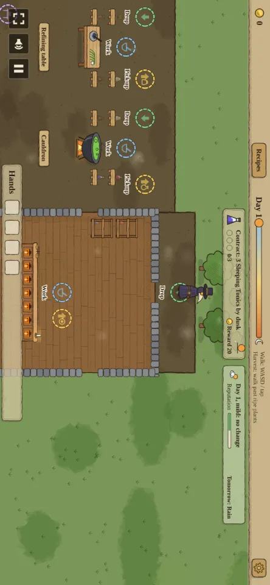
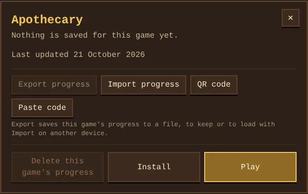
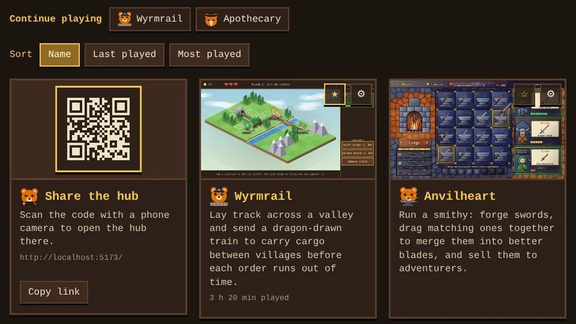
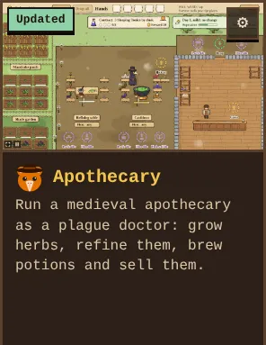
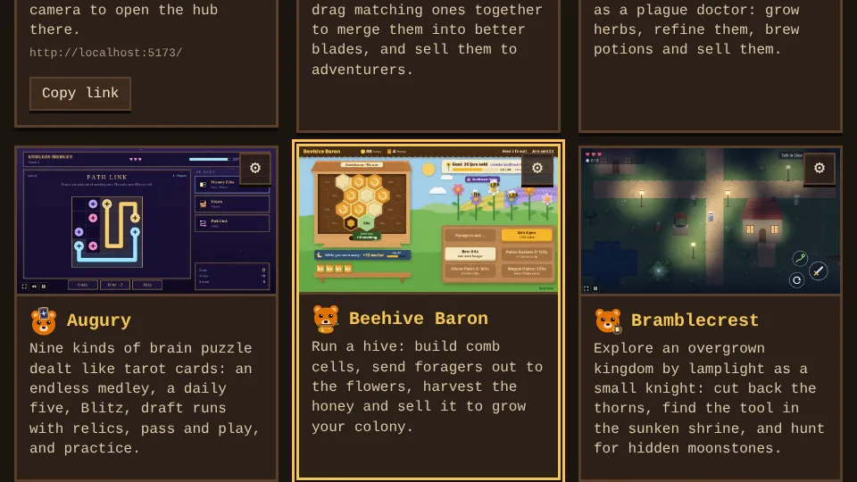
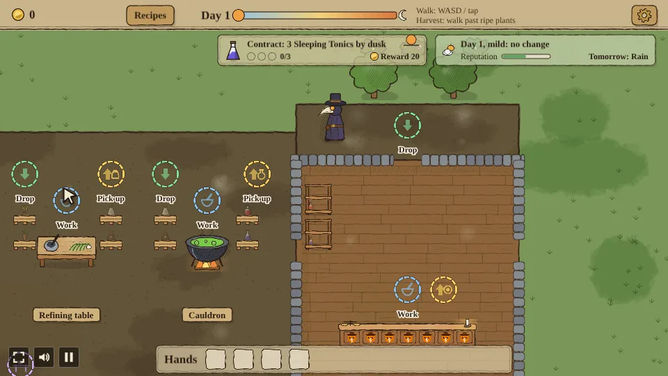

# game-proto

A hub of small game prototypes built with [Phaser 4](https://phaser.io), TypeScript and Vite. The
start page lists the games; each one lives in its own folder under `games/`.


| Game | What it is |
| --- | --- |
| [Apothecary](games/apothecary/README.md) | Run a medieval apothecary as a plague doctor: grow herbs, refine them, brew potions and sell them to customers. |
| [Deadline](games/deadline/README.md) | Hold the bottom of a road against growing waves of zombies: move left and right, shoot automatically, and shoot crates open for upgrades. |
| [Palisade](games/palisade/README.md) | Hold a barricade against waves of goblins, orcs, harpies, shield bearers and shamans as a ranger, picking one of three upgrades each level, hiring guards with coins, with a boss and a choice of road every ten waves. |
| [Tiny Kingdom](games/tiny-kingdom/README.md) | Draw three tiles a turn and place farms, houses, towers and roads on a small island grid, each scoring against its neighbours, join them to the castle, and reach each round's goal before the tiles run out. |
| [Hotfoot](games/hotfoot/README.md) | Run as a knight who never stops: jump spikes and pits, slide under blades, and pick one of two boons at each checkpoint. |
| [Anvilheart](games/anvilheart/README.md) | Run a smithy: forge swords, drag two matching ones together to merge them into a better blade, and sell them to adventurers as their orders come in. |
| [Broadside](games/broadside/README.md) | Captain a pirate ship on an old sea chart: steer left and right, hold a side to aim and charge a broadside at enemy ships, follow each wave's captain's order, sail over their loot, and upgrade hull and cannons at the harbor between waves. |
| [TinctureTinker](games/tincture-tinker/README.md) | A match-3 board of Apothecary's ingredients: swap tiles to gather what each potion order asks for before the moves run out, and sell the potion for coins. |
| [Catacomb](games/catacomb/README.md) | Fight through a short dungeon with a deck of cards: a hand of five each turn against foes who show what they will do next, and a new card after every fight. |
| [Golem Garden](games/golem-garden/README.md) | A tower defense in a garden: plant seeds beside the path that grow into pebble and moss golems, and stop the pests before they eat the Heartwood. Five cleared waves bloom the Heartwood and unlock the Thorn golem; golems combo, a Queen Slug comes every tenth wave, and good runs open forked gardens. |
| [Beehive Baron](games/beehive-baron/README.md) | Run a beehive: build comb cells, send foragers out to the flowers for nectar, harvest the ripened honey and sell it for more bees and upgrades. |
| [Wyrmrail](games/wyrmrail/README.md) | Lay track across a new valley each game, steer a dragon-drawn train with switches to carry cargo between villages before each order's time runs out, keep it fed, feed the workshops and finish with a festival after the eighth village. |
| [Shrine Stack](games/shrine-stack/README.md) | Stack a temple from swinging stones: tap to drop each one, overhangs break off, and every balanced tier of three stones earns a blessing. Spend favor between tiers, take curses for double favor, and climb past the crown into a windy sky. |
| [Mapmaker](games/mapmaker/README.md) | Reveal a fog-covered island tile by tile on a voyage's supplies, climb hills and peaks to see further, and sell your charts at port for upgrades. |
| [Lanternkeep](games/lanternkeep/README.md) | Send moths from their jar to light a castle's lanterns before night falls, keep them burning on scarce oil, and upgrade wicks, oil and the moths between nights. |
| [Space Wars](games/space-wars/README.md) | Command a fleet of 3D ships on a 70s paperback star map: build a base, raise units, work through a chain of contracts, hold the relay beacon and salvage wrecks while you fight rival factions, each with its own buildings and ships. |
| [Lane Brawl](games/lane-brawl/README.md) | Lead a team of five low-poly 3D heroes down the lanes in a MOBA against NPC teams: chase objectives, chain last hits, pick an upgrade each level, build items from parts, fight over a guardian beast, ambush from tall grass, break an inhibitor and destroy the enemy base. |
| [Colonizer](games/colonizer/README.md) | A base-building RTS embroidered like the Bayeux tapestry: gather wood, food and ore, build, research techs and raise armies of three factions, pick an Age II boon, earn Age III with three deeds, then destroy the enemy Town Center. |
| [Riftblade](games/riftblade/README.md) | Fight across four worlds as a blaster soldier or a blade knight: survive five minutes on each, beat its boss, and choose your way on the star map between them; every level-up offers a new skill. |
| [Scrapyard Titans](games/scrapyard-titans/README.md) | Build a squad of junk-built robots on an 8x8 board, bolt on parts and watch them brawl it out against seven rival commanders. |
| [Bramblecrest](games/bramblecrest/README.md) | A small knight explores an overgrown kingdom by lamplight, finding a new tool in every dungeon that opens more of the world. |
| [Ninefold](games/ninefold/README.md) | Fill every row, column and box with each digit once: a daily puzzle, Classic boards at three levels, and Delve, a run of ever bigger boards with hearts and relics, in nine unlockable art styles. |
| [Augury](games/augury/README.md) | Nine kinds of brain puzzle dealt like tarot cards (picture grids, bridges, code breaking, calc cages, cross sums, sliding blocks, tile flips, path links and a memory echo), in six modes from an endless medley to pass and play. |
| [Mazewright](games/mazewright/README.md) | A tower defense with no road: every hedge and tower you plant on the open lawn is a wall, so you build the maze the beetles walk, and a planting that would close the last way through is refused. Three gardens, twenty waves, moths that fly over and moles that chew through hedges. |

## Settings

The hub's **Settings** button opens the settings every game shares. They are saved in the browser
(`shared/settings.ts`) as soon as they change and apply to a game the next time it opens. The ✕ or
**Done** closes the panel.


- **Language**: English (UK), English (US) or Deutsch, British English until another is picked.
  The hub switches at once; the start, pause and How to play screens of every game follow the next
  time it opens, and so does each game whose own text has been translated. Numbers and dates match
  the language: 1,234.5 and 17/10/2026 in British English, 1,234.5 and 10/17/2026 in US English,
  1.234,5 and 17.10.2026 in German. Adding `?lang=de` (or `en`, `en-US`) to a URL shows that
  language without changing the setting.

  

- **Difficulty**: Easy, Normal or Hard. Normal is each game as designed; each game picks what it scales:

  | Game | Easy | Hard |
  | --- | --- | --- |
  | Apothecary | customers wait 50% longer | customers wait 30% less |
  | Deadline | zombies have 25% less health | zombies have 30% more health |
  | Palisade | foes have 25% less health | foes have 30% more health |
  | Tiny Kingdom | round goals 20% lower, campaign stars 1% higher | round goals 20% higher, campaign stars 6% lower |
  | Hotfoot | 5 hearts | 2 hearts |
  | Anvilheart | adventurers wait 50% longer | adventurers wait 30% less |
  | Broadside | enemy ships and forts have 25% less health | enemy ships and forts have 30% more health |
  | Lane Brawl | red's champions, minions and towers deal 20% less damage | red's champions, minions and towers deal 25% more damage |
  | Scrapyard Titans | your commander has 130 health and rivals get 1 gold less a round | your commander has 80 health and rivals get 1 gold more a round |
  | TinctureTinker | 5 more moves per order | 3 fewer moves per order |
  | Catacomb | foes have 25% less health | foes have 30% more health |
  | Golem Garden | pests have 25% less health | pests have 30% more health |
  | Beehive Baron | foraging trips 25% shorter | foraging trips 30% longer |
  | Wyrmrail | orders allow 50% more time | orders allow 30% less time |
  | Shrine Stack | stones swing 20% slower | stones swing 25% faster |
  | Mapmaker | 16 supplies a voyage | 9 supplies a voyage |
  | Lanternkeep | lanterns burn 30% longer | lanterns burn 20% shorter |
  | Space Wars | rivals attack with 9 warships | rivals attack with 4 warships |
  | Colonizer | the AI gathers 25% slower | the AI gathers 25% faster |
  | Riftblade | foes have 25% less health and come 25% slower | foes have 35% more health and come 25% faster |
  | Bramblecrest | 5 hearts, and the bosses call in foes 25% less often | 2 hearts, and the bosses call in foes 30% more often |
  | Ninefold | 5 hints a Classic board, 4 hearts a Delve run | 2 hints a Classic board, 2 hearts a Delve run |
  | Augury | 4 hearts in Endless and Draft, 4 minutes of Blitz | 2 hearts in Endless and Draft, 2½ minutes of Blitz |
  | Mazewright | 25 cabbages, and foes have 20% less health | 10 cabbages, and foes have 25% more health |

- **Frame rate (FPS)**: the most frames per second a game draws, 30 to 320 (60 by default).
- **Show FPS**: a readout of the frame rate in each game's corner.
- **Reduce motion**: turns off screen shake, flashes and blinking hit effects.
- **Music** and **Sound effects**: how loud each plays, 0 to 100 (60 and 80 by default), and
  **Mute all sound**. Every sound is made in code (`shared/audio.ts`), so there are no audio files.
- **Genre filter** (off by default, hub only): a row of genres above the cards (Action, Strategy,
  Management, Puzzle, Adventure) that lists just the games of one. Each card's genres are its
  `data-genres` in `index.html`.
- **Updates**: when the installed apps download a new version. **Automatic** updates on the next
  visit online, **Wi-Fi only** waits while the phone is on mobile data or Data Saver, and **Off** keeps
  the version in place. Wi-Fi only is offered, and picked by default, only where the browser can tell
  WiFi from mobile data (Chrome and other Chromium browsers on Android); elsewhere Automatic is the
  default. **Update now** fetches a new version at once whatever the setting says, and says so
  when the browser has no app installed to update.

  
- **Phone held the wrong way**: what a game does on a phone held upright when it plays sideways (or
  the other way round). **Turn the game** (the default) turns the game a quarter round so it fills
  the screen and the player just turns the phone, even with the phone's rotation locked; in full
  screen on Android the screen is also locked the game's way round. **Ask me to turn it** covers the
  paused game with a hint to turn the phone instead. Games that play both ways round (Augury and
  Ninefold) just turn their view.

  
- **Controller** (on by default) and **Cursor speed** (1 to 10, 5 by default): see Controllers below.
- **Saved progress**: **Export all** saves every game's progress and the settings to a `.gh` file,
  and **Import all** loads one back, on this or another device. **QR code**, **Paste code** and
  **Scan code** move the same as a progress code (see Progress codes). The row also shows the time
  played on this device over every game. **Delete all progress** erases every game's saves, time
  played and the Continue playing row, and keeps the settings, the favourites and any other site's
  storage on the same origin.


- **Restore defaults** puts the settings back, and **Done** closes the panel.

Each card also has a **⚙** in its corner that opens that game's own settings: whether it has
anything saved on this device, when the game was last updated, **Export progress** and **Import progress** for just that game's
progress (see Progress files), **QR code**, **Paste code** and **Scan code** for the same as a progress code
(see Progress codes), **Install**, which opens the game ready to install as an app (see
Install as an app), **Delete this game's progress** (its storage keys, which all start
with its folder name, see `shared/progress.ts`) and **Play**.



The first card, **Share the hub**, shows a QR code of the hub's link to scan with a phone, with
buttons to copy the link or share it. The code is drawn in the browser from the page's own address
when it loads (`shared/qr.ts`, no outside service), so it points wherever the hub is hosted.


Above the cards, **Continue playing** links the last three games played on this device, and a link
at the bottom of the hub opens the bug and feedback forms. The covers load as they scroll into view.

The **☆** beside a card's ⚙ stars the game: starred games come first, and the genre filter gets a
**Favourites** button. Each card also shows how long the game has been played on this device, such
as "3 h 20 min played", counted only while the game runs (not on its start or pause screen, nor with
the tab hidden). Once a game has been played, **Sort** lists the cards by **Name**, **Last played**
or **Most played**. Favourites, time played and the order stay on this device: they are kept under
`hub-` keys (`shared/favourites.ts`, `shared/playTime.ts`), which no progress file or code carries,
and nothing is sent anywhere. Deleting a game's progress also forgets its time played.



A card shows **New** for a game added in the last 14 days that this device hasn't opened yet, and
**Updated** for a game that changed since it was last opened here (hover the badge for the date).
Opening the game clears its badge. On a first visit no game shows Updated. The dates come from git
when the hub is built (`scripts/gameDates.ts`): a game counts as updated when its `src/` or
`index.html` changed, not its screenshots, docs or `shared/`. Which version of each game was last
opened is kept on the device only, under `hub-seen` (`shared/gameDates.ts`).



Every game also has a full screen button in its bottom left corner, and the **F** key toggles full screen. Browsers that cannot take a page full screen, such as iPhones, don't show the button. Beside it, the speaker button opens the sound menu, with one volume for the music, one for the sound effects and a Mute button; the **M** key mutes every sound and turns it back on, and the pause screen sets the same volumes. The corner buttons keep 12px clear of the edges, plus a phone's safe area, so rounded corners never cut them.

Every game shows a loading screen while its art is drawn, then waits on a start screen until **Start** is pressed (or Enter or Space). The pause button next to full screen, the **P** key or leaving the tab pauses it; Resume, P, Space or Esc play on, and the pause screen links back to all games. Both screens have a **How to play** button (or the **H** key) that shows the game's goal, its controls, how a round goes and a few tips; Back, H or Esc close it.

Every game awards bronze, silver and gold trophies for milestones, with a short toast and fanfare, and their start and pause screens list them under **Trophies**, earned or still to earn; hidden ones keep their name until earned. Each hub card shows how many of its game's trophies are earned (🏆 4/10), and the hub's **Trophies** button opens a shelf of every trophy earned on this device, by game. Trophies are saved with the game's progress (`shared/trophies.ts`), so they move with its progress file or code and go when its progress is deleted.

## Watch AI

Games whose AI can play every side have a watch mode: add `?watch` to the game's URL, such as
`/games/colonizer/?watch` (on `npm run dev` or the published site alike). The AI then
plays your side as well, and a panel in the top right holds the match still while you look round
(its pause button), plays it at 1x, 2x, 4x or 8x (**[** and **]** step the speed) and shows a log of
what each AI decides (**L**).

| Game | What the watch mode does |
| --- | --- |
| Colonizer | two random factions, both run by the planner, on an open map; a click on the end screen starts another match |
| Space Wars | all five factions run by the AI on an open map until one is left; contracts don't run; a tap on the end screen starts another battle |
| Lane Brawl | all ten champions run by the AI, blue's with a random class, with no fog; objectives don't run; the camera follows blue's champion; Watch another on the end screen starts another match |
| Scrapyard Titans | all eight commanders run by the AI, your seat's with a random commander, season and terrain; your seat's fights play on the board; Watch another on the end screen starts another match |

## Running locally

Needs Node 26 (`.nvmrc`), the version CI and the builds use.

```sh
npm install
npm run dev       # dev server with hot reload; the hub is at /, each game at /games/<name>/
npm run build     # typecheck (games, tests and configs) + production build of the hub and every game into dist/
npm run preview   # serve the production build
```

## Controllers

A game controller plays the hub and every game, read through the browser's Gamepad API in the
standard layout (`shared/gamepad.ts`). Browsers make a controller known once one of its buttons is
pressed on the page.

- **Hub:** the D-pad or the left stick moves the focus between the cards and buttons (and inside an
  open dialog), **A** presses, **B** closes the dialog, **X** opens the focused card's ⚙ and
  **Start** opens Settings, where left and right move a slider.
- **Start and pause screens:** **Start** pauses and resumes, the D-pad and **A** pick the buttons and
  volumes, **B** resumes from the pause screen and leaves How to play and Trophies (where up and down scroll), and
  **Select** opens the sound menu on any screen.
- **In a game:** the left stick brings up a cursor over the game (`shared/padCursor.ts`), **A** taps
  and holds like the left mouse button, **B** is the right button and the right stick scrolls like a
  mouse wheel. It sends the same events a mouse would, so every game plays with it without code of
  its own, and it hides on the first real mouse move or tap. **Cursor speed** sets how fast it goes.





## Layout

- `index.html`: the hub page, the share card and one card per game.
- `games/<name>/`: one game, with its own `index.html`, `src/`, `e2e/` playthrough test, `docs/`
  screenshots and `README.md`. Games don't import from each other.
- `shared/`: the settings every game shares (`settings.ts`), the hub's Settings panel
  (`settingsPanel.ts`), `audio.ts`, the sound effects and music made in code, `corner.ts`, the corner buttons, `gamepad.ts` and `padCursor.ts`, the controller and its cursor (see Controllers), `setupGame.ts`, which each game calls to apply the frame cap, the FPS readout, reduced motion, full screen and the sound button
  and to add the loading, start and pause screens (`startScreen.ts`) with the game's How to play (`howToPlay.ts`), `watch.ts`, the Watch AI panel and its `?watch` flag,
  `trophies.ts`, the trophies, their toast and the hub's trophy shelf, `playCount.ts`, the play counters (see Play counts), `progress.ts`, each game's saved progress and the recently played games, `gameDates.ts`, the Last updated line and the New and Updated badges, `playTime.ts` and `favourites.ts`, the time played and the starred games (see above), `saveFile.ts` and `saveCodes.ts`, the progress files (see Progress files), `progressCode.ts` and `scanner.ts`, the progress codes and their camera scanner (see Progress codes), `install.ts`, the installable apps (see Install as an app), `i18n.ts` with the shared texts in `i18n/`, the translations and number and date formats (see Language), and `scaling.ts`, which keeps a game sharp from a phone to a 4K screen (`grep -l setupScaling games/*/src/main.ts` lists the games that use it).
- `e2e/hub.spec.ts`: checks that the hub lists every game, that each card opens it, and that the
  settings are saved and reach a game, that a game's ⚙ deletes just its progress, the progress files and codes, that the hub and every game have an app manifest, the genre filter and Continue playing row, favourites, time played and Sort, the Last updated line and that an Updated badge clears once its game is opened, that a game starts and pauses and counts its time played, that trophies show on the cards, the shelf and the pause screen, that a stand-in controller walks the hub, the start and pause screens and taps a game with its cursor, and that the cards show play counts. `e2e/screens.spec.ts` opens each game that uses
  `shared/scaling.ts` on an upright and a sideways phone, a tablet, a laptop and a 4K screen.
- `package.json`, `tsconfig.json`, `tsconfig.e2e.json`, `vite.config.ts` and `playwright.config.ts`
  are shared. `tsconfig.json` typechecks the games and `shared/`; `tsconfig.e2e.json` typechecks
  the Playwright tests and the two configs, with Node's types. Vite builds every
  `games/*/index.html` next to the hub; Playwright runs one project per game.

See `AGENTS.md` for adding a game and for the playthrough rules.

## Tests

```sh
npx playwright install chromium        # once
npm run test:e2e                       # the hub test and every game's playthrough
npx playwright test --project apothecary   # one game only
```

One playthrough workflow (`.github/workflows/playthrough.yml`) plays each game whose folder
changed (every game when `shared/` or the build setup changed), on pull requests only, under a single required `Playthrough` check, and uploads videos and
screenshots as the `playthrough-<name>` artifact. The Hub workflow runs the hub test, opening each game from its
card in one job per game, on pull requests only for the games whose folder changed. The Screens workflow checks each game that uses `shared/scaling.ts` on five screens,
one job per game, on pull requests only for the games whose folder changed. The Screenshots workflow fails a pull request that adds more than 4
screenshots or images over the size limits (WebP screenshots of at most 200 KB; `npm run screenshots -- <file>` converts one). Each CI run also uploads a `game-build` artifact: download it from
the run's summary page, unzip it and serve the folder (for example with `npx serve`) to play. Dependabot
(`.github/dependabot.yml`) opens update PRs: npm weekly, GitHub Actions and the Docker base image
monthly, with minor and patch updates grouped into one PR. PR Links and the template check skip
Dependabot's PRs, since their descriptions quote release notes from other sites.

## Play counts

Each game counts how often it is played on a public counter at Abacus, a free open source counter
service with no account (`shared/playCount.ts`). `setupGame` adds one to the game's counter
(`chriszly-game-proto/<game folder>`) when a game opens, once per browser tab, and the hub shows
each card's count as "N plays". Only the built site counts: the dev server, browser automation (so
the playthroughs and e2e tests) and `?watch` matches never do. If the service can't be reached, the
games play as usual and the cards simply show no count. Nothing else is sent.

## Install as an app

The hub and every game install as apps of their own (PWAs) that play offline: open the hub or a
game on the site and pick **Install** (Chrome and Edge, on phones and computers) or **Share > Add to
Home Screen** (Safari on iPhone and iPad). The hub shows an **Install** button next to Settings, and
every game one on its start and pause screens, where the browser can install it; the **Install** in
a game's ⚙ on the hub opens the game with `?install`, which shows that button as the main one in
every browser (and says how to install from the browser's menu where there is no prompt). Each app
has its own name and icon, drawn from its favicon on its background colour.


- `scripts/pwa.ts`, a Vite plugin, links every page to its manifest: the hub's is
  `public/manifest.webmanifest`, and each game's is made from its title and background colour. It
  also writes `sw.js` into the build, the service worker from `scripts/sw.js` with every file of the
  build and a hash of its content, so a deploy is a new version that replaces the old cache. An
  update downloads only the files whose content changed and copies the rest from the old cache, so
  it costs phones little data. The Updates setting can hold updates back: the service worker can't read
  the settings, so `shared/install.ts` copies it into a cache of its own, and while updates are held
  back the new version's install fails on purpose and pages load from the cache, so the version in
  place keeps playing. Pages load from the network while online and from the cache offline,
  so a player sees an update the next time they open the app online.
- `shared/install.ts` registers the service worker (from the hub and from `setupGame`, only in the
  built site and never under browser automation), shows the Install buttons, and in the
  installed app asks the browser to keep its storage.
- `node scripts/pwa-icons.mjs [game...]` draws the icons into `public/icons/` from the favicons.
  The build fails for a game without icons.

Saves stay in the browser's storage on the device. On Android and computers the installed apps and
the website share it; on iPhones each home screen app keeps its own, and private browsing forgets
everything when the window closes.

## Progress files

A player can carry progress to another device, or between the website and an app, as a file:
the ⚙ on a game's card exports and imports just that game's progress as
`<game>-<date>.gh<code>` (`.ghap` for Apothecary, codes in `shared/saveCodes.ts`), and the Settings
panel exports and imports every game's progress and the settings as `game-hub-progress-<date>.gh`.
The files are encrypted (AES-GCM, `shared/saveFile.ts`), so they can't be read or edited by hand:
an edited file, or another game's, is refused. The key ships with the code, so this keeps out
casual editing, not a determined player. The installed hub on a computer also opens these files
directly.

## Progress codes

The same progress also moves as a code, with no file and no outside service: **QR code** (on a
game's ⚙, or in the Settings panel for every game) shows a QR code of a link to the hub with the
progress in its `#p=` part. Scanning it with another device's camera opens the hub there, which asks
and then loads it; **Copy code** copies the link, to send by chat or mail, and **Paste code** loads
one. The link part after `#` never reaches the web server. `shared/progressCode.ts` makes the code:
a format version, the game's code from `shared/saveCodes.ts` (`gh` for every game), then the data a
file holds, packed (`shared/pack.ts`), deflated and sealed with the same AES-GCM key, all written as
digits (7 bytes to 17 digits) so the QR code packs them in its dense numeric mode (`shared/qr.ts`).
Packing writes the saved JSON as compact binary, each key and repeated string once, whole numbers as
varints and other numbers with their whole part and up to six significant digits (462.76886699627227
becomes 462.769; a file keeps every digit), which makes a code between a sixth
and two fifths smaller (two fifths for a Riftblade run under way). Codes from before packing
(format 1) still load. A changed, cut short or
unknown code is refused, and one from a newer hub asks to update first. Most games' progress fits
one QR code; when it doesn't (a long run under way, or every game at once), the dialog shows a loop
of up to 40 smaller codes in turn (`gp:<id>:<n>:<count>:<digits>`, each with a slice of the digits),
four a second (one every 1.5 seconds with reduced motion), which **Scan code** collects until it
has them all. On an iPhone the camera opens the link in Safari, which keeps other saves
than the installed app, so **Scan code** reads the code with the camera inside the hub instead
(`shared/scanner.ts`): with the browser's own `BarcodeDetector` where there is one (Chrome on
Android), elsewhere with the free, MIT-licensed `barcode-detector` package (ZXing as WebAssembly,
Apache 2.0), loaded only when the scanner opens. Its `.wasm` file is part of the build, so scanning
works offline and fetches nothing from another site.


## Play online

Every push to main builds the hub and its games and publishes them on GitHub Pages, at
[chriszly.github.io/game-proto](https://chriszly.github.io/game-proto/), with the hub as the start
page (`.github/workflows/deploy.yml`). Paths in the build are relative, so it works under the
`/game-proto/` subpath.
