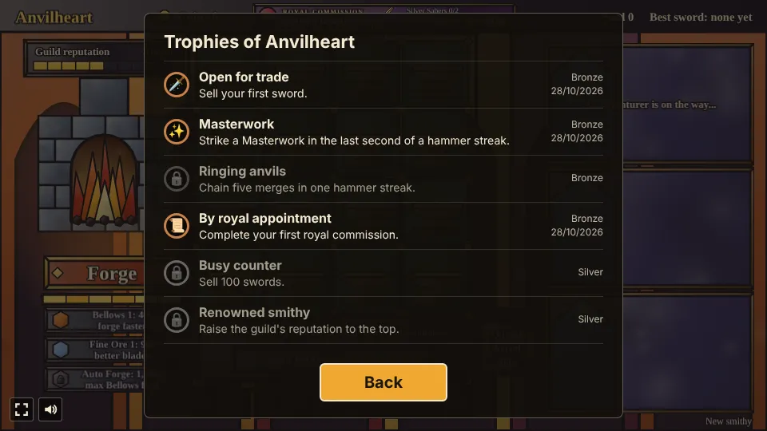

# Anvilheart

A merge game prototype built with [Phaser 4](https://phaser.io), TypeScript and Vite, part of the
[game hub](../../README.md).

You run a smithy, drawn as a stained-glass window. The forge on the left makes Rusty Daggers onto a
board of sixteen anvils. Drag two matching swords together and they merge into one sword of the
next tier, up to the Dragonslayer and, from two of those, the legendary Anvilheart. Adventurers come
to the counter on the right, each asking for a sword, and you sell them one by dragging it onto
them: the exact sword they asked for earns a tip and the guild's good name. Quick merges chain into
a hammer streak for bonus coins, and royal commissions in the top bar ask you to deliver great
swords to the crown, ending with the Crown Blade, which wins the smithy. The coins buy upgrades for
the forge, a fifth row of anvils and a quench barrel. After the win you can found a new smithy
under a new charter, keeping the guild stars that raise every price or buy lasting perks, and
choose an edict that changes the new charter's rules. Mid-game the forge learns to make bucklers for
adventurers who order a sword and shield set, and a merge timed in a streak's last second strikes a
Masterwork.


## How to play

| Control | Action |
| --- | --- |
| Tap or click Forge | Make a Rusty Dagger on the first empty anvil, once the forge is hot |
| Drag a sword onto a matching sword | Merge the two into one of the next tier |
| Drag a sword onto an empty anvil or another sword | Move it there, or swap the two |
| Drag a gem onto a plain sword | Set the gem in it |
| Drag a sword onto an adventurer | Sell it, if it is at least as good as the one they asked for; the exact one pays a tip |
| Drag a sword onto the commission banner | Deliver it to the crown, if the commission wants it |
| Tap the commission banner | Choose between the crown's two offers, or found a new smithy once the Crown Blade is in |
| Drag a Rusty Dagger onto a battered sword | Repair it, for a bonus |
| Drag a sword onto the quench barrel, once bought | Keep it there, off the anvils |
| Drag anything onto the scrap bin above the barrel | Throw it away, for nothing, to free its anvil |
| Tap the quench barrel or the fifth row's button | Buy it |
| Tap the switch under the furnace, once shown | Forge bucklers instead of swords, or swords again |
| Drag a buckler onto an adventurer with a set order | Hand it over; the set is paid once the sword follows |
| Tap "Guild perks" (bottom right) or the stars in the top bar | Spend guild stars on lasting perks |
| Tap an upgrade | Buy its next rank |
| Tap Auto Forge, once bought | Switch the auto forge on or off |
| New smithy (bottom right), then tap again within 3 seconds | Throw everything away and start again: the board, coins and upgrades, and also your guild stars, perks, charters and reputation |

1. **The forge** makes one sword at a time and then has to heat up again (1.2s), shown by the bar
   under the button.
2. **Merging**: two swords of the same tier make one of the next. While you hold a sword, the
   swords it can merge with are outlined in gold and the adventurers who would buy it in green.
3. **Adventurers** come every 6 seconds while there is room at the counter, three at most (at
   middling reputation, see below). The first one always wants an Iron Shortsword; later ones ask
   for anything up to one tier better than your best sword so far, up to the Dragonslayer. They
   leave if they wait too long (the jewel bar under their order).
4. **Exact fit pays a tip.** The exact sword an adventurer asked for pays its price and 50% more
   (rounded down: an Iron Shortsword asked for and given pays 15 coins instead of 10). A better
   sword than they asked for is taken but only pays the price they asked, so it is usually worth
   more kept for someone who wants it. While you hold a sword, each adventurer who would buy it
   shows a tag: green "Exact fit +50%" with the tipped price, or grey "Overkill, pays N c".
5. **Hammer streak.** A merge within 4 seconds of the one before chains into a streak. A ring of
   orange glass round the anvil of the last merge drains to show the time left. From the second
   merge on, each one bursts into sparks and pays 5 coins times the streak's length ("Hammer
   streak ×3 +15c"), so a quick run of merges pays 10, then 15, then 20, then 25 coins a merge,
   where it stays however long the streak runs.
   **Masterwork strikes.** In the streak's last second the ring turns gold: a sword merged then is
   a Masterwork, in a gold glow with a glint at its tip. It pays half again whatever it sells for
   (an exact-fit Iron Shortsword pays 22 coins instead of 15) and never rusts.
6. **Royal commission.** The banner in the top bar names the great sword the crown wants, starting
   with a Golden Claymore, and shows how many of the sword below it (two Silver Sabers make one) are
   on your anvils, or "Ready" once the sword is made. Drag it onto the banner to deliver it: it
   leaves your board, so a commission costs a sword you could have sold and an anvil while you
   build it. Delivering completes the commission: it pays a purse and a guild star, counted in the
   top bar, and the next one takes its place. The commissions are a Golden Claymore (500 coins), a
   Runeblade (1200), a Dragonslayer (3000), two Dragonslayers (6000), three (9000) and last the
   Crown Blade: an Anvilheart (20000). Delivering the Crown Blade wins the smithy; you can keep
   smithing afterwards, or found a new one (see below).
   **Choose your commission.** From the second commission on, the crown offers each one two ways:
   quick, as listed, or grand, with a gem set in every sword asked for, for two and a half times
   the purse (a gemmed Runeblade pays 3000 instead of 1200). A window opens with the two offers
   when the one before is done; "Decide later" closes it and tapping the banner opens it again.
   Nothing is delivered until you have chosen.
7. **Guild reputation.** The meter at the top left starts in the middle. An exact fit raises it by
   5 and an adventurer who walks off lowers it by 10. At full reputation adventurers come twice as
   often (every 3 seconds) and wait 25% longer; at none they come every 9 seconds and wait 25%
   less.
8. **Gems.** Once you have made a Steel Sword, the forge now and then (8%) makes a green gem
   instead of a sword. Drop it on a plain sword to set it; merging a gemmed sword keeps the gem.
   Some adventurers (a quarter, once gems are about) ask for a gemmed sword, which pays double, and
   only take one with a gem.
9. **Bigger smithy.** A fifth row of four anvils (800 coins, the button over the covered row) and a
   quench barrel beside the board (300 coins, tap it) that holds one sword or gem off the anvils.
   Swords in the barrel merge, sell and deliver like any other.
10. **The Anvilheart.** Two Dragonslayers merge into a ninth tier, the Anvilheart. Delivered to the
   crown, it completes whatever commission stands on its own, and it is what the Crown Blade asks
   for.
11. **Discovered swords** are shown in a row under the anvils, one frame per tier. A frame shows its
   sword's picture once you have made that sword, and a question mark until then.
12. **Rust.** A sword left on its anvil for 3 minutes dulls (it fades, and a rust-brown ring round
   the anvil drains), and a minute later it drops a tier. Moving, merging or swapping it starts it
   afresh, Rusty Daggers and gems never rust, and the quench barrel keeps a sword safe for as long
   as you like.
13. **Adventurers with traits.** From the second adventurer on, about a third come with a trait,
   written under their order. A **Haggler** waits 60% longer but pays 70% of any price. A
   **Noble** pays triple for the exact sword asked for and takes nothing else. A **Veteran** also
   takes the sword one tier below the one asked for, at the price asked (no tip); nobody asking
   for a Rusty Dagger is a Veteran.
14. **Returning heroes.** Whoever buys a Knight's Blade or better may come back half a minute
   later (3 in 10 do) with a new order, a trophy of a tenth of the sword's price in coins, and the
   sword itself, battered and a tier lower, laid on the first empty anvil. A battered sword merges
   and sells like any other, and a Rusty Dagger dropped on it repairs it for a fifth of its price.
15. **A new charter.** Once the Crown Blade is in, "Found a new smithy" (in the win window, or by
   tapping the banner) clears the board, barrel, coins and upgrades but keeps your guild stars,
   reputation and swords sold. Every guild star raises every sale's price by 5% (a sword's price
   on the order card already includes it), and in each new charter the commissions ask for one
   more sword each (two Golden Claymores, then two Runeblades, and so on, paying as much more).
   The top bar names the charter: Anvilheart II, III and so on. "New smithy" in the corner still
   throws everything away, stars and perks included, once you tap it a second time to confirm.
16. **Charter edicts.** Each new charter offers two edicts, and you take one before the new smithy
   opens; it rules that charter. **Iron shortage**: the forge is half again as slow, but every sale
   pays 25% more. **Tournament season**: adventurers come twice as often, with a third less
   patience. **Gem rush**: the forge makes three times the gems, but plain (ungemmed) orders pay 25%
   less. The charters take the edicts in turn, two at a time. The edict in force is written under the
   reputation meter.
17. **Guild perks.** Guild stars can be spent, from "Guild perks" at the bottom right or by tapping
   the stars, on perks kept in every charter: the **Guild barrel** (1 star, every smithy starts with
   the quench barrel), **Oiled anvils** (2 stars, swords take twice as long to rust) and a **Fourth
   desk** (3 stars, room for four adventurers at a smaller counter). A spent star no longer raises
   prices, so the top bar counts only the stars left.
18. **Bucklers.** Once you have made a Knight's Blade, a switch under the furnace sets the forge to
   make Wooden Bucklers instead of daggers (Fine Ore makes Iron Bucklers too). Two bucklers of a
   kind merge into the next: Wooden, Iron, Steel, Silver and Golden. Bucklers never rust and only
   sell as half of a set: a fifth of the adventurers who ask for a Shortsword or better then want a
   sword and shield set, with no gem or trait, and wait 40% longer. Hand them the sword and the
   buckler (at least as good as asked) in either order; the second completes the set, which pays
   the sword as usual plus the buckler's price, with 50% on top. Someone who walks off holding half
   a set leaves it behind: it goes back onto an empty anvil (or into the empty barrel), or, with no
   room, pays its plain price. A reload puts a handed-over half back the same way.
19. **The smithy is kept**: the board and barrel (and how long each sword has lain), coins, swords
   sold, upgrades, the forge's mode and best buckler, the standing commission and its open offer,
   your guild stars, perks, charter and edict, reputation and whether you have won are saved in the
   browser.


### Swords

Prices are what an adventurer who asked for that sword pays; given exactly that sword, they pay 50%
more.

| Tier | Sword | Price |
| --- | --- | --- |
| 1 | Rusty Dagger | 4 |
| 2 | Iron Shortsword | 10 |
| 3 | Steel Sword | 25 |
| 4 | Knight's Blade | 60 |
| 5 | Silver Saber | 140 |
| 6 | Golden Claymore | 320 |
| 7 | Runeblade | 720 |
| 8 | Dragonslayer | 1600 |
| 9 | Anvilheart | 4000 |

Adventurers never ask for the Anvilheart; it is made for the crown. A gemmed sword asked for pays
double its price, and every guild star adds 5%.

### Upgrades

| Upgrade | Ranks | What it does |
| --- | --- | --- |
| Bellows | 4 (40, 110, 260, 600 coins) | The forge heats up 20% faster per rank |
| Fine Ore | 5 (90, 250, 700, 1500, 3000 coins) | 20% chance per rank that the forge makes an Iron Shortsword; at rank 5 it makes nothing else |
| Auto Forge | 1 (1200 coins), once Bellows is maxed | The forge makes a sword by itself whenever it is hot and an anvil is free, so you only merge and sell. Tap it again to pause or restart it |
| Fifth row | 1 (800 coins) | Four more anvils under the board; bought with the button over the covered row |
| Quench barrel | 1 (300 coins) | A barrel beside the board that holds one sword or gem; bought by tapping it |

### Bucklers

A buckler adds its price to a set order, before the set's 50% bonus.

| Tier | Buckler | Price |
| --- | --- | --- |
| 1 | Wooden Buckler | 6 |
| 2 | Iron Buckler | 15 |
| 3 | Steel Buckler | 40 |
| 4 | Silver Buckler | 100 |
| 5 | Golden Buckler | 240 |

### Trophies

Nine trophies, listed behind the Trophies button on the start and pause screens and counted on the
hub's card. Each pops up at the top of the page once, when it is earned.

| Tier | Trophy | Earned by |
| --- | --- | --- |
| Bronze | Open for trade | Selling your first sword |
| Bronze | Masterwork | Striking a Masterwork in the last second of a hammer streak |
| Bronze | Ringing anvils | Chaining five merges in one hammer streak |
| Bronze | By royal appointment | Completing your first royal commission |
| Silver | Busy counter | Selling 100 swords |
| Silver | Renowned smithy | Raising the guild's reputation to the top |
| Silver | Dragon bane | Forging a Dragonslayer |
| Gold | The Crown Blade | Delivering the Crown Blade |
| Gold | Smithing dynasty (hidden) | Founding a third new smithy after a win |




The difficulty, set on the hub page's Settings, changes one thing: adventurers wait 50% longer on Easy and 30% less on Hard.

## Running locally

`npm run dev` at the repo root, then open `/games/anvilheart/` (or pick Anvilheart on the hub page).

## Playthrough test

`e2e/playthrough.spec.ts` plays the first sale in headless Chromium: it checks the new smithy and
its first royal commission, waits for the first adventurer and their Iron Shortsword order, forges
four daggers (checking the forge must heat up in between), drags one dagger onto another and
checks they merged and started a hammer streak, then merges the other two in the streak ring's
last second and checks that chained the streak (10 coins) and struck a Masterwork Shortsword. It
drags the Masterwork onto the adventurer and checks the sale paid the exact-fit tip and the
Masterwork's half again (22 coins) and raised the guild reputation from 50 to 55, and finally that
the streak runs out. Like
the other games' tests it owns the game clock and plays at 4x speed (`PLAYTHROUGH_SPEED`). The
shared **Playthrough** workflow (`.github/workflows/playthrough.yml`) runs it on every pull request
that changes `games/anvilheart/` or the workflow itself, and uploads the video and screenshots as
the `playthrough-anvilheart` artifact.

```sh
npx playwright test --project anvilheart
```

## Code layout

All paths are inside `games/anvilheart/`.

- `src/game/`: the rules in plain TypeScript with no Phaser dependency. `swords.ts`, `shields.ts`
  (the bucklers), `upgrades.ts`, `charter.ts` (the edicts and guild perks) and `commissions.ts`
  are data tables (the last also scales commissions per charter and makes the grand offers),
  `items.ts` says what can lie on an anvil (swords, gems, gemmed, battered and Masterwork swords,
  bucklers) and how two combine, `state.ts` holds the shop, its timings, the reputation, rust,
  trait and returning-hero rules and the sale price rule, `sim.ts` forges, rusts, merges (with
  streaks), repairs, delivers to the crown, offers commissions, sells, buys, brings heroes back,
  buys perks, picks edicts and founds new charters, and `save.ts` keeps the smithy.
- `src/scenes/`: `BootScene` bakes textures, `GameScene` draws the smithy and turns drags into
  rules calls, `layout.ts` says where things are drawn.
- `src/art/`: all the stained-glass art, painted on canvases in code at startup: `glass.ts` holds
  the glass-and-lead painting kit, `scenery.ts` the mosaic wall, furnace, anvils and counter,
  `swords.ts` the nine swords (each also with a set gem, battered and as a Masterwork), the five
  bucklers and the loose gem, `characters.ts` the
  four adventurers and `ui.ts` the buttons, cards, tags, banner, barrel, the win and offer windows
  and effects.
- `src/ui/`: the leaded-glass button.

Adding a sword is an entry in `src/game/swords.ts` and a shape and colours for it in
`src/art/swords.ts`.
