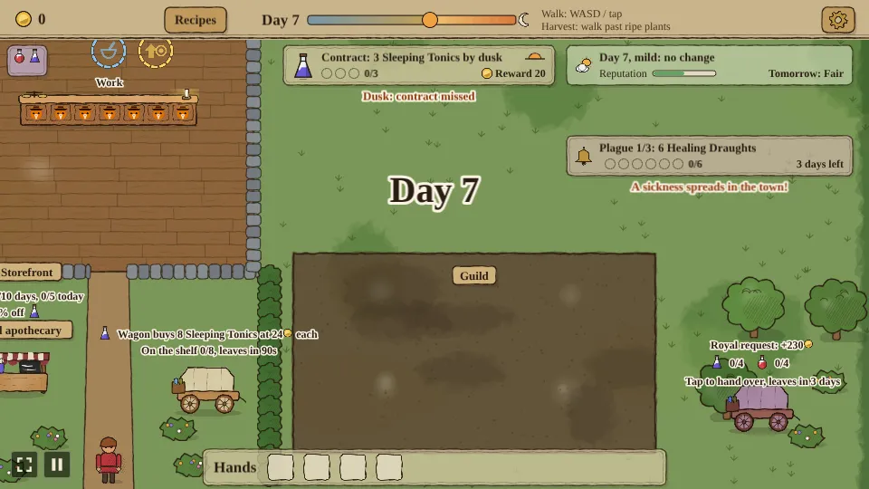
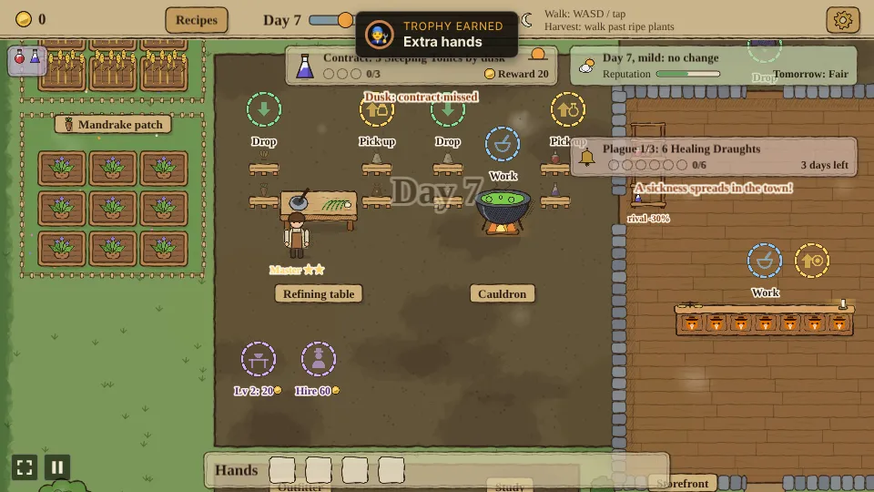
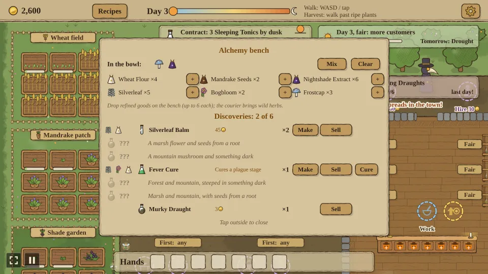
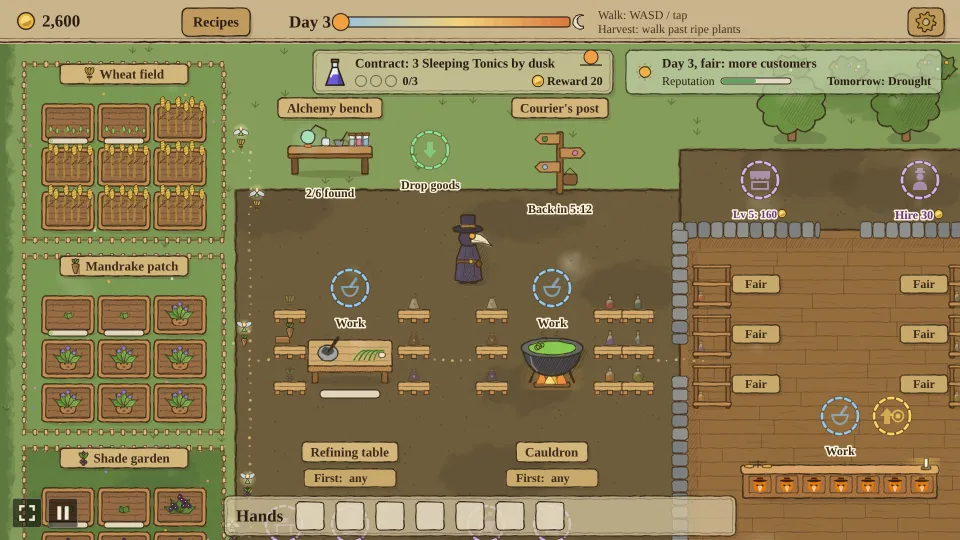
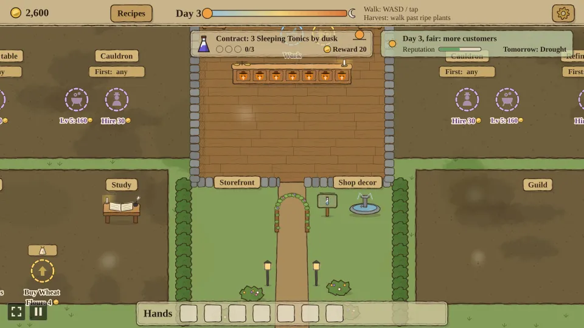
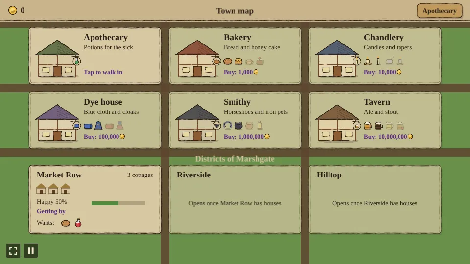

# Apothecary

A small automation game prototype built with [Phaser 4](https://phaser.io), TypeScript and Vite, part of
the [game hub](../../README.md).

You play a plague doctor running a medieval apothecary. Grow herbs in the backyard, refine them,
brew potions in the cauldron and sell them to customers at the storefront. It looks like a page
from a herbalist's almanac: watercolour washes on aged paper in deep, muted tones, wobbly ink outlines and hatched
shadows, with the interface in dark ink on parchment cards and a serif type.


The apothecary is laid out in two rows either side of the shop. The first production line runs
east along the left half: the wheat field, mandrake patch and shade garden stacked at the far
edge, then the refining table, then the cauldron, then into the shop's left wall. Each station has
its drop and pick-up markers north of it, either side, and its work spot just above it; its in
pallets stand left of it and its out pallets right of it, and its name, its "First:" sign and its
upgrade, craftsman and pixie markers sit in a row below it. The shop stands in the middle and faces
the street at the bottom; the doctor goes in by its north door, where the counter's drop-off
stands outside. Hedges line the ground below the shop on both sides, since only customers use the
street. The market below holds the outfitter and the study on the left and the guild on
the right. The right half is grass until the expansion is bought, which opens it up for a second
production line that mirrors the first. Pixies fly goods along each row into the shop. The map is
bigger than the screen, so the camera follows the doctor. The cards over the yard (the contract,
the town and plague cards, the orders and the hands) are a little see-through.


## How to play

| Control | Action |
| --- | --- |
| WASD / arrow keys, or tap | Walk |
| Touch: put a finger down and drag | A steering stick appears where the finger went down and the doctor walks the way you drag; it follows a finger that goes past its rim. A tap without dragging still walks to the spot |
| Mouse wheel, + / - keys, or pinch with two fingers | Zoom in and out; the top bar stays the same size and the zoom is remembered and the same in every shop |
| Walk past ripe plants | Harvest every ripe plant within one character height of the doctor; the spinning sickle marks the edge |
| Recipes (top bar) | Show what each station makes from what, and what each potion sells for; tap again to close |
| Tap a slot in the hands bar (bottom of the screen) | Throw that item away; a small bin on each full slot shows it |
| Tap a waiting customer's order bubble | With the doctor inside the shop, hand them everything they want that is on the shelf |
| Cogwheel (top bar) | Open the settings |
| Stand on a floor marker | Each is a dashed ring with a faint icon. Green: drop off items. Blue: work the station. Gold: pick up products or coins, a mix of every kind there, with what it gives beside the arrow (a sack at a refining table, an empty bottle at a cauldron, a coin at the till). Purple: stand still on it to pay coins towards an upgrade or build, each kind with its own icon; the longer you stay, the faster it pays (twice as fast every second); its caption shows the coins still to pay |


1. **Gardens**: each garden grows one kind of plant in nine beds, three rows of three edge to
   edge. Harvest ripe wheat in the wheat field and mandrake in the mandrake patch. Beds regrow on
   their own: wheat in 24 seconds, mandrake in 30 and nightshade in 32, so the three goods come in
   at close to the same pace (each goes into four of the six recipes). Tap a garden's sign to
   replant it with another plant of its line (see **Replanting** below).
2. **Refining table**: drop off plants; wheat becomes wheat flour, mandrake becomes mandrake seeds
   and nightshade becomes nightshade extract.
   Stand on the work spot while it refines; pick the finished goods up on the pick-up marker.
3. **Cauldron**: drop in refined goods. Two wheat flour brew a Healing Draught and two mandrake
   seeds a Sleeping Tonic; those two recipes are known from the start. Four more are learned at the
   study (see below): wheat flour and mandrake seeds brew a Vigour Tonic, nightshade extract and
   mandrake seeds a Shadow Elixir, nightshade extract and wheat flour a Moonlight Salve, and two
   nightshade extract a Witch's Brew. Stand on the work spot while it brews. When work starts, the cauldron brews whichever
   potion the shop has fewest of, on its out pallets and the shop's shelves together, and a potion
   six or more ahead of the shortest one customers ask for waits, keeping its ingredients for the
   short one. The last quarter of each brew is
   its fine window, gold on the brewing bar: step off the work spot then (which stops the brew
   where it is) and onto the pick-up marker, and the potion comes out **Fine**, worth half again
   as much. Left to finish, it comes out plain onto its pallet, as craftsmen always do.
4. **Storefront**: the storefront faces the street at the bottom of the map. Customers come in
   by the street door in the shop's bottom wall, walk up to the counter and show the potions they want and how long they will wait; they are only served, and
   only lose patience, once they stand at the counter. The doctor goes in and out by the north door
   in the top wall, since the shop's walls are solid and the street door is the customers' own.
   Drop potions on the drop marker outside the north door, before going in, and stand on the work
   spot right behind the counter; customers pay for each potion as they get it and leave the coins
   on the pick-up marker beside it. Along the shop's side walls stands one shelf for each potion the
   apothecary has learned, showing up to
   six bottles (and how many there are, past that). An overstocked shop sells cheaper: up to 5 of a
   potion on its shelf sell at full price, and from there the cut grows in even steps to half price
   on a full shelf (with the starting 10 a shelf: 10% off at 6, 50% at 10). The cut for the next
   sale shows under each shelf ("-30%"). A fine potion stands on
   its plain potion's shelf, with a gold sparkle, and goes to the next customer who wants that
   potion first. Each shelf has a price sign beside it, Cheap, Fair or Dear (see **Price signs**
   below).


**The study**, in the market beside the outfitter, teaches the recipes the apothecary doesn't know
from the start, one at a time and always in this order: the Vigour Tonic (30 coins, sells for
11), the Shadow Elixir (60, sells for 24), the Moonlight Salve (120, sells for 20) and the Witch's
Brew (240, sells for 34). Its purple marker goes up for sale once the garden's pixies are hired,
and its caption names the next recipe. Customers only ask for potions the apothecary has learned,
and a cauldron only brews those. The Recipes panel lists every recipe, the ones still to learn
faded with "Study" in place of their price.

The study also teaches three crafts, each its own lesson with its own purple marker around the
desk, for sale with the recipes: **replanting** (30 coins), which lets a garden's sign switch what
it grows (see **Replanting**), the **crafting order** (40 coins), which puts up the "First:" signs
at the tables and cauldrons (see **Priority**), and the **price signs** (60 coins), which put up the
Cheap, Fair and Dear signs at the shelves (see **Price signs**). Until then the gardens grow what
they were planted with, a station makes things in its own order and every potion sells at Fair.


**The shade garden** grows nightshade, for the Shadow Elixir, the Moonlight Salve and the Witch's
Brew. It stands at the top of the market, on the left, and is planted on its
purple marker (80 coins) once the garden's pixies are hired; the second line's stands beside it,
on the right, and is planted once the expansion's land is bought (60). Customers only ask for the
nightshade potions once a shade garden grows and the study has taught them. The garden's pixies
fly its nightshade in from its own garden to the refining table's third pallet.

**Regulars and reputation**: a customer served with at least half of their tip left comes back
another day as a regular, with a gold star on their order bubble, for the same potions as last
time, and pays 3 coins more for each. The street keeps a reputation, the bar on the town card at
the top right: it starts halfway, each filled order raises it by 3 and each customer who walks off
unserved lowers it by 8. A good reputation brings customers more often, up to twice as often at
the top; a bad one, up to a third less often.

**Weather**: the town card shows today's weather from the almanac and tomorrow's, and the yard
shows it too: on a rainy day the light turns grey-blue and rain falls, in a drought a warm haze
hangs over everything with heat rising in wavy lines, a fair day is a little golden, and a mild
day is as it is. With reduced motion the light changes but nothing falls or rises. Rain makes
plants grow half again as fast, a drought slows them to 60%, a fair day brings customers half
again as often, and a mild day, like the first, changes nothing. A day ends at dusk or when its contract is
kept, as before.

**Market day**: every fourth day is a market day. At midday a crowd of up to five customers comes in
at once, filling every place at the counter and two more. Serve every one of them and the purse
gets 6 coins for each; if any walks off, the bonus is lost. The town card counts them, and a note
under it says how it went.

**Blight**: from the third day, rain can blight a bed (about one every 45 seconds of a rainy day).
A blighted bed withers to a sickly violet-grey, stops growing and blights a neighbouring bed in
its garden every 40 seconds, in any weather, until the doctor walks past it: the sickle clears
blighted beds in reach before it cuts anything, hands full or not, and the bed grows again from
seed. The town card says which garden the blight struck. The guild's **Herbalist** upgrade (60
coins, after growth) makes every bed immune, so a garden left to the pixies is never quite
hands-off until then.


**Replanting**: once the study has taught it, tap a garden's sign to switch all nine of its beds to the next plant its line
grows: wheat, mandrake, and nightshade once the line's shade garden is planted (the shade garden
can be switched too). The sign shows the plant's name and icon. Every bed starts again from seed
and the blight is cleared, so rebalancing the gardens for the day's contract costs a crop. The
pixies pick from whatever each garden grows, flying it in from that garden.


**Price signs**: once the study has taught them, each shelf has a sign beside it, Fair at first. Tap it to go Dear, then Cheap,
then Fair again. A Dear potion sells for 40% more, but a customer waiting for one loses patience
half again as fast (and so tips less). A Cheap one sells for 25% less, is asked for twice as
often and raises the reputation by 2 more for each one sold. The cut under each shelf counts the
sign in: "+33%" or "-27%" against the price.


**The rival shop**: from the fourth day a rival apothecary opens a stall across the street, left
of the street door, and undercuts one potion a day (the same one in every game, going round what
customers ask for). Customers pay 30% less for a plain one that day ("rival -30%" under its
shelf); a Fine one beats the cut and pays in full. The rival sells 4 of that potion a day itself;
sell 5 or more and the day counts as outsold. A day a kept contract ends early only has to beat
the rival's sales for the part of the day that went by. The stall's lines say what is undercut and how the
race stands ("Outsold 2/10 days, 3/5 today"). Outsell it for a month, ten days running, and it
closes for good: the stall is boarded up and the street is yours.


**The plague**, the game's ending: from the fifth day a sickness spreads through the town in
three stages, each on its own card under the town card. The first asks for 6 Healing Draughts,
the second for 6 Sleeping Tonics, the third for 10 potions of any kind, each sold at the counter
within three days (a pip per potion, and the days left on the right). A stage met moves the
sickness on; a stage missed comes back asking for 2 more and costs 10 reputation. Past the last
stage the **Panacea** is unlocked: one wheat flour, one mandrake seeds and one nightshade extract
in a cauldron brew the town's cure (9 seconds) before anything else, and it goes straight to the
town the moment it is done, never out early and never for sale. That cures the town and wins the
game: a panel says so, and "Keep trading" carries on with the shop as it is.

**Seasons of sickness**: five days after each cure a new, stronger outbreak comes. Its stages ask
for 6 Moonlight Salves, 6 Witch's Brews and 12 potions of any kind, 2 more each season after (a
stage asking for a potion customers can't get yet takes any kind instead), and it ends with the
Panacea as before. Curing a season earns a **town seal**, every cure counting: each seal raises
every potion's price by 10%. The plague card says how many seals the town has and on which day the
next season's sickness comes.


**Tips**: on top of the price, a customer whose order is filled leaves a tip: a coin, plus two
for each potion they asked for (3 for one potion, 5 for two). The tip shrinks while they wait at
the counter and is gone once they have used up 60% of their patience, so a quick shop earns more.
The coin ring on the corner of each order bubble shows it: the ring empties as the tip shrinks,
and the label above it says what they would tip right now ("tip +4", or "no tip"). The bar under
the potions is their patience, as before.

**Orders**: every customer's order is always on screen too, in a row of small cards under the top
bar on the left: one card per customer, in the order they came in, with the potions they still
want and, once they wait at the counter, a bar of their patience. So the doctor can see what is
needed while working out in the gardens.


**Daily contract**: the card at the top of the screen asks for a number of one potion by dusk,
"Contract: 3 Sleeping Tonics by dusk" on the first day. Each potion of that kind sold at the
counter fills a pip. Fill them all and the reward goes straight into the purse and the next day's
contract comes in at once; at dusk an unkept contract lapses and the next day starts. A day lasts
four minutes, and the little sun on the right of the card sinks towards the horizon as dusk nears.
The top bar names the day ("Day 3") and shows its sky from dawn to dusk, a sun crossing it as the
day passes and the moon at its end; over the last part of the day the world takes on a warm
evening light that deepens towards dusk, and each new day is named across the screen as it starts.
The first two days ask for Sleeping Tonics and then Healing Draughts; from day 3 the potion goes
round every one customers ask for, so learned recipes and the shade gardens pay off every day. On
days 4, 7, 10 and so on the contract is a bundle of two potions ("Contract: 2 Moonlight Salves + 2
Witch's Brews"), kept once both are delivered. Each kept contract asks for one more potion than
the last (up to 12), and the reward is a little under half of what the potions sell for, three
fifths for the nightshade potions.


**While you were away**: once anything runs without the doctor (a craftsman or pixies hired), the apothecary keeps going while the game is closed. On the next visit the time away, up
to two hours, is played through the same rules with the doctor off his work spots, and a chip in
the top right says what it earned: "While you were away: +32, 9 potions", with a gold coin after the 32 (every amount on screen is a number and a gold coin, with no currency name). Tap the chip to
dismiss it. The coins land where they would have: in the till, or in the purse when a craftsman
carries them or a contract pays.


**Pallets**: every station keeps each kind of goods coming in or going out on its own pallet. A
pallet or shelf holds 10 of each kind at first; the guild's Storage upgrade raises that by 10 a
level, up to 40. The refining table keeps its plants on pallets left of it and its refined goods
on pallets right of it; the cauldron keeps the refined goods left of it and its potions on two
columns of pallets right of it, and the counter keeps its potions on shelves. On both lines the
pallets stack the same way from the top: wheat, mandrake and nightshade (and their goods). A pallet stands
only once its goods can be had: nightshade's once a shade garden grows, a potion's once it is
learned. The drop and pick-up markers stand above the pallets they fill and empty. A full pallet takes nothing more: the doctor keeps the item and the
pixies wait until there is room.


**Craftsmen** work a station so the doctor doesn't have to stand on its work spot. Each station
takes up to two, hired one at a time on the purple marker beside it (30, then 60 coins); they
stand by the station once hired, and its work spot goes away. At work they rock to and fro over
the station, grinding, stirring or handing potions over; idle, they stand still. At a refining table or cauldron the
first craftsman works as the doctor would, and the second opens a second pipe: a second plant or
brew on the go alongside the first, at the same speed, with its own bar below the first. Either
pipe's brew can be taken out fine. At the counter
the first craftsman serves customers, a potion every 1.5 seconds where the doctor hands them over
at once, and the second makes that twice as fast and also brings the coins from the till.


**Priority**: once the study has taught the crafting order, each refining table and cauldron has a
small "First:" sign by its name. Tap it to
choose what the station makes first whenever it can: wheat, mandrake or nightshade at a table, a
any potion learned at a cauldron, or "any" to leave it to the station (a table takes
plants in the order they came, a table makes what its out pallets hold fewest of and a cauldron
what the shop holds fewest of). Tapping the
sign doesn't walk the doctor. A station with nothing for its priority makes something else rather
than wait.


**What's for sale** opens up as you buy things. At first only one purple marker shows, and each
purchase puts the next one out, in this order: refining table level 2, pack 2, cauldron level 2, a
craftsman at the counter, then the garden's pixies. From the garden's pixies on it branches out:
boots, sickle, the counter's upgrade, craftsmen at the table and cauldron, the table's pixies, the
shade garden, the study and its three crafts, and entry to the guild (50 coins), which puts the guild's growth, pixies,
storage and prices upgrades up for sale. The cauldron's pixies follow the table's, the land follows the
cauldron's pixies, customers follows prices and the extra slot follows customers. The second line's things are for sale once their
station stands.


Every station has an upgrade marker and goes up to level 5. Upgrades cost 20, 40, 80 and 160
coins: the refining table and cauldron work faster, and customers at an upgraded counter pay
more for each potion (2 coins over the price per counter level, counting level 1) and wait
longer. Once a level is paid off, step off the marker and back on to start on the next. An upgrade
marker goes away once its last level is bought, and a hire marker once both craftsmen are hired.

The **outfitter** in the market below the first line kits the doctor out, two levels each: a bigger
pack carries one more item per level (30, then 60 coins), boots walk a fifth faster per level and
a longer sickle harvests from a quarter further away (25, then 50 coins each).


The **herb market** below the outfitter opens once the garden pixies are hired. Stand still on its
green marker to sell the plants and refined goods the doctor carries, one at a time, or on its gold
marker to buy one of the good its sign shows (tap the sign to pick another). Prices change every
day: rain makes plants cheap and a drought dear, refined goods swing half as much, and the market
pays three fifths of what it charges. A starved line can be patched with coins, and a glut turned
into cash.


**The merchant wagon** pulls up across the street on day 6 and every third day after, from
mid-morning for a minute and a half. It wants a whole crate of 8 of one potion and pays 60% over
the price for each. Tap it while the shelf holds 8 of that potion to sell the crate straight into
the purse. The wagon's sale counts for no contract, plague stage or rival, so it is a choice
between the wagon and the counter.


**Royal requests.** On day 7 and every seventh day after, the crown's courier waits on the green
right of the guild for three days. It asks for 4 (one more every two weeks) of up to three of the
potions customers ask for, and pays two and a half times their price for the lot, plus reputation.
Tap it to hand over what the shelf holds of them, plain ones first; it keeps what it got until the
last one is in.



**Master craftsmen.** Hired craftsmen grow better at a refining table or cauldron the longer they
work it: after 10, 30 and 90 minutes of work it earns a master's star, shown under the craftsman,
and each star makes the station work 15% faster.



**The alchemy bench.** Once the study has taught all six recipes, an alchemy bench stands on the
grass north of the first line's yard. Stand still on its green marker to put refined goods on it
(up to 6 of each), then tap the bench: put two or three ingredients in the bowl and press Mix. Six
potions wait to be discovered, each from its own mix (in any order), and the panel hints at each
one ("A forest herb and something milled"). A right mix discovers its potion and puts it in the
bench's book, where Make mixes it again from what is at hand; a wrong one makes a Murky Draught
worth 3 coins. Bench potions are sold from the panel to the town's collectors for 45 to 170 coins
(town seals raise them like every potion), and the Fever Cure and Plague Bane can instead be given
to the town to end the plague's current stage at once.



**Herb expeditions.** Every new potion needs a wild herb that only grows out of town. Hire a
courier at the post beside the bench (400 coins, once), tap the post and send them to the forest
(3 minutes, Silverleaf), the marsh (5 minutes, Bogbloom) or the mountains (8 minutes, Frostcap).
The trip runs on game time, which the time away plays too, so the courier comes back with 3 of the
herb even while the game is closed. The satchel holds up to 12 of each; herbs that don't fit stay out
in the wild.



**Shop decor.** Once you have joined the guild, tap Shop decor on the shop's front wall to buy
decor for the street, each once and for good, each lifting the reputation a little when it goes up:
a painted sign (200 coins, tips a quarter bigger), lanterns (450, customers wait a fifth longer),
a herb arch over the path (900, regulars come back half again as often) and a fountain (1,800, a
customer who walks off costs half the reputation).



The **guild** in the market below the second line sells upgrades for the rest of the apothecary:
growth makes every garden grow a quarter faster per level (20, then 40 coins), pixies fly half again
as fast per level, carrying more goods a second (30, then 60), storage lets every pallet and shelf
hold 10 more of each kind per level (25, 50, then 100), prices make customers pay a quarter
more per potion per level (20, then 40), an extra order slot lets a fourth customer wait at the
counter (30), customers makes them come in more often, a new one every 6 to 10 seconds and then
every 4 to 7 instead of every 12 to 20 (25, then 50), and the herbalist (60, after growth) keeps
every bed clear of blight. A busier shop is harder to keep up with: per
customers level, a fifth more customers want two potions (35% at first, then 55% and 75%), and they
wait a third less long, then half as long. One line with a craftsman per station can't serve
everyone at the top level; it takes the second line, more craftsmen or station upgrades.


**Pixies** take the walking out of the loop. Three teams can be hired on their own purple markers,
a handful of coins at a time: gardens to refining table (60 coins), table to cauldron (100) and
cauldron to counter (150). Pixies pick ripe plants up from the gardens, or finished goods from a
station's out pallets, and fly them along a faint trail of fairy dust to the next station, where
each one flies over to its own kind's pallet or shelf and sets its goods down when there is room.
Mandrakes and nightshade set off from their own garden. The drop and pick-up markers they replace
go away, though a drop marker comes back while the doctor carries goods they take, such as goods
from the other line. What the doctor carries goes to them when they are hired, one after another,
unless the other line still moves those goods by hand. Each kind of goods keeps to its own side of
the trail, so when one kind waits for room at the next station the others keep flying. With
reduced motion the pixies glide without beating their wings.


**The expansion** opens the right half for a second production line. Its land is bought on a
marker beside the shop's right wall (100 coins), which lays the yard and puts a build marker where each
part will go: a wheat field and a mandrake patch (25 coins each), a refining table (50), a
cauldron (75) and its shade garden (60). The second line works like the first and has its own
pixies, for hire once the stations at both ends stand; its cauldron's pixies fly in through the
shop's right wall, as the first line's do through the left. The counter's drop marker stays
until every cauldron has its pixies, and comes back whenever the doctor carries a potion.


**The town** opens once the plague is cured: the cure's panel says the town grants a charter, and a
**Town** button left of Recipes leads to the town map. It shows the apothecary and a lot for every
other shop in town, and each shop costs ten times the one before, as the biggest thing to spend coins
on. The first is the **bakery** (1,000 coins). Tap a lot to buy it with the coins in the purse, and
tap it again to walk in; the top bar's button goes back to the map, and the map's goes back to the
apothecary. Every shop and the apothecary keep working while you are elsewhere, and while the game
is closed.

A shop's yard works like the apothecary's: gardens of sixteen beds, four by four, harvested by
walking past them, stations with drop, work and pick-up markers, and a small storefront by the
street, where goods dropped outside its back wall go on its shelves and the doctor (or up to two
shopkeepers) behind the counter serves the customers who come in from the street. Every shop's yard
is a place of its own: the bakery is a village green, its gardens across the top, a line down either
side, the guild on the green and a duck pond by the shop; the chandlery climbs a hillside in
terraces, its lines stepping down to the shop; the dye house has a river between its gardens and its
works, crossed by three bridges; the smithy's woods and mines feed a cobbled forge yard in the
middle; and the tavern's lines run around a lake, with a beer garden by its door. The bakery grows
wheat and honeycomb, mills wheat into flour and bakes two flour into bread (24 coins) or flour and
honeycomb into honey cake (39). Every station and the counter have their own purple markers for a
level, workers and pixies, dearer in each shop than in the one before (three times as much a shop)
but nothing like the shop itself:

| Bakery | Cost |
| --- | --- |
| Station or counter level (4 levels: a station works half again as fast a level, the counter sells 15% dearer) | 60, 120, 240, 480 |
| Baker (2 per station) or shopkeeper (2 at the counter) | 90, then 180 |
| Pixies: field to mill, hives to oven, orchard to oven, mill to oven, oven to the shelves | 180, 180, 180, 300, 450 |
| Outfitter: pack, boots, sickle (one level each) | 360, 300, 300 |
| Study: crafting order, price signs | 120, 180 |
| Study: apple tart, then fruit cake | 180, 360 |
| Guild: join | 450 |
| Guild: growth, pixies, prices (2 levels each) | 180, 360; 270, 540; 180, 360 |
| Guild: storage (3 levels), slots (1), customers (2), herbalist (1) | 225, 450, 900; 270; 225, 450; 360 |
| Second line | 1,500 |

Between its gardens and its first station, every shop has a little market of its own, like the
apothecary's. Its **outfitter** sells one more level of the doctor's pack, boots and sickle, which
count everywhere on top of the apothecary's two (so a pack holds up to 11 with every shop's). Its
**study** teaches that shop's crafting order, which puts a "First:" sign at each station with two
recipes, and its price signs, which put a Cheap, Fair or Dear sign under each shelf; both work as
in the apothecary, and until they are learned a station makes what the shelves hold fewest of and
everything sells at Fair.

Each shop knows two recipes when it is bought, and its study teaches two more, one after the other,
from a purple marker under its lessons. Learning the first plants the shop's third garden, which
stands empty with "Learn a recipe at the study to plant it" until then, and has its own pixies to
its station. A recipe not learned yet isn't made, its shelf stands empty and no customer asks for it;
the town map shows its icon faint on the shop's card. The recipes cost three times as much in each
shop as in the one before:

| Shop | Third garden | First recipe | Second recipe |
| --- | --- | --- | --- |
| Bakery | Orchard (apples) | Apple tart: flour and an apple (45 coins) | Fruit cake: flour, honeycomb and an apple (66) |
| Chandlery | Lavender field | Lavender soap: beeswax and lavender (135) | Scented candle: beeswax, a wick and lavender (198) |
| Dye house | Madder field (the dye mill grinds madder root into red dye) | Red cloth: linen and red dye (405) | Gown: two linen, blue dye and red dye (594) |
| Smithy | Copper pit | Copper pot: two copper (1,215) | Lantern: iron and copper (1,782) |
| Tavern | Orchard (apples) | Cider: two apples (3,645) | Apple ale: malt, dried hops and an apple (5,346) |


Every shop also has a **guild**, like the apothecary's. Join it once, and its seven upgrades go up
for sale: growth (its beds grow a quarter faster a level), pixies (half again as fast a level),
storage (6 more of each good on every pallet and shelf a level, from 12), prices (a quarter dearer a
level), slots (a fourth customer at the counter), customers (they come in as often again a level)
and the herbalist (the blight never takes its beds). They count only in that shop, and cost three
times as much in each shop as in the one before.


Every good a shop sells has a **fine window** too: the last quarter of its station's bar is gold,
and picked up by hand then (step off the work spot and onto the pick-up marker), it comes out
Fine, with a sparkle on its icon. Customers and households take the fine ones first, and pay half
again as much for them. From day 4 each shop also has a **contract** of its own, shown under the
top bar: sell so many of one of its goods today (4 at first, one more for every contract kept, up
to 12) and its reward goes into the till. A new one comes with every day, for another good.


A shop's day runs like the apothecary's, and the **town card** at the top right shows it: the day's
weather, the shop's reputation and tomorrow's weather.

- **Weather.** Rain makes its beds grow half again as fast, a drought slows them to 60%, and on a
  fair day customers come half again as often.
- **Tips and reputation.** Every customer brings a tip, a quarter of what their order pays, which
  shrinks while they wait (the ring around the coin on their bubble) and goes into the till when
  their order is filled. A filled order raises the shop's reputation and one who walks off lowers
  it, and a good name brings customers more often. A sale off a Cheap shelf raises it too.
- **Regulars.** A customer served with half their tip still left comes back now and then as a
  regular, with a star on their bubble, for the same goods, and pays a fifth more for them. A shop
  remembers four.
- **Market days.** Every fourth day a crowd of five comes in at midday. They take every free place
  at the counter first and wait in the street for the rest, and serving all of them pays a bonus,
  half of what their goods are worth; one walking off, or still waiting at dusk, loses it.
- **Blight.** From day 3 rain can blight a bed. It stops growing, its pixies pass it by, and it
  blights a neighbour now and then until the doctor's sickle clears it. The guild's herbalist keeps
  every bed clear.
- **Overstock.** Past 5 of a good on the shelf, each one sells for less, down to half on a full
  shelf, as at the apothecary; the cut price shows in orange under the shelf.
- **Two-good contracts.** Every third day from day 4, as at the apothecary, the contract asks for
  two goods, the total split between them.


Below the guild, every shop has room for a **second line**, like the apothecary's expansion. Bought
once at its marker (1,500 coins at the bakery, three times as much in each shop after), it builds a
copy of each station in a row under the first, which levels and hires on its own, and a second set
of pixie routes from the same gardens (their markers stand under the first line's) to the same
shelves.


The till's coins are picked up at the counter, and the map shows what waits in each shop's till.

The town's **districts** are what the shops are for. Below the lots, each district's card shows its
homes, how happy it is and what it wants. Every 30 seconds each home asks for one good, taking turns
through its district's list, and takes it off the shelf of the shop that sells it (potions from the
apothecary's shelves), paying the shelf price into that shop's till (a Fine potion half again as
much, and its price sign counts, as for a customer). Happiness moves halfway towards
the share it got. Four rounds in a row at 80% or more add a home, up to eight; once full, its
cottages grow into houses, which want honey cake and Sleeping Tonics as well as bread and Healing
Draughts. A full district of houses grows into manors, which also want candles and tapers from the
chandlery, manors grow into mansions (see the dye house) mansions into palaces (see the smithy) and palaces into castles (see the tavern). Four rounds in a row at 30% or less lose a home again, down to three. Market Row opens with
the town; Riverside opens once Market Row has houses, and Hilltop once Riverside has.

The second shop is the **chandlery** (10,000 coins). Its beehives give honeycomb, pressed into
beeswax at the wax press, and its flax field gives flax, spun into wicks at the spinning wheel. The
dipping vat makes a candle from a beeswax and a wick (72 coins) or a taper from two beeswax and a
wick (117). Its prices are three times the bakery's:

| Chandlery | Cost |
| --- | --- |
| Station or counter level | 180, 360, 720, 1,440 |
| Chandler (2 per station) or shopkeeper (2 at the counter) | 270, then 540 |
| Pixies: hives to press, flax to wheel, lavender to vat, press to vat, wheel to vat, vat to the shelves | 540, 540, 540, 900, 900, 1,350 |


The third shop is the **dye house** (100,000 coins). Its looms weave two flax into linen, and its
dye mill grinds woad leaves into blue dye. The dye vat makes blue cloth from a linen and a dye (216
coins) or a cloak from two linen and a dye (351). A full district of manors grows into mansions,
which also want blue cloth and cloaks.

| Dye house | Cost |
| --- | --- |
| Station or counter level | 540, 1,080, 2,160, 4,320 |
| Dyer (2 per station) or shopkeeper (2 at the counter) | 810, then 1,620 |
| Pixies: flax to loom, woad to mill, madder to mill, loom to vat, mill to vat, vat to the shelves | 1,620, 1,620, 1,620, 2,700, 2,700, 4,050 |


The fourth shop is the **smithy** (1,000,000 coins). Its coppice grows timber, burned into charcoal
at the charcoal kiln, and its ore pit gives iron ore, which the bloomery smelts with charcoal into
iron. The anvil makes a horseshoe from an iron (648 coins) or an iron pot from two (1,053). A full
district of mansions grows into palaces, which also want horseshoes and iron pots.

| Smithy | Cost |
| --- | --- |
| Station or counter level | 1,620, 3,240, 6,480, 12,960 |
| Smith (2 per station) or shopkeeper (2 at the counter) | 2,430, then 4,860 |
| Pixies: coppice to kiln, ore to bloomery, copper to anvil, kiln to bloomery, bloomery to anvil, anvil to the shelves | 4,860, 4,860, 4,860, 8,100, 8,100, 12,150 |


The fifth shop is the **tavern** (10,000,000 coins). Its barley field gives barley, malted at the
maltings, and its hop garden gives hops, dried at the oast. The brew kettle makes ale from a malt and
dried hops (1,944 coins) or stout from two malt and dried hops (3,159). A full district of palaces
grows into castles, which also want ale and stout.

| Tavern | Cost |
| --- | --- |
| Station or counter level | 4,860, 9,720, 19,440, 38,880 |
| Brewer (2 per station) or shopkeeper (2 at the counter) | 7,290, then 14,580 |
| Pixies: barley to maltings, hops to oast, orchard to kettle, maltings to kettle, oast to kettle, kettle to the shelves | 14,580, 14,580, 14,580, 24,300, 24,300, 36,450 |


Once every district is full of castles, the town map says the town has become a city: the
game's second ending, after the cure of the plague.


**The next town.** Once the town is a city, the heading over its districts offers the road to the
next town: tap it to found Marshgate, then Highcrag and Saltmere. The shops stay; the districts
start over from three cottages in Market Row, and the city made earns a town seal (every potion's
price goes up). Each later town's homes pay a quarter more per city made, and take one more happy
round per city (up to three) to grow.




You can carry four items at a time, more with a bigger pack; they stack up on the doctor's back and show in the hands bar at the bottom of the screen. Progress is saved in the browser automatically.

The cogwheel at the right of the top bar shows the difficulty and frame rate the game runs with, which are set on
the hub page's Settings, and has "New game", which starts over. On Easy customers wait 50% longer
before they leave, on Hard 30% less.


## Running locally

`npm run dev` at the repo root, then open `/games/apothecary/` (or pick Apothecary on the hub page).

## Playthrough test

`e2e/playthrough.spec.ts` plays the first round of the loop in headless Chromium with real
clicks: it opens and closes the recipes, harvests both gardens, refines, brews, takes one potion
out fine in its window, sells potions to a customer and collects the coins, checking items,
pallets, the recipe the cauldron picks, what each potion is paid and tipped, the reputation and the
first day's contract along the way. It plays at 4x speed (`PLAYTHROUGH_SPEED`), so the run takes
under a minute. The Playthrough Apothecary workflow runs it on every PR
that changes `games/apothecary/` and uploads a video and milestone screenshots as the
`playthrough-apothecary` artifact.

```sh
npx playwright install chromium        # once
npx playwright test --project apothecary   # starts the dev server and plays; CPU_THROTTLE=4 simulates a slow machine
```

Changes to gameplay, layout or controls update the test in the same PR; see the repo's `AGENTS.md`
for the rules and for how to debug a failing run.

## Code layout

All paths are inside `games/apothecary/`.

- `src/game/`: the rules (items, recipes, state, simulation tick and player actions) in plain
  TypeScript with no Phaser dependency, plus saving.
- `src/scenes/`: Phaser scenes. `BootScene` bakes textures, `GameScene` draws the world and wires
  input to the rules.
- `src/art/`: all the art, painted in code on canvases at startup with the watercolour and ink
  helpers in `paint.ts` (no image files): the plague doctor, townsfolk, items, gardens, stations,
  the study, shop shelves, pixies, floor markers, the ground, the parchment interface cards, and the
  alchemy bench, courier's post, wild herbs and shop decor (`alchemy.ts`).
- `src/ui/`: small reusable display pieces (icon rows, progress bars, pallets, shop shelves), the recipe and settings panels and `Board`, the panel the bench, the courier's post and the decor board open.
