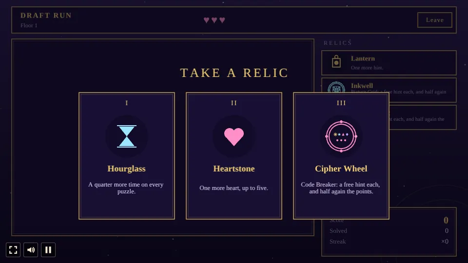

# Augury

A collection of brain puzzles built with [Phaser 4](https://phaser.io), TypeScript and Vite, part of
the [game hub](../../README.md).

Nine kinds of puzzle, dealt like cards from an arcane tarot deck: logic, numbers, spatial thinking
and memory. Every puzzle is made in code from a seed, so they never run out, and each kind comes at
four levels, from Novice to Oracle. Play an endless medley of random puzzles, the same five puzzles
as everyone else today, a race against the clock, a draft run where you pick the next card and
gather relics, a pass-and-play match for two, or practise any puzzle with no clock.

It plays sideways or upright, and turns with the phone.

## How to play

| Control | Action |
| --- | --- |
| Tap or click | Fill a cell, pick an island, flip a tile, press a pad key or a glyph |
| Drag | Slide a block (Unjam) or draw a path (Path Link) |
| Keys 1-9, Backspace | Write or clear a number (Calc Cages, Cross Sums); pick a glyph (Code Breaker) |
| Enter | Make the guess (Code Breaker) |
| S and D, or Left and Right | Same or different (Memory Echo) |
| Undo (U), Hint (H), Skip | Take back a move, use a hint, give the puzzle up |
| Leave | Back to the menu (the run ends there, and its score and bests count) |
| Continue | On the menu after a reload: picks the run up again (every mode but Practice) |

### The puzzles

| Puzzle | Skill | Rules |
| --- | --- | --- |
| Picture Grid | Logic | Fill cells so each row and column shows its runs of filled cells, in order. A second tap marks a cell empty. |
| Bridges | Logic | Tap two islands in a line to lay a bridge (a second makes it double, a third takes it away). Each island needs as many bridges as its number, bridges never cross, and every island must connect. |
| Code Breaker | Memory | Find the hidden row of four glyphs. Each guess shows filled pegs for right glyphs in the right place and rings for right glyphs in the wrong place. Run out of guesses and it is lost. |
| Calc Cages | Numbers | Every row and column holds each number once, and the numbers in each cage make its target with its sign. |
| Cross Sums | Numbers | A number crossword: each run of cells adds up to its clue, with no number twice in a run. |
| Unjam | Spatial | Slide blocks along their length (drag them, or tap one and then a free cell in its line) to free the gold block through the gap. |
| Tile Flip | Spatial | A tap flips a tile and its four neighbours; put every light out. |
| Path Link | Spatial | Drag to join each pair of matching stars; the paths fill every cell and never cross. |
| Memory Echo | Memory | Cards turn up one at a time; say whether each is the same as the one 1, 2 or 3 steps back. Three in four must be right. |

Any answer that keeps the rules counts, not only the one the puzzle was made from.

### Modes

- **Endless Medley**: random puzzles one after another, never the same kind twice in a row, three
  more always showing as Up next. Every three puzzles the level goes up. Each puzzle has its own
  clock; a lost, skipped or timed-out puzzle costs one of 3 hearts. 2 hints for the whole run.
- **Daily Five**: five puzzles of five kinds, the same for everyone on the same day, from Novice to
  Oracle. One try a day; the menu shows today's score.
- **Blitz**: three minutes on one clock and no hearts. A solve gives back 10 to 25 seconds (more at
  higher levels), a skip or a loss takes 10. The level rises every two solves.
- **Draft Run**: before each puzzle, choose one of the cards dealt. Every third solve offers three
  relics: one charm (while any is left) and two of the others, each of which can be taken again
  except the Crystal Ball (a draft deals three cards at most):

| Relic | Effect |
| --- | --- |
| Lantern | One more hint. |
| Heartstone | One more heart, up to 5. |
| Hourglass | A quarter more time on every puzzle. |
| Crystal Ball | One more card to choose from in every draft. |

  Each puzzle kind has its own charm, taken once: Inkwell (Picture Grid), Bridgewright (Bridges),
  Cipher Wheel (Code Breaker), Abacus (Calc Cages), Tally Stone (Cross Sums), Oiled Gear (Unjam),
  Mirror Coin (Tile Flip), Silver Spool (Path Link) and Echo Shell (Memory Echo). Its kind's
  puzzles come with a free hint, which costs no points, and pay half again the points; Memory Echo,
  which has no hints, turns its cards a third slower instead. A draft card marks the charm it
  is helped by, so the run leans towards the kinds you hold charms for.

  

- **Pass and Play**: two players take turns on the same three puzzles (Novice, Adept, Master). The
  lower total time wins; a skip or loss adds 30 seconds and a hint 15.
- **Practice**: pick any puzzle and level. No clock, no hearts, free hints, and a new puzzle of the
  same kind whenever you like.

**Points**: 100 per level (Novice 100 to Oracle 400), plus 2 for every second left, less 40 per
hint (never below 20), times a streak bonus of 10% per puzzle solved in a row (up to double).
**Records** keeps the puzzles solved of each kind, the fastest solve without hints at each level,
and the best score of each mode.

**Difficulty** (hub setting): Easy gives 4 hearts in Endless and Draft and 4 minutes of Blitz, Hard
2 hearts and 2½ minutes; Normal is 3 hearts and 3 minutes. The puzzles themselves don't change.

## Code layout

- `src/game/puzzles/`: the nine puzzles, each making itself from a seed and level, with its rules,
  moves and hint (`nonogram`, `bridges`, `code`, `calc`, `sums`, `unjam`, `flip`, `link`, `echo`).
- `src/game/kinds.ts`: the puzzle kinds, their skills and the `PuzzleDef` they share.
- `src/game/run.ts`: the six modes: dealing, hearts, hints, clocks, points, drafts and relics.
- `src/game/progress.ts`, `src/game/save.ts`: the records and their save.
- `src/scenes/GameScene.ts`: the menu, practice picker, records and the run screen.
- `src/scenes/views/`: how each puzzle is drawn and played.
- `src/scenes/painter.ts`, `glyphs.ts`, `theme.ts`, `layout.ts`: drawing, emblems, colours and
  positions.
- `src/audio.ts`: music and sound effects.
