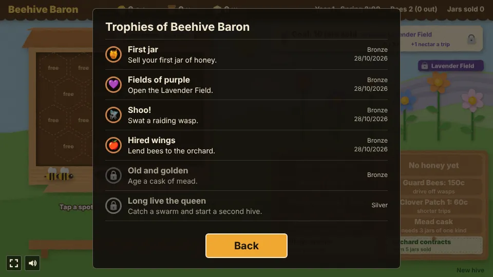

# Beehive Baron

An idle beehive in cut paper. Build comb cells, send your foragers out to the meadow for nectar,
let the full cells ripen into honey, harvest the capped cells and sell the jars. Cells built side by
side earn a comb bonus on every jar, goals of jars sold unlock new meadows on the far hill, and the
bees keep gathering a little nectar while you are away. Each open meadow gives its own honey, a
market shifts which one sells best, village orders pay a premium, wasps raid the capped cells, and
brood cells hatch new bees. The coins (and the wax from each harvest) buy more cells and upgrades,
until the Waggle Dance sends the bees out on their own. The year turns through four seasons, and in
winter the bees stay home and eat honey; casks age jars into mead, a farmer borrows idle bees for
the orchard, a crowded hive swarms into a second one under a queen you pick, meadows foraged
without a break wilt, and the county honey fair, held every late summer, is the ending: its first
gold makes you the Beehive Baron, and each year after asks for more.


## How to play

1. **Build a cell**: tap a spot in the comb. The first cell is free; each one after costs more,
   and wax pays part of it (see below). With a mouse, pointing at an empty spot first shows a green
   preview with its price, the wax it uses and how many built cells it would touch.
2. **Send the foragers**: tap **Send foragers**. Every bee at home flies to a flower and brings
   nectar back. A cell holds 4 drops; nectar that comes home to a full comb is lost.
3. **Harvest**: a full cell ripens into honey and is capped with pale wax. Tap it to fill a jar
   and get a piece of wax, and the cell starts over.
4. **Sell**: tap **Sell** to sell every jar on the shelf. A clover jar is worth 15 coins, plus the
   comb bonus, plus 5 once the Sunflower Ridge is open; other kinds and the market change that.
5. **The hive is kept**: the comb, coins, jars, wax, bees, upgrades, unlocked meadows, where
   the bees forage, the season and the bees' next winter meal, the casks, the hives and the queen, the fair entries and fairs held,
   the tired meadows and the bees lent to the orchard are saved in the browser. Bees out foraging come home when the page reloads, and
   wasps, the market's timer, village orders, contract offers and a gathering swarm start afresh. **New hive**, in the bottom
   right corner, starts over.


### Comb bonus: build cells touching

Every edge two built cells share glows gold and adds **1 coin to every jar you sell**. The plaque
on the hive roof shows the total ("Comb bonus +18c a jar"), and the Sell button's price includes
it. Building a cell next to others pops a green "+3 touching" tag over it, and the build preview
lights the edges it would share in green. A tight cluster pays far more than cells scattered over
the comb: ten cells in a clump share 18 edges, which more than doubles a jar's price.


### Goals unlock meadows

The goal card at the top right names the next goal, the meadow it unlocks and that meadow's
benefit, with a bar of how far along you are. The locked meadow already shows, faded, on the far
hill with a padlock tag. The goals come in a chain, each counting jars sold since the hive began,
and every meadow's benefit lasts for good:

| Goal | Unlocks | Benefit |
| --- | --- | --- |
| 10 jars sold | Lavender Field | Every forager brings 1 more drop a trip |
| 30 jars sold | Sunflower Ridge | Every jar sells for 5 more coins |
| 80 jars sold | Heather Moor | Full cells ripen twice as fast |


### Honey kinds and the market

Each open meadow gives its own nectar, and a cell holds one kind: an empty cell takes whatever
comes home first, then only fills with that kind. Clover grows by the hive, the Lavender Field
gives lavender and the Heather Moor gives heather, each with its own colour of cell and jar.

| Honey | Opens with | Jar price |
| --- | --- | --- |
| Clover | the start | 15 coins |
| Lavender | Lavender Field (10 jars sold) | 18 coins |
| Heather | Heather Moor (80 jars sold) | 22 coins |

After the first sale the **market** board under the hive lists every kind with what a jar of it
sells for now (comb bonus and Sunflower Ridge included). Once two kinds are open, one of them is
**in demand** (a green price with a star) and sells for half as much again; the demand moves on
to the next open kind every minute, and the board counts down to it. Tap a kind on the market to
send the foragers there: the highlighted entry with the little bee is where they go, and the Send
button says which nectar they fetch. Bees already out finish their trip.


### Tired meadows

Once a second kind is open, a meadow tires while bees are out on it: a thin strip under its price
on the market fills up. Give it a break (send the foragers to another kind) and it rests twice as
fast as it tired. A meadow foraged for a whole minute without a break **wilts** until the season
turns: the market says "wilted" and every trip there brings half the nectar (rounded up). Rotate
the kinds, ideally with the market's demand, and no meadow wilts. While only clover is open,
nothing tires.


### Village orders

From 3 jars sold, a note pinned to the board asks for 3 to 5 jars of one open kind within 2
minutes, for example "Order: 4 Heather". Every jar of that kind you sell counts, and once the whole
order is sold it pays a premium of 8 coins per jar on top of the jars' price. A lapsed order pays
nothing, and a new one comes 20 seconds after the last ends. Lavender is only ordered while its
field stays open at least another minute, and its order lapses when autumn shuts the field.

### Wasp raids

From 8 jars sold, a wasp flies in now and then (every 40 to 80 seconds while a cell is capped) and
lands on a capped cell. An orange bar over the cell runs out in 5 seconds, and then the honey is
gone. Tap the wasp to swat it away, or harvest the cell first. **Guard Bees** drive off every wasp
as it lands.


### Brood cells

Bees are not bought: they hatch. Tap **Brood cell** in the shop, then an empty spot (tap the button
again to cancel). A brood cell costs a honey cell's price plus 30 coins and holds no nectar, but it
hatches a new bee every 45 seconds while the hive has fewer than 12 bees (a green ring shows the
next one growing). It counts for the comb bonus like any cell, so it competes with honey cells for
the best spots.


### Wax

Every harvest also gives a piece of wax (shown in the HUD). Wax pays 3 coins of a new cell's price
each, for up to half of it, so the prices on the empty spots and the shop already take it off and
the preview names the wax a build uses. A big comb funds itself.

### While you were away

Close the page and the bees keep foraging, slowly: each bee not lent to the orchard gathers 1 drop per 30 seconds away,
up to **20 drops** a visit, poured into the filling cells (it never spills, and an already full
comb gets nothing). When you come back a chip under the hive says how much they brought, with a
bar against the cap: "While you were away: +12 nectar (cap 20)". It fades after a few seconds, or
when tapped. Cells it fills start ripening as you return.


### Seasons and winter

The year turns through spring, summer, autumn and winter, 2 minutes each; the HUD says which it is
and how long it has left, and the hills change colour with it. Each season changes the rules:

| Season | What happens |
| --- | --- |
| Spring | The bees fly as usual. A new hive starts in early spring. |
| Summer | Every forager brings 1 more drop a trip. Once the Heather Moor is open, its last minute is the county fair. |
| Autumn | The Lavender Field shuts: no lavender nectar, and the market and orders skip it. Foragers sent there go back to clover. |
| Winter | The bees stay home: no trips, no idle foraging, no away nectar, no orchard contracts, and brood cells rest. Every 20 seconds they eat a jar from the shelf for every 4 bees (at least one jar, the cheapest kind first); with no jar they eat a capped cell's honey, and with no honey at all a bee starves (the last bee never). |

So selling everything before winter is a gamble: keep jars or capped cells back to feed the hive,
or put honey in casks, which the bees never touch. Every spring the HUD counts another year
survived.


### Mead casks

**Mead cask** in the shop takes 3 jars of one kind (the kind you have most of) and ages them for
90 seconds into a cask of mead on the right end of the shelf (a ring shows it aging, the cask
glows when it is ready). Mead sells with the jars on **Sell**, for a multiple of what the three
jars would have sold for the moment they went in: clover x1.5, lavender x1.6, heather x1.8. The
cellar holds 3 casks. Cash now, or more later; and mead keeps through winter.


### Orchard contracts

From 5 jars sold, a farmer pins a contract to the board now and then: "Orchard: lend 4 bees,
+100c". Tap it, with that many bees at home, and they go to the orchard for 90 seconds, paid up
front at 25 coins a bee; they bring no nectar meanwhile and the HUD counts them as lent. The offer
stands for 40 seconds, the farmer never asks for your last bee, and no contracts come in winter.
Idle bees get a second job.


### Swarming into a second hive

A hive with every spot built and 12 bees is crowded, and a swarm gathers: a chip above the buttons
counts down 45 seconds, after which half the bees leave. Tap the chip before then to catch the
swarm into a **second hive** for 180 coins, and pick its queen. It has its own comb of 20 spots (its first cell free,
then the same rising prices), its own comb bonus (added to the plaque), and the hive can now hold
24 bees. Tabs on the roof switch between the two combs; nectar fills both, a wasp brings its comb
to the front, and the brood and build previews work on the comb shown.

The queen's bees are the half of the swarm that would have left, plus every bee her brood cells
hatch. Each queen has her own gift, and the plaque on her comb names her:

| Queen | Gift |
| --- | --- |
| Gentle | Wasps never raid her comb |
| Hardy | Her bees eat half as much in winter (a jar for every 8 of them, not 4) |
| Busy | Her bees bring 1 more drop of nectar a trip |


### The county honey fair

Once the Heather Moor is open, the goal card becomes the fair's. The fair is held every year in
the **last minute of summer**; until then the card counts down to it and names its classes and
the points gold needs. While it is on, tap the card, then a capped cell, to enter that cell's
honey: it scores one point for every capped cell of the same honey it touches (up to 6), the cell
gives its wax and starts over, and a higher entry replaces a lower one of the same class. Once
every class is entered and the points reach gold, you win this year's gold; the first gold makes
you the Beehive Baron, with an end card, and you keep playing. Autumn closes the fair: the card
says how it went and the entries are cleared for next year. A judge wants a cluster: cap a ring
of one kind around a cell before you enter it.

Every fair after the first asks for more and adds a class, a ladder after the ending:

| Fair | Classes | Gold needs |
| --- | --- | --- |
| 1st | Clover, Lavender, Heather | 14 points |
| 2nd | + Mead: tap a ready cask while entering (clover 4, lavender 5, heather 6 points) | 17 points |
| 3rd | + Fresh: a jar from a cell whose first drop came this summer (it counts for its kind too) | 20 points |
| later | the same five classes | 3 more each year, up to 28 |


### Trophies

Ten trophies, listed behind the Trophies button on the start and pause screens and counted on the
hub's card. Each pops up at the top of the page once, when it is earned.

| Tier | Trophy | Earned by |
| --- | --- | --- |
| Bronze | First jar | Selling your first jar of honey |
| Bronze | Fields of purple | Opening the Lavender Field |
| Bronze | Shoo! | Swatting a raiding wasp |
| Bronze | Hired wings | Lending bees to the orchard |
| Bronze | Old and golden | Ageing a cask of mead |
| Silver | Long live the queen | Catching a swarm for a second hive |
| Silver | Every meadow | Opening all three meadows |
| Silver | Full shelves | Selling 100 jars |
| Gold | Beehive Baron | Winning gold at the county fair |
| Gold | Blue-ribbon keeper (hidden) | Winning gold at three county fairs |



### What the coins buy

| Buy | Ranks | What it does |
| --- | --- | --- |
| Comb cell | one per spot (20 spots): free, then 12 coins, rising 25% per cell (wax pays up to half) | Room for 4 more drops of nectar, and comb bonus for each built cell it touches |
| Brood cell | one per spot: a comb cell's price plus 30 coins (wax pays up to half) | A new bee every 45 seconds (not in winter), up to 12 bees, and comb bonus like any cell |
| Pollen Baskets | 3 (40, 120, 320 coins) | Every forager brings one more drop a trip |
| Clover Patch | 3 (60, 180, 480 coins) | Trips take 20% less time per rank |
| Waggle Dance | 1 (250 coins) | Bees at home fly out by themselves, as many as the comb has room for |
| Guard Bees | 1 (150 coins) | Every wasp is driven off as it lands, before it steals anything |
| Mead cask | up to 3 at a time, 3 jars of one kind each | Mead worth 1.5 to 1.8 times the jars, 90 seconds later |
| Catch the swarm | once (180 coins), when the hive is crowded | A second hive with its own comb, room for 12 more bees and a queen of your pick |

The difficulty, set on the hub page's Settings, changes one thing: foraging trips take 25% less
time on Easy and 30% more on Hard.

## Running locally

`npm run dev` at the repo root, then open `/games/beehive-baron/` (or pick Beehive Baron on the hub
page).

## Playthrough test

`e2e/playthrough.spec.ts` plays the first jar of honey in headless Chromium: it checks the new
hive, checks the foragers stay home while there is no comb, builds the first cell, sends the two
foragers out twice until the cell is full, waits for it to ripen and be capped, harvests it and
sells the jar for 15 coins (a lone cell touches nothing, so no comb bonus, and one jar is short of
the first goal, so no meadow unlocks). Along the way it checks the first jar is clover honey and
that its harvest gave a piece of wax. Like the other games' tests it owns the game clock and plays
at 4x speed (`PLAYTHROUGH_SPEED`). The **Playthrough Beehive Baron** workflow
(`.github/workflows/playthrough.yml`) runs it on every PR that touches this folder or
the workflow, and uploads the video and screenshots as the `playthrough-beehive-baron` artifact.

```sh
npx playwright test --project beehive-baron
```

## Code layout

All paths are inside `games/beehive-baron/`.

- `src/game/`: the rules in plain TypeScript with no Phaser dependency. `state.ts` holds the hive,
  its numbers, prices and the comb bonus, `sim.ts` builds, forages, ripens, hatches, harvests,
  sells, buys, turns the seasons, runs the market, wasp raids, village orders, orchard contracts,
  casks, swarms, tired meadows and the fair and adds the nectar gathered while away, `honey.ts` is
  the kinds of honey, `meadows.ts` the chain of goals, `upgrades.ts` the upgrade table, `wasps.ts`,
  `orders.ts`, `seasons.ts`, `mead.ts`, `swarm.ts` (and the queens), `contracts.ts`, `tired.ts` and
  `fair.ts` their numbers, and `save.ts`
  keeps the hive.
- `src/scenes/`: `BootScene` bakes textures, `GameScene` draws the hive and turns taps into rules
  calls, `layout.ts` says where things are drawn.
- `src/art/`: the cut-paper art, painted on canvases at startup: `paper.ts` cuts card with
  shadows and grain, `scenery.ts` the meadow, meadows, hive, flowers, jar, comb cells and UI cards,
  `bees.ts` the bee and the wasp.
- `src/ui/`: the paper buttons.
