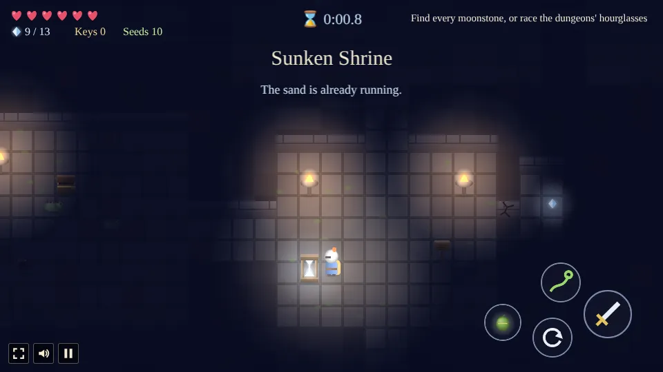
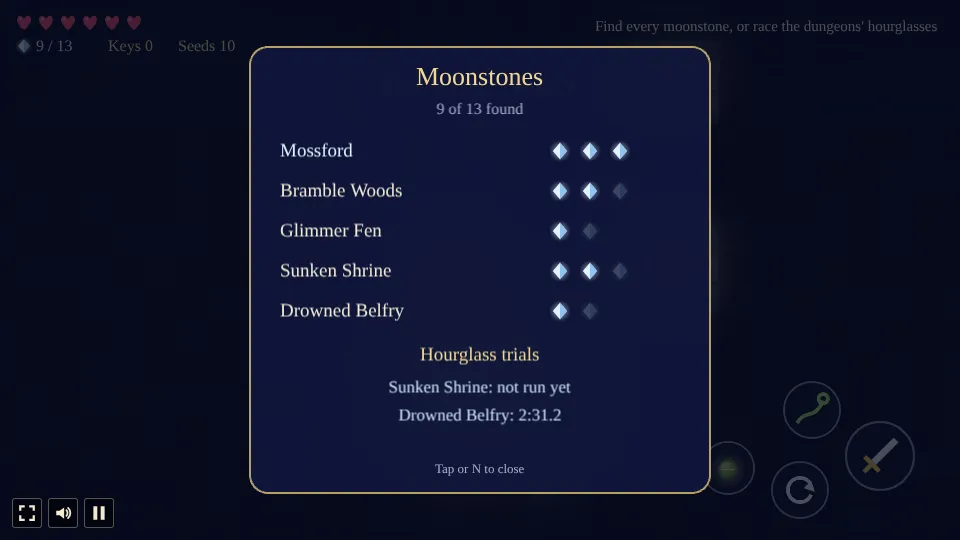

# Bramblecrest

A top-down adventure built with [Phaser 4](https://phaser.io), TypeScript and Vite, part of the
[game hub](../../README.md).

A small knight in a lamplit village at night. Thorns keep creeping over Mossford's north gate, and
Elder Wren has a job for you: fetch your grandfather's old blade, cut the gate free and find out
what grows the thorns. Beyond the gate lie Bramble Woods, a misty fen across the river and a shrine
sunk deep in the roots, with a new tool inside that opens more of the world. In the second chapter
a bell starts tolling under the fen at midnight, and the hermit's bellseeds open the way down to
it. Everything is drawn as a soft 3D miniature by moonlight: lamp glow, glowing mushrooms, fog and a
tilt-shift haze.

The kingdom keeps secrets. Moonstones are hidden on every map, and most of them are not lying in
plain sight. People drop hints if you listen, and how many stones you carry home changes how each
chapter ends.

## How to play

- **Walk** with WASD or the arrow keys, or click or tap the ground. Tapping a person, chest, sign,
  bush or foe walks over and talks, opens, reads, cuts or attacks.
- **Steer by touch**: put a finger down anywhere on the world and drag. A steering stick appears
  where the finger went down and the knight walks the way you drag; the stick follows a finger that
  goes past its rim, and a quick tap still walks to what you tapped. Another finger can use the
  buttons meanwhile.

- **Space**, **J** or the sword button talks to or opens what is in front of you, and otherwise
  swings the sword. The sword cuts bushes and thorns too.
- **Shift**, **K** or the roll button rolls out of the way; nothing hits you mid-roll.
- **Q**, **L** or the vine button throws the hookvine once you have it. It pulls you to golden
  posts, across water and pits, and it does a few other things worth finding out.
- **B**, **X** or the seed button plants a bellseed once you have them. Step back: it swells and
  bursts, breaking boulders and cracked walls and hurting anything close, you included. Tapping a
  boulder or cracked wall walks over and plants one. Old Sedge refills your pouch, and cut bushes
  and beaten foes sometimes drop a seed pod.
- The journal line at the top right always says what to do next.

### Chapter one: the Thornmother

1. Talk to Elder Wren in the square. She sends you for the old blade in the chest by the shed.
2. Bring the blade back to her, then cut the thorns at the north gate.
3. Find the Sunken Shrine in Bramble Woods. It has a locked door, a stone block that wants to be
   somewhere else, a chasm and a tool in a chest behind iron bars.
4. Face the Thornmother at the bottom of the shrine. Her bulbs are her weak spot, but you can't
   reach them from where you stand.
5. Bring the news back to the elder.

### Chapter two: the Drowned Bell

1. Ask Elder Wren about the bell that tolls under the fen at night.
2. Old Sedge in Glimmer Fen knows where it rings from, and gives you a pouch of bellseeds.
3. Open the way into the Drowned Belfry. Inside are cracked walls, three bells that want to be rung
   in the right order, a flooded room and the key to the bell tower's hall.
4. Face the Bellwraith. Its great bell hunts you from above and slams down; it is only open to a
   blade when something knocks it over.
5. Tell the elder the bell is quiet.

### After the end

Once chapter two is told, the kingdom stays open, and there is more to do in it:

- **Moonstone page.** **N**, or a tap on the moonstone counter, opens a page with each place's
  moonstones, the found ones lit, so you know where to look again (but not where).
- **Hourglass trials.** An hourglass now stands by the door of the shrine and of the belfry. Turn
  it and every foe in that dungeon wakes again and its boss rises stronger: the Thornmother's bulbs
  drop faster and her volleys come thicker, and the Bellwraith hunts faster and takes more hits. A
  clock runs at the top until the boss falls, and the moonstone page keeps your best time. Leaving
  the dungeon or falling ends the trial.

### Hearts and falls

You have three hearts on Normal (five on Easy, two on Hard). Foes, thorn seeds, bursts and the
bosses cost half a heart a hit, and the Bellwraith's bell a whole heart if it lands on you. Cut bushes now and then drop a heart, and heart vessels add one for good.
Fall and you wake where you last came in, healed; nothing is lost.

### Secrets

There are eight moonstones in chapter one, and five more turn up once chapter two starts. A few
hints, and no more:

- Listen to the people of Mossford, and to anyone you meet past the river.
- Not every tree casts a shadow.
- Statues look at things for a reason.
- A wisp that runs from you is not always running away.
- Be kind to animals. More than once.
- A rock that sits where no rock should is worth a second look.
- Builders hide what they don't want found, and ringers what they don't want drowned.

## Running locally

From the repository root, `npm run dev` and open `http://localhost:5173/games/bramblecrest/`.

## Playthrough test

`e2e/playthrough.spec.ts` plays the first quest in headless Chromium with real taps: it talks to
Elder Wren, takes the Old Blade from the chest by the shed, brings it back and cuts the thorns at
the north gate, checking the quest, items, flags and save at each step. Run it with
`npx playwright test --project bramblecrest`.

## Code layout

| Path | What it holds |
| --- | --- |
| `src/main.ts` | Creates the game and hands it to the hub's `setupGame` and `setupScaling` |
| `src/howToPlay.ts` | The How to play shown on the start and pause screens |
| `src/game/maps.ts` | The five maps as tile grids, with their people, chests, signs, exits, foes, posts, doors, blocks, plates, rooms and moonstones |
| `src/game/state.ts` | The save: where the knight is, hearts, items, keys, moonstones, flags, the quest and the trials' best times |
| `src/game/talk.ts` | What each person says, by where the quest stands |
| `src/game/path.ts` | A* for tap-to-walk |
| `src/art/paint.ts` | Every sprite, painted onto canvases in soft 3D |
| `src/art/ground.ts` | Paints each map's ground into one texture |
| `src/scenes/GameScene.ts` | The world: walking, the sword, the hookvine, bellseeds, foes, puzzles, the bosses and the story |
| `src/scenes/foes.ts` | Foe stats, bellseed timings and the two bosses' timings, and how much harder they are in a trial |
| `src/scenes/light.ts` | The night: the dark, the lamp glow and the miniature haze |
| `src/scenes/hud.ts` | Hearts, moonstones, keys, bellseeds, the journal line, dialog, touch buttons, the trial's clock, the moonstone page and the end card |
| `src/scenes/layout.ts` | The view, speeds, reaches and button positions |
