# Bramblecrest

A top-down adventure built with [Phaser 4](https://phaser.io), TypeScript and Vite, part of the
[game hub](../../README.md).

A small knight in a lamplit village at night. Thorns keep creeping over Mossford's north gate, and
Elder Wren has a job for you: fetch your grandfather's old blade, cut the gate free and find out
what grows the thorns. Beyond the gate lie Bramble Woods, a misty fen across the river and a shrine
sunk deep in the roots, with a new tool inside that opens more of the world. In the second chapter
a bell starts tolling under the fen at midnight, and the hermit's bellseeds open the way down to
it. In the third, a cold light burns on the Hollow Peaks north of the woods, and only an old
lantern that shows hidden ways leads to it. In the fourth, the wind turns salt and the tide goes
out and stays out: east of the fen lies the Tidewrack Coast, an old keeper's gust horn and a sea
cave with something in its pool. Everything is drawn as a soft 3D miniature by moonlight: lamp glow, glowing mushrooms, fog and a
tilt-shift haze.

The kingdom keeps secrets. Moonstones are hidden on every map, and most of them are not lying in
plain sight. People drop hints if you listen, and how many stones you carry home changes how each
chapter ends.

## How to play

- **Walk** with WASD or the arrow keys, or click or tap the ground. Tapping a person, chest, sign,
  bush or foe walks over and talks, opens, reads, cuts or attacks.
- **Steer by touch**: put a finger down anywhere on the world and drag. A steering stick appears
  where the finger went down and the knight walks the way you drag; the stick follows a finger that
  goes past its rim, and a quick tap still walks to what you tapped. Another finger can use the
  buttons meanwhile.

- **Space**, **J** or the sword button talks to or opens what is in front of you, and otherwise
  swings the sword. The sword cuts bushes and thorns too.
- **Shift**, **K** or the roll button rolls out of the way; nothing hits you mid-roll.
- **Q**, **L** or the vine button throws the hookvine once you have it. It pulls you to golden
  posts, across water and pits, and it does a few other things worth finding out.
- **B**, **X** or the seed button plants a bellseed once you have them. Step back: it swells and
  bursts, breaking boulders and cracked walls and hurting anything close, you included. Tapping a
  boulder or cracked wall walks over and plants one. Old Sedge refills your pouch, and cut bushes
  and beaten foes sometimes drop a seed pod.
- The journal line at the top right always says what to do next.
- **Coins** drop from cut bushes now and then and from every beaten foe. Marla the baker sells a
  hearty pie (one more heart) and light boots (a longer roll, sooner again) once you have the
  blade; Old Sedge sells a bigger bellseed pouch (15 instead of 10) and a long vine (the hookvine
  reaches much farther) once he has given you bellseeds. Talk to them to see their wares; tap a
  price, or press 1 or 2, to buy.
- **H**, **C** or the horn button blows the gust horn once you have it (chapter four). Its wind
  shoves foes back and makes them reel, brings lantern moths down, blows shots out of the air and
  turns windmills and pinwheels.
- **Fishing.** A fishing rod waits in a chest by Mossford's pond. Face water and press Space, J or
  the sword button (or tap the water) to cast; when the float dips, press again (or tap) to pull.
  Perch bite in the village pond, eels in the woods' river and the fen, bream off the coast;
  nothing bites in the dungeons' water. Walking or rolling away pulls the line in. Your creel holds
  five of each.
- **Cooking.** At a campfire (in Mossford, by Sedge's hut, by Tam's and by Nell's) cook two fish
  into a meal that lasts until you next fall: perch stew (one more heart), eel skewers (a faster
  roll, sooner again) or bream chowder (the hookvine reaches farther). One meal at a time.

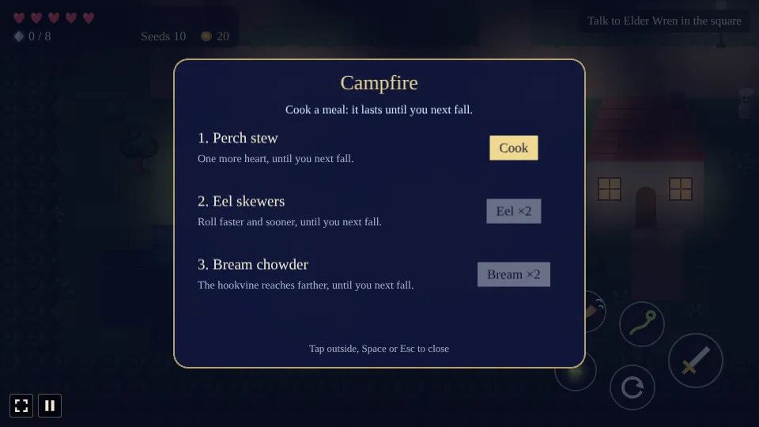

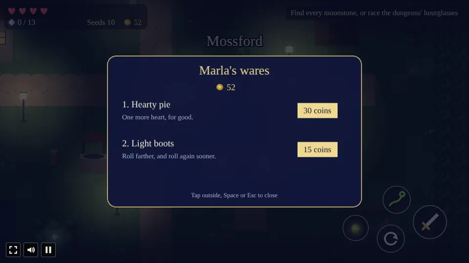

### Chapter one: the Thornmother

1. Talk to Elder Wren in the square. She sends you for the old blade in the chest by the shed.
2. Bring the blade back to her, then cut the thorns at the north gate.
3. Find the Sunken Shrine in Bramble Woods. It has a locked door, a stone block that wants to be
   somewhere else, a chasm and a tool in a chest behind iron bars.
4. Face the Thornmother at the bottom of the shrine. No blade cuts her ring of thorns, but her
   three bulbs are her weak spot: when one glows, face it and throw the hookvine to pull it down,
   then strike it twice before it rises again. Roll through her thorn volleys and keep her slugs
   off you; once all three bulbs are gone, she withers.
5. Bring the news back to the elder.

### Chapter two: the Drowned Bell

1. Ask Elder Wren about the bell that tolls under the fen at night.
2. Old Sedge in Glimmer Fen knows where it rings from, and gives you a pouch of bellseeds.
3. Open the way into the Drowned Belfry. Inside are cracked walls, three bells that want to be rung
   in the right order, a flooded room and the key to the bell tower's hall.
4. Face the Bellwraith. Its great bell hunts you from above and slams down; it is only open to a
   blade when something knocks it over.
5. Tell the elder the bell is quiet.

### Chapter three: the Hollow Peaks

1. Ask Elder Wren about the cold light on the peaks. The rockfall on the pass north of the woods
   has cleared.
2. Tam the goatherd lives up there. The old watchers' lookout east of his hut, sealed by a boulder,
   still holds their lamp: the **Moonlantern**.
3. A chasm cuts the peaks in two. Its bridge is there, but only the Moonlantern's light shows it,
   and only a few steps around you: feel your way across, and mind the branches that lead
   elsewhere.
4. The Glass Caverns lie past it: cracked ice, another hidden bridge, a gap for the hookvine, and
   shades that only show in your light.
5. Face the **Gloamwing**. It circles high over its hall shedding frost, then marks your spot with
   its shadow and dives. Right after a dive it hangs low: catch it with the hookvine, pull it down
   and strike.
6. Tell the elder the peaks are dark again.

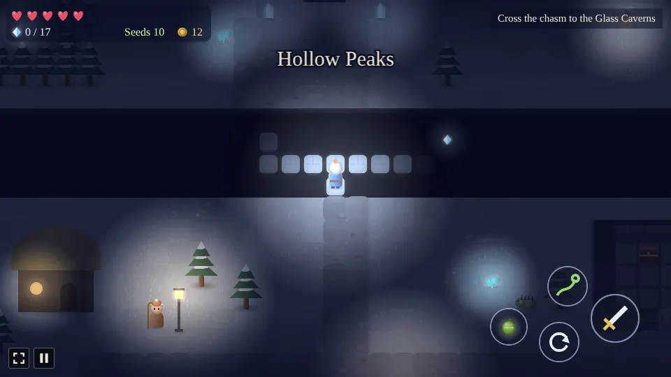

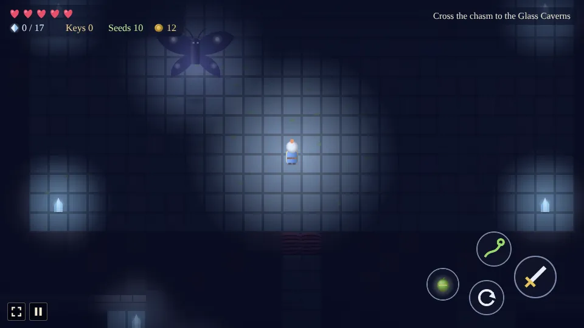

### Chapter four: the Tidewrack Coast

1. Ask Elder Wren about the wind from the sea. The rocks on the path east of the old bell tower
   have fallen away.
2. Nell the fisher lives on the Tidewrack Coast. The tide went out a week ago and never came back,
   and the way to the sea cave lies under an inlet that never drains.
3. The old keeper's **gust horn** is on an islet off the strand, across the water on the hookvine.
4. Blow the horn at the windmill: its pump drains the inlet and opens the way north to the sea
   cave, the **Brine Grotto**. Inside: two pinwheels that want wind, a tide channel for the
   hookvine, cracked rock, crabs and the key to the hall.
5. Face the **Brinewyrm**. It swims under its pool, rises at one edge and spits brine. While it is
   up it is too slick for a blade: blow it ashore with the horn and strike while it flops.
6. Tell the elder the tide has turned.

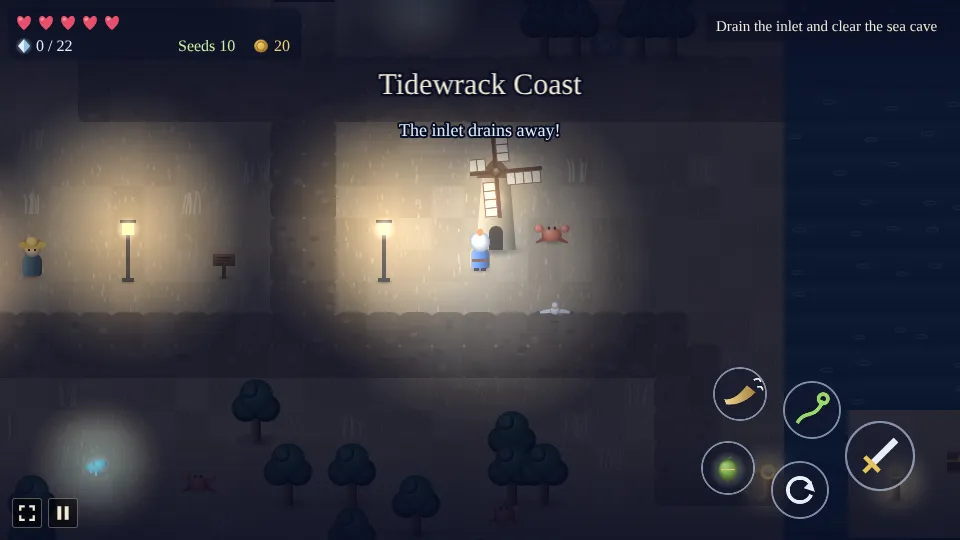

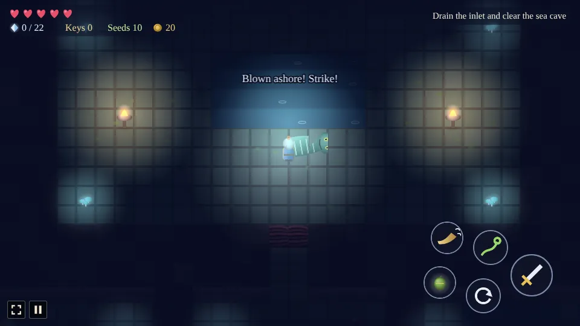

### Requests

Once the first chapter is told, people start asking for small favours, and the journal keeps track
of them. Bring them what they lost and each pays you back: Marla wants three fen lilies (a heart),
Pip his toy boat that drifted across the river (a whetstone: your sword reaches farther), Elder
Wren three glowcaps for the lamp oil (a deep purse: foes drop two coins), Old Sedge his spectacles,
lost in the belfry (a moon charm: you stay safe longer after a hit) and Tam three goat bells
scattered over the peaks (a heart). Their things only show once they have asked.

### After the end

Once chapter two is told, the kingdom stays open, and there is more to do in it:

- **Journal.** **N**, or a tap on the moonstone counter, opens the journal: each place's
  moonstones, the found ones lit, so you know where to look again (but not where), the requests
  you took and how far along they are, your best trial times, and your creel and meal.
- **Bestiary.** The journal's corner button, or the left and right arrow keys, turn to the
  bestiary: every kind of foe in three families (crawlers, moths and wild things), dark until you
  beat one. Beat three of a kind to fill its page; fill every page of a family and its foes drop an
  extra coin from then on.
- **Hourglass trials.** An hourglass now stands by the door of the shrine and of the belfry, of
  the caverns once the Gloamwing is beaten, and of the grotto once the Brinewyrm is. Turn it and every foe in that dungeon wakes again and
  its boss rises stronger: the Thornmother's bulbs drop faster and her volleys come thicker, the
  Bellwraith hunts faster and takes more hits, the Gloamwing dives sooner and takes more hits, and
  the Brinewyrm spits wider, stays up less long and takes more hits.
  A clock runs at the top until the boss falls, and the journal keeps your best time. Leaving the
  dungeon or falling ends the trial.
- **New game+.** After chapter four, the end card (or Elder Wren, any time after) offers to begin
  again from the first night. You keep your tools, upgrades, coins, the requests you finished, your
creel and your bestiary;
  every foe has half as many hearts again, moves faster and hits twice as hard, the bosses fight as
  in a trial, and the moonstones are buried in new places. Look for their glimmer in your lantern's
  light and swing to dig them up. Each new game+ moves them again.

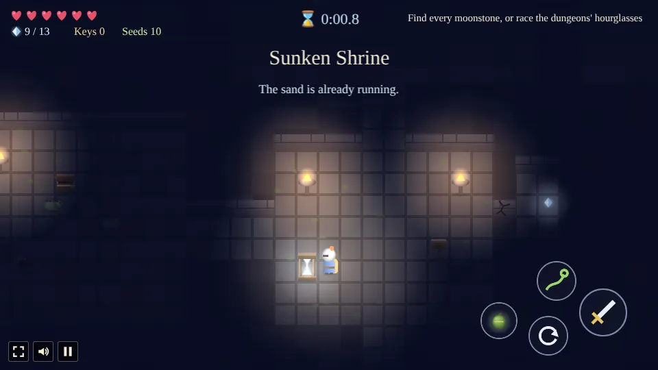

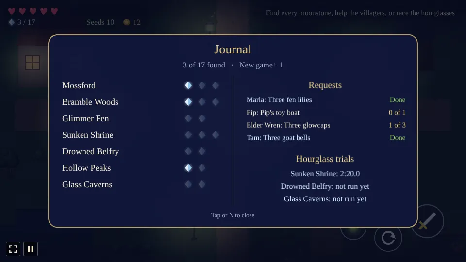

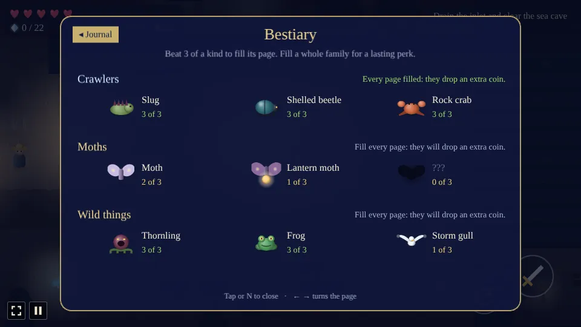

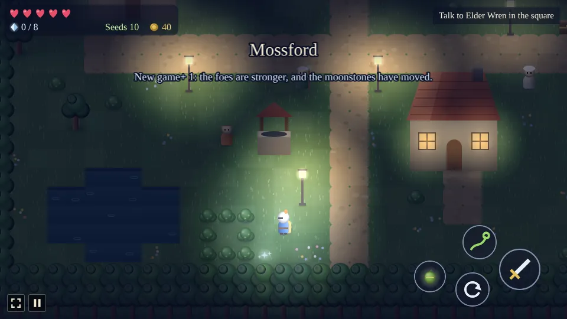

### Foes that need your tools

Most foes fall to the sword, but two don't, and the coast has two of its own:

- **Shelled beetles** turn the blade with their shell. Flip one on its back with the hookvine or a
  bellseed's burst, then strike before it rights itself.
- **Lantern moths** fly too high for the sword and drop embers on you. Pull one down with the
  hookvine, or burst a bellseed under it, and strike while it lies on the ground. A blast of the
  gust horn brings one down too.
- **Rock crabs** scuttle sideways at you along the shore. **Storm gulls** wheel round you and then
  swoop straight through where you stand: roll, or blow them off course with the horn.

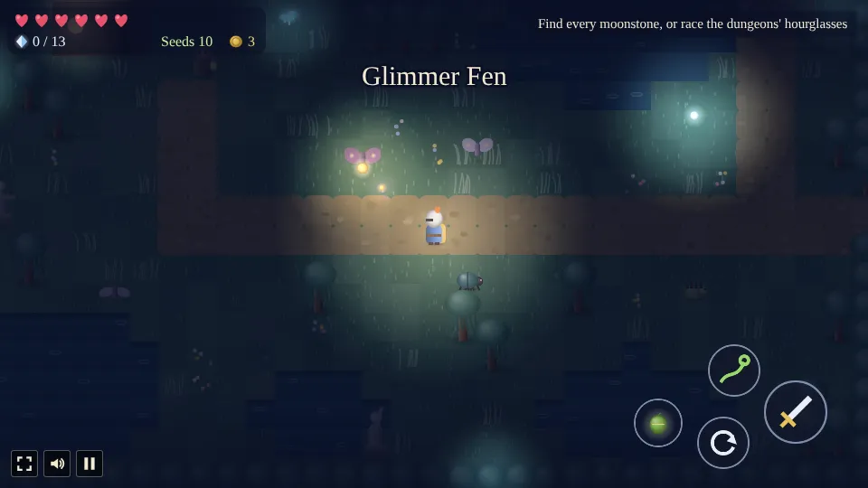

### Trophies

Ten trophies, listed on the start and pause screens: the blade and the first two bosses, the first
upgrade and all four, a beetle flipped and beaten, an hourglass trial, the shrine and belfry trials
under par, every moonstone (all 22, chapter four's included), and one more that stays hidden until
you earn it.

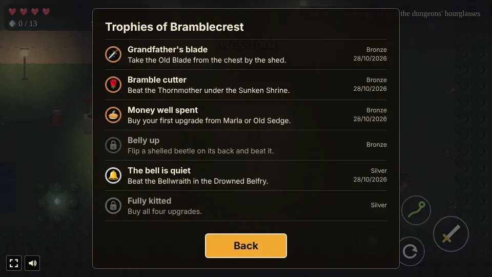

### Hearts and falls

You have three hearts on Normal (five on Easy, two on Hard). Foes, thorn seeds, bursts and the
bosses cost half a heart a hit, and the Bellwraith's bell or the Gloamwing's dive a whole heart if
it lands on you. Perch stew from a campfire adds a heart until you next fall. Cut bushes now and then drop a heart, and heart vessels add one for good.
Fall and you wake where you last came in, healed; nothing is lost.

### Secrets

There are eight moonstones in chapter one, five more turn up once chapter two starts, four more in
chapter three and five in chapter four. A few hints, and no more:

- Listen to the people of Mossford, and to anyone you meet past the river.
- Not every tree casts a shadow.
- Statues look at things for a reason.
- A wisp that runs from you is not always running away.
- Be kind to animals. More than once.
- A rock that sits where no rock should is worth a second look.
- Builders hide what they don't want found, and ringers what they don't want drowned.
- A bridge nobody can see may have more than one end.
- Grandmothers bury things, and grandchildren hear about it.

## Running locally

From the repository root, `npm run dev` and open `http://localhost:5173/games/bramblecrest/`.

## Playthrough test

`e2e/playthrough.spec.ts` plays the first quest in headless Chromium with real taps: it talks to
Elder Wren, takes the Old Blade from the chest by the shed, brings it back and cuts the thorns at
the north gate, checking the quest, items, flags and save at each step. Run it with
`npx playwright test --project bramblecrest`.

## Code layout

| Path | What it holds |
| --- | --- |
| `src/main.ts` | Creates the game and hands it to the hub's `setupGame` and `setupScaling` |
| `src/howToPlay.ts` | The How to play shown on the start and pause screens |
| `src/trophies/` | The ten trophies, their texts and when each is earned |
| `src/game/maps.ts` | The nine maps as tile grids, with their people, chests, signs, exits, foes, posts, doors, blocks, plates, rooms, moonstones, the requests' things, mills, fish and the grotto's pool |
| `src/game/state.ts` | The save: where the knight is, hearts, items, keys, moonstones, flags, the quest, the trials' best times, coins, upgrades, requests, the new game+ cycle, the creel, the meal and the bestiary, and what each upgrade, request and meal gives |
| `src/game/plus.ts` | Where new game+ buries the moonstones |
| `src/game/talk.ts` | What each person says, by where the quest stands |
| `src/game/path.ts` | A* for tap-to-walk |
| `src/art/paint.ts` | Every sprite, painted onto canvases in soft 3D |
| `src/art/ground.ts` | Paints each map's ground into one texture |
| `src/scenes/GameScene.ts` | The world: walking, the sword, the hookvine, bellseeds, the Moonlantern, the gust horn, fishing and cooking, foes, puzzles, the bosses, requests, the bestiary, new game+ and the story |
| `src/scenes/foes.ts` | Foe stats, the bestiary's families, bellseed timings and the four bosses' timings, and how much harder they are in a trial and in new game+ |
| `src/scenes/light.ts` | The night: the dark, the lamp glow and the miniature haze |
| `src/scenes/hud.ts` | Hearts, moonstones, keys, bellseeds, the journal line, dialog, touch buttons, the trial's clock, the journal and bestiary pages, the shops and campfires, and the end and new game+ cards |
| `src/scenes/layout.ts` | The view, speeds, reaches and button positions |
