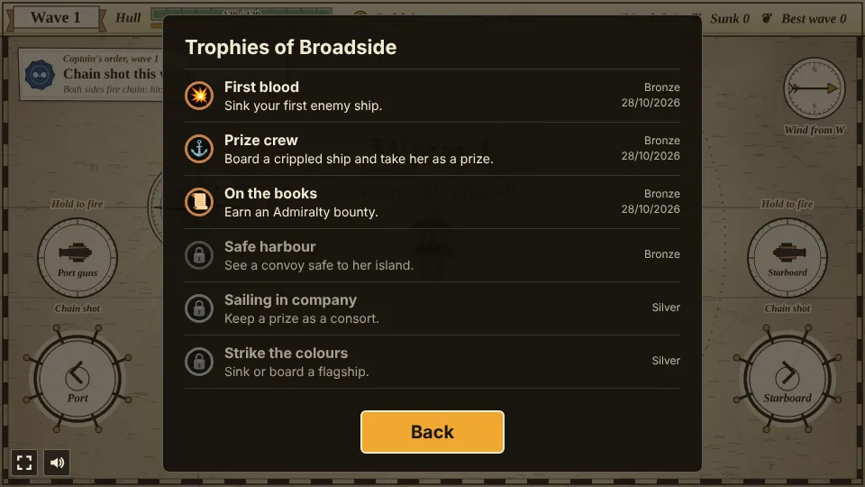

# Broadside

A naval battle prototype built with [Phaser 4](https://phaser.io), TypeScript and Vite, part of
the [game hub](../../README.md).

You captain a pirate ship with black sails, drawn as an engraved miniature on an old hand-tinted
sea chart: parchment with a compass rose and rhumb lines, hatched sea, and islands ringed with
coast form lines. The ship always sails on; you put the helm over to port or starboard, and you
fire the cannons that line its sides yourself. Hold a side's fire control to aim: its firing arc
lights up and a charge fills along the arc's rim, and letting go fires the broadside, further and
harder the longer you held it. Each wave comes with one captain's order, a bonus for that wave,
and its own wind. Sunk ships leave a barrel of plunder floating where they went down; sail over it
to haul it aboard, or sail alongside a crippled ship to board her and take her as a prize. Once a
wave is beaten the ship puts into harbor, where a prize draft offers three perks to keep one of,
and the gold buys a stronger hull, heavier shot, more guns, a faster crew, faster sails and more
sailors, and each side's guns are loaded with the shot you choose. From wave 2 the Admiralty posts
a bounty each wave, a side goal that pays half the wave's loot on top. From wave 6 some islands
carry shore forts that shell you, and the harbor charts two courses for the next wave; from wave 7
every third wave sends a merchantman with you to see safe to an island. A prize can be kept as a
consort that sails on with you from wave to wave, and late drafts offer the second rank of a perk; wave 20 is the pirate haven, three forts and the admiral's
flagship, and sinking her wins the campaign. When your ship goes down, the Admiralty awards
medals that buy a head start for the next run, which can sail a different ship.


## How to play

| Control | Action |
| --- | --- |
| Hold the **Port** wheel (bottom left), Left arrow or A | Turn to the left |
| Hold the **Starboard** wheel (bottom right), Right arrow or D | Turn to the right |
| Hold **Port guns** (above the left wheel) or Q, then let go | Aim, charge and fire the port broadside |
| Hold **Starboard** guns (above the right wheel) or E, then let go | Aim, charge and fire the starboard broadside |
| Tap a card of the prize draft (as the harbor opens) | Keep that perk for the rest of the run |
| Tap a row at the harbor | Buy that upgrade, patch the hull, hire sailors or keep a prize as a consort |
| Tap **Port** or **Starboard** under the harbor's ledger | Load that side with the next kind of shot |
| **Set sail**, or from wave 6 **Merchant lane** or **Hunter patrol** | Leave the harbor for the next wave, on the course chosen |
| Tap **Scuttle the prize** (under the bounty) | Sink your newest prize for twice its loot |
| Tap a ship and rows on the "Sunk!" panel, then **Sail again** | Choose the ship for the next run and spend the Admiralty's medals on starting upgrades |
| **Sail on** (once the haven is razed) | Keep the run going through the waves beyond |

On a phone, one thumb can hold a wheel while the other holds a fire control.

1. **Hold to aim.** The guns no longer fire on their own. At rest each side shows a dotted wedge,
   its firing arc out to the guns' full reach (fainter while that side reloads). Holding a fire
   control turns that wedge into an ochre wash and fills a charge meter, like a sextant's scale,
   along its rim and round the held button. Letting go fires the broadside. An uncharged shot
   reaches 65% of the full range and hits for the base damage; a full charge (one second) reaches
   all of it and hits 50% harder. The gun crews train on the nearest enemy in reach within the arc
   (or just outside it), leading a moving target, and fire straight out if there is none. Each side
   reloads on its own (two seconds), and the two bars under the hull show how loaded they are; a
   side being reloaded doesn't charge until it is loaded.
2. **One captain's order per wave.** A note under the top bar, sealed in blue wax, names one bonus
   for the whole wave. The first wave is always chain shot; every later wave draws a different
   order from the last.

   | Order | Bonus |
   | --- | --- |
   | Chain shot | Both sides fire chain shot this wave, whatever they were loaded with |
   | Grapeshot | Both sides fire grapeshot this wave |
   | Double powder | Shot flies 30% farther and hits 30% harder (round shot shows a powder flash) |
   | Fair wind | Sail and turn 25% faster |
   | Rum for the gun crews | Reload 30% faster |

   Otherwise each side fires the shot it was loaded with at the harbor, named under its fire
   control:

   | Shot | What it does | Looks like |
   | --- | --- | --- |
   | Round shot | Full range and weight | A plain ball |
   | Chain shot | A hit slows the ship by 40% for 4 seconds (a dotted ring) | Two balls on a chain |
   | Grapeshot | 70% of the range, three shots a gun in a fan, each half as hard; a hit slows the ship's reload to half pace for 4 seconds (a ring of dashes) | Small clusters |

3. **Wind.** Each wave has a wind, shown by the arrow on the wind rose in the top right corner
   ("Wind from W"). Every ship sails up to 18% faster running before it and as much slower beating
   into it, and shot fired downwind reaches up to 25% further: the firing arc on the downwind side
   is longer. The first wave's wind always blows from the west; later waves draw one of the eight
   main points.
4. **Boarding.** An enemy ship under a fifth of its hull is crippled: it limps along at 70% of its
   speed inside a dashed ochre ring. Sail alongside it (hull to hull, within about a ship's
   width) for a little over a second, while the ring fills, and you take her instead of sinking her.
   The prize crew patches her to half her hull and she sails with you as an escort for the rest of
   the wave, in a ring of green dots, fighting any enemy near you (a mortar ketch prize holds fire
   while her shell could land on you or a prize); enemies shoot at her too. A
   button under the order card scuttles your newest prize at once for twice her loot; a prize
   still afloat when the wave is beaten is sold in harbor for her loot, unless you keep her as a
   consort (below). Fireships can't be boarded.
5. **Enemy ships** come over the horizon one after another, close in and turn to fire their own
   broadsides, which go off on their own. Their crews aim worse than yours. Rust-coloured arrows at
   the edge of the screen point to ships out of sight.
6. **Enemies steer round islands.** A captain whose way to you is blocked by an island plans a
   course round it, the shorter way, and draws it on the chart as a faint dotted line ending in an
   arrow, labelled with the ship's name. Close in, every captain keeps a lookout and bears off a
   beach ahead, shortening sail to come about in time, so islands make cover to fight round.
7. **Loot**: every sunk ship leaves a barrel of gold that drifts toward your ship once close. It
   sinks after 25 seconds, blinking at the end; ochre arrows point to barrels out of sight. Once
   the last ship of a wave goes down, the crew hauls in every barrel still afloat.
8. **The harbor** opens as soon as the last enemy ship of the wave is sunk, with the prize draft
   first (below). The crew patches a quarter of the hull for free; the rest is 10 gold, and 12
   gold hires 8 sailors. Under the ledger, tap a side to load its guns with the next kind of shot
   (round, chain, grape); loading is free and lasts until changed.
9. **The sea has no edge.** Like on a globe, sailing off the top brings you back in at the
   bottom, and off the left side back in on the right. Enemy ships, loot and cannonballs cross
   over the same way, and the arrows point the shortest way round.
10. **Islands**: the shallows around an island are safe, but a ship that runs onto the sand,
   yours or an enemy's, glances off and takes 8 damage to its hull.
11. **The run is over when your hull is sunk**. "Sail again" starts afresh at wave 1. The best wave
   beaten is kept in the browser.
12. **Admiralty rewards.** At the end of a run the Admiralty awards one medal per wave beaten, and
   2 more for beating your best wave (and 5 more for razing the haven). Medals are kept in the
   browser between runs. On the "Sunk!" panel, tap starting upgrades to choose them for the next
   run (tap again to put one back); the medals are spent when you sail again.

   | Reward | Medals | Next run starts with |
   | --- | --- | --- |
   | Letter of credit | 2 | 40 gold |
   | Refitted hull | 3 | Oak Planking 1 |
   | Picked gun crews | 3 | Heavy Shot 1 |
   | New canvas | 3 | Fast Sails 1 |
   | An extra pair of guns | 5 | More Guns 1 |

13. **The prize draft.** As each harbor opens, three cards offer perks (four after a Hunter
   patrol); tap one to keep it for the rest of the run, at no cost, and the ledger opens. The first
   wave always offers Salvage, Bouncing shot and A mortar of your own; later drafts draw from the
   perks not yet taken, so every run builds differently. Once fewer new perks are left than the
   draft has cards, it fills up with the second rank of perks you hold (headed "Prize: rank 2"),
   so drafts go on until about wave 14.

   | Perk | What it does | Rank 2 |
   | --- | --- | --- |
   | Salvage | Every ship sunk patches 6 hull | Patches 12 |
   | Bouncing shot | A ball of yours that would splash skips once across the water and flies half as far again | Skips twice |
   | A mortar of your own | Every 6 seconds a shell is lobbed at the nearest enemy within 360, bursting for 22 (it holds fire while the shell could land on your own ship or a prize) | Every 4 seconds |
   | Prize gun crews | Your prizes reload twice as fast | Three times as fast |
   | Grapnels | Boarding takes half the time and a prize needs half the crew | A quarter of each |
   | Swivel guns | Broadsides train half as wide again either side (48 degrees instead of 32) | Twice as wide (64 degrees) |
   | Carronades | Shot at a ship inside half your reach hits 50% harder | 75% harder |

14. **Admiralty bounties.** From wave 2, a line under the order card names one side goal for the
   wave and whether it still stands. Met when the wave is beaten, it pays half the loot gathered
   that wave on top (prizes sold and forts razed count), shown on the harbor's ledger.

   | Bounty | Met when |
   | --- | --- |
   | Lose no more than 20 hull | The hull lost this wave (before any patching) stays at 20 or under |
   | Never run aground | Your ship touches no beach this wave |
   | Beat the wave within N seconds | The last ship sinks within 30 seconds plus 8 a ship (never on a convoy wave) |
   | Board a ship and take her as a prize | A prize is taken this wave |
   | Sink the mortar ketch before any brig | Only on waves with both; a ketch goes down or is taken as a prize before the first brig is |

15. **Crew.** Your ship carries sailors (40 on the Frigate), shown at the top; with fewer than a
   full crew every reload is slower in the same share, down to a third of the pace. Grapeshot
   kills a sailor per pellet that hits, and a blast (a shell or a fireship) kills 3 on every ship
   it hurts; round and chain shot never kill crew. Brigs, galleons and flagships load grapeshot
   within about 130 of their target, so close alongside them the deck gets raked. A prize takes
   half her full crew across from yours (a quarter with Grapnels), which slows your own reloads
   while you keep her: you can't board without 4 sailors left aboard after that, scuttling her or
   selling her at the harbor brings them back, and losing her loses them. The harbor hires 8
   sailors for 12 gold. Enemy crews suffer the same way under your grapeshot.
16. **Shore forts.** From wave 6 an island carries a fort (two from wave 12), a stone star that
   shells your ship like a mortar ketch whenever you are within 340 (16 damage every 5 seconds, a
   rust ring marking the spot). Your shot and shells batter it; razed, it pays 50 gold plus 5 a
   wave straight into the hold. Forts are optional: the wave is beaten once its ships are sunk.
17. **The pirate haven.** Wave 20 brings three forts and the admiral's flagship, the biggest ship
   afloat (five guns a side, 300 gold). Sinking her wins the campaign: the end card awards the
   medals and offers **Sail on**, which puts into harbor and carries the run on through the waves
   beyond (the forts and flagships keep coming), or **Sail again** from wave 1.
18. **Choose your ship.** The "Sunk!" panel picks the ship for the next run; the first run always
   sails the Frigate, and the choice is kept in the browser. Each has its own crew, and a hull
   upgrade adds 30 to any of them.

   | Ship | Unlocked by | Hull | Guns a side | Speed | What else |
   | --- | --- | --- | --- | --- | --- |
   | Frigate | the start | 120 | 2 (10 damage, 2 s reload, range 260) | 90 | 40 sailors |
   | Cutter | best wave 3 | 90 | 1 heavy gun (14 damage, 1.5 s reload, range 240) | 114, turns faster | 24 sailors |
   | Bomb Ketch | best wave 6 | 150 | 2 to port (10 damage, 2.2 s, range 250); a mortar to starboard | 70, turns slowly | 36 sailors; holding the starboard control aims a shell that lands where the arc reaches two seconds later, bursting for 26 (more when charged); it always lands clear of your own hull, now and where you'll be |

19. **Choose the next course.** From the harbor after wave 5, "Set sail" becomes two buttons, one
   per charted course for the next wave (not the haven), and the wave's banner names it:

   | Course | The wave brings |
   | --- | --- |
   | Merchant lane | Three merchantmen among the warships. They carry no guns and run from you, and one that runs for 30 seconds gets clean away ("She got away!"). Every ship sunk, scuttled or sold that wave pays double loot |
   | Hunter patrol | Two more brigs, and the prize draft after the wave has four cards instead of three |

20. **Keep a consort.** The harbor's "Keep a consort" row buys back the richest prize sold there
   for her sale price: her prize crew goes across again and she sails into the next wave with
   you, setting out astern, and on from wave to wave while she floats. The crew patches a quarter
   of her hull as soon as she is kept, and each harbor after she draws a wage of half her wave 1
   loot (a brig 13 gold) and is patched again; one
   the purse can't pay is paid off and sold. You can keep two at once, and scuttling one sinks
   her for double loot as with any prize.
21. **Convoy waves.** From wave 7, every third wave (7, 10, 13, 16, 19 and on, never the haven)
   a laden merchantman sets out astern of you for an island at least 500 away, named on the
   wave's banner and a green line under the order card, and a dashed green ring marks where she
   must reach; a green arrow points to it when off screen. She sails slower than you and steers
   round other islands on her own; the enemy's sloops and fireships hunt her instead of you. If
   she gets there she pays her cargo (90 gold plus 6 a wave) straight into the hold; sunk, it is
   lost. The wave isn't over until she arrives or is sunk.


### Enemy ships

| Ship | From | What it does |
| --- | --- | --- |
| Sloop | wave 1 | Small and quick, one gun a side, 10 gold |
| Brig | wave 3 | Two guns a side and twice the timber, 25 gold; loads grapeshot up close |
| Galleon | wave 5 | Slow, three guns a side and very tough, 60 gold; loads grapeshot up close |
| Fireship | wave 3 | No guns, faster than you; sails straight at you and blows up alongside (26 damage to every ship near), and blows up too when sunk. Rammed, it leaves no loot. 12 gold |
| Mortar ketch | wave 4 | Keeps its distance and lobs a shell every few seconds; a rust ring marks where it will land, two seconds later, where you'd be holding your course. 20 damage to any ship under it. 30 gold |
| Flagship | every fifth wave | Comes last, four guns a side and the toughest hull, its hull bar always shown, 150 gold; loads grapeshot up close |
| Admiral's flagship | wave 20 | The haven's last ship: five guns a side, 440 hull, 300 gold. Sinking her wins the campaign |
| Merchantman | Merchant lane waves | No guns; runs from you and gets away after 30 seconds. 40 gold (doubled on the lane). Also the convoy you escort |

Every wave brings one more sloop than the last, and enemy hulls (and forts) get 12% tougher each wave.

### Upgrades

| Upgrade | Ranks | What it does |
| --- | --- | --- |
| Oak Planking | 5 | +30 hull, and patches 30 of it |
| Heavy Shot | 5 | Cannonballs hit 25% harder |
| More Guns | 3 | One more cannon each side |
| Drilled Crew | 4 | Reload 15% faster |
| Fast Sails | 3 | Sail and turn 12% faster |

Below them, "Patch the hull" repairs the ship for 10 gold and "Hire sailors" brings 8 aboard for
12 gold, up to a full crew.


### Trophies

Nine trophies, listed behind the Trophies button on the start and pause screens and counted on the
hub's card. Each pops up at the top of the page once, when it is earned.

| Tier | Trophy | Earned by |
| --- | --- | --- |
| Bronze | First blood | Sinking your first enemy ship |
| Bronze | Prize crew | Boarding a crippled ship and taking her as a prize |
| Bronze | On the books | Earning an Admiralty bounty |
| Bronze | Safe harbour | Seeing a convoy safe to her island |
| Silver | Sailing in company | Keeping a prize as a consort |
| Silver | Strike the colours | Sinking or boarding a flagship |
| Silver | Old salt | Clearing wave 10 |
| Gold | Scourge of the haven | Sinking the admiral's flagship to win the campaign |
| Gold | Terror of the seas (hidden) | Winning the campaign on Hard |



The difficulty, set on the hub page's Settings, changes one thing: enemy ships and forts have 25% less health on Easy and 30% more on Hard.

## Running locally

`npm run dev` at the repo root, then open `/games/broadside/` (or pick Broadside on the hub
page).

## Playthrough test

`e2e/playthrough.spec.ts` plays the first wave in headless Chromium. It holds the helm wheels
down to check that the ship turns each way and sails straight on once let go, and checks that the
first wave's order is chain shot, its wind blows from the west and both sides start loaded with
round shot. Then it steers by the wheels to close on each sloop and turn
side-on, holds that side's fire control (checking that the broadside charges without firing),
lets go once the charge reaches the sloop, and checks that chain shot flew and that the sloop it
hit is slowed. It fights on the same way until both sloops are sunk, checks the gold from the loot
(sailed over, or hauled in when the wave ends), waits for the harbor, keeps the first card of
the prize draft (Salvage), buys Heavy Shot with the plunder, loads the starboard guns with chain
shot and sets sail for wave 2. Like the other games' tests it owns the game clock and plays at
4x speed (`PLAYTHROUGH_SPEED`). The **Playthrough Broadside** workflow
(`.github/workflows/playthrough.yml`) runs it on every pull request that changes
`games/broadside/` or the workflow itself, and uploads the video and screenshots as the
`playthrough-broadside` artifact.

```sh
npx playwright test --project broadside
```

## Code layout

All paths are inside `games/broadside/`.

- `src/game/`: the rules in plain TypeScript with no Phaser dependency. `ships.ts`,
  `upgrades.ts`, `orders.ts` (the captain's orders), `shot.ts` (the kinds of shot),
  `admiralty.ts` (the medals' rewards), `hulls.ts` (the player's ships), `perks.ts` (the prize
  draft) and `bounties.ts` (the Admiralty's bounties) are data tables, `waves.ts` says what each
  wave brings (and which carry forts, and the haven), `state.ts` holds the run and works out the
  player's ship from its hull, the upgrades bought, the perks and the wave's order, `sim.ts`
  sails the ships (enemy captains plan their way round islands), charges and fires the
  broadsides, shells from forts and mortars, boards prizes, keeps the crew and runs the harbor,
  and `save.ts` keeps the best wave, the medals and the ship chosen.
- `src/scenes/`: `BootScene` paints the textures, `GameScene` draws the chart, follows the ship
  with the camera across the wrapping sea and wires the helm wheels, fire controls and keys to the
  rules, `soundCues.ts` turns what each frame changed into sound and music, `layout.ts` says
  where things are drawn.
- `src/audio.ts`: the music (a sea-shanty jig in D Dorian) and the sound effects, all made in code.
- `src/art/`: the chart, ships, shot, plunder, controls and panels, painted on canvases in code
  and added as textures at startup.
- `src/ui/`: the harbor panel and buttons.

Adding an upgrade is an entry in `src/game/upgrades.ts` and its effect in `stats` in
`src/game/state.ts`; adding a captain's order is an entry in `src/game/orders.ts` (plus a seal
emblem in `bakeSeal` in `src/art/art.ts`); adding an enemy ship is an entry in
`src/game/ships.ts`, a look in `src/art/art.ts` and a place in `src/game/waves.ts`; adding a
perk is an entry in `src/game/perks.ts` and its rule in `src/game/sim.ts`; adding a bounty is an
entry in `src/game/bounties.ts`; adding a ship for the player is an entry in `src/game/hulls.ts`
and a look in `src/art/art.ts`.
