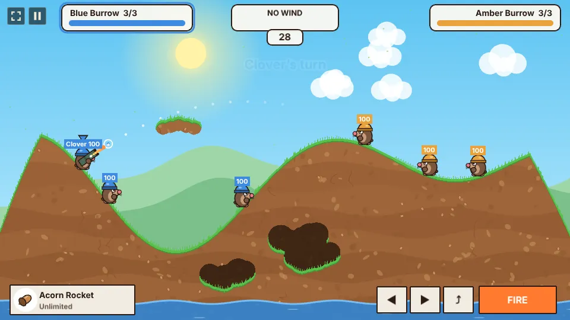
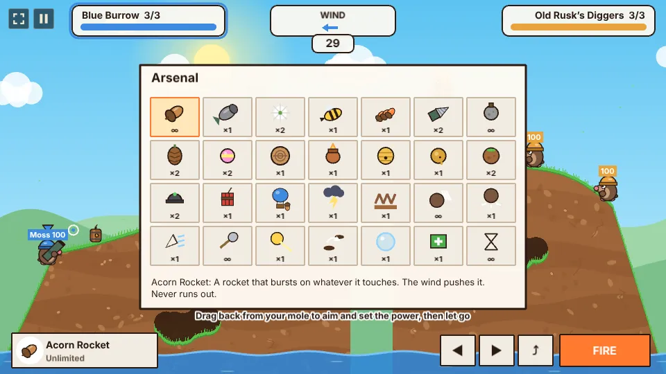
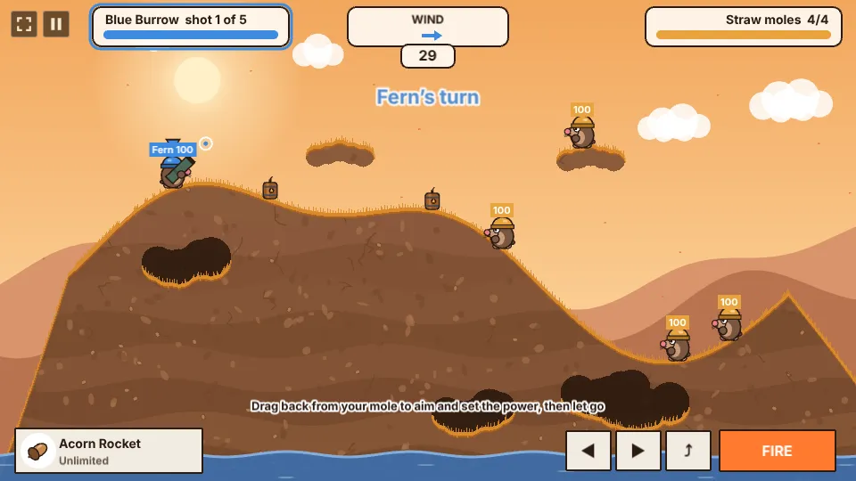
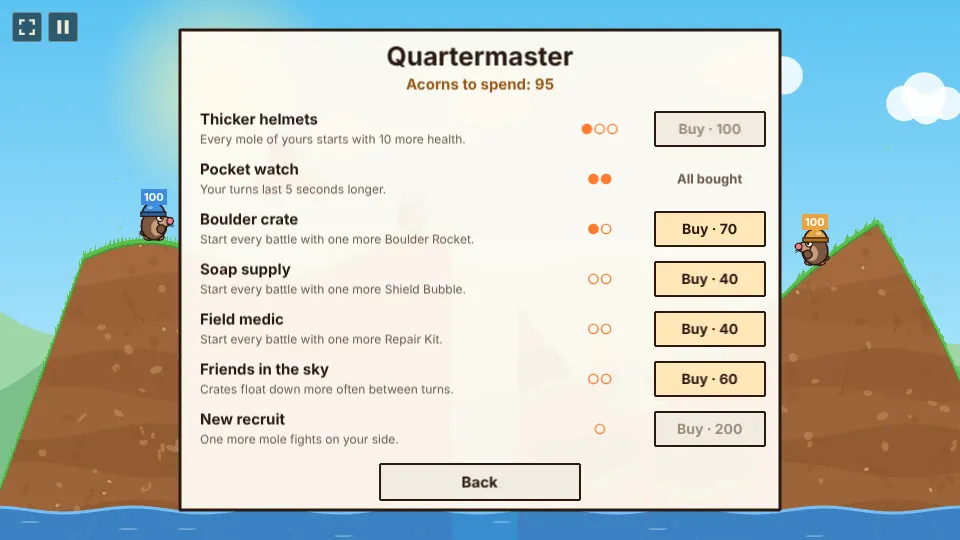
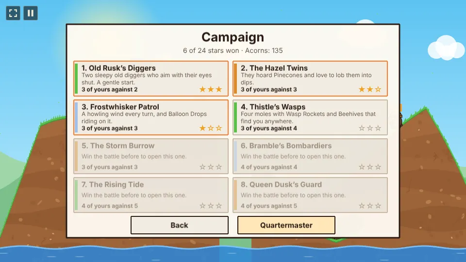
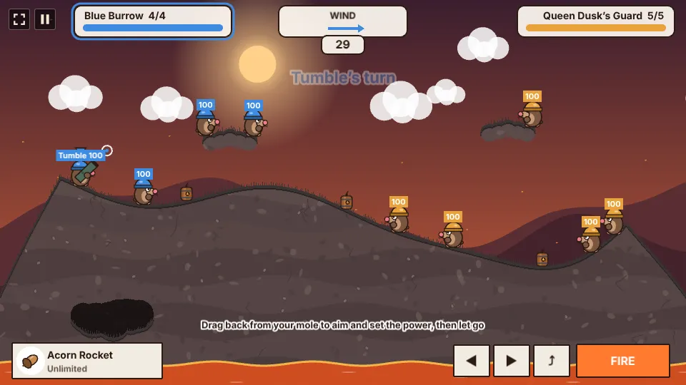
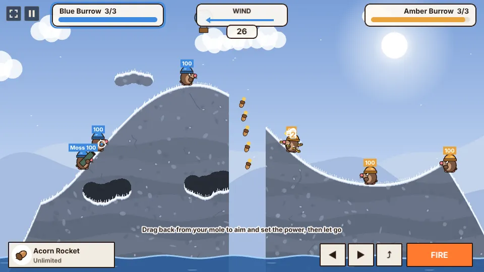

# Burrow Brigade

Turn-based artillery with squads of helmeted moles. Each turn one of your moles walks, aims with a
slingshot drag and fires one of 26 weapons over the hills. Every blast digs the ground away and
throws moles about, the wind changes every turn, and a mole that falls into the water is out. The
last team with a mole standing wins. Play the Burrow AI, a campaign of eight rival burrows, the daily
range, or a friend on one screen.

## How to play

- **Aim and fire:** press on your mole and drag back, like a slingshot: the direction sets the
  angle and the length the power. Let go to fire. Or use ↑ ↓ (W S) to aim, and hold and release
  Space to charge and fire.
- **Walk:** ← → (A D), hold the ◀ ▶ buttons, or tap the ground. **Jump** with Enter or ⤴, flip
  backwards with Backspace.
- **Weapons:** the weapon button (bottom left) opens the arsenal; Tab, Q and E step through it.
  Weapons with a target (Balloon Drop, Storm Bolt, Tunnel Hop) are aimed by tapping the map; tools
  and close moves go off with USE or Space.
- **Turns:** 30 seconds to walk, aim and fire, then 3 seconds to scramble away. Crates float down
  between turns: walk into one for a weapon, or into a green-cross crate to heal. From turn 24 the
  water rises a little every turn.
- **Powder kegs** stand about the map: any blast or flame that reaches one sets it off with a big
  bang and burning powder, so a shot next to a keg near the enemy hits twice.
- **Maps** come in five looks: meadow, autumn, frost, a red canyon and a volcano whose sea is lava.
- **Wind:** the arrow at the top. It pushes rockets, the Dandelion's seeds, the Balloon Drop's
  acorns, flames and bees, but never thrown weapons.

## Daily range

One try a day at a range that is the same for every player that day: one mole, five shots, the
day's winds and four straw moles. Every point of damage scores, and each straw mole knocked out
adds 25. The menu keeps your best and your days in a row. After every match the result names the
star of the match, the mole that did the most damage.

## Campaign

Eight battles against rival burrows, each with its own map theme, team sizes and habit: the Hazel
Twins hoard Pinecones, the Frostwhisker Patrol rides a howling wind with Balloon Drops, the Rising
Tide floods the map from turn 8. Every battle has three stars: win it, win within its turn limit,
and win without losing a mole. Winning a battle opens the next.

Every battle pays acorns, more for a win and each star. Spend them at the **Quartermaster** on
upgrades for your side in the campaign: thicker helmets, longer turns, extra Boulder Rockets,
Shield Bubbles and Repair Kits, more crates and a fourth (or fifth) mole.

## Weapons

| Group | Weapons |
| --- | --- |
| Rockets (wind) | Acorn Rocket (unlimited), Boulder Rocket, Dandelion (splits in three at the top), Wasp Rocket (homes in), Firecrackers (five in a row), Drill Rocket (bores on through earth) |
| Thrown (no wind) | Pebble Grenade (unlimited, 3 second fuse), Pinecone (scatters five nuts), Rubber Ball (five bounces), Rolling Log (rolls along the ground), Ember Pot (flames that run downhill), Beehive (bees chase the nearest enemy), Dirt Clod (adds earth) |
| Strikes | Mine, Dynamite, Balloon Drop (five acorns from a balloon), Storm Bolt (lightning), Quake |
| Close | Paw Swipe (unlimited), Ground Pound, Burrow (dig a tunnel, unlimited), Sunbeam (a straight beam through everything) |
| Tools | Tunnel Hop (dive and pop up elsewhere), Shield Bubble, Repair Kit, Skip Turn |

## Difficulty

The hub's difficulty sets how loosely the Burrow AI aims and how much of your shot's path you see
while aiming: all of it on Easy, the start of it on Normal, none on Hard.

## Code

- `src/game/terrain.ts`: the ground as a mask of earth and air, the map maker, spawn points and the
  flight steps shared by shells, the aim preview and the AI.
- `src/game/world.ts`: everything that moves (moles, shells, flames, bees, crates, balloons, bolts,
  particles) and what every weapon does.
- `src/game/weapons.ts`: the arsenal's list. `src/game/ai.ts`: the Burrow AI. `src/game/campaign.ts`:
  the campaign's battles and stars. `src/game/save.ts`: stats, settings and campaign stars.
- `src/scenes/GameScene.ts`: menu, turns, input, HUD and drawing; `draw.ts` draws the moles, shells
  and particles; `terrainArt.ts` paints the ground and the sky.

See [AGENTS.md](AGENTS.md) for the architecture, save keys and test hooks.
