# Burrow Brigade

Turn-based artillery with squads of helmeted moles. Each turn one of your moles walks, aims with a
slingshot drag and fires one of 28 weapons over the hills. Every blast digs the ground away and
throws moles about, the wind changes every turn, and a mole that falls into the water is out. The
last team with a mole standing wins (or, on Flag hill, the first to hold the flag five times). Play the Burrow AI, a campaign of eight rival burrows, the daily
range, or a friend on one screen.

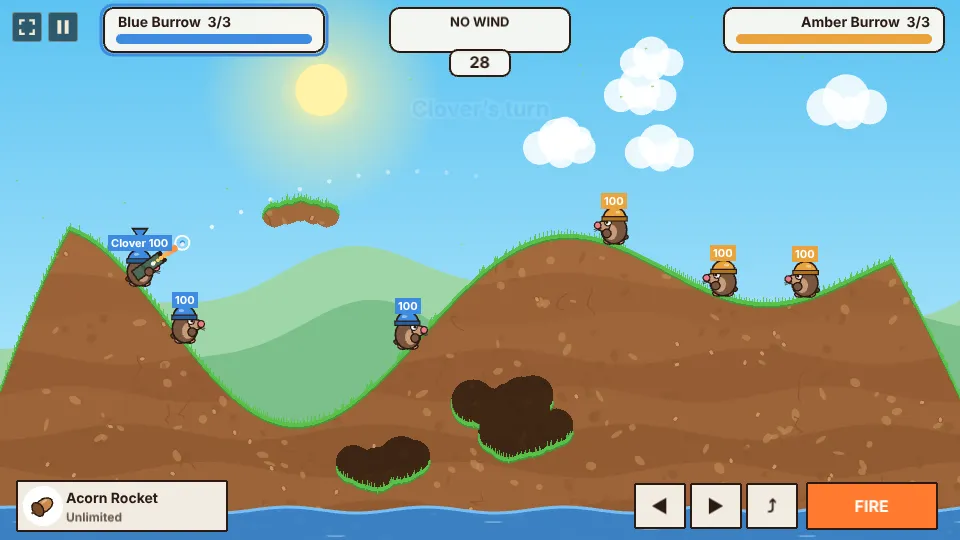

## How to play

- **Aim and fire:** press on your mole and drag back, like a slingshot: the direction sets the
  angle and the length the power. Let go to fire. Or use ↑ ↓ (W S) to aim, and hold and release
  Space or the FIRE button to charge and fire (a quick tap on FIRE fires at 60% power).
- **Walk:** ← → (A D), hold the ◀ ▶ buttons, or tap the ground. **Jump** with Enter or ⤴, flip
  backwards with Backspace.
- **Pick your mole:** before your mole moves, tap another of yours with a small ring over it to
  hand it the turn. Each mole goes once before any goes twice, so you can save one in a good spot
  for the right moment.
- **Weapons:** the weapon button (bottom left) opens the arsenal; Tab, Q and E step through it.
  Weapons with a target (Balloon Drop, Storm Bolt, Tunnel Hop) are aimed by tapping the map; tools
  and close moves go off with USE or Space.
- **Turns:** 30 seconds to walk, aim and fire, then 3 seconds to scramble away. Crates float down
  between turns: walk into one for a weapon, or into a green-cross crate to heal. From turn 24 the
  water rises a little every turn.
- **Powder kegs** stand about the map: any blast or flame that reaches one sets it off with a big
  bang and burning powder, so a shot next to a keg near the enemy hits twice.
- **Maps** come in five looks: meadow, autumn, frost, a red canyon and a volcano whose sea is lava.
- **Wind:** the arrow at the top. It pushes rockets, the Dandelion's seeds, the Balloon Drop's
  acorns, flames and bees, but never thrown weapons.

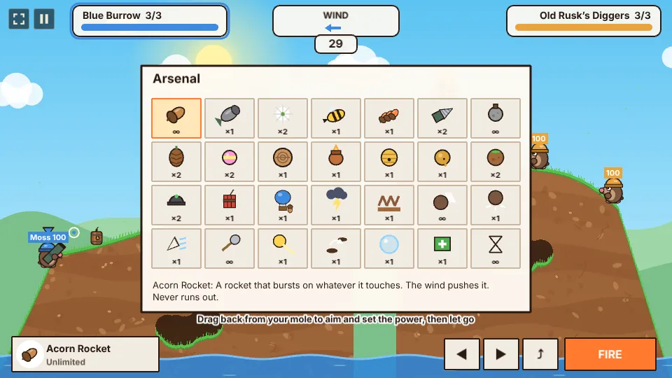

## Match kinds and the weapon draft

The menu picks the kind of a quick match (against the AI or a friend):

- **Classic:** the last team with a mole standing wins.
- **Forts:** each side starts behind a stone wall with a plank along its top in front of every
  mole, low enough to lob over, then places four more stone blocks or wooden planks on its own half
  before the first turn (the Burrow AI builds in front of its moles). Blocks break like the hills.
- **Flag hill:** a flag stands on the middle ridge. A mole by it at the end of its side's turn
  scores a point, unless an enemy mole is there too; the first to five points wins, or the last
  team standing. The Burrow AI sends its nearest mole up the hill.

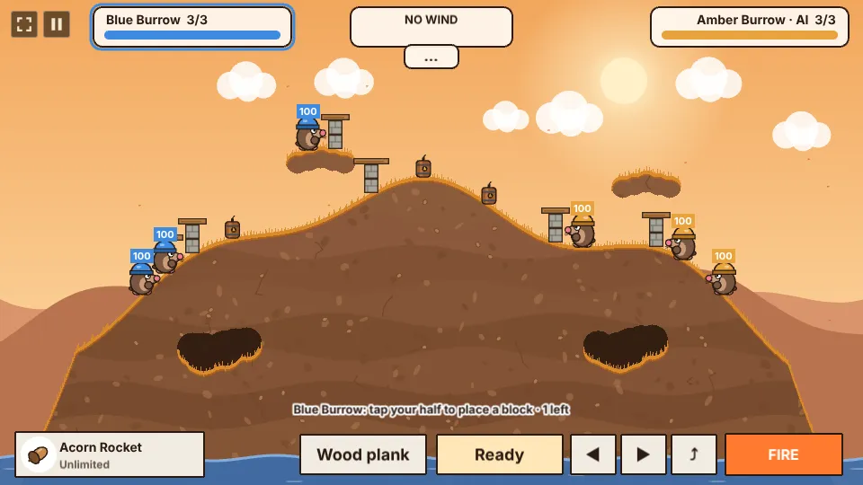

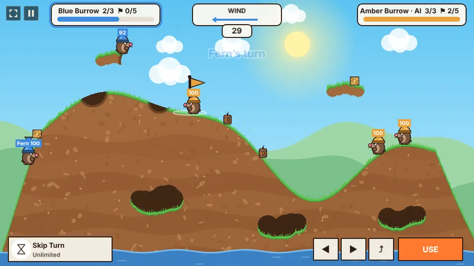

With **Weapon draft** on in Options, both sides pick six weapons in turn from a pool of twelve
before a quick match. Each side keeps the weapons that never run out and only its own picks of the
rest.

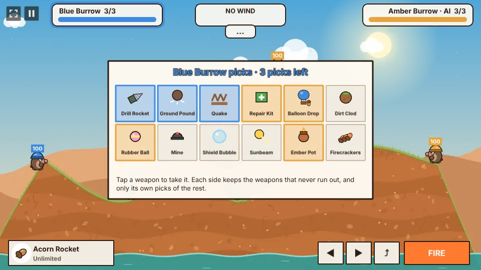

## Daily range

One try a day at a range that is the same for every player that day: one mole, five shots, the
day's winds and four straw moles. Every point of damage scores, and each straw mole knocked out
adds 25. The menu keeps your best and your days in a row. After every match the result names the
star of the match, the mole that did the most damage.

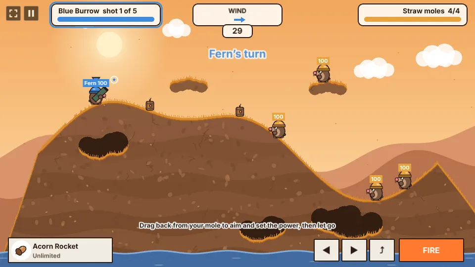

## Campaign

Eight battles against rival burrows, each with its own map theme, team sizes and habit: the Hazel
Twins hoard Pinecones, the Frostwhisker Patrol rides a howling wind with Balloon Drops, the Rising
Tide floods the map from turn 8, and Queen Dusk herself leads the last battle with a crown and
220 health. Every battle has three stars: win it, win within its turn limit,
and win without losing a mole. Winning a battle opens the next; winning the last opens the
**Veteran** tier, the same battles with one more rival mole, sharper aim and more ammo for them,
its own stars and half as many acorns again.

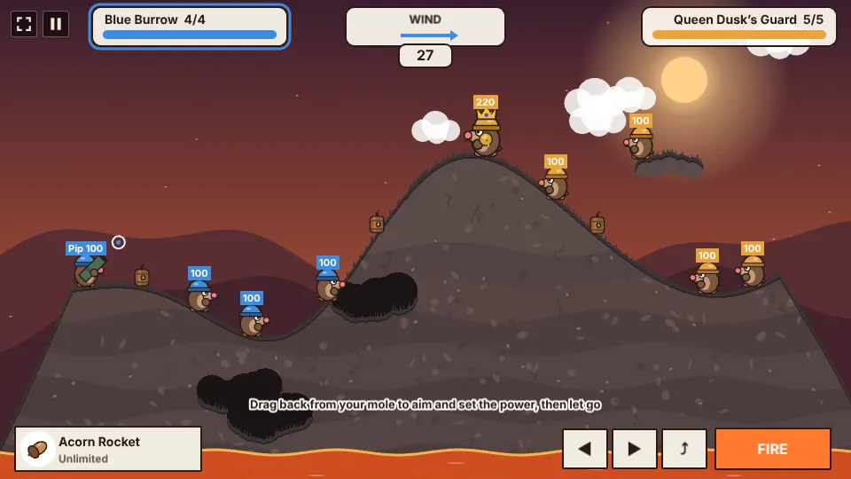

Before each battle the **Trades** screen gives every one of your moles a trade, in the order they
go: a **Digger** burrows twice as far, a **Gunner**'s blasts hurt enemies 15% harder on its turn,
a **Medic** brings a Repair Kit every third turn of your team while it stands, and a **Scout** shows
the wind of the next two turns beside the wind panel. The trade's badge sits on the mole's label.
Quick matches keep plain moles.

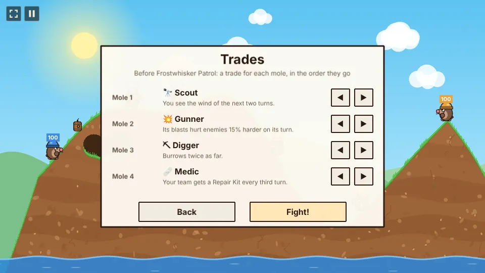

Every battle pays acorns, more for a win and each star. Spend them at the **Quartermaster** on
upgrades for your side in the campaign: thicker helmets, longer turns, extra Boulder Rockets,
Shield Bubbles and Repair Kits, more crates and a fourth (or fifth) mole.

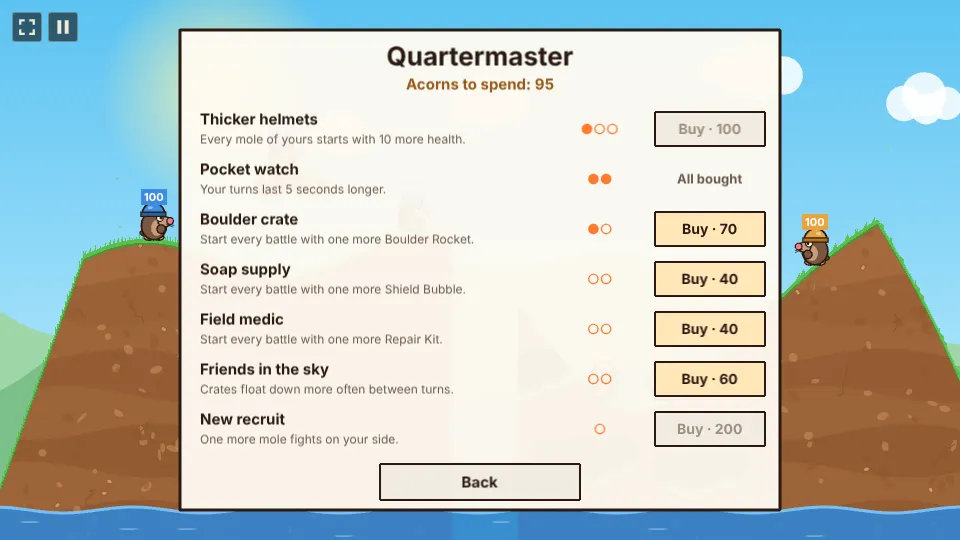

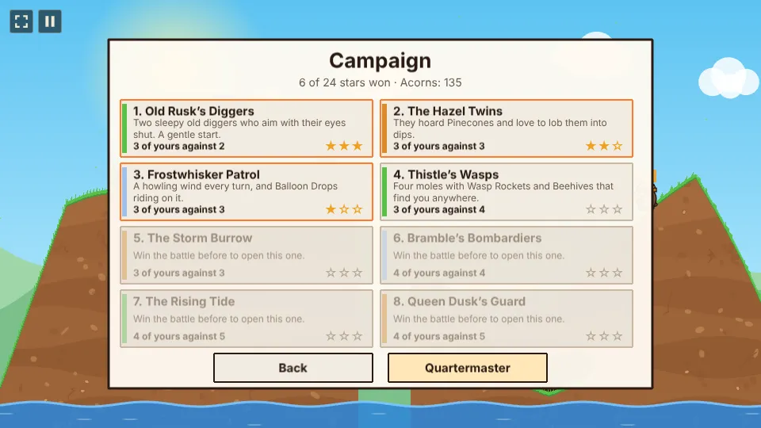

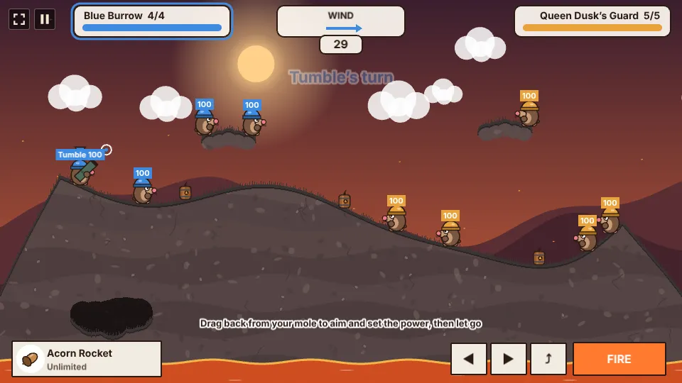

## Weapons

| Group | Weapons |
| --- | --- |
| Rockets (wind) | Acorn Rocket (unlimited), Boulder Rocket, Dandelion (splits in three at the top), Wasp Rocket (homes in), Firecrackers (five in a row), Drill Rocket (bores on through earth) |
| Thrown (no wind) | Pebble Grenade (unlimited, 3 second fuse), Pinecone (scatters five nuts), Rubber Ball (five bounces), Rolling Log (rolls along the ground), Ember Pot (flames that run downhill), Beehive (bees chase the nearest enemy), Sap Bomb (sticks to what it hits, a mole too), Dirt Clod (adds earth) |
| Strikes | Mine, Dynamite, Balloon Drop (five acorns from a balloon), Storm Bolt (lightning), Quake |
| Close | Paw Swipe (unlimited), Ground Pound, Gust Fan (blows moles, kegs and bombs away), Burrow (dig a tunnel, unlimited), Sunbeam (a straight beam through everything) |
| Tools | Tunnel Hop (dive and pop up elsewhere), Shield Bubble, Repair Kit, Skip Turn |

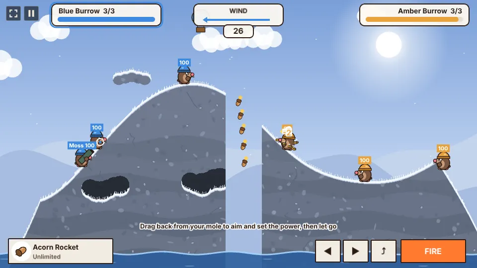

## Difficulty

The hub's difficulty sets how loosely the Burrow AI aims and how much of your shot's path you see
while aiming: all of it on Easy, the start of it on Normal, none on Hard. Options on the menu can
set a difficulty for Burrow Brigade alone (or follow the hub's), the turn time, crates and weapon
draft of quick matches, and weather.

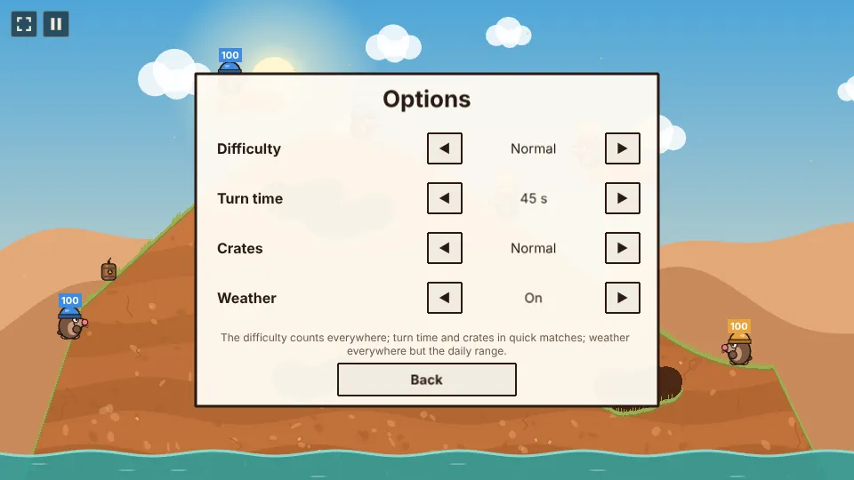

## Weather and hats

Now and then a match brings weather: rain puts fires out twice as fast, fog shortens the aim
preview and gusts shift the wind in the middle of a turn. Campaign stars open seven hats for your
moles, from an acorn cap to a laurel wreath, picked on the Campaign screen.

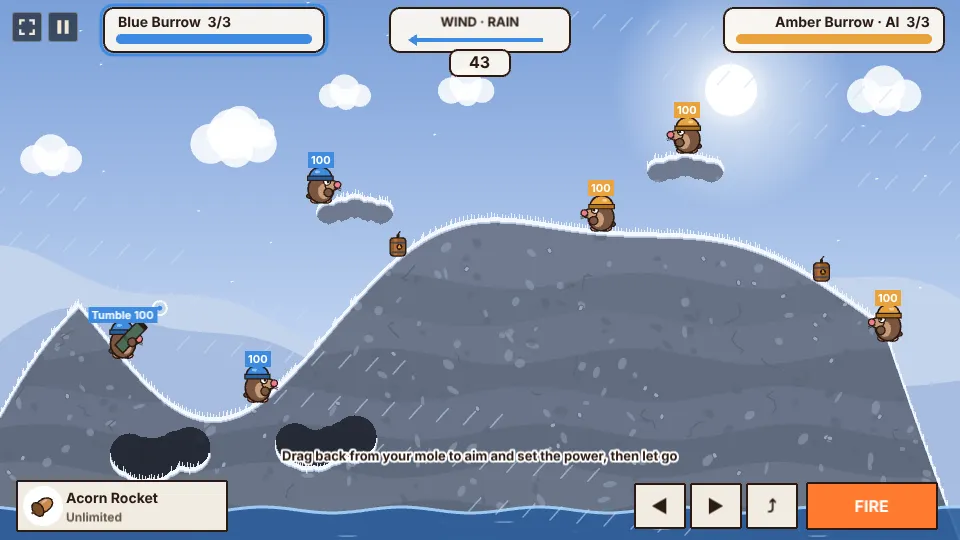

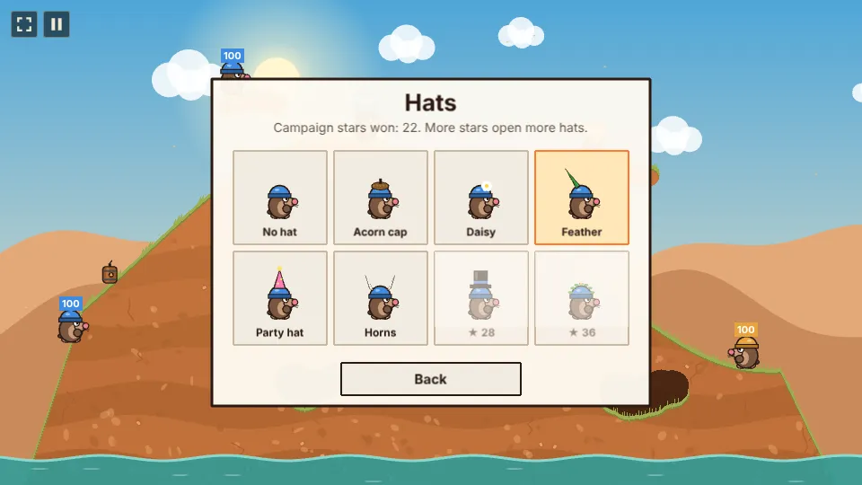

## Code

- `src/game/terrain.ts`: the ground as a mask of earth and air, the map maker, spawn points and the
  flight steps shared by shells, the aim preview and the AI.
- `src/game/world.ts`: everything that moves (moles, shells, flames, bees, crates, balloons, bolts,
  particles) and what every weapon does.
- `src/game/weapons.ts`: the arsenal's list. `src/game/ai.ts`: the Burrow AI. `src/game/campaign.ts`:
  the campaign's battles and stars. `src/game/modes.ts`: mole trades, match kinds, fort blocks, the
  flag and the weapon draft. `src/game/save.ts`: stats, settings and campaign stars. `src/game/options.ts`: the Options panel's
  choices and the game's own difficulty. `src/game/hats.ts`: the hats and the stars each needs.
- `src/scenes/GameScene.ts`: menu, turns, input, HUD and drawing; `draw.ts` draws the moles, shells
  and particles; `terrainArt.ts` paints the ground and the sky.

See [AGENTS.md](AGENTS.md) for the architecture, save keys and test hooks.
