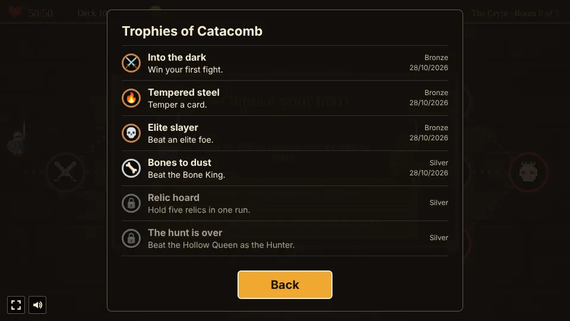

# Catacomb

A dungeon deckbuilder prototype built with [Phaser 4](https://phaser.io), TypeScript and Vite, part
of the [game hub](../../README.md).

A hero, the Knight or the Hunter, walks a dungeon in two acts: the Crypt, from the entrance on the
left to the Bone King on the right, then down a stair to the Sunken Tombs and the Hollow Queen. Each
room on the way is a fight, an elite, a campfire, a treasure chest, a merchant or a mystery, and the
paths fork, so the route is the player's to pick. Each act is laid out anew for every run. Fights
are played with a deck of cards: a hand of five each turn, three energy to spend on them, flasks to
drink for free, and foes who show what they will do on their next turn. Every fight won drops gold
and adds a new card to the deck; gold buys cards, relics, flasks and a card's removal from the
merchant. Beating the Hollow Queen opens the next depth, a harder run with one more rule, and the
best depth reached is saved. Everything is painted in a painterly style, with brush strokes drawn
in code.


## How to play

| Control | Action |
| --- | --- |
| Tap a hero | Before the first room: set out as the Knight or the Hunter (`<` and `>` pick the depth once one is open) |
| Tap a lit room | Walk there and go in |
| Tap a card in hand | Play it, if there is energy for it |
| Tap a flask | In a fight, on your turn: drink it, for no energy |
| End turn | Discard the hand and let the foes act |
| Tap a reward card | Add it to the deck (or Skip to take none) |
| Rest, Temper or Remove a card | At a campfire: heal, or tap a card to temper it or burn it from the deck |
| Tap a ware | At the merchant's: buy a card or a relic, or pay to remove a card; Leave to go on |
| Tap a choice | In a mystery room: take one of its two choices |
| Tap a relic in the top bar | Show its name and what it does |


1. **The hero**: a run starts by picking one of two. The **Knight** has 50 health and sets out
   with five Strikes, four Defends, a Bash and a Stoneskin Flask. The **Hunter** has 40 health and
   sets out with three Strikes, three Venom Knives (deal 4, apply 2 Poison), three Dodges (gain 4
   block, draw 1), a Defend and a Venom Flask.
2. **The map**: each act has seven columns of rooms, and from each room the dotted paths lead on
   to one or more rooms in the next. The rooms that can be entered next are lit gold; elites and
   the boss have a red ring. The first room is a lone fight (always a slime in the Crypt) and the
   last the act's boss. Every column between holds two or three rooms: one kind that is always
   there (a mystery in the second, a campfire in the third, a treasure chest in the fourth, a
   merchant in the fifth) and one or two more drawn from fights, elites, mysteries and merchants.
3. **Turns**: each turn the hero draws five cards and has three energy. A card's cost is in its
   corner. Attacks (red) hit the foe in front, or every foe; skills (blue) give block, health,
   energy or more cards; powers (purple) stay in play for the rest of the fight. When the draw pile
   runs out, the discard pile is shuffled into it.
4. **Block** soaks up damage until the start of the hero's next turn. Health carries over from
   room to room, and the run is over when it reaches zero.
5. **Intents**: a sword over a foe is the damage it will deal on its turn (with a status icon after
   it if the hit also leaves one), a shield the block it will gain, an arrow that it grows
   stronger, adding to every hit after, a purple skull the status it will put on the hero, and a
   purple flame the curse card an elite will add to the deck. Each foe opens with the same move,
   then picks its next one at random from its moves, never the same one twice in a row.
6. **Statuses**, shown over a fighter's head with their numbers:
   - **Weak** (a broken sword): attacks deal a quarter less. Wears off by one each time its owner
     acts.
   - **Vulnerable** (a cracked shield): takes half as much damage again from attacks. Wears off by
     one at the end of each round; put on the hero during the foes' turn, it starts wearing off a
     round later, so it lasts as many foe turns as its number.
   - **Poison** (a green drop): loses that much health at the start of its turn, ignoring block,
     then the poison drops by one.
7. **Gold and rewards**: every fight drops gold (each foe has its own amount) and offers one of
   three common cards; an elite drops more gold, a flask and offers rare cards. A treasure chest
   offers three rare cards.
8. **Flasks**: three slots down the left of a fight hold one-use potions, drunk on the hero's turn
   for no energy. Each hero sets out with one, elites and bosses leave one behind, and the merchant
   sells two. Keep one for the boss, or drink it now.
9. **Powers** are cards that stay in play once played, shown in purple rings by the hero: Bulwark
   (3 block each turn), Thorns (deal 3 back to any foe that hits you), Battle Rage (1 Strength each
   turn, added to every hit) and Venom Veil (poison on one foe splashes half onto the rest). A second
   copy of a power in play adds its effect again and shows as a count (×2) on its ring.
10. **Curses** are grey cards that can't be played and only leave the deck when burnt or removed:
    Rust clogs a slot in the hand, Wound costs 2 health when drawn (it never kills), and Doubt makes
    the first card each turn cost 1 more while in hand. Elites threaten them as a move, and the
    shrine's loot and the chained chest come with one.
11. **Campfires**: rest to heal 30% of the hero's health (15% from depth 2), temper a card (each
    card but a curse can be tempered once, for more damage, block or effect, or a lower cost; tempered cards
    have a `+` and green lettering), or burn a card to thin the deck (down to no fewer than five
    cards).
12. **The merchant** sells two common cards (30 gold), a rare card (65), two relics (80 each), two
    flasks (25 each, with a free slot) and removes one card from the deck per visit (40).
13. **Mystery rooms** each hold one of four scenes with two choices: an altar (8 health for a rare
    card), a shrine (temper two random cards, or 45 gold and a Doubt curse), a chained chest (a
    relic and a Rust curse) and a pool (heal 15, or temper a random card for 4 health). Random
    tempering never picks a curse, and the pool's second choice is closed when no card can be tempered.
14. **Relics** are passive bonuses for the rest of the run, shown in the top bar.
15. **Two acts**: beating the Bone King leaves a relic and opens the stair down to the Sunken
    Tombs, with new foes, its own elite and the Hollow Queen; the hero heals a rest's worth on the
    way down. Beat her to clear the dungeon.
16. **The depth ladder**: beating the Hollow Queen opens the next depth, and the deepest one opened
    is saved in the browser (the game's only save). Depth 0 is the dungeon as designed; each depth
    stacks one more rule, picked with `<` and `>` on the hero panel:

    | Depth | New rule |
    | --- | --- |
    | 1 | Foes have 20% more health |
    | 2 | Campfires (and the stair down) heal only 15% |
    | 3 | The deck starts with a Wound curse |
    | 4 and down | Foes have 20% more health again, and again each depth |


### Foes

| Foe | Act | Health | Gold | Moves (the first is its opening move) |
| --- | --- | --- | --- | --- |
| Slime | 1 | 24 | 12 | Attack 6, block 5, attack 8 |
| Giant Rat | 1 | 13 | 7 | Attack 3 twice, attack 4 and 2 Poison |
| Skeleton | 1 | 30 | 14 | Block 6, attack 9, attack 4 twice |
| Cultist | 1 | 26 | 14 | Grow 2 stronger, attack 6, 2 Weak |
| Grave Knight (elite) | 1 | 58 | 40 | Block 10, attack 13, attack 6 twice and 2 Vulnerable, curse (Wound) |
| Bog Witch (elite) | 1, 2 | 46 | 40 | 2 Weak, attack 7 and 3 Poison, attack 11, grow 2 stronger, curse (Doubt) |
| Bone King (boss) | 1 | 90 | 60 | Attack 10, block 12, attack 4 three times, grow 3 stronger, 2 Vulnerable |
| Ghoul | 2 | 34 | 16 | Attack 8 and 1 Weak, attack 12, grow 2 stronger |
| Wraith | 2 | 28 | 15 | 2 Vulnerable, attack 5 twice, block 8 |
| Tomb Spider | 2 | 22 | 11 | Attack 3 and 3 Poison, attack 7, block 6 |
| Mummy | 2 | 44 | 18 | Block 10, attack 13, 2 Weak |
| Gargoyle (elite) | 2 | 82 | 50 | Block 16, attack 17, attack 5 three times, curse (Rust) |
| Hollow Queen (boss) | 2 | 130 | 100 | 4 Poison, attack 15, attack 6 three times and 1 Vulnerable, block 15, grow 3 stronger |


### Cards

The Knight's deck starts with five Strikes, four Defends and a Bash; the Hunter's with three
Strikes, three Venom Knives, three Dodges and a Defend. Tempered at a campfire, each card becomes
its `+` version.

| Card | Cost | Effect | Tempered | Found |
| --- | --- | --- | --- | --- |
| Strike | 1 | Deal 6 | Deal 9 | Starter |
| Defend | 1 | Gain 5 block | Gain 8 block | Starter |
| Bash | 2 | Deal 10 | Deal 14 | Knight starter |
| Venom Knife | 1 | Deal 4, apply 2 Poison | Deal 6, apply 3 Poison | Hunter starter |
| Dodge | 1 | Gain 4 block, draw 1 | Gain 6 block, draw 1 | Hunter starter |
| Cleave | 1 | Deal 7 to all foes | Deal 10 to all | After a fight |
| Twin Strike | 1 | Deal 4 twice | Deal 6 twice | After a fight |
| Iron Wall | 2 | Gain 13 block | Gain 18 block | After a fight |
| Scout Ahead | 0 | Draw 2 | Draw 3 | After a fight |
| Shield Bash | 1 | Deal 5, gain 5 block | Deal 7, gain 7 block | After a fight |
| Heavy Blow | 2 | Deal 16 | Deal 22 | After a fight |
| Bandage | 1 | Heal 4, draw 1 | Heal 7, draw 1 | After a fight |
| Second Wind | 0 | Gain 1 energy, draw 1 | Gain 2 energy, draw 1 | After a fight |
| Hamstring | 1 | Deal 5, apply 2 Weak | Deal 7, apply 3 Weak | After a fight |
| Sunder | 1 | Deal 4, apply 2 Vulnerable | Deal 6, apply 3 Vulnerable | After a fight |
| Poison Dart | 1 | Deal 3, apply 4 Poison | Deal 3, apply 6 Poison | After a fight |
| Bulwark | 1 | Power: gain 3 block at the start of each turn | Costs 0 | After a fight |
| Thorns | 1 | Power: deal 3 back to any foe that hits you | Costs 0 | After a fight |
| Whirlwind | 2 | Deal 6 twice to all foes | Deal 8 twice to all | Rare |
| Fireball | 2 | Deal 15 to all foes | Deal 20 to all | Rare |
| Leech | 2 | Deal 12, heal 6 | Deal 15, heal 8 | Rare |
| Fortress | 1 | Gain 12 block, draw 1 | Costs 0 | Rare |
| Toxic Cloud | 2 | Apply 5 Poison to all foes | Apply 8 Poison to all | Rare |
| War Cry | 1 | Apply 2 Weak and 2 Vulnerable to all foes | Costs 0 | Rare |
| Battle Rage | 1 | Power: gain 1 Strength at the start of each turn | Costs 0 | Rare |
| Venom Veil | 1 | Power: poison on one foe splashes half onto the rest | Costs 0 | Rare |
| Rust | - | Curse: unplayable, clogs the hand | - | Gargoyle, chained chest |
| Wound | - | Curse: unplayable, lose 2 health when drawn | - | Grave Knight, depth 3 |
| Doubt | - | Curse: unplayable, the first card each turn costs 1 more | - | Bog Witch, shrine loot |

Rare cards come from treasure chests, elites, the merchant and the altar.

### Flasks

| Flask | Effect |
| --- | --- |
| Healing Flask | Heal 12 |
| Quicksilver Flask | Gain 2 energy |
| Venom Flask | Apply 4 Poison to every foe |
| Stoneskin Flask | Gain 10 block |
| Foresight Flask | Draw 3 cards |

### Relics

| Relic | Effect |
| --- | --- |
| Oak Ward | Start each turn with 3 block |
| Whetstone | Your attacks deal 2 more damage per hit |
| Ember Lantern | Gain 1 more energy on the first turn of each fight |
| Mending Moss | Heal 5 after each fight you win |
| Golden Idol | Fights drop half as much gold again |
| Bone Charm | Every foe starts each fight with 2 Vulnerable |
| Venom Gland | Poison you apply is 2 higher |


### Trophies

Nine trophies, listed behind the Trophies button on the start and pause screens and counted on the
hub's card. Each pops up at the top of the page once, when it is earned.

| Tier | Trophy | Earned by |
| --- | --- | --- |
| Bronze | Into the dark | Winning your first fight |
| Bronze | Tempered steel | Tempering a card |
| Bronze | Elite slayer | Beating an elite foe |
| Silver | Bones to dust | Beating the Bone King |
| Silver | Relic hoard | Holding five relics in one run |
| Silver | The hunt is over | Beating the Hollow Queen as the Hunter |
| Gold | Queen of nothing | Beating the Hollow Queen |
| Gold | Deeper still | Beating the Hollow Queen at depth 3 |
| Gold | Bottomless (hidden) | Beating the Hollow Queen at depth 5 |



The difficulty, set on the hub page's Settings, changes one thing: foes have 25% less health on Easy and 30% more on Hard.

## Running locally

`npm run dev` at the repo root, then open `/games/catacomb/` (or pick Catacomb on the hub page).

## Playthrough test

`e2e/playthrough.spec.ts` plays the first room in headless Chromium: it checks the new run opens
on the hero panel at depth 0, taps the Knight, checks the run (full health, the starter deck and a
flask), taps the first room on the map, checks the fight starts with a hand
of five and three energy, then plays cards by tapping them (attacks first, then defends) and ends
turns until the slime falls, checking each card's cost and effect, that the slime opens with its
first move and never repeats a move twice in a row, and each of its turns against its intent. Then it checks the slime's 12 gold was picked up, takes the first reward card and checks it joined the deck and the next
rooms opened. Like the other games' tests it owns the game clock and plays at 4x speed
(`PLAYTHROUGH_SPEED`). The **Playthrough Catacomb** workflow (`.github/workflows/playthrough.yml`)
runs it on every pull request that touches this folder or that workflow (not on pushes to main), and uploads
the video and screenshots as the `playthrough-catacomb` artifact.

```sh
npx playwright test --project catacomb
```

## Code layout

All paths are inside `games/catacomb/`.

- `src/game/`: the rules in plain TypeScript with no Phaser dependency. `cards.ts` and `enemies.ts`
  are data tables (the cards, powers and curses, the foes and their moves), `heroes.ts` the two
  heroes, `flasks.ts` the flasks, `depth.ts` the depth ladder and its save, `map.ts` lays out a new
  Crypt for each run, `relics.ts` and `events.ts` are the relics and mystery rooms, `state.ts`
  describes a run, and `sim.ts` moves it on: choosing the hero, walking the map, playing cards and
  drinking flasks, statuses, the foes' turn, the campfire, the merchant, mystery rooms, rewards and
  the descent to the second act. Randomness (the maps, shuffles, rewards, wares, relics, flasks,
  foes' next moves) goes through `Math.random`.
- `src/scenes/`: `BootScene` bakes textures, `GameScene` draws the map, the fights, the merchant and the panels
  and wires taps to the rules, `layout.ts` says where things are drawn.
- `src/art/`: all the art, drawn in code and baked into textures at startup, then repainted with
  brush strokes by `paint.ts`: the knight and the foes, the crypt and the map, the parchment card
  faces, and the icons for cards, intents, statuses, relics, gold and rooms.
- `src/ui/`: the card faces and buttons.

Adding a card is an entry in `src/game/cards.ts` (and, for a new kind of effect, `playCard` in
`src/game/sim.ts`); adding a foe is an entry in `src/game/enemies.ts` and its art in
`src/art/characters.ts`.
