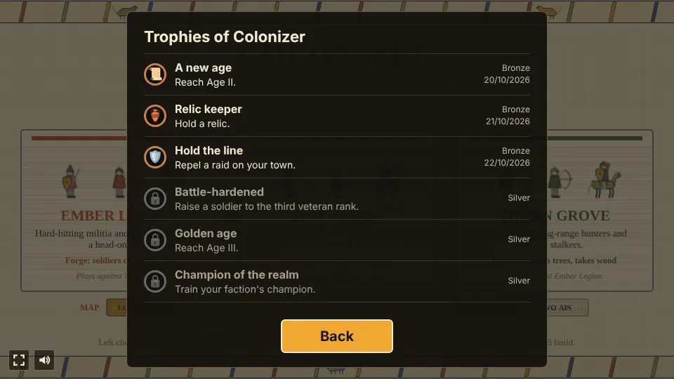

# Colonizer

A small real-time strategy prototype built with [Phaser 4](https://phaser.io), TypeScript and Vite,
part of the [game hub](../../README.md). It is a classic base-building RTS with villagers, ages and armies, and is
drawn as the Bayeux tapestry: the skirmish embroidered in eight wool colours on natural linen, every
figure in profile with a kite shield, buildings in elevation, fog as unworked linen with the needle
still at its edge, and the HUD as the tapestry's borders with slanted bars and stitched lettering.
All of it is painted in code on 2D canvases; there are no image files.

You pick one of three factions and play a skirmish on a 128 by 128 tile map against an AI opponent,
which plays the next faction along, or against two AIs in a three-way match. The menu also picks the
map kind: Lowlands, Lakes or Highlands. Gather wood, food and ore, put up buildings, research techs in
the Academy and the Town Center, train villagers and armies, earn your way through three ages, and
destroy the enemy Town Center to win, or raise a Monument in Age III and hold it for three minutes.
Lose your own Town Center, or let the enemy's Monument stand, and the match is over.

## Map kinds and rivals

Two rows of toggles under the faction cards set up the match, and the menu keeps them for the next one.

- **Map**: **Lowlands** is the map as first designed, open fields with a few lakes and rock ridges.
  **Lakes** has twelve wide lakes, two big ones either side of the middle and a pond by each start,
  so the ways across run between waters, a Dock always has a shore, and a short palisade across a
  gap between two lakes shuts a whole approach. **Highlands** has two long rock ridges, one across
  each side's half of the map, each broken by three narrow passes, so walls and rams decide where
  armies get through. Every map is checked so that each Town Center, camp and trading post can be
  walked to.
- **Rivals**: **One AI**, or **Two AIs** for a three-way match: the second AI plays the third
  faction from the top-right corner, with two caches of its own nearby (the free bottom-left corner
  gets the same trees, bushes, mine and caches). Everyone raids everyone: each AI turns on its rivals
  by turns, and on whoever raises a Monument first. A side whose Town Center falls is out, and
  everything of it falls with it; the last Town Center standing wins, or a Monument that stands its
  three minutes. So you can let the AIs wear each other down, pick a side to hit, or race them to the
  Monument.

## Rival temperaments

Each AI draws a temperament for the match, which sets its build, raid timing and picks:

| Temperament | Plays like | First raid | Raid party | Boon, Age III edge |
| --- | --- | --- | --- | --- |
| **Raider** | Stable early, cavalry first, no palisade, Stirrups right after Age II | 6 min, then every 2 min, once it has 8 soldiers | 6 | Shieldwall, Muster |
| **Builder** | Saves for the Monument first in Age III, a big late army | 14 min, then 4 min apart, once it has 20 | 14 | Shieldwall, Masonry |
| **Warden** | A long palisade from Age I, three Watchtowers, archers first | 12 min, then 3 min apart, once it has 14 | 10 | Harvest Rites, Masonry |

The **Rivals** row of the card under the deeds card shows each rival's banner with **?** until you
have seen its Town Center: scout its base to learn what it is.

## Factions

| Faction | Units | Own building |
| --- | --- | --- |
| Ember Legion | Militia (melee), Archer (ranged), Knight (cavalry) | **Forge** (150 wood, 50 ore, one only): every soldier costs 20% less |
| Tide Coven | Spearman (melee, strong against cavalry), Slinger (ranged), Rider (cavalry) | **Dock** (140 wood, up to three): stands on a shore and lands 10 food every 12 s |
| Thorn Grove | Brute (tough melee), Hunter (long-range), Stalker (fast cavalry) | **Grove** (100 wood, 50 food, up to two): plants a tree nearby every 15 s, up to 14 around it, and takes wood like a Lumber Camp |

Every faction has the same villagers and the same other buildings. The faction's own building is
the last one on the first page of the build list.

## How to play

| Control | Action |
| --- | --- |
| Left click | Select one unit or building; hold and drag to box-select units; Shift adds to the selection |
| Right click | Attack an enemy, gather from a tree, bush or mine, finish a building, walk, or go to a camp |
| Right click, with production buildings selected | Plant their rally flag: new units walk there (on a tree, bush, mine, farm or camp, new villagers gather there); right click one of them to take it down |
| **Rally flag**, with a production building selected | Then click the map to plant the flag, the same as a right click (and on a touch screen) |
| Space, or click a red marker at the edge | Look at where you are under attack (or at the raid) |
| Tap, on a touch screen | With units selected, a tap gives the right click's order (tap another of your units or buildings to select it instead); with a production building selected, a tap on the ground plants its rally flag |
| A, then left click | Attack-move: the army walks and fights whatever it meets on the way |
| S | Stop the selected units |
| B | Open the build list for the selected villagers, then click a spot to place it (drag a line for a palisade) |
| 1 to 9 | Select a control group; Ctrl with a number saves the selection to it |
| Arrow keys, or the screen edge (mouse) | Scroll the map |
| Click the minimap | Look at that part of the map |
| Click the horn toast | Look at the raid or the attack it names |
| Click a camp | Say what it holds and who has it |
| Right click a trading post, with trade carts selected | Send the carts trading |
| **Ring the bell**, with the Town Center selected | Villagers near the Town Center or a Watchtower shelter inside; **Back to work** sends them out again |
| Esc | Cancel placing a building or attack-moving |
| Bottom panel | Train units, research techs and advance the ages from the buttons |

Villagers gather on their own once they have a node to work, and go back to a node of the same kind
when one runs out. Buildings need a builder to finish them, and a builder goes on to gather once
the building is done. Every unit is animated in a few embroidered frames: villagers chop with an
axe, reap with a sickle, mine with a pick, hammer at a building and carry their load home; soldiers
walk (riders gallop), swing a sword or club, thrust a spear, draw and loose a bow, whirl a sling or
charge with a lowered lance.

## The three ages

- **Age I** is where every match starts.
- **Age II** is researched at the Town Center (400 food, 200 wood). It unlocks Stirrups and Bodkin
  at the Academy (Stirrups makes cavalry 20% faster), and offers the **Age II boon**: a one-time pick between two cards in the panel,
  which stand in for the panel's buttons until you choose.
  - **Shieldwall**: your melee infantry (Militia, Spearmen or Brutes) take 20% less damage.
  - **Harvest Rites**: farms gather 20% faster.
- **Age III** is earned, not only bought. The **deeds card** under the top bar lists three deeds:
  reach Age II, field 14 soldiers at once, and repel a raid (kill every raider the enemy sent, or
  half of them so the rest turn back). Once all three are done, the Town Center can research Age III
  (500 food, 300 wood, 200 ore), and every soldier then deals 2 more damage. Age III also offers the
  **Age III edge**, a second one-time pick of two cards:
  - **Masonry**: buildings and walls have 30% more health, those already standing included.
  - **Muster**: soldiers train 25% faster.

The top bar shows the boon's icon and then the edge's (a stretch of stone or a war drum).

The top bar's age track has a pip for each age; the next pip fills as its deeds are done.

## Raids

The enemy leaves your opening alone: its first raid comes no sooner than six minutes in (a Raider),
twelve (a Warden) or fourteen (a Builder), and its army rests a while after each raid before the
next (see the temperaments above). Each raid has a goal. The first goes for your outlying economy (a
Lumber or Mining Camp, a farm, a Dock or a Grove away from your Town Center's arrows), the second for
a relic you hold, and those send a party (6, 14 or 10 by temperament) while the rest stay home. From the third raid on, or once the enemy reaches Age III, it comes for your Town Center with
everything. A party turns home once its goal is done, once half of it has fallen (which counts as
repelling it) or after two and a half minutes.

In a three-way match the AIs raid each other too; only the raids that come for you sound the horn.
When the enemy sends its army at you, a horn sounds: a toast under the top bar names
the raid and the side it comes from, with an arrow pointing towards it, and the minimap pulses rings
of red running stitch where the raiders are until the last of them falls. The deeds card counts
how many have been routed. In a fight, every blow throws ochre sparks and a damage number, and
arrows fly from the bows; every load a villager drops off pops a "+10" badge with its icon.

## Attack alerts

Any blow a rival lands on your villagers, soldiers or buildings raises an alert, raid or not. Red
rings of running stitch spread on the ground where the fight is and on the minimap, and stay until
eight seconds after its last blow; hits within twelve tiles of a fight belong to it, so one skirmish
is one alert. When the fight is out of sight, the toast under the top bar says what is hit
(*Villagers under attack*, *Lumber Camp under attack*) with an arrow towards it, and a red arrow at
the edge of the view points the way. Click the toast or the arrow, or press Space, to look there.
The camp guards fighting back raise none.

## Rally flags and spacing

Select a Town Center, Barracks, Archery Range or Stable and right click the map (or press **Rally
flag** and click) to plant its rally flag: an ochre pennant with a running thread back to the
building, shown while it is selected. Shift-click several buildings to give them all the same flag;
right click one of them to take it down. New soldiers walk to the flag and stand round it; a
villager whose flag is on a tree, bush, mine or farm goes straight to work there, and one whose flag
is on a Lumber or Mining Camp (or a Grove) works the nearest wood or ore to it.

 Units no longer stack on one spot: they push gently apart until each
has room, so a group spreads out where it stops (villagers at work hold their place).

## The town bell and the garrison

Select the Town Center and press **Ring the bell** when a raid comes in: every villager within 14
tiles of a shelter runs to the nearest one with room, the Town Center (12) or a finished Watchtower
(5), and disappears inside. Each villager sheltering adds an arrow of 3 damage to that building's
volleys, and a knot of ochre on its roof counts them. They gather nothing while they hide, so press
**Back to work** as soon as the raiders are dead or gone and they walk back to the node they left, or to the building they were putting up.
A shelter that falls spills its garrison out onto the ground. The AI rings its own bell when enemy
soldiers come within 14 tiles of its Town Center, and releases it once they are gone.

## Veteran ranks

Every soldier but the Ram earns ranks by its kills: **Seasoned** at 2, **Veteran** at 5 and
**Champion** at 9. Each rank adds 10 health (healed on the spot) and 1 damage, and draws a chevron
over the unit's head; the panel shows the rank and the kill count. A veteran is worth pulling back
from a losing fight. The enemy's soldiers rank up the same way.

## The Market and trade carts

The build list's second page offers the **Market** in Age II (150 wood, 50 food, one only). Select
it to swap resources: ore buys a lot of 100 wood or 100 food, and a lot sells for ore. The base lot
costs 70 ore and sells for 42; every purchase raises that resource's price by 12% and every sale
lowers it, and prices drift back to the base over a few minutes. The Market also trains **Trade
Carts** (80 wood, 40 food): each drives to the nearest of the two **trading posts** in the middle
of the map, loads 40 ore there, and brings it to the nearest building that takes ore (the Market, a
Mining Camp or the Town Center), then sets off again. A new cart sets off at once, so the Market
has no rally flag. The posts are the same distance from both
Town Centers and marked on the minimap for everyone. A cart can't fight: the road to the post is a
line the enemy can raid, and the AI's economy raids go for a Market too. The AI builds a Market after
its Watchtower and keeps three carts on the road, and sells a resource that piles up past 600 when
its ore runs low or buys one that runs out when it has ore to spare.

## Siege rams

In Age II the Barracks trains the **Ram** (160 wood, 60 ore): a slow slung log under a roof, pushed
by two crewmen, with 220 health and a blow of 32 against buildings, palisades and gates, which it
goes for on its own. It can't hurt a unit at all, and sent at one it only walks there, so rams
need an escort and give attackers an answer to a walled base and to a standing Monument. The AI
keeps two rams with its army from Age II.

## Faction champions

In Age III the Town Center trains the faction's **champion** (200 food, 150 ore, one at a time):

- The Ember Legion's **Warlord**, a plumed knight on foot (170 health, 11 damage) whose aura gives
  every own soldier within 6 tiles +2 damage; a ring of ochre stitch shows its reach.
- The Tide Coven's **Seer** (90 health, 6 damage at range 5) who sees 14 tiles into the fog, so an
  army round it is never surprised.
- The Thorn Grove's **Druid** (130 health, 5 damage) who mends every own unit within 5 tiles by 3
  health every 1.5 s; a green ring shows its reach.

A champion earns ranks like any soldier. The AI trains its own once it reaches Age III, so a late
match has one to protect and one to hunt.

## Walls and gates

The build list's second page (**Walls & More**) has the **Palisade** (4 wood a stake) and the
**Gate** (25 wood). Drag a line on the map to lay a palisade, up to 40 stakes; the selected villagers
start on it and each goes on to the next unfinished piece nearby. A diagonal line has no gaps. A gate
goes in a gap or straight onto one of your own stakes, and only your units walk through it. Soldiers
and towers never pick walls as targets on their own, but an army with no way round breaks through the
nearest stake or gate. A Builder AI lays a short palisade with a gate across the front of its base
once it reaches Age II, a Warden a longer one in Age I, and a Raider none.

## Neutral camps and relics

Seven camps sit in cleared patches on every map, guarded by wild Brigands and Poachers who fight
anyone who comes near and never stray far from their post:

- Four **caches**, a cart of 250 ore and a cart of 300 food near each side. Kill the guards and stand
  someone by the cart, and the pile is yours (it is gone for the other side).
- Three **relics**, each in a little gilded shrine. The **Relic of Valor** stands in the middle of
  the map (soldiers deal 1 more damage), the **Relic of Plenty** and the **Relic of Haste** on the two
  flanks (villagers gather 10% faster; every unit moves 10% faster). Once the guards are dead, a side
  with units at the shrine, and none of the other side's, holds the relic and its banner flies their
  colour; the other side takes it the same way.

Right click a camp to send the selection to stand round it. The **relics card** under the deeds card
shows each relic with a green ring when you hold it and the enemy's colour when they do. The AI sends
its army to take relics between raids.

## The Monument

In Age III the build list's second page (**Walls & More**) offers the **Monument** (500 wood, 300 food, 400 ore, one
only, 90 s to build). Once it is finished it counts down three minutes on the relics card; if it is
still standing at the end, its owner wins. Everyone sees a Monument from the moment it is begun, the
match says so when one is finished, and the AI throws everything it has at yours. The AI builds one
too once it reaches Age III.

## Economy and population

- Wood comes from trees, food from berry bushes and farms, and ore from gold mines. The Tide Coven's
  Dock adds food on its own, and the Thorn Grove's Grove grows new trees.
- Villagers carry ten at a time to the Town Center, or to a Lumber or Mining Camp for wood and ore.
  Trade carts bring 40 ore a trip from a trading post to the Market, a Mining Camp or the Town Center.
- A house adds population; the Town Center adds ten. Units in training and villagers sheltering
  count against the cap.

## Trophies

Ten trophies, listed behind the Trophies button on the start and pause screens and counted on the
hub's card:

| Trophy | Tier | Earned by |
| --- | --- | --- |
| A new age | Bronze | Reaching Age II |
| Relic keeper | Bronze | Holding a relic |
| Hold the line | Bronze | Repelling a raid on your town |
| Battle-hardened | Silver | Raising a soldier to the third veteran rank |
| Golden age | Silver | Reaching Age III |
| Champion of the realm | Silver | Training your faction's champion |
| Victory | Silver | Winning a match |
| Last one standing | Gold | Winning a match against two rivals |
| Iron will | Gold | Winning a match on Hard |
| Built to last (hidden) | Gold | Winning a match with a Monument |

## Difficulty

| Easy | Normal | Hard |
| --- | --- | --- |
| The AI gathers 25% slower | The game as designed | The AI gathers 25% faster |

The hub's difficulty setting changes only how fast the AI gathers. Normal is the game as designed.
With the hub's Reduce motion setting on, every unit holds one still frame for what it is doing,
sparks and arrows in flight are left out, damage numbers and badges fade without rising, and the
minimap's raid rings stand still.

## Watch AI

Add `?watch` to the game's URL (`/games/colonizer/?watch`) to skip the menu and start a
match between two random factions, both played by the AI, on a random map kind, with the whole map
in view; every other match or so is a three-way one with the third faction. The log names each
side's temperament. Scroll with the
arrow keys or the minimap and click a unit to see what it is doing. The panel in the top right
holds the match still, sets the speed from 1x to 8x (**[** and **]**) and opens a log of every build,
unit, tech, attack and relic run (**L**). A click on the end screen starts another match.

## Notes

- There is no save yet: each match starts fresh.
- The map is the same for a given seed, and the seed is fixed in the playthrough test.
- The AI picks its boon and edge by temperament, and researches Age III once it has the three deeds.
  Its raid deed is yours to give (or, in a three-way match, the other AI's): it repels a raid when
  three or more enemy soldiers come at its Town Center and at least half of them fall before the
  rest leave.
- The AI builds its faction's own building early, sets a rally flag in front of its base for each
  production building, and (unless it is a Raider) walls off the front of its base.
- The AI plays at a human pace: about 30 commands a minute, so it can leave villagers idle too.
- The AI rings its town bell when enemy soldiers reach its base, builds a Market and runs three
  trade carts, adds two rams to its army in Age II and trains its champion in Age III.
- The Town Center and Watchtowers shoot hard enough to hold off a small raid on their own; a
  Watchtower costs 125 wood and 50 ore.
