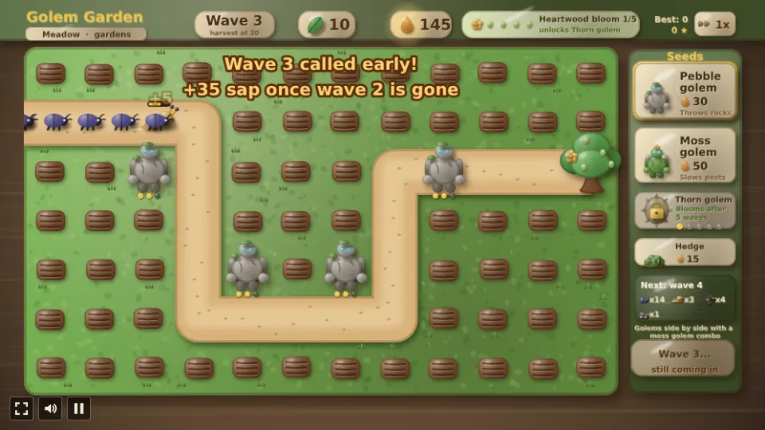
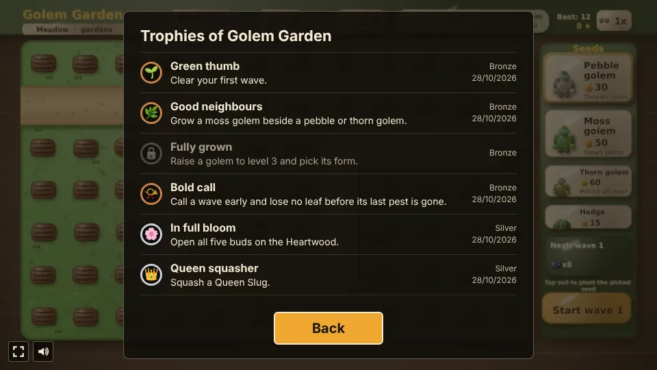

# Golem Garden

A tower defense prototype built with [Phaser 4](https://phaser.io), TypeScript and Vite, part of the
[game hub](../../README.md).

Pests are coming down the garden path to eat the Heartwood, the great tree at its end. Plant seeds
in the soil beside the path: each one grows into a golem that throws rocks or moss at the pests
within reach. Squashed pests drop sap, which buys more seeds and raises your golems' levels. Every
wave you clear opens a bud on the Heartwood, and a tree in full bloom gives you a third seed, the
Thorn golem. At level 3 every golem picks one of two forms, each golem can be told what to aim at,
and a cheap hedge seed blocks the path until the pests chew through it. Golems side by side with a
moss golem combo, moles tunnel, snails wear armour, aphids swarm, and every tenth wave the Queen
Slug slimes the garden. From wave 3 a compost heap pays interest on unspent sap. Wave 30 is the
garden's harvest: one to three stars by the leaves kept, which unlock new gardens with forked
paths, and then the waves go on without end. After each Queen Slug you pick one of three boons
that shape the rest of the run, lost leaves can be regrown for sap between waves, and three stars
on a garden open its thorny variant, a harder twist with a laurel to win. Hold out as many waves
as you can.

Everything is claymation: hand-rolled plasticine on a studio table, with fingerprint smudges and
soft highlights, lumpy golems with bead eyes, a pressed clay path, soil pads with tool-cut furrows
and pressed lettering on clay tags. It is all painted in code at startup; there are no image files.


## How to play

| Control | Action |
| --- | --- |
| Tap or click a seed card | Pick the seed to plant (the Thorn golem's once it is unlocked) |
| Hover a soil cell | See how far the golem would reach |
| Tap or click a soil cell | Plant the picked seed there, if you have the sap |
| Hedge card, then a path cell | Plant a hedge on the path for 15 sap; pests stop and chew through it |
| Tap or click a golem | Open its menu: Raise (a level, up to 3), Aim, Move or Uproot; tap it again to close |
| Raise a level-2 golem | Pick its level-3 form from the two offered (Boulder or Sling, Bog or Spore, Bramble or Barb) |
| Aim | Step the golem's targeting: First, Strongest, Weakest or Flyers |
| Move, then tap soil | Move the golem there for 10 sap, as it is (level and all) |
| Uproot | Pull the golem up for 70% of the sap spent on it (its seed and levels) |
| 1x / 2x (top right) | Play at double speed, or back to normal |
| Garden tag (under the title) | Pick a garden to plant: the Meadow, or one your best wave has unlocked |
| Start wave | Send the next wave of pests down the path |
| Call wave N now | Once the current wave has all come in, send the next one early for bonus sap |
| A garden card | After the Heartwood falls, or at the harvest: plant that garden afresh |
| Keep going | At the harvest: carry on in this garden, without end |
| Tap the Heartwood (or the leaf tag) | Between waves: regrow a lost leaf for sap, dearer each time |
| A boon card | After a Queen Slug wave: take that boon for the rest of the garden |
| A garden's Thorny tag | In the garden picker, once the garden has 3 stars: plant its thorny variant |

1. **Seeds grow first.** A seed takes a few seconds to grow into a golem, and only a grown golem
   fights. You can plant between waves and during them.
2. **Golems** throw at the pest furthest along the path within their reach:

   | Golem | Seed | Grows in | Damage | Reach | Throws every | Also |
   | --- | --- | --- | --- | --- | --- | --- |
   | Pebble golem | 30 sap | 3s | 7 | 110px | 0.7s | |
   | Moss golem | 50 sap | 4s | 3 | 140px | 0.8s | halves a pest's speed for 1.5s |
   | Thorn golem | 60 sap | 4s | 5 | 80px | 0.6s | pricks every pest within reach at once; locked until the Heartwood blooms |

   Raising a golem to level 2 costs 40 sap and to level 3 costs 70; each level adds 60% damage and
   12px of reach. A tapped golem opens a little menu: **Raise**, **Aim**, **Move** (10 sap, to any
   free soil cell) and **Uproot** (gives back 70% of the sap spent on it, rounded down).
3. **Level 3 forms.** The raise to level 3 asks you to pick one of two forms, and the golem keeps
   it (a bead in the form's colour sits on its shoulder):

   | Golem | Form | What it does |
   | --- | --- | --- |
   | Pebble golem | Boulder | double damage, which also lands at half strength on every pest within 44px of the target; throws 60% slower |
   | Pebble golem | Sling | throws nearly twice as often and reaches 50px further, for 80% of the damage |
   | Moss golem | Bog | pests it hits crawl at a quarter speed for 3s (instead of half speed for 1.5s) |
   | Moss golem | Spore | slows every pest within reach at once, for 70% of the damage |
   | Thorn golem | Bramble | reaches 60px further |
   | Thorn golem | Barb | pricks half again as deep and ignores armour |

4. **Aim.** Each golem aims at the **First** pest (furthest along the path, the default), the
   **Strongest** (most health left), the **Weakest** or **Flyers** (crows before anything else).
   The Aim chip steps through them; a golem that hits everything in reach (a thorn golem, a Spore
   moss golem) has nothing to aim.
5. **Hedges.** The Hedge card plants a hedge on any free path cell for 15 sap. A hedge has 60
   health; walking pests stop in front of it and chew (6 health a second for each leaf they would
   bite, so a beetle takes 10 seconds and the Queen Slug 2), and move on once it is gone. Crows fly
   over it and a mole in its tunnel passes under it. Hedges are gone for good once chewed through,
   and they are chewed faster the more pests are stacked at them, so place them where golems reach.
6. **Combos.** Golems side by side (up, down, left or right, both grown) with a moss golem help
   each other, shown by a clay vine between them:

   | Pair | Combo |
   | --- | --- |
   | Pebble golem next to a moss golem | its rocks do 50% more damage to slowed pests |
   | Thorn golem next to a moss golem | it pricks twice with every throw |

7. **Pests**: each wave brings more of them, with 12% more health per wave.

   | Pest | From wave | Health | Speed | Sap | Bites | Also |
   | --- | --- | --- | --- | --- | --- | --- |
   | Beetle | 1 | 20 | 40 | 5 | 1 | |
   | Slug | 2 | 50 | 24 | 9 | 2 | |
   | Crow | 3 | 14 | 72 | 6 | 1 | flies over hedges; what Flyers aim at |
   | Mole | 4 | 34 | 34 | 8 | 1 | tunnels under the middle of the path (30% to 60% of the way), out of reach, as a moving heap of earth |
   | Armoured snail | 5 | 36 | 20 | 11 | 2 | shrugs off small hits: 4 off every hit, down to 1 |
   | Aphid | 6 | 5 | 46 | 1 | 1 | comes in a swarm of 6 + half the wave's number, two swarms from wave 12 |
   | Queen Slug | 10, 20, ... | 620 | 13 | 80 | 5 | a boss every tenth wave; her slime trail halves the throwing speed of golems on and beside the cells she crosses for 6s |

8. **The Heartwood** has 10 leaves. A pest that reaches it eats as many as it bites, and the garden
   is lost when none are left. Clearing a wave adds 10 + 5 x the wave's number in sap. The most
   waves ever cleared is saved in the browser.
9. **Compost.** From wave 3 on, clearing a wave (or calling the next early) also pays 10% of the
   sap you have not spent, rounded down and at most 30. Saving for a big raise earns a little on the
   way; spending it all keeps the garden safer now.
10. **Harvest.** Clearing wave 30 is the garden's harvest. It earns stars by the leaves the
    Heartwood still has: one star for any, two for 6 or more, three for all 10. The stars are saved
    per garden (the best harvest counts), and the stars from every garden together unlock the next
    gardens. The waves then go on without end; Keep going, or plant another garden.
11. **Heartwood bloom.** Each wave you clear (or call early, below) opens one of the five buds on the
    Heartwood, shown on the tree and in the top bar (for example 3/5). With all five open the tree is
    in bloom and the Thorn golem's seed card unlocks; until then it shows a padlock and the buds
    still to go. The bloom is kept from garden to garden (it is saved in the browser), so once the
    Heartwood has bloomed the Thorn golem stays unlocked.
12. **Gardens.** Tap the garden tag under the title to pick a garden; a new garden starts from wave
    1, and your best, your stars and the bloom carry over. When the Heartwood falls, the same picker
    lets you plant again, and each card shows the garden's stars. Pests take a forked garden's ways
    in turn.

    | Garden | Unlocked at | Path |
    | --- | --- | --- |
    | Meadow | from the start | one winding path |
    | Forked Brook | 1 star | splits round a soil bed and meets again before the Heartwood |
    | Two Gates | 3 stars | two entrances whose paths meet halfway |

13. **Speed.** The 1x button at the top right doubles the game's speed (2x) and back, at any time.
14. **Call the next wave early.** Once every pest of the current wave has come onto the path, the
    wave button turns into "Call wave N now, +15 early". Tapping it starts the next wave coming in
    while the last pests are still walking. The called wave counts as done once its last pest is
    squashed or gets through: then it pays its clearing bonus plus 15 sap and opens its bud. Until
    then a bite still costs a leaf, so a call early is a bet on golems that can hold both waves. Wave 30, the harvest, can't be called early: its stars wait for
    its last pest. Nor can a wave while its Queen Slug is on the path. The card above the button previews the next wave's pests,
    counted from the game's own wave list (in two rows once there are more than three kinds, with
    the Queen Slug named in its title), so you can weigh the sap against the crowd.
15. **Sap you can see.** A squashed pest leaves an orange splat and a "+N" pop, and its sap
    droplets fly in an arc to the sap counter, which glows as they land. With reduced motion on (hub
    Settings) the splat and "+N" stay put and fade, without the flying droplets or the glow.

16. **Boons after each boss.** Squashing the Queen Slug (waves 10, 20, 30 and on) stops the garden,
    once her wave is cleared, until you take one of three boons, which lasts until you plant
    another garden (a queen who gets through to the Heartwood leaves no boons). The offers
    alternate between two sets of three, and a boon taken twice counts twice:

    | Boon | What it does |
    | --- | --- |
    | Long moss | every slow lasts half again as long |
    | Sunny row | golems on the row with the most grown golems (or, with none grown, the most planted) reach 20px further (the row glows) |
    | New growth | two Heartwood leaves grow back, up to 10 |
    | Thick hedges | hedges planted from now have half again the health (90) |
    | Sharp rocks | pebble golems do 20% more damage |
    | Rich compost | compost pays up to 15 sap more |

    Wave 10, 30, 50 and on offer the first three, wave 20, 40 and on the last three. The thorny
    Meadow, which has no hedges, offers Long moss in place of Thick hedges.
17. **Regrow a leaf.** Between waves, tap the Heartwood (or the leaf tag, which shows a green plus
    when you can) to grow back a lost leaf: 25 sap for the first in a garden, 25 more for each one
    after. Three stars need all 10 leaves at the harvest, so they are now a sap trade-off.
18. **Thorny variants.** A garden with three stars opens its thorny variant, a tag under its card
    in the garden picker. It plays the same garden with one twist, and its harvest at wave 30 wins
    the garden's laurel, shown on that tag from then on:

    | Garden | Twist |
    | --- | --- |
    | Meadow | No hedges: the hedge seed is gone |
    | Forked Brook | Double crows: every crow comes with a twin |
    | Two Gates | Lean start: start with 30 sap instead of 60 |
19. **Trophies.** Ten trophies, listed on the start and pause screens (Trophies) and counted on the
    hub's card; a toast shows each one as it is earned:

    | Trophy | Tier | Earned by |
    | --- | --- | --- |
    | Green thumb | bronze | clearing your first wave |
    | Good neighbours | bronze | growing a moss golem beside a pebble or thorn golem |
    | Fully grown | bronze | raising a golem to level 3 and picking its form |
    | Bold call | bronze | calling a wave early and losing no leaf before its last pest is gone |
    | In full bloom | silver | opening all five buds on the Heartwood |
    | Queen squasher | silver | squashing a Queen Slug |
    | First harvest | silver | reaching the harvest at wave 30 in any garden |
    | Perfect harvest | gold | harvesting a garden with all ten leaves |
    | Every garden | gold | harvesting all three gardens |
    | Thorny laurel | gold, hidden | harvesting a thorny garden |







The difficulty, set on the hub page's Settings, changes one thing: pests have 25% less health on
Easy and 30% more on Hard.

## Running locally

`npm run dev` at the repo root, then open `/games/golem-garden/` (or pick Golem Garden on the hub
page).

## Playthrough test

`e2e/playthrough.spec.ts` plays the first wave in headless Chromium: it picks the pebble seed,
checks the locked Thorn golem card picks nothing, checks a tap on the path plants nothing, plants
two seeds by tapping soil, waits for them to grow, starts wave 1, checks the wave button offers to
call wave 2 early once all the beetles are in (without taking it), and checks the golems squash all
eight beetles before any reaches the Heartwood, with the sap they drop, the wave's bonus and the
Heartwood's first bud. Like the other games' tests it owns the game clock and plays
at 4x speed (`PLAYTHROUGH_SPEED`). The **Playthrough Golem Garden** workflow
(`.github/workflows/playthrough.yml`) runs it on pull requests that touch this folder
and uploads the video and screenshots as the `playthrough-golem-garden` artifact.

```sh
npx playwright test --project golem-garden
```

## Code layout

All paths are inside `games/golem-garden/`.

- `src/game/`: the rules in plain TypeScript with no Phaser dependency. `board.ts` has the grid
  and the gardens with their paths, `data.ts` the golems, their forms and targeting, the hedge,
  combos, compost, the harvest, pests and waves, `state.ts` planting, upgrading, aiming, moving,
  uprooting, calling waves and the tick that moves pests (and stops them at hedges) and makes
  golems throw, and `save.ts` the best wave, the bloom, the stars and the garden last picked.
- `src/scenes/`: `BootScene` bakes textures, `GameScene` draws the garden, the HUD, the seed
  panel, the golem menu and the garden picker and wires taps to the rules, `layout.ts` says where
  things are drawn.
- `src/art/`: `clay.ts` is the plasticine toolkit and the golem, pest, sprout and flower painters;
  `textures.ts` paints the table, garden, HUD, panel, cards and icons into textures at startup.
- `src/ui/`: the clay button.

Retuning a golem or a pest is its row in `GOLEM_INFO` or `PEST_INFO` in `src/game/data.ts`.
