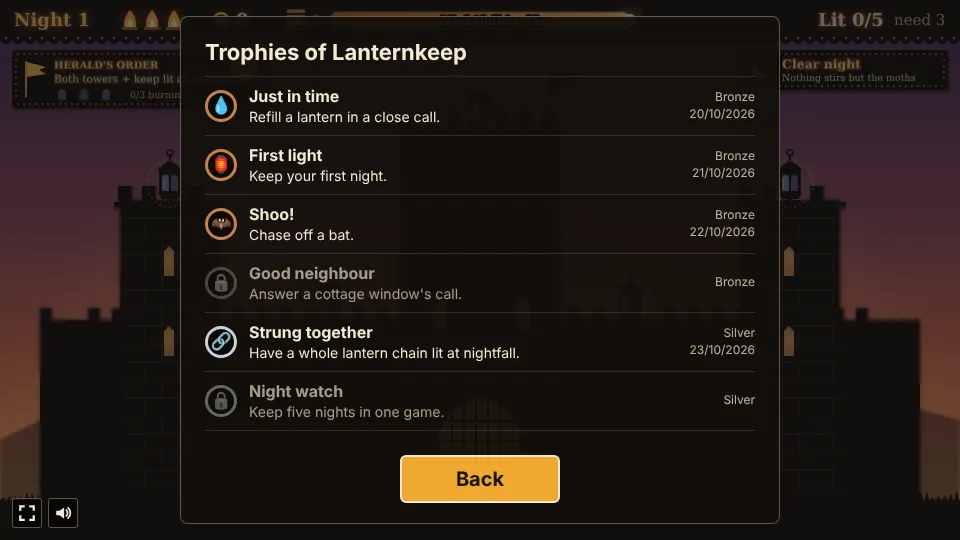

# Lanternkeep

A lantern-lighting prototype built with [Phaser 4](https://phaser.io), TypeScript and Vite, part of
the [game hub](../../README.md).

Dusk is falling on the keep. Its lanterns are dark, and the only way to light them is a jar of
moths: tap a lantern and a moth flies out, catches its wick and flies home. A lantern only burns
for so long on its oil, so light them too early and they are out again before night. Have enough
of them burning when the sun is gone and they pay coins; too few and one of the keep's hearths
goes out. Each night the herald orders a bonus, gusts come for the lanterns, and a refill that
saves a nearly dry lantern pays on the spot. Every night is of a kind (foggy, a feast, stormy),
bats come to snuff the lanterns, and lanterns side by side form chains that pay when all of them
burn. Cottage windows call for a lantern, refills draw on a cask of oil, some spots hold a beacon,
a candle or a bell, every fifth night the Great Owl sweeps a row, and at every fifth nightfall the
keep can move to the Docks, Chapel Hill or the Market. From night 6 a moth tires after four
flights. Spend the coins between nights on better wicks, more oil, more and faster moths,
fireflies, nectar, a second jar, the cask and rekindling a lost hearth. Keep ten nights to reach
the Great Festival; the nights go on after it, and every nightfall from the tenth offers two curses
that make the nights harder and pay more.

It is played as a shadow-puppet theatre: the keep is black cut card in front of a backlit paper
screen that turns from saffron to indigo as dusk falls, light shows through its arrow slits and
stone joints, the lanterns have coloured-glass panes and the moths are lace-winged puppets.


## How to play

| Control | Action |
| --- | --- |
| Tap or click a lantern | Send an idle moth to light it, or to refill a lit one's oil; with every moth busy, the tap waits in line |
| Tap or click a bat | Send an idle moth to chase it off |
| Tap or click an idle moth on its jar | With the second jar bought: send it to rest at the other jar |
| Tap or click an upgrade | Between nights: buy its next level, or put a fill in the cask |
| Tap or click a district | At a fifth nightfall: move the keep there (or stay) |
| Tap or click a curse | At a nightfall from the tenth: take it (or press Go on to take none) |
| Next dusk | Between nights: start the next night's dusk |
| Keep going | After the Great Festival: play on |
| New keep | After the game ends: start again |

1. **Dusk lasts 45 seconds.** The bar at the top empties as the sun sinks.
2. **Moths**: three wait in the jar at the gate, one of each kind. Each one flies to the lantern
   you tap, takes a moment to catch the wick (the ring fills), then flies back to the jar before it
   can go again. A lantern a moth is already on its way to sends no second moth.
   - **Fast** (lighter, blue wings) flies 50% faster, but takes 30% longer to catch the wick.
   - **Slow** (pale green wings) flies 25% slower, but catches the wick 30% quicker.
   - **Heavy** (big, tan wings) flies 20% slower, and its lanterns burn 50% longer (30 seconds).
   The jar keeps the kinds in that order as it grows: a fourth moth from the Moths upgrade is fast.
   - **Firefly** (green-gold wings and a glowing tail), bought with the Firefly upgrade, flies 10%
     faster and lights two lanterns in one flight: after the one you tap it flies on to the oldest
     waiting tap, or else the nearest dark lantern no moth is going to, then home. A tap sends an
     idle firefly before any other moth.
3. **Queue**: a tap made while every moth is busy is not lost. Up to two taps wait, with an amber
   ring on their lanterns, and the next moth to come home takes the oldest. A tap on a lantern a
   moth is already flying to is ignored, and the queue empties at nightfall.
4. **Oil**: a lit lantern burns for 20 seconds (the bar under it), then goes dark. Sending a moth
   to a lit lantern fills it up again; while the moth sits on it, it burns no oil. Queued taps
   show their place in line on a small badge.
5. **Herald's order**: each night the card under the HUD names a bonus goal, with a pip for each
   part of it. Meet it by nightfall for 15 more coins. The orders take turns, one a night:
   - Both towers and the keep lit at nightfall (night 1, 6, ...).
   - The west wall lit at nightfall: left tower, left wall and far left (night 2, ...).
   - Save two lanterns in a close call (night 3, ...).
   - The east wall lit at nightfall: right tower, right wall and far right (night 4, ...).
   - Shield a lantern from a gust (night 5, ...).
6. **Gusts**: five seconds before a gust, a plaque counts down ("Gust in 4s") beside the lantern
   it will blow out, with wind curling in from the nearer edge and a dashed ring round it. The
   gust goes for the lit lantern with the most oil left. A moth sitting on that lantern when the
   gust hits shields it: a moth that finishes lighting or refilling the warned lantern stays on it
   (a pale blue ring) until the gust has passed, then flies home. Otherwise the lantern goes dark.
   Night 1 has one gust (34 seconds before nightfall), nights 2 and 3 two (also 22), and every
   night after three (also 10). With no lantern lit, the wind passes harmlessly.
7. **Close calls**: a lit lantern with under 15% of its oil left shows an orange ring and a
   "Save it +2c" tag. A moth that reaches it before it goes dark refills it as a close call and
   pays 2 coins at once ("+2c close call!", with a flare of sparks).
8. **Nightfall** counts the lanterns still lit. Each pays 5 coins, all of them lit pays 10 more,
   and the herald's order its reward. Fewer than three in five lit puts out one of the three
   hearths; when the last goes out, the keep is lost. The most nights kept is saved in the
   browser.
9. **Each night** adds one more lantern, up to ten.
10. **Kinds of night**: the plaque under the HUD on the right names the night's kind, and the
    night panel says what the next one will be. The first night is always clear; after it each
    night draws one of four kinds:
    - **Clear night**: nothing changes.
    - **Foggy night**: mist over the castle, and oil burns 40% faster.
    - **Feast night**: bunting on the walls, and the lanterns, the all-lit bonus and the chains pay
      double (the herald's order does not).
    - **Stormy night**: rain, and two more gusts (also 28 and 16 seconds before nightfall).
11. **Bats**: from the third night a bat comes in from the edge of the screen (two from night 6),
    with a dotted line to the lit lantern with the most oil, and snuffs it when it gets there. Tap
    the bat and an idle moth chases it off ("Chased off!"); a moth sitting on the lantern when the
    bat arrives drives it off too. If its lantern goes dark first the bat turns to another lit one,
    and with none lit it leaves.
12. **Lantern chains**: lanterns side by side are joined by a cord: the west wall (far left, left
    tower, left wall), the east wall (right wall, right tower, far right), the keep (its two
    sconces and the top) and the gate (left wall, gate, right wall). A chain only shows on a
    night that has all its lanterns, so the first has none. The cord lights up amber while all
    of it burns, and each chain lit at nightfall pays 8 coins.
13. **The Great Festival**: keep ten nights (meet the quota ten times) and the valley holds the
    Great Festival: a win, with sky lanterns rising. "Keep going" plays on, night after night.
14. **Windows that call**: from the second night a cottage window calls for a named lantern
    (a plaque counts down beside it, with a gold ring round it). Light or refill that lantern
    within 8 seconds for 3 coins ("+3c window lit!"); a call that runs out costs nothing. Two
    windows call a night (37 and 23 seconds before nightfall), three from night 6 (also 11).
15. **The oil cask**: the barrel on the HUD holds fills of oil (3 to start, 6 at most). From the
    third night a refill of a lit lantern draws one fill; lighting a dark lantern is always free.
    With the cask dry a tap on a lit lantern is refused, so keep one going or let it go dark,
    except on a lantern a gust or the owl is coming for: a moth may still be sent to shield it, and
    one that arrives with no fill for it sits on the lantern as it is ("Cask dry!") and guards it.
    Chase a bat off instead. With no fill to spare a window calls only for a dark lantern.
    Between nights the Cask card puts a fill in for 3 coins.
16. **Kinds of lantern**: from the fourth night some spots hold a special lantern, named under
    it: one on night 4, two on night 5, three from night 6, on spots that change with the night.
    - **Beacon** (red-orange panes): holds 40% less oil, so it goes dark sooner, but pays triple
      at nightfall.
    - **Candle** (a single pale pane): catches at once, but holds half the oil.
    - **Bell** (teal panes, a bell under it): while lit, every bat within 150 pixels is held still.
17. **The Great Owl**: every fifth night, 26 seconds before nightfall, a dashed line marks a row
    of lanterns (the one with the most lit) and a plaque counts down. Six seconds later the owl
    sweeps across it and snuffs every lit lantern it passes unless a moth sits on it: a moth that
    lights a lantern on the row stays to keep it, like a gust's guard.
18. **Districts**: at every fifth nightfall a panel asks where the keep stands next. Each
    district has its own ten spots, chains and rule, and the herald's orders name its lanterns:
    - **The Keep**: the old walls, with no rule.
    - **The Docks**: a sea wind, so each gust blows out a second lantern (the next with most oil).
    - **Chapel Hill**: vespers pay 2 more coins a lantern, but three lanterns in four must burn.
    - **The Market**: close calls and window calls pay double, and oil burns 15% faster.
19. **Tired moths**: from night 6 a moth that comes home from its fourth flight of the dusk (a
    chase counts; a firefly's second lantern does not) rests 6 seconds in its jar, wings folded,
    with a lilac ring filling and a "zz" countdown, before it can fly again. Then it counts afresh.
    Each Nectar level takes 1.5 seconds off the rest.
20. **The second jar**: the Jar card (120 coins, once) puts a second moth jar by the east wall.
    Every other moth rests there to start with, so its flights to the east side are shorter. Tap
    an idle moth on its jar during dusk (not a tired one) and it flies over to rest at the other one, from then on.
21. **Rekindle a hearth**: between nights the Hearth card lights a hearth that went out, for 40
    coins, then 80, then 120. Three rekindles a game at most.
22. **Pick your peril**: every nightfall from the tenth (before night 11 on) a panel offers two
    of four curses. Take one, both or neither ("Go on"). Each curse lasts the rest of the game
    and raises the pay of every nightfall by 25% (x1.25 for one, x1.5 for two, ...), and the best
    multiplier reached is saved in the browser.
    - **Wet wicks**: lighting a lantern takes 50% longer.
    - **Restless bats**: one more bat comes every night.
    - **Thin oil**: oil burns 25% faster.
    - **Watchful lord**: one more lantern must burn at nightfall to keep the hearths.


### Upgrades

| Upgrade | Each level | Costs |
| --- | --- | --- |
| Wicks | Lanterns catch 25% faster | 10, 20, 35 |
| Oil | Lanterns burn 6 seconds longer | 10, 20, 35 |
| Moths | One more moth in the jar (kinds keep cycling fast, slow, heavy) | 15, 30, 50 |
| Wings | Moths fly 20% faster | 10, 20, 35 |
| Firefly | One more firefly in the jar | 25, 45 |
| Nectar | Tired moths rest 1.5 seconds less (from night 6) | 15, 30, 50 |
| Jar | A second moth jar by the east wall (once) | 120 |
| Cask | One more fill of oil (up to 6) | 3 each |
| Hearth | Rekindle a hearth that went out (three a game) | 40, 80, 120 |


The difficulty, set on the hub page's Settings, changes one thing: lanterns burn 26 seconds on
Easy and 16 on Hard, instead of 20. (A heavy moth's lanterns burn 50% longer on every setting.)

### Trophies

Ten trophies, listed behind the Trophies button on the start and pause screens and counted on the
hub's card. Each pops up at the top of the page once, when it is earned.

| Tier | Trophy | Earned by |
| --- | --- | --- |
| Bronze | Just in time | Refilling a lantern in a close call |
| Bronze | First light | Keeping your first night |
| Bronze | Shoo! | Chasing off a bat |
| Bronze | Good neighbour | Answering a cottage window's call |
| Silver | Strung together | Having a whole lantern chain lit at nightfall |
| Silver | Night watch | Keeping five nights in one game |
| Silver | On the move | Moving the keep to another district |
| Gold | Great Festival | Keeping ten nights and reaching the Great Festival |
| Gold | Tempting fate | Playing with four curses taken |
| Gold | Keeper of the flame (hidden) | Keeping twenty nights in one game |



## Running locally

`npm run dev` at the repo root, then open `/games/lanternkeep/` (or pick Lanternkeep on the hub
page).

## Playthrough test

`e2e/playthrough.spec.ts` plays the first night in headless Chromium: it checks the herald's order
and the night's one gust, taps a lantern and checks one moth (and only one) flies out and lights
it, sends a moth to sit on it when the gust is warned for it and checks the gust is shielded,
waits until its oil is nearly gone, then taps it and two more lanterns at once and two more after,
checking the last two wait in the queue and are lit as moths come home and that saving the first
pays a close call. Night falls with every lantern lit, and it checks the pay (with the order's
reward and no chain on the first night), the hearths and the night panel. It also checks the
first night is clear and has no bats. Like the
other games' tests it owns the game clock and plays at 4x speed (`PLAYTHROUGH_SPEED`). The
**Playthrough Lanternkeep** workflow (`.github/workflows/playthrough.yml`) runs it on
every PR that touches this folder, and uploads the video and screenshots as the
`playthrough-lanternkeep` artifact.

```sh
npx playwright test --project lanternkeep
```

## Code layout

All paths are inside `games/lanternkeep/`.

- `src/game/`: the rules in plain TypeScript with no Phaser dependency. `state.ts` has dusk, moths,
  oil, gusts, close calls, the herald's orders, kinds of night, bats, chains, window calls, the
  cask, kinds of lantern, the Great Owl, nightfall, the Great Festival, the move between
  districts and the upgrades, `places.ts` the districts (where their lanterns and chains are) and
  the jar, and `save.ts` the best score.
- `src/scenes/`: `BootScene` bakes textures, `GameScene` draws the screen, the district's
  scenery, lanterns, chains, moths, bats, the owl, the order card and night-kind plaque, mist,
  bunting and rain, gust, owl and window plaques, close-call tags, HUD and panels and wires taps
  to the rules, `layout.ts` says where the HUD and panels go.
- `src/art/puppet.ts`: every texture (paper screens, the cut-card scenery of each district,
  lanterns of every kind, moth, bat and owl puppets, mist, bunting, sky lanterns, plaques, icons),
  painted on 2D canvases at startup.
- `src/ui/`: the button.
- `src/trophies/`: the ten trophies. `index.ts` lists them with their texts in `i18n/`, and
  `check.ts` awards them from the state each frame.

Retuning a night is the constants at the top of `src/game/state.ts`; an upgrade is its row in
`UPGRADES` there, a moth kind its row in `MOTH_KINDS`, an order its row in `ORDERS`, the gusts
`gustsFor` and `GUST_WARN_MS`, a kind of night its row in `NIGHT_KINDS`, the bats `batsFor` and
`BAT_SPEED`, a kind of lantern its row in `LANTERN_KINDS`, the owl `OWL_AT_MS` and `OWL_EVERY`,
the window calls `callsFor` and `CALL_MS`, the cask `CASK_START` and `CASK_MAX`, and a district
(its spots, chains and rule) its entry in `DISTRICTS` in `places.ts`.
