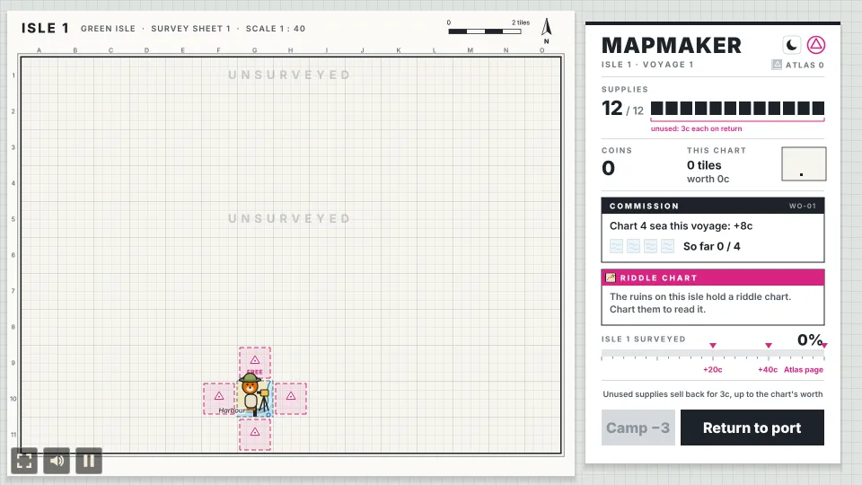
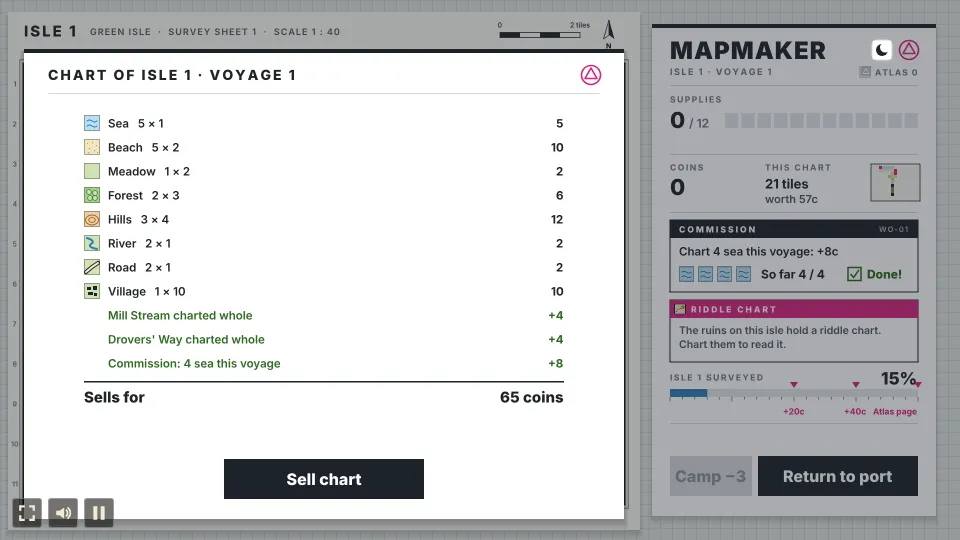
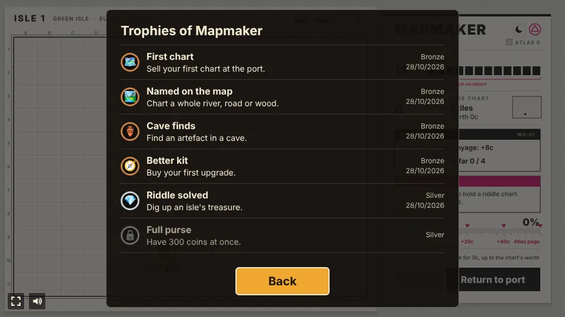
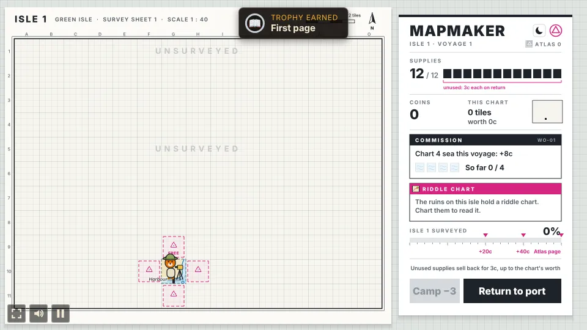

# Mapmaker

A fog-of-war charting prototype built with [Phaser 4](https://phaser.io), TypeScript and Vite,
part of the [game hub](../../README.md).

A bear surveyor lands at the port of an island nobody has mapped. The island is a modern
topographic survey sheet: what you have surveyed is printed in layered height colours with contour
lines, hill shading, map symbols and place names, and the rest is blank, gridded drafting paper.
Each voyage you have a sack of supplies, and every tile you survey costs one (two for forests and
peaks, none along rivers and roads). Push inland across beaches, meadows and forests, climb hills
and peaks to see the land around them, turn up wrecks, caves and storms, pitch base camps, solve
the ruins' treasure riddle, chart rivers, roads and woods whole for their named bonuses, and find
the villages and ruins worth the most. When the supplies run out (or you turn back early), the
surveyor sails home and draws what they found into a chart, which sells at the port. Pick a
commission off the board and a hand for the next voyage, spend the coins at the harbor, set sail
again, and chart the whole isle to bind it into your atlas before a new one waits over the horizon:
an archipelago, a volcanic isle or a jungle isle. From the third isle a rival surveyor charts
alongside you, and binding one isle of every kind completes the Royal Atlas.

## How to play

| Control | Action |
| --- | --- |
| Tap a magenta survey station | Survey that tile for its cost; the surveyor walks there |
| Camp | Pitch a base camp where the surveyor stands, for 3 supplies |
| Tap charted ground | Once the riddle chart is found, dig there for the treasure, for 1 supply |
| Return to port | End the voyage (early, if you like: unused supplies sell back) and draw the chart |
| Sell chart | Sell the voyage's chart at the port |
| Moon or sun beside the logo | Switch between the white survey sheet and the dark night sheet |
| Tap a commission | Pick it off the harbor's board for the next voyage |
| Tap a hand | Take them aboard for the next voyage (tap again to leave them ashore) |
| Buy | Buy an upgrade at the harbor |
| Keep charting, New atlas | On the Royal Atlas page: carry on, or start over and try for a better best |
| Set sail | Start the next voyage with full supplies (to a new isle once this one is charted) |

1. **Surveying**: a blank tile next to a charted land tile carries a magenta survey station
   (pointing at one shows its cost). The sea can be charted but leads nowhere: you can't survey
   on from a sea tile.
2. **Terrain costs**: most tiles cost one supply, but forests and peaks are hard going and cost
   two (the station is marked −2), and rivers and roads are free to follow (marked FREE). A station
   the supplies can't pay for turns grey, so the route you take matters.
3. **Finds**: some tiles hide something, found the moment they are charted. A shipwreck's stores
   add 3 supplies to the voyage; a cave holds an artifact that sells for 15 coins with the chart;
   a storm settles on a blank tile nearby and blocks it until the voyage ends.
4. **Base camps**: Camp spends 3 supplies to pitch a magenta tent where the surveyor stands (not
   on the port). From then on, for the rest of the isle, you can survey any blank tile up to two
   steps from a camp, even with fog in between.
5. **Treasure riddle**: the ruins hold a riddle chart. Chart them and the panel reads its clues,
   such as "Two tiles west of a peak, by the water". Tap charted ground to dig there for 1 supply;
   the right tile pays 60 coins with the chart. While the riddle is open and you have a supply
   left, the voyage waits for you to tap Return to port.
6. **Lookouts**: hills reveal the four tiles beside them for free, and peaks all eight around them.
   A lookout that charts new ground sweeps a dotted sight ring out over the tiles it sees, and their
   values gather into one tally ("Viewshed, 6 tiles, +18"), while the panel's small live chart inks
   the new tiles in magenta.
7. **Supplies**: 12 a voyage. When they can't pay for anything more, the surveyor heads home on
   their own.
8. **Turn back early or push on**: every supply left when you tap Return to port sells back for 3
   coins, up to what the chart's tiles pay (after the rival's share). The panel brackets the unused supply pips and the
   button carries the sell-back as a magenta tag (+18c). A voyage that spends every supply sells
   none back.
9. **Charts**: every tile revealed on a voyage, surveyed or seen from a lookout, goes on the chart,
   with any artifacts and the treasure.
10. **Whole features pay**: every river, road and wood (three or more forest tiles joined) is a
   named feature. Pointing at the station that would chart its last tile says so ("finishes Mill
   Stream +4c"), and the chart that charts the last tile of one pays 2 coins for each of its
   tiles on top. Routes that follow a river or a road pay twice.
11. **Commission board**: the first voyage comes with a commission; after that the harbor lays out
   a board of up to three to pick from, with the first one picked for you. Most ask for so many
   tiles of one terrain on the next voyage. A **long** one asks for more over two or three voyages
   for a bigger pay: the tiles add up voyage to voyage, and the panel counts the voyages left.
   The board stays hidden while a long commission runs.
12. **Hire a hand**: the harbor also offers three of four hands, free, for the next voyage only.
   A Woodsman makes forests cost 1; a Climber makes peaks cost 1 and lookouts see a tile further;
   a Naturalist doubles what cave artifacts pay; a Boatman makes the sea free to chart and lets
   you survey on from charted sea tiles. The sheet's header says who is aboard.
13. **Isle goal**: the panel's "Isle surveyed" bar shows how much of the isle is charted (its land
   and the sea beside it). The voyage whose chart takes it past 50% pays +20 coins, past 75% +40
   coins, and at 100% the isle is bound into your atlas as a page; the atlas count shows beside the
   voyage in the panel and at the harbor.
14. **Islands**: what you have charted stays charted between voyages. Once every tile you can reach
   is charted, the next voyage sails to a new island with more villages and ruins. The isles take
   turns: a green isle, an archipelago (islets joined by sandbars, lots of beach), a volcanic isle
   (hills and peaks, little wood) and a jungle isle (thick forest cut by rivers, no roads). Each
   binds into the atlas as a page of its own colour.
15. **The rival surveyor**: from the third isle a grey surveyor lands on the far shore. For every
   two tiles you survey they chart one, heading for ruins, peaks and hills, and plant a grey
   pennant on it that shows through the paper. A tile they charted first sells for half when you
   chart it. Once they have charted the ruins they make for the treasure, and if they reach it
   first it is gone.
16. **The Royal Atlas**: binding one isle of each of the four kinds completes the Royal Atlas. Its
   page shows the four pages and the voyages it took, keeps your best (fewest voyages) between
   games, and lets you keep charting or start a new atlas.

The game saves itself at every step.

### What tiles are worth

| Tile | Coins | Survey cost | Note |
| --- | --- | --- | --- |
| Sea | 1 | 1 | Leads nowhere |
| Beach | 2 | 1 | |
| Meadow | 2 | 1 | |
| Forest | 3 | 2 | |
| Hills | 4 | 1 | Reveals the four tiles beside it |
| Peak | 6 | 2 | Reveals the eight tiles around it |
| River | 1 | free | Runs from the high ground to the sea |
| Road | 1 | free | Runs from the port to a village |
| Village | 10 | 1 | Landmark |
| Ruins | 12 | 1 | Landmark; holds the riddle chart |

| Find | What it does |
| --- | --- |
| Shipwreck | +3 supplies this voyage |
| Cave | An artifact, +15 coins on the chart |
| Storm | Blocks a blank tile nearby until the voyage ends |
| Treasure | Dug up on the riddle's tile: +60 coins on the chart |

| Feature | Bonus once charted whole |
| --- | --- |
| River | 2 coins a tile |
| Road | 2 coins a tile |
| Wood (3+ forest tiles) | 2 coins a tile |

| Hand | For one voyage |
| --- | --- |
| Woodsman | Forests cost 1 supply |
| Climber | Peaks cost 1 supply; hills and peaks see one tile further |
| Naturalist | Artifacts from caves pay 30 instead of 15 |
| Boatman | Sea costs nothing, and charted sea can be surveyed on from |

A voyage that turned back with supplies left and took the isle past 50%: the unused supplies and
the milestone are paid with the chart.

The station that would finish a river, and the bonus once it is charted whole.

The rival surveyor on a volcanic isle, with the tiles they charted first flagged, and a chart that
lost half of three of them while a long commission paid.

### Upgrades

| Upgrade | Ranks | Costs | What it does |
| --- | --- | --- | --- |
| Provisions | 3 | 40, 80, 140 | +3 supplies every voyage |
| Spyglass | 2 | 60, 120 | Hills and peaks see one tile further |
| Fine Ink | 3 | 50, 100, 180 | Charts sell for 25% more |
| Lodestone Compass | 1 | 90 | Shows villages and ruins on blank paper as gold compass roses |

The harbor, with the commission board and the hands beside the upgrades.

Once an isle is charted in full, its atlas page shows at the harbor and the next voyage sails to a
new isle; one page of every kind completes the Royal Atlas.

## Dark theme

The sheet comes in two looks: the white survey sheet and a night sheet with light ink on dark paper
and deeper height colours. The game starts in the look the device prefers (its dark mode setting),
and the moon or sun button beside the panel's logo switches it, which the game remembers.

## Trophies

Ten trophies, listed behind the Trophies button on the start and pause screens and counted on the
hub's card:

| Trophy | Tier | Earned by |
| --- | --- | --- |
| First chart | Bronze | Selling your first chart at the port |
| Named on the map | Bronze | Charting a whole river, road or wood |
| Cave finds | Bronze | Finding an artefact in a cave |
| Better kit | Bronze | Buying your first upgrade |
| Riddle solved | Silver | Digging up an isle's treasure |
| Full purse | Silver | Having 300 coins at once |
| First page | Silver | Charting an isle to its last tile |
| Royal cartographer | Gold | Completing the Royal Atlas |
| One step ahead (hidden) | Gold | Digging up the treasure on an isle the rival is charting |
| Fully equipped (hidden) | Gold | Buying every upgrade to its last rank |

## Difficulty

The hub's Difficulty setting changes the supplies of a voyage: 16 on Easy, 12 on Normal, 9 on Hard.

## Code layout

- `src/main.ts`: creates the game and applies the hub's settings.
- `src/game/`: the rules, with no Phaser: `island.ts` rolls an island (rivers, roads, finds, the
  riddle and the features included), `sim.ts` surveys, camps, digs, moves the rival, charts, sells,
  lays out the board and the hands, buys and tracks the isle goal and the Royal Atlas, `state.ts`
  holds the state and numbers, `terrain.ts`, `kinds.ts`, `upgrades.ts` and `hands.ts` the tables,
  `save.ts` the save, the best and the theme.
- `src/trophies/`: the trophies (`index.ts`), their texts (`i18n/`) and when each is earned
  (`check.ts`).
- `src/scenes/`: `BootScene` bakes the art, `GameScene` paints the island and draws the sheet,
  panel and overlays and takes the taps, `layout.ts` says where everything goes.
- `src/art/`: the survey-sheet art, painted on canvases in code: `map.ts` (terrain, contours,
  symbols, rivers, roads, blank paper, place names), `surveyor.ts` (the surveyor and the rival),
  `icons.ts` (also the hands' icons and the finds, camp, claim, riddle and treasure marks),
  `paint.ts` (the light and dark palettes and helpers).
- `src/ui/Button.ts`: the flat ink button.
- `e2e/playthrough.spec.ts`: plays the first voyage.

See [AGENTS.md](AGENTS.md) for how it fits together.
