# Mazewright

A tower defense with no road, built with [Phaser 4](https://phaser.io), TypeScript and Vite, part of
the [game hub](../../README.md).

Beetles come out of their burrows and walk to the cottage across an open lawn, always by the
shortest free way. Every hedge and tower you plant is a wall, so you build the maze they must walk:
the longer it is, and the more towers it passes, the fewer beetles get in. The one rule: a way
through must always stay open. A planting that would close the last way from a burrow (or trap a
beetle already on the lawn) is refused with an orange no-entry ring.

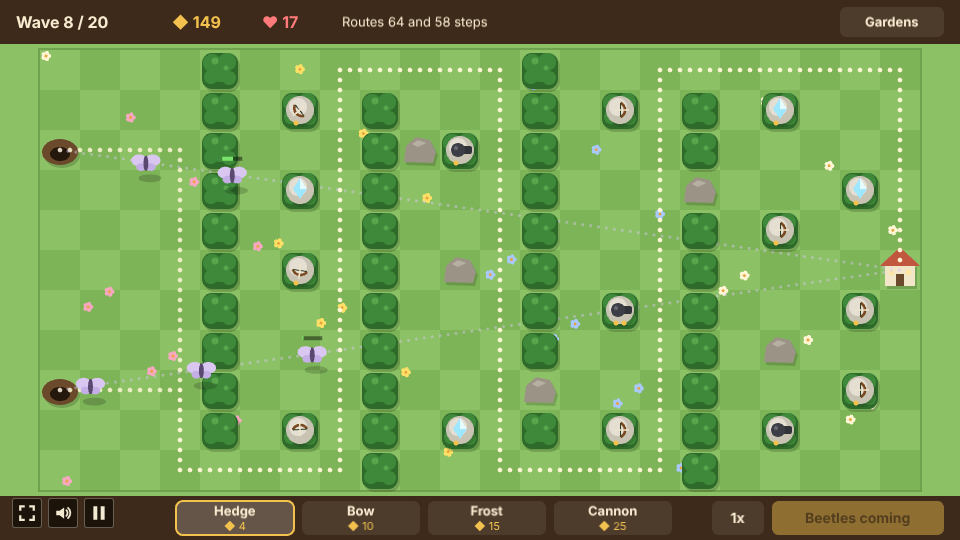

## How to play

| Control | Action |
| --- | --- |
| Tap or click a tool, or keys 1 to 8 | Pick a tower from your pouch, even one you can't afford yet (it shows dim); pick the same one again (or press Escape) to put it away, so taps on the lawn plant nothing |
| Tap, click or drag on the lawn | Plant the tool there, or a whole line of them |
| Hover the lawn | See the new route before you plant |
| Tap or click a tower | Open its panel: Upgrade, Sell (tap it twice), Aim for a tower that picks a target, and Turn for a bonfire or sunglass |
| Upgrade button (after the tools), or U | Upgrade mode: every tower you tap or drag over is upgraded at once, and a gold mark shows the ones you can afford; tap Upgrade again to go back to the tool you had |
| Sell button, or S | Sell mode: every tower you tap or drag over is sold at once (for its whole price if it was planted since the last wave, else 70%), to clear a lot of the maze quickly; tap Sell again to go back |
| A tower tool on a hedge | Plant the tower in the hedge's place, for its cost less what the hedge sells for (the route doesn't change) |
| Start wave, or Space | Send the next wave; once the last one is all out, send the next early for 5 gold |
| Way of play (garden picker, top left) | Classic, Challenge, Swarm, Endless or Sandbox, for every garden |
| Wave timer / Calm (garden picker) | After wave 1 the next wave comes by itself 20 seconds after the last is all out; Calm waits for Start wave |
| Speed button, or F | Play at double speed |
| One gardener / Two gardeners (garden picker) | Play alone, or two on one screen, each on their own half of the lawn |
| Watch (on a garden card) | Watch your latest win in that garden again |
| ▶ Wave (on a garden card) | Go on with the game you left there, from its last break between waves |
| Gardens | Back to the garden picker |

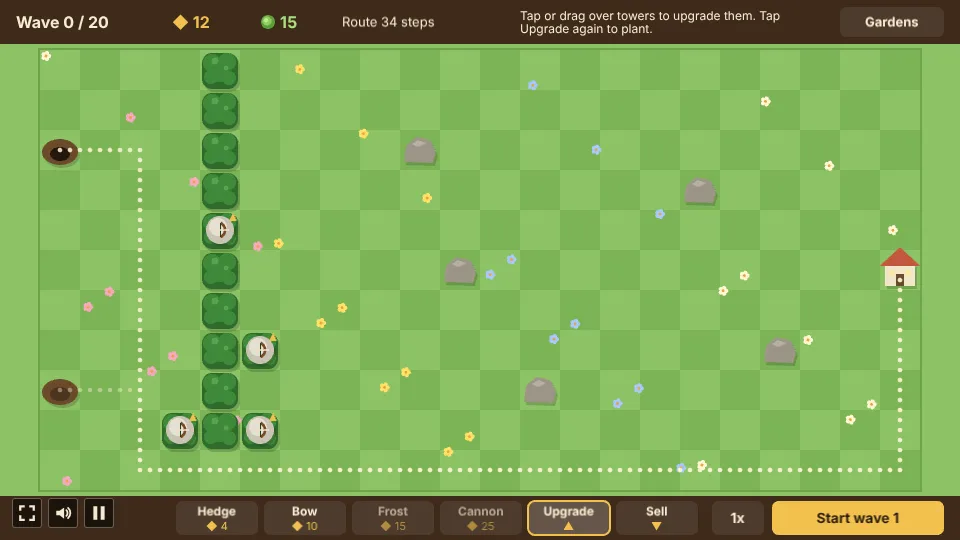

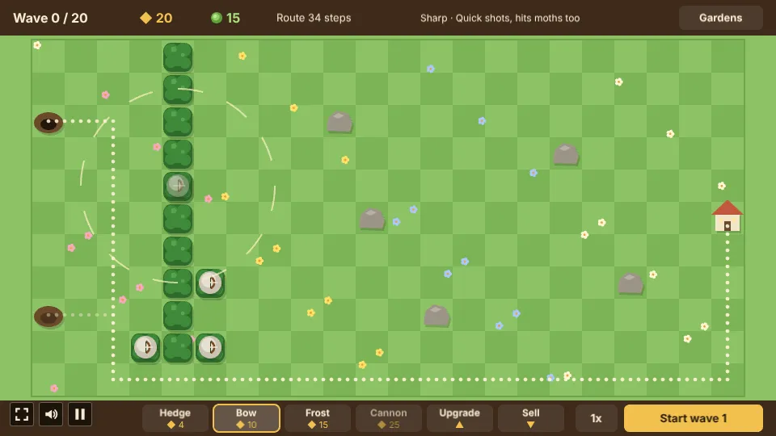

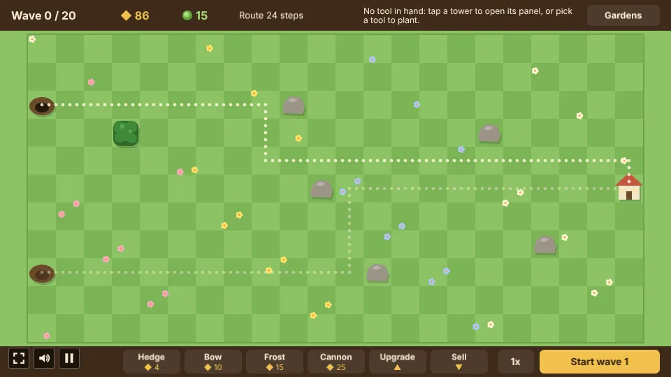

Every planting, upgrade and sale shows what it cost or paid in a short note rising from the tower
(−21 ◆ for a cannon in a hedge's place, which already counts what the hedge sells for; +10 ◆ for a sale).

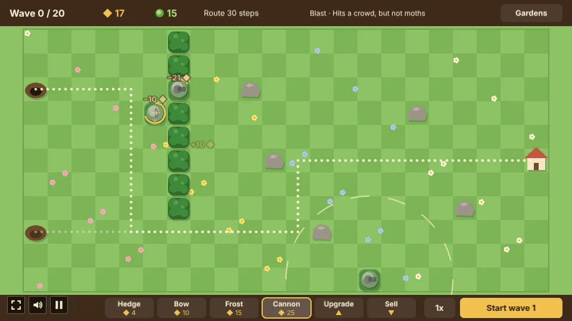

**Growing time.** A tower grows for a second per 10 gold it cost (a bow 1 second, a crossbow 3.5),
and an upgrade grows again for what it cost; a growing tower is faint, with a gold ring that fills,
and doesn't fire. Hedges grow in under half a second and block at once. So plant before the foes
come, and upgrade between waves rather than in the thick of one.

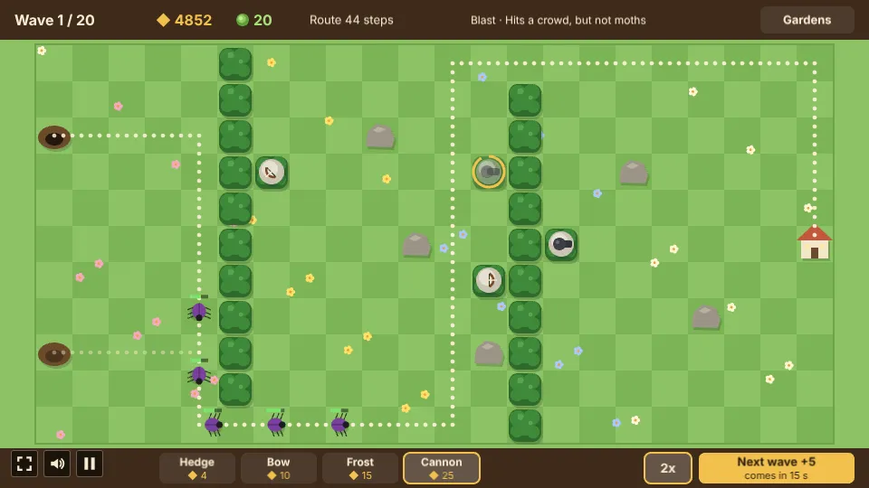

### Gardens

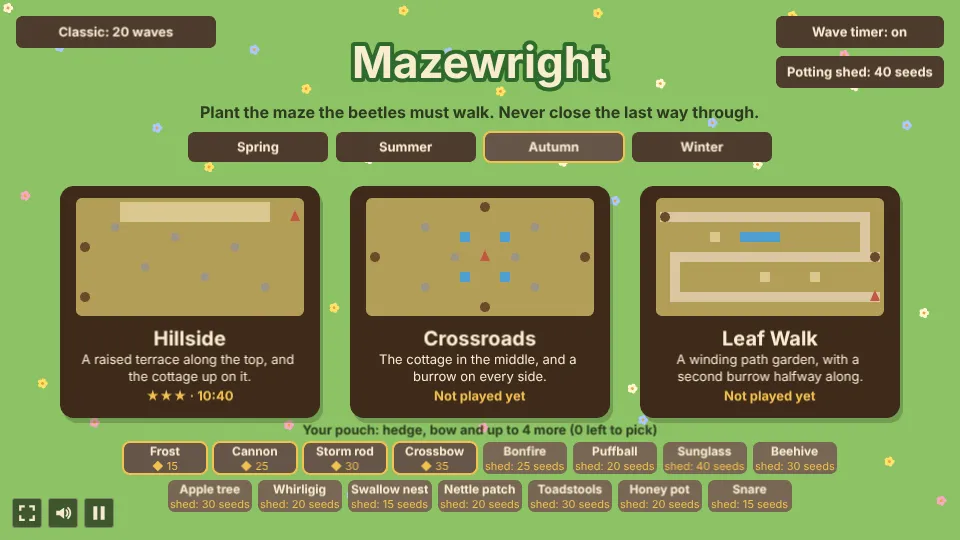

Twelve gardens in four seasons, three a season, each with its own rocks, water and burrows, so
each asks for its own maze. The picker has a tab for each season: spring is open from the start,
and summer, autumn and winter open once 4, 10 and 18 stars are won across all gardens.

| Season | Gardens |
| --- | --- |
| Spring | **Meadow** (open lawn), **Orchard** (rows of rocks), **Millpond** (a pond, a burrow at the top and the cottage in the corner) |
| Summer | **Brook** (a brook with two fords and banks), **Warren** (three burrows), **Gravel Walk** (a path garden) |
| Autumn | **Hillside** (a raised terrace), **Crossroads** (the cottage in the middle, four burrows), **Leaf Walk** (a winding path garden) |
| Winter | **Ice Pond** (a frozen pond, three burrows), **Last Cabbage** (one cabbage, six burrows, 130 gold to start), **Snow Path** (a path garden with banks) |

Rocks never move and nothing is planted on them. **Water** is the same for walkers, but moths fly
over it and a sunglass beam shines across it. A tower on a raised **bank** (a lighter tile with a
step) reaches a quarter further. In a **path garden** the foes keep to the gravel path, and towers
go only on the lawn beside it: there is no maze to build, only where to put each tower. A garden
with more burrows opens them on waves 6, 10, 13, 15 and 17, and every route must stay open from the
start.

Under the cards is your **pouch**: the hedge and the bow always come along, and you pick up to four
more of the other thirteen towers and the two garden traps. The pick is kept for the next game.

**Seeds and the potting shed.** Every finished game pays seeds: a win 10 plus 5 a star, a loss 2
plus one for every 4 waves held (Sandbox pays none). The potting shed (top right of the garden
picker) sells them back: every tower but the hedge, bow, frost and cannon costs as many seeds as
its gold price, each tower's master level twice that, and the pouch's fifth and sixth slots 60 and
100. Each card tells what the buy brings: a tower's gold price and use, then its master level's trick, and
the slots say they take one more tower along. A tower still in the shed shows its price on its pouch chip. A first visit credits the gardens
already played, so seeds are waiting for players from before the shed.

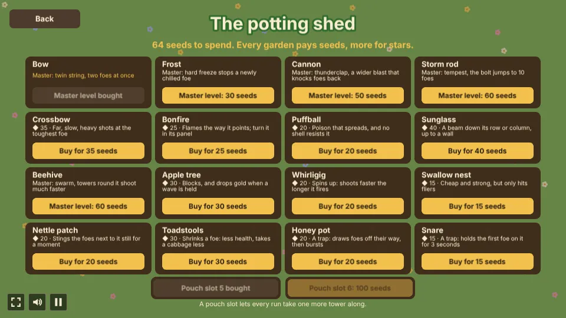

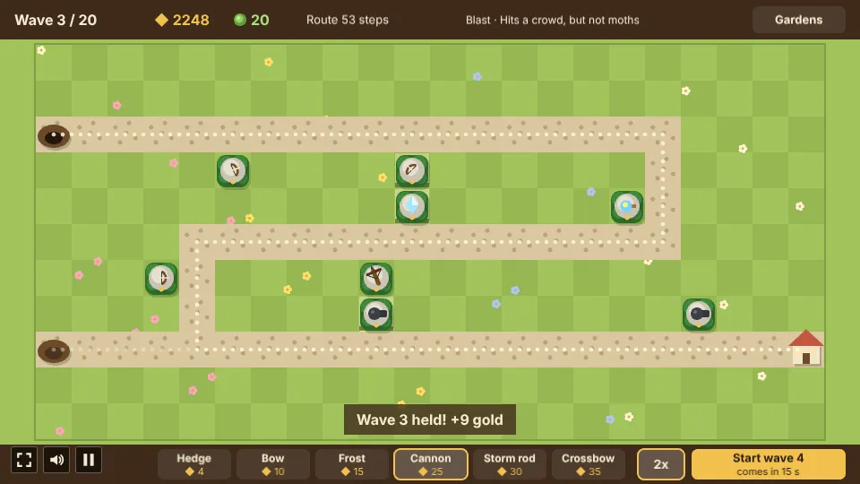

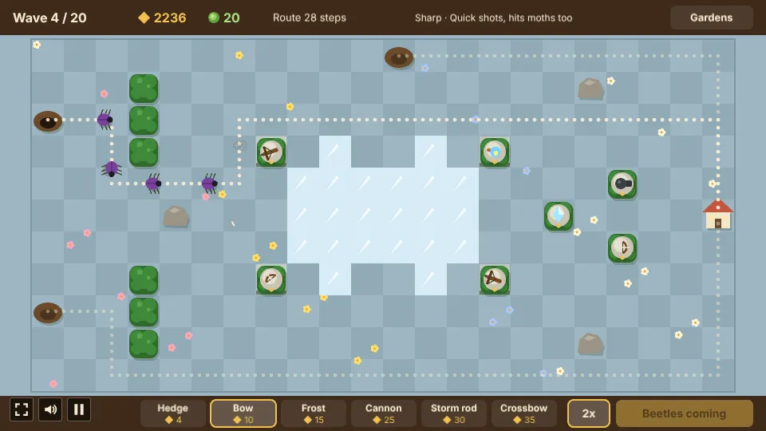

**Weather.** Summer and winter gardens have weather of their own. In summer a tower that fires
nonstop for 8 seconds wilts in the heat and rests for 3, unless a frost tower's reach covers it. In
winter, every 14 seconds of a wave, frost freezes one tower for 4 seconds, unless a bonfire's reach
covers it. So a summer maze wants frost towers among its hardest workers, and a winter one a
bonfire or two to keep the rest warm.

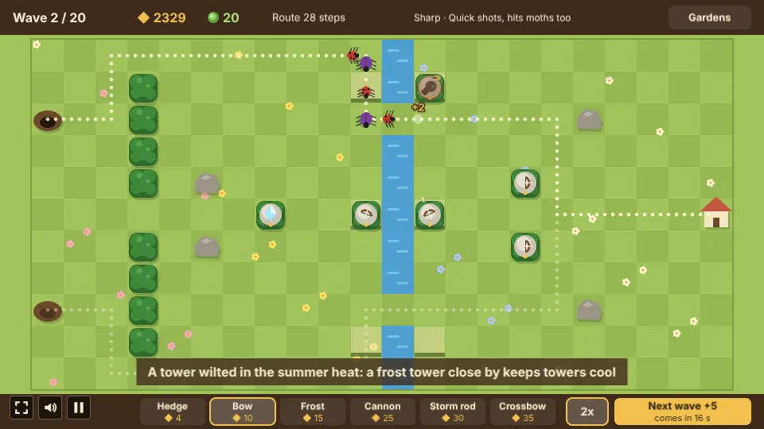

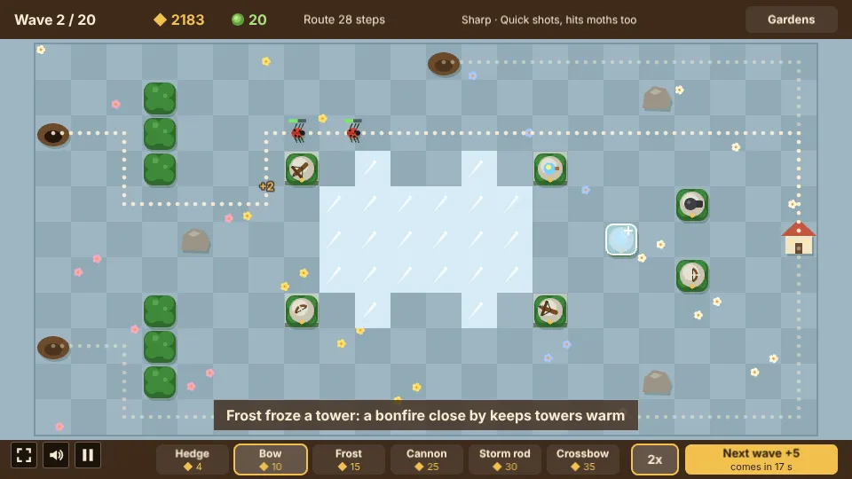

**Two gardeners.** Two can play on one screen: pick Two gardeners on the garden picker. Each
gardener plants on their half of the lawn (a dashed line marks the middle) with their own gold and
their own row of tools under their half, as pictures with their prices; keys 1 to 8 pick the left
gardener's tools. Both start with the usual gold, a foe pays whoever's half it is beaten on, and a
held wave's pay and the early bonus are shared out. The waves are the same for both, and foes are
30% tougher, so the maze has to work across both halves.

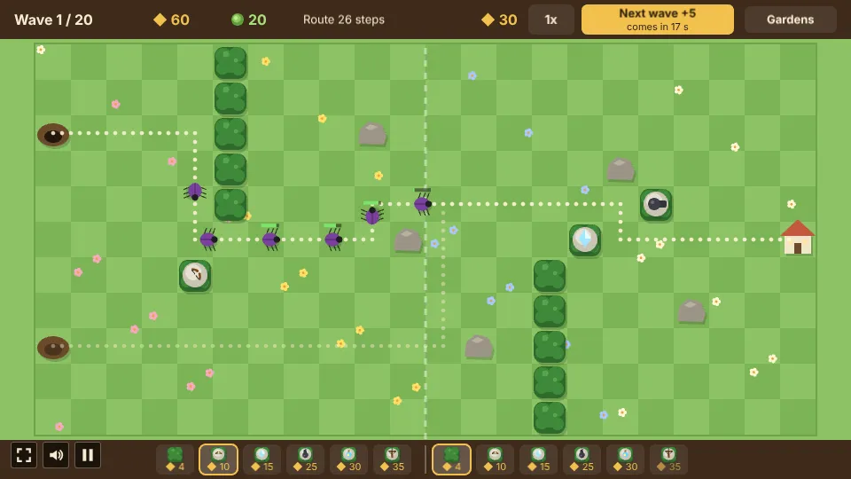

**Replays.** Each garden keeps your latest Classic or Swarm win, and its card gets a Watch button
that plays it back: every hedge, tower, upgrade and wave as you played it, at 2x, or 1x or 4x with
the speed button (F). Nothing can be planted while it plays, and it changes no records or seeds.

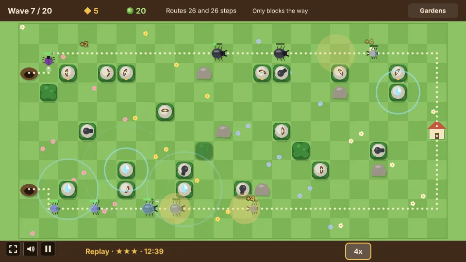

**Going on later.** A game in play is saved in every break between waves. Close the page, or tap
Gardens, and its garden's card gets a gold ▶ Wave button that takes you back to that break, with
the maze, gold, cabbages and wave timer as they were. A wave left half-played starts again from the
break before it. Tapping the card itself starts that garden afresh and drops the saved game, as does
starting any other garden.

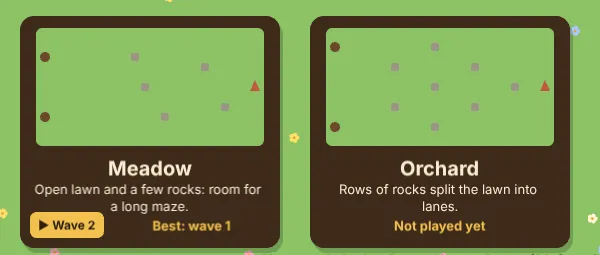

### Towers

Every tower stands on a hedge and blocks its tile. Every tower but the hedge rises to level 3, and
then to a master level, which costs as much as the first three together, keeps level 3's numbers
and adds a trick of its own (its panel tells it from level 3), once the potting shed has sold it. Selling gives back 70% of what a
tower cost, or all of it while the tower is still growing (and all of an upgrade still growing). Before
the first wave and between waves, a tower planted in that break sells back for all it cost, and an
upgrade bought in it for all of its price, until the next wave starts, so a maze can be tried and
changed for free; towers from before the break keep the 70%.

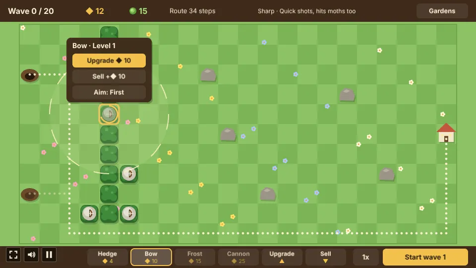

| Tower | Cost | Reach | What it does |
| --- | --- | --- | --- |
| Hedge | 4 | | Only blocks the way: the cheap way to make the maze longer |
| Bow | 10 | 3 tiles | Quick single shots at the foe closest to the cottage; hits moths |
| Frost | 15 | 2.5 tiles | A pulse every second that chills (slows to about half) and nicks everything near it |
| Cannon | 25 | 3.5 tiles | Slow shots that hit every foe on the ground around the target; not moths |
| Storm rod | 30 | 3 tiles | A bolt that jumps on to up to 3 more foes standing close together (4 and 5 at higher levels); hits moths |
| Crossbow | 35 | 7 tiles | Slow, heavy bolts at the toughest foe in reach; hits moths |
| Bonfire | 25 | 2.2 tiles, one way | Breathes flames down the way it points and sets ground foes alight; turn it from its panel |
| Puffball | 20 | 2.5 tiles | Poisons a foe, and the poison spreads to ground foes walking close to it; goes through armour |
| Sunglass | 40 | its row or column | A beam down the way it points, up to the first rock or tower, hitting every foe in the line |
| Beehive | 30 | the 8 tiles round it | Doesn't shoot: the towers round it reload 20% faster (30%, 40%) |
| Apple tree | 30 | | Doesn't shoot: drops 5 gold each time a wave is held (8, 12) |
| Whirligig | 20 | 2.5 tiles | Darts that come faster the longer it keeps firing; hits moths |
| Swallow nest | 15 | 3.5 tiles | Strong, quick darts at fliers only |
| Nettle patch | 20 | 1.6 tiles | Stings every ground foe next to it still for half a second, now and then |
| Toadstools | 30 | 2.5 tiles | Shrinks one foe at a time, the toughest first: a quarter less health, and it takes a cabbage less |

| Master trick | |
| --- | --- |
| Bow, swallow nest | Two foes at once |
| Frost | Hard freeze: a newly chilled ground foe stops for a second |
| Cannon | Thunderclap: a wider blast that knocks foes back |
| Storm rod | Tempest: the bolt jumps to 10 foes |
| Crossbow, bonfire | Bolts and flames go through every shell |
| Puffball | Spore cloud: poisons every foe in reach |
| Sunglass | Heats foes twice as fast |
| Beehive | Towers round it reload 55% faster |
| Apple tree | 20 gold a held wave |
| Whirligig | Never spins down |
| Nettle patch | Stings hold twice as long |
| Toadstools | Shrinks two foes at once |

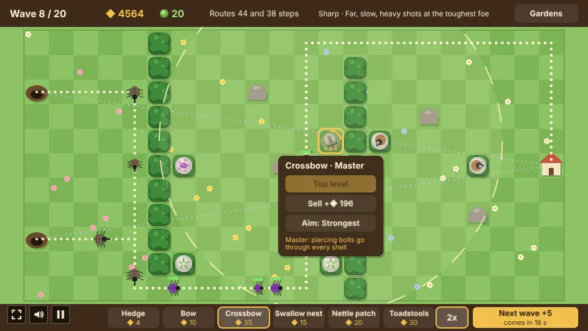

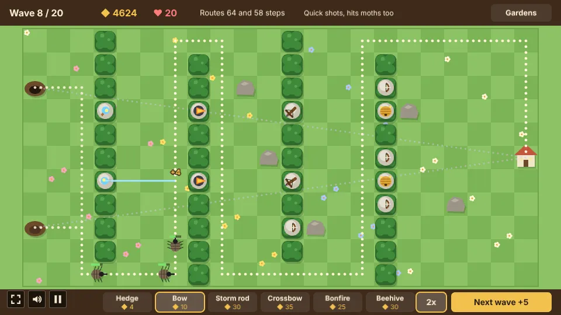

**Garden traps.** Two pouch picks are one-use traps that lie on the lawn and never block, so they
can go anywhere free, even under foes. A **honey pot** (20 gold) waits until a ground foe comes
within 2.5 tiles, draws every ground foe in that reach off its way for 3 seconds, then bursts: 45
Blast round it, and the foes there stand still for 1.5 seconds. A **snare** (15 gold) holds the
first ground foe to step on it for 3 seconds and pricks it. Moths fly over both.

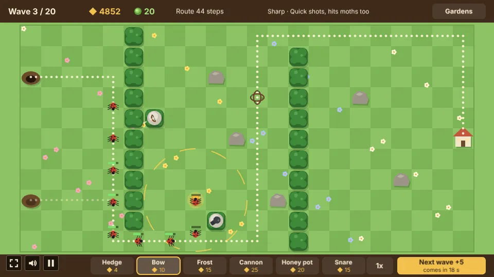

**Damage kinds and shells.** Every tower's hits are Sharp (bow, crossbow, whirligig), Blast
(cannon), Heat (bonfire, sunglass, and burning), Spark (storm rod), Cold (frost) or Poison
(puffball). Some foes wear a shell: the stag beetle's is waxy (half Heat, 1.5 times Blast), the
mole's coat is hairy (half Blast, 1.5 times Sharp) and the weevil's is hard (half Sharp, 1.5 times
Spark). Poison goes through every shell. Sunglass and bonfire hits also heat a foe up; once it
glows, it takes double Heat damage.

**Aim.** A tower that picks one target can aim at the First foe (closest to the cottage), the
Last, the Strongest, the Weakest or Fliers first. The crossbow starts on Strongest, the others on
First.

### Foes

| Foe | | Cabbages it takes |
| --- | --- | --- |
| Beetle | the usual walker | 1 |
| Ladybird | quick and frail | 1 |
| Stag beetle | slow and tough, with a waxy shell | 2 |
| Moth | flies straight from its burrow to the cottage, over the maze | 1 |
| Mole | a hairy coat; walks the maze, but chews through a hedge (not a tower) that stands in the way of a much shorter route | 1 |
| Woodlouse | from wave 6; splits into two small woodlice when beaten | 1 |
| Earwig | from wave 7; the fastest foe, and tough | 1 |
| Weevil | from wave 8; a hard shell | 1 |
| Snail | from wave 9; slow, a rubbery shell (half Spark, 1.5 times Cold), and heals unless chilled or poisoned | 1 |
| Ember beetle | from wave 11; fire-proof, Heat does nothing to it | 1 |
| Beetle queen | wave 10, very tough | 5 |
| Beetle Empress | wave 20: lays a beetle every 5 seconds and turns her shell against the kind of damage that hurt her most | 5 |

**Kings and big foes.** A king wears a crown: six times the health, slower, eight times the gold
and takes three cabbages. A king beetle leads wave 5, a king stag beetle wave 10 and a king mole wave 15,
and some kings bring a trick: a king mole chews three hedges, a king woodlouse splits into four, a
king moth lets three moths go when beaten. Big foes (size 2 and 3, from wave 12) are bigger,
tougher and take more cabbages. After the Empress, one king of every kind rushes in.

There are 20 waves, each tougher than the last. The second burrow opens at wave 6, and from then on
foes come out of the open burrows in turn, so the maze has to serve every route; all must stay open
from the start. Beaten foes pay gold, and a held wave pays 6 more plus its number. Hold all 20 to save the
garden.

**Stolen cabbages.** The patch by the cottage holds 15 cabbages, the lives. A foe that gets there
takes its share (a stag beetle two) and walks the maze back to its burrow with them, so every maze
holds foes twice. Beat it on the way and the cabbages drop and roll back along the route to the
patch, unless another foe picks them up. Cabbages carried into a burrow are lost, and the garden
falls once none are left in the patch, carried or rolling.

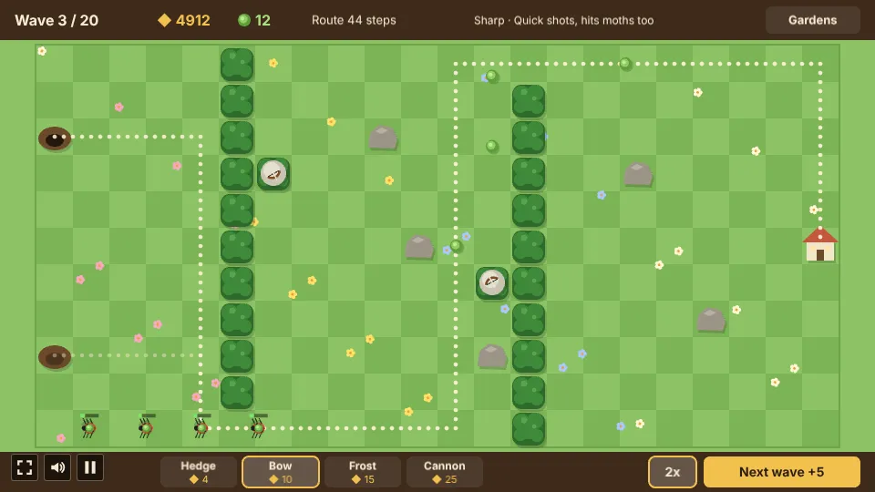

**Ways of play.** The button at the top left of the garden picker picks how every garden is
played, and is kept for the next game:

| Way | |
| --- | --- |
| Classic | The 20 waves. A win earns one to three stars by cabbages kept (three with 90%, two with half), and the garden keeps its most stars and fastest win |
| Challenge | The 20 waves with the garden's own pouch of two to four towers (lent even before the shed sells them), named on its card. A win earns the garden's ✦, which counts like a star for opening seasons, and 10 more seeds |
| Swarm | The 20 waves, each sent the moment the last is all out, for a quarter more gold; won without losing a cabbage, it earns a fourth star |
| Endless | Waves never stop: after wave 20, waves 11 to 20 come round again, bigger each time. The garden keeps the most waves held |
| Sandbox | 10,000 gold, towers grow at once and waves never stop, with no records: a place to try mazes |

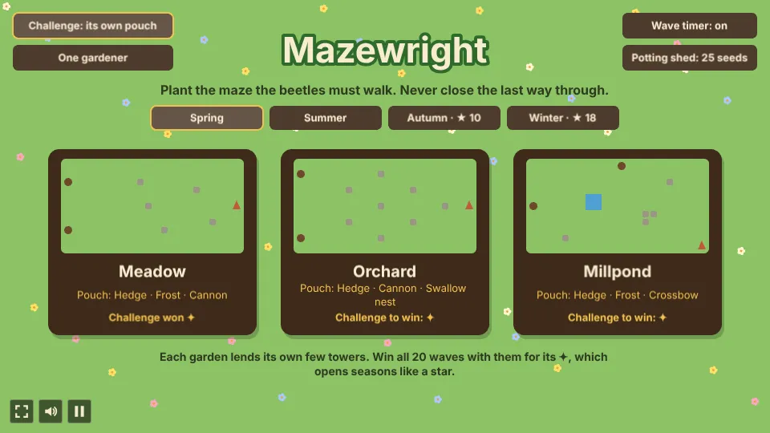

| Garden | Challenge pouch |
| --- | --- |
| Meadow | Hedge, Frost, Cannon |
| Orchard | Hedge, Cannon, Swallow nest |
| Millpond | Hedge, Frost, Crossbow |
| Brook | Hedge, Whirligig, Frost |
| Warren | Hedge, Crossbow, Nettle patch |
| Gravel Walk | Whirligig, Cannon, Swallow nest |
| Hillside | Hedge, Crossbow, Puffball |
| Crossroads | Hedge, Crossbow, Frost, Swallow nest |
| Leaf Walk | Crossbow, Swallow nest, Cannon |
| Ice Pond | Hedge, Bonfire, Bow |
| Last Cabbage | Hedge, Bow, Whirligig |
| Snow Path | Sunglass, Bonfire, Bow |

**Difficulty** (hub setting): Easy gives 25 cabbages and foes 20% less health, Hard 10 cabbages and
25% more health; Normal is 15 cabbages.

## Code layout

- `src/game/rules.ts`: the grid size, towers, foes, waves and tuning numbers.
- `src/game/maps.ts`: the twelve gardens and their seasons (burrows, cottage, rocks, water, banks, paths).
- `src/game/grid.ts`: the walking field (steps from every tile to the cottage) and routes.
- `src/game/sim.ts`: a game: building and the never-close rule, foes, shots, waves and events.
- `src/game/save.ts`: the records per garden, the pouch, the way of play, the potting shed, replays and the game in play.
- `src/scenes/GameScene.ts`: the garden picker and the game screen: input, drawing and the bars.
- `src/scenes/art.ts`, `layout.ts`: the flat vector art and where things go.
- `src/audio.ts`: music and sound effects.
- `src/i18n/`: the texts in British English, US English and German; `src/howToPlay.ts`.
- `e2e/playthrough.spec.ts`: plays the first wave.
- `e2e/bot.ts`: a greedy bot that plays every garden in Node, to check the balance (not a test).

Run it with `npm run dev` from the repo root and open `/games/mazewright/`.
