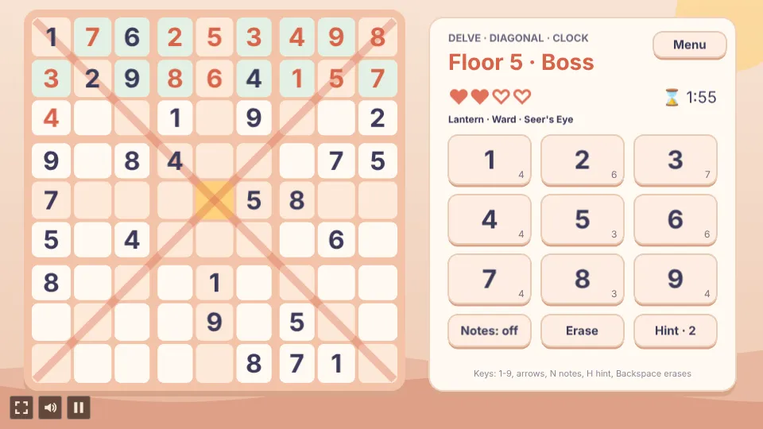
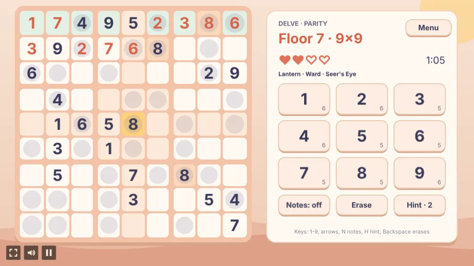
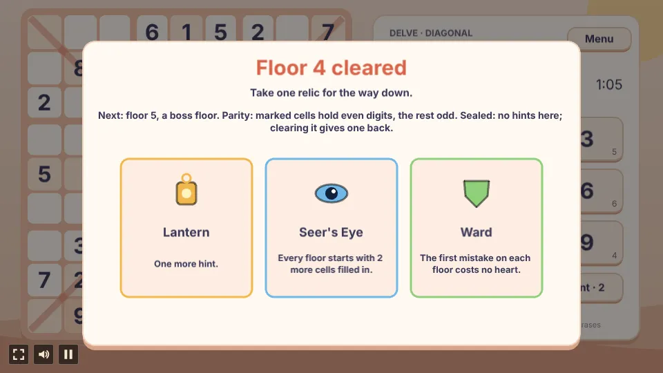

# Ninefold

A number-placement puzzle built with [Phaser 4](https://phaser.io), TypeScript and Vite, part of the
[game hub](../../README.md).

Fill the board so every row, column and box holds each digit once. Play the daily puzzle (the same
board for everyone that day), Classic boards at three levels, or **Delve**: a run of ever bigger
boards where every mistake costs a heart and each cleared floor offers a relic. Every puzzle is
made in code with exactly one solution, so they never run out. Solving boards unlocks nine art
styles, from Paper Cut-out to Stained Glass; the digits stay plain and easy to read in all of them.

## How to play

| Control | Action |
| --- | --- |
| Tap or click a cell, or the arrow keys | Pick a cell |
| Number pad, or keys 1-9 | Write that digit in the picked cell |
| Notes (N) | Switch to pencil marks: digits then toggle small notes in the cell |
| Erase (Backspace) | Clear a wrong digit from the picked cell, or an empty cell's notes |
| Hint (H) | Fill in the picked cell, or the first open one |
| Menu | Leave the board for the menu |

It plays sideways or upright, whichever way the phone or window is held, and turns with it: upright,
the board sits under a header with the mode, hearts and clock, and the nine digits make one row of
keys under the board.

A right digit stays. A wrong one shows in red, counts a mistake and can be erased or written over.
Picking a cell lights its row, column and box, and every cell holding the same digit; the number
pad shows how many of each digit are still to place and greys out finished ones. A finished row,
column or box flashes and stays tinted.

### Modes

- **Daily puzzle**: a Normal 9x9 board picked by the date. The menu ticks it off once solved, until the next day.
- **Classic**: a fresh 9x9 board at Easy (40 givens), Normal (32) or Hard (26), with 3 hints and no
  limit on mistakes. **Next puzzle** deals another at the same level.
- **Delve**: floor 1 is a 4x4 board, floors 2 and 3 are 6x6 and from floor 4 every floor is a 9x9
  with fewer givens (past floor 6, one fewer every 3 floors, down to 24). The run starts with 3
  hearts and 1 hint; a mistake costs a heart, and at none the run ends. From floor 4 each floor
  draws a twist, and every 5th floor is a **boss floor** with two twists (one on the board, one
  that presses you) and 3 fewer givens; clearing a boss floor restores every heart. The cleared
  floor's card names the next floor and its twists:

| Twist | Rule |
| --- | --- |
| Diagonal | Both long diagonals hold each digit once too (2 fewer givens). |
| Parity | Marked cells hold even digits, the rest odd (6 fewer givens). |
| Clock | A heart is lost every 3 minutes on the floor; the clock counts down to it. |
| Sealed | No hints on the floor; clearing it gives one back. |

A cleared floor also offers three of four relics, each of which can be taken again:

| Relic | Effect |
| --- | --- |
| Lantern | One more hint. |
| Heartstone | One more heart, up to 5. |
| Seer's Eye | Every floor starts with 2 more cells filled in. |
| Ward | The first mistake on each floor costs no heart. |

### Styles

**Styles** on the menu shows all nine; tap an unlocked one to wear it. Every solved board, in any
mode, counts towards them:

| Style | Unlocks when you |
| --- | --- |
| Paper Cut-out | start (the default) |
| Garden Markers | solve 3 puzzles |
| Chalkboard | solve a puzzle with no mistakes |
| Ink & Parchment | solve 10 puzzles |
| Cosy Pixel | solve a puzzle without hints |
| Star Chart | solve a Hard puzzle or Delve floor 6 |
| Carved Stone | solve 25 puzzles |
| Neon Arcade | solve a 9x9 in under 10 minutes |
| Stained Glass | have unlocked every other style |

**Difficulty** (hub setting): Easy gives 5 hints a Classic board and 4 hearts a Delve run, Hard 2
hints and 2 hearts; Normal is 3 and 3. The puzzles themselves don't change.

## Code layout

- `src/game/sudoku.ts`: making and solving 4x4, 6x6 and 9x9 boards with one solution.
- `src/game/state.ts`: the rules of both modes, hints, relics and style unlocks.
- `src/game/catalog.ts`: the styles, relics and Classic levels.
- `src/game/save.ts`: the saved progress.
- `src/scenes/GameScene.ts`: the menu, style picker, board, panel and end cards.
- `src/scenes/layout.ts`: where everything sits, sideways and upright.
- `src/scenes/themes.ts`: the colours and fonts of the nine styles.
- `src/audio.ts`: music and sound effects.

See [AGENTS.md](AGENTS.md) for the architecture and how to change things.

## Run it

From the repository root: `npm run dev`, then open `/games/ninefold/`. The playthrough test is
`npx playwright test --project ninefold`.
