# Ninefold

A number-placement puzzle built with [Phaser 4](https://phaser.io), TypeScript and Vite, part of the
[game hub](../../README.md).

Fill the board so every row, column and box holds each digit once. Play the daily puzzle (the same
board for everyone that day), the **weekly gauntlet** (a board a day, scored over the week), Classic
boards at eight levels (Killer, Thermo, Arrow, Kropki and Sandwich among them), or **Delve**: a run
of ever bigger boards where every mistake costs a heart and each cleared floor offers a relic, with
five harder **ascensions** to climb. The **School** teaches four solving techniques, and the
**Calendar** stamps every daily solved. Every puzzle is made in code with exactly one solution, so
they never run out. Solving boards unlocks nine art styles, from Paper Cut-out to Stained Glass, and
a full month of dailies a tenth, Almanac; the digits stay plain and easy to read in all of them.

## How to play

| Control | Action |
| --- | --- |
| Tap or click a cell, or the arrow keys | Pick a cell |
| Number pad, or keys 1-9 | Write that digit in the picked cell |
| Notes (N) | Switch to pencil marks: digits then toggle small notes in the cell |
| Erase (Backspace) | Clear a wrong digit from the picked cell, or an empty cell's notes |
| Undo (U or Z) | Take back the latest note, wrong digit or erase (a mistake still counts) |
| Hint (H) | Fill in the picked cell (or, with none picked, the easiest one) and name the technique it took |
| Menu | Leave the board for the menu |

It plays sideways or upright, whichever way the phone or window is held, and turns with it: upright,
the board sits under a header with the mode, hearts and clock, and the nine digits make one row of
keys under the board.

A right digit stays. A wrong one shows in red, counts a mistake and can be erased or written over.
Picking a cell lights its row, column and box, and every cell holding the same digit; the number
pad shows how many of each digit are still to place and greys out finished ones. A finished row,
column or box flashes and stays tinted.

A board in play is saved as you go (a Delve run with its relics, or its relic offer between
floors, too), so closing the page and coming back goes on where you stood.

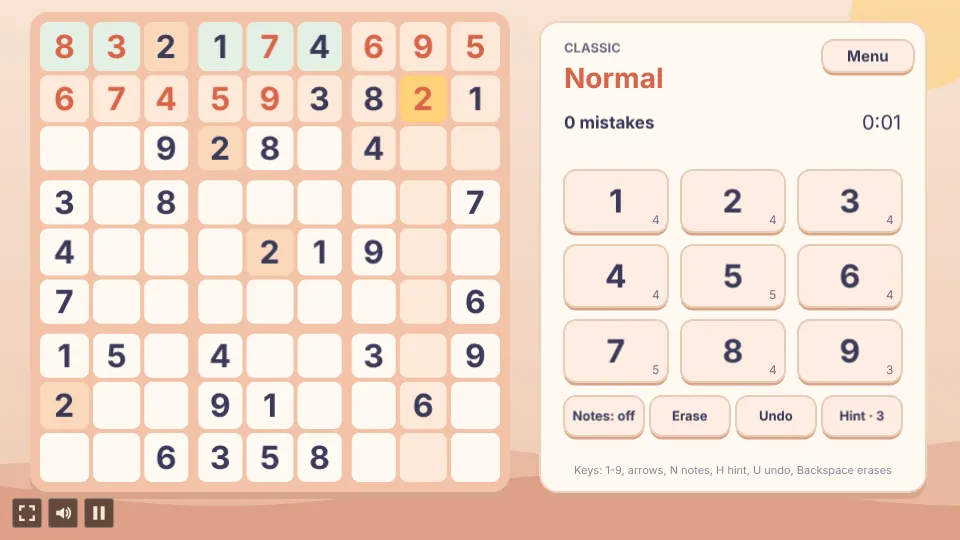

### Modes

- **Daily puzzle**: a Normal 9x9 board picked by the date. The menu ticks it off once solved, until
  the next day, and counts your **daily streak**: daily puzzles solved on days in a row. Each daily
  solved stamps its day on the **Calendar** (menu), a page a month with arrows back to the first
  month stamped; a month with every day stamped earns the **Almanac** style.

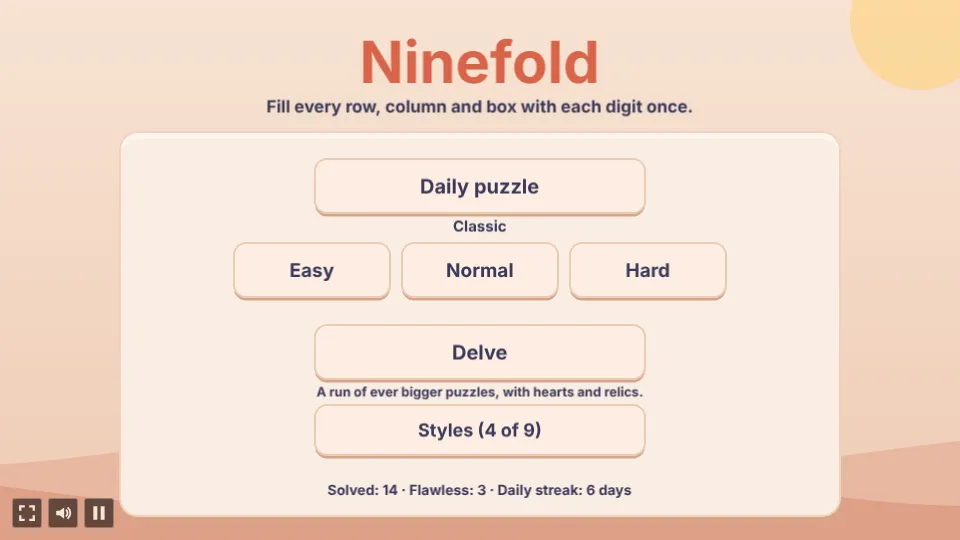

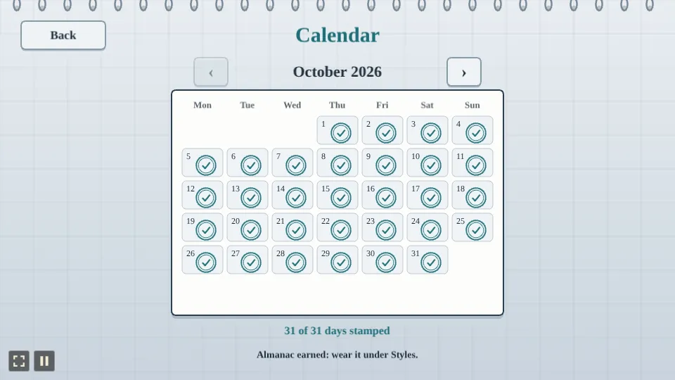
- **Weekly gauntlet**: seven 9x9 boards, one for each day from Monday to Sunday, the same for
  everyone that week: Monday a plain 40-given board, Tuesday Diagonal, Wednesday Thermo, Thursday
  Parity, Friday Killer, Saturday a Hard board and Sunday a Killer with only 12 givens. Today's
  board can be started once (leaving it scores 0) and scores 1000, less 100 a mistake, 150 a hint
  and 1 every 6 seconds (at least 100). The menu shows the day and the week's total so far.

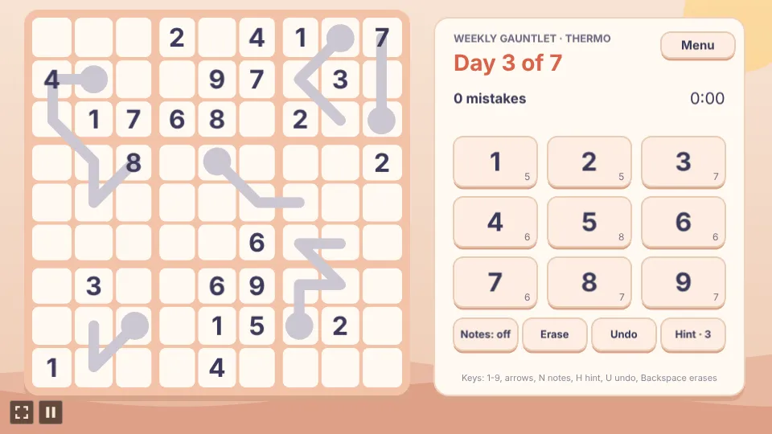
- **Classic**: a fresh 9x9 board at Easy (40 givens), Normal (32) or Hard (26), or a **Killer**
  board (16 givens, with cages), a **Thermo** board (24 givens, with thermometers), an **Arrow**
  board (18 givens: the digits on each arrow add up to its circle), a **Kropki** board (14 givens:
  a white dot joins digits one apart, a black dot digits where one is double the other, and two
  cells with no dot are neither) or a **Sandwich** board (20 givens: each sum outside the board adds
  up the digits between the 1 and the 9 of its row or column), with 3 hints and no limit on mistakes.
  **Next puzzle** deals another at the same level.

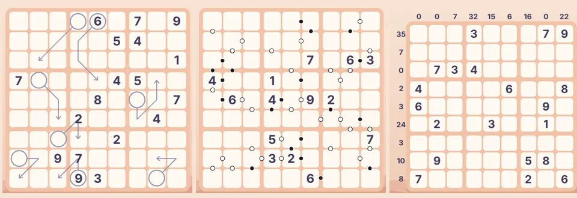

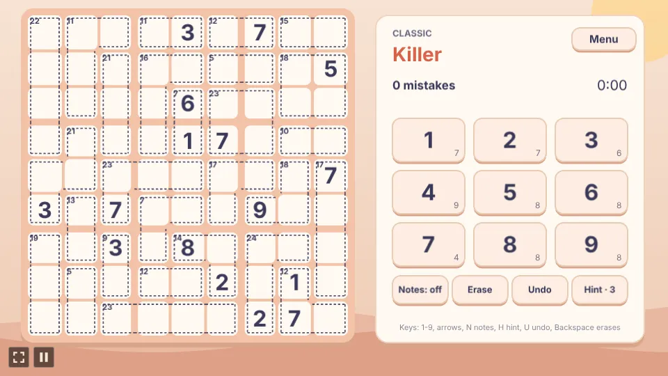

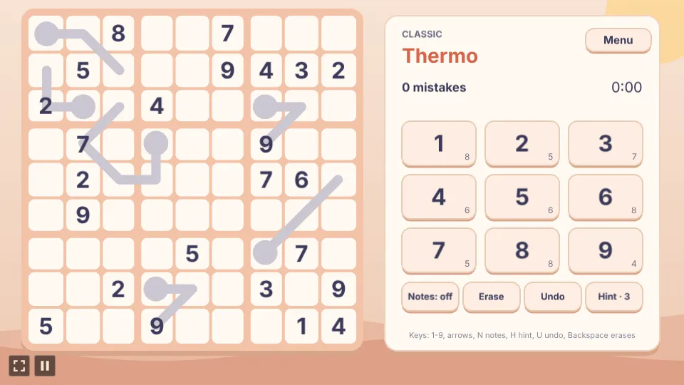
- **Delve**: floor 1 is a 4x4 board, floors 2 and 3 are 6x6 and from floor 4 every floor is a 9x9
  with fewer givens (past floor 6, one fewer every 3 floors, down to 24). The run starts with 3
  hearts and 1 hint; a mistake costs a heart, and at none the run ends. From floor 4 each floor
  draws a twist, and every 5th floor is a **boss floor** with two twists (one on the board, one
  that presses you) and 3 fewer givens; clearing a boss floor restores every heart. The cleared
  floor's card names the next floor and its twists:

| Twist | Rule |
| --- | --- |
| Diagonal | Both long diagonals hold each digit once too (2 fewer givens). |
| Parity | Marked cells hold even digits, the rest odd (6 fewer givens). |
| Killer | Dashed cages: their digits add up to the small sum in the corner, with no digit twice (14 fewer givens). |
| Thermo | Digits rise along each thermometer, from its round bulb to its tip (6 fewer givens). |
| Arrow | The digits on each arrow add up to the digit in its circle (8 fewer givens). |
| Kropki | White dots join digits one apart, black dots digits where one is double the other; no dot, neither (14 fewer givens). |
| Sandwich | Each sum outside the board adds up the digits between the 1 and the 9 of its row or column (6 fewer givens). |
| Clock | A heart is lost every 3 minutes on the floor; the clock counts down to it. |
| Sealed | No hints on the floor; clearing it gives one back. |

A boss floor draws its board twist from Diagonal, Parity, Killer, Thermo, Arrow, Kropki and
Sandwich, and its pressing one from Clock and Sealed.

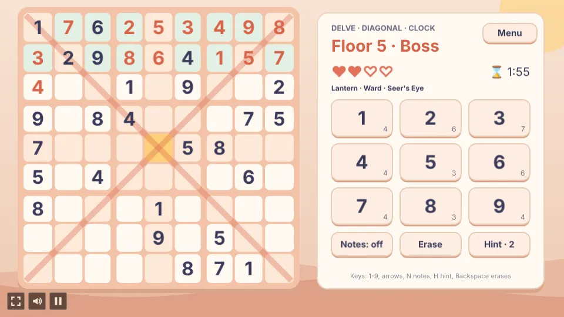

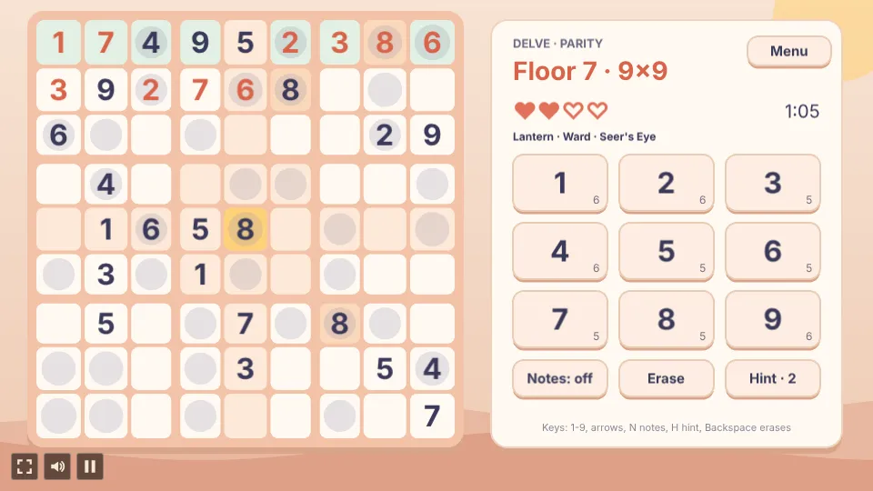

A cleared floor also offers three of ten relics. The last six give something and take something; Twin Sight is held once, every other relic can be taken again:

| Relic | Effect |
| --- | --- |
| Lantern | One more hint. |
| Heartstone | One more heart, up to 5. |
| Seer's Eye | Every floor starts with 2 more cells filled in. |
| Ward | The first mistake on each floor costs no heart. |
| Twin Sight | Every floor starts with each empty cell's candidates noted. One heart less. |
| Gambler's Die | 8 right digits in a row give a hint; a mistake that costs a heart costs one more. |
| Phoenix Feather | When the last heart goes, it burns and the run goes on with one heart. |
| Sandglass | A floor cleared within 4 minutes heals a heart. |
| Iron Vow | Two more hearts, up to 5, but every hint is gone. |
| Keystone | The first box finished on each floor heals a heart. |

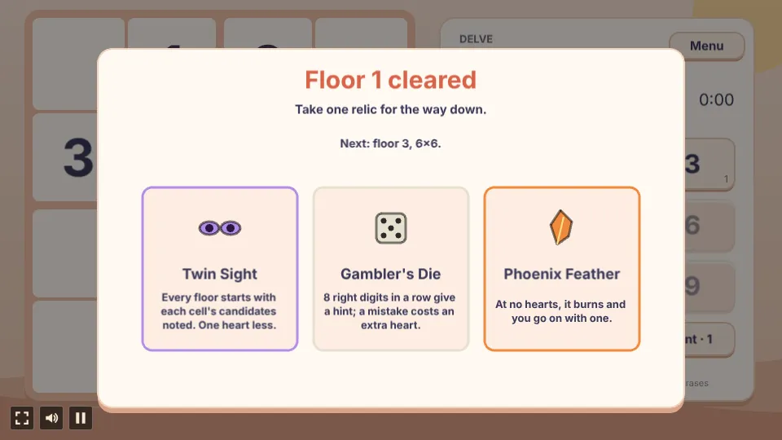

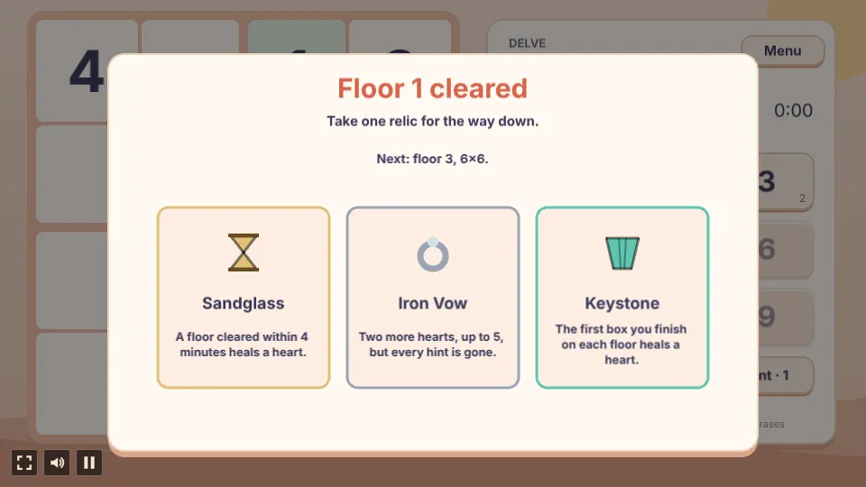

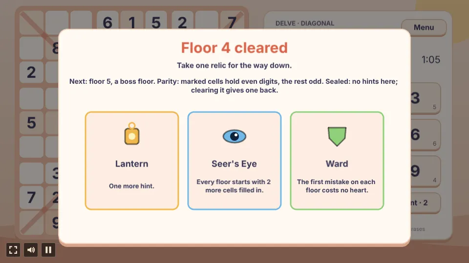

#### Ascensions

Clearing Delve floor 10 opens **Ascension 1**, a harder Delve; clearing floor 10 at the highest
ascension open opens the next, up to Ascension 5. The arrows either side of Delve on the menu pick
where the next run starts (Delve again on the run-over card starts at the ascension of the run that
ended), and the menu names the newest rule. Each ascension keeps every rule below
it:

| Ascension | Adds |
| --- | --- |
| 1 | One heart fewer at the start |
| 2 | No hint at the start |
| 3 | 2 fewer givens on every floor |
| 4 | No notes (Twin Sight leaves the offers) |
| 5 | Two relics to choose from, not three |

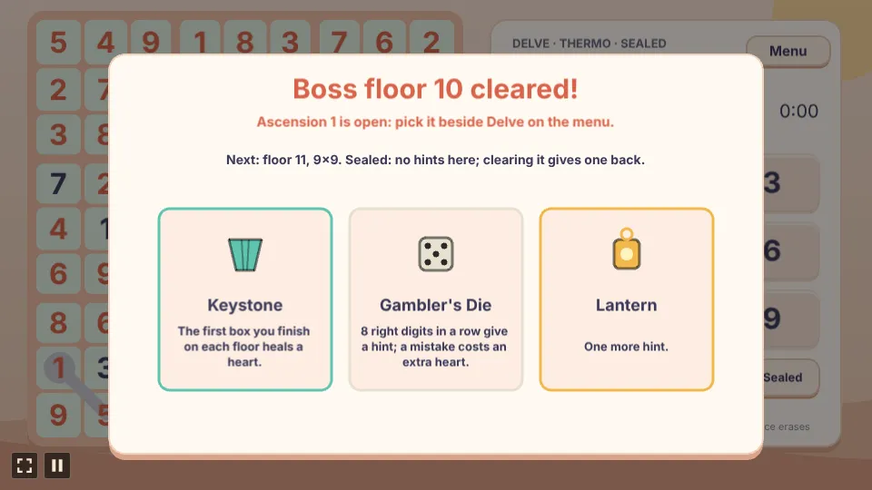

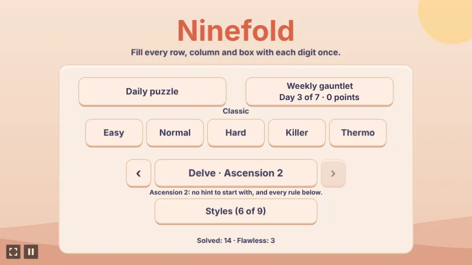

### Technique school

**School** on the menu holds four lessons, each a 6x6 board stopped where one technique is the way
on: **hidden single** (a digit with one place left in a box), **naked pair** (two cells with the
same two candidates), **pointing pair** (a box whose digit sits on one line) and **X-wing** (two rows
that pin a digit to the same two columns). A card explains the technique; then every empty cell
shows its candidates, the cells that show the technique are marked and the cell it unlocks is
ringed. Placing its digit earns the lesson's stamp. Mistakes cost nothing and a lesson isn't saved.

Hints name their technique too: the panel says which of these (or a naked single) places the
hinted digit, or that no simple technique gets there.

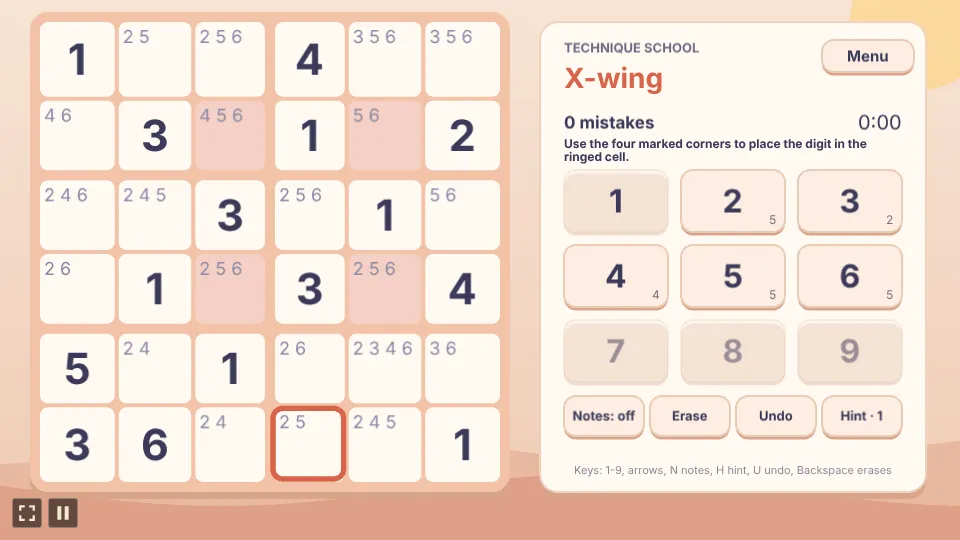

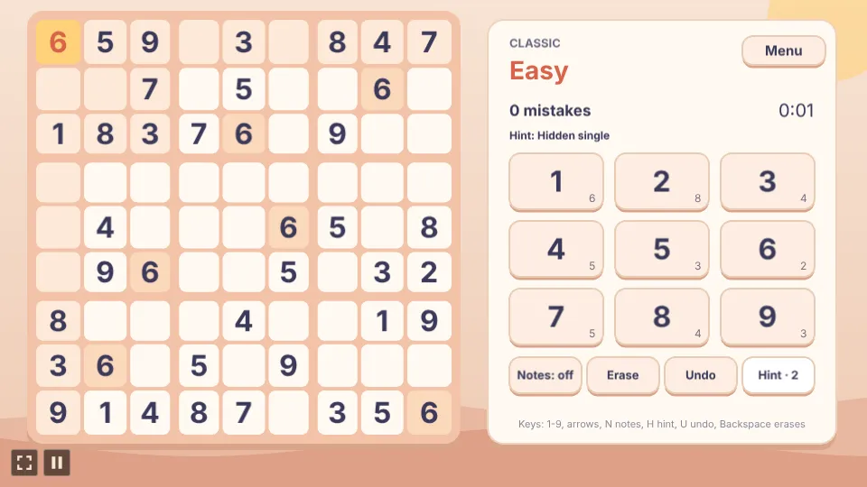

### Styles

**Styles** on the menu shows all ten; tap an unlocked one to wear it. Every solved board, in any
mode, counts towards the first nine, and the calendar earns the tenth:

| Style | Unlocks when you |
| --- | --- |
| Paper Cut-out | start (the default) |
| Garden Markers | solve 3 puzzles |
| Chalkboard | solve a puzzle with no mistakes |
| Ink & Parchment | solve 10 puzzles |
| Cosy Pixel | solve a puzzle without hints |
| Star Chart | solve a Hard puzzle or Delve floor 6 |
| Carved Stone | solve 25 puzzles |
| Neon Arcade | solve a 9x9 in under 10 minutes |
| Stained Glass | have unlocked the eight styles above |
| Almanac | stamp every day of a month on the calendar |

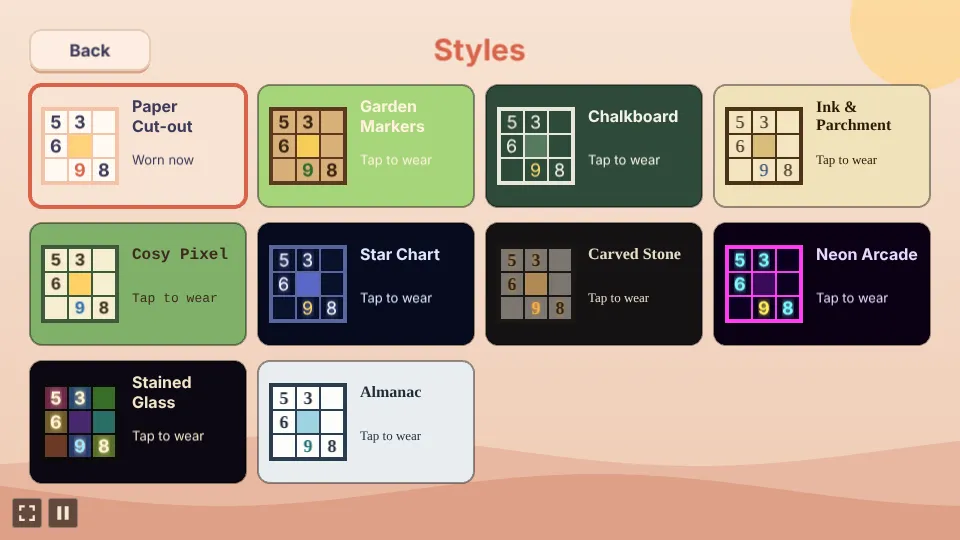

### Trophies

Ten trophies (`src/trophies/`), listed under **Trophies** on the start and pause screens; the
last three stay hidden until earned:

| Trophy | Tier | Earned by |
| --- | --- | --- |
| First fill | Bronze | Solving your first puzzle, in any mode |
| Clean slate | Bronze | Solving a puzzle with no mistakes |
| Quick pencil | Bronze | Solving a 9x9 in under 10 minutes |
| Three in a row | Silver | Solving the daily puzzle three days running |
| Boss breaker | Silver | Clearing a Delve boss floor |
| Deep digger | Silver | Clearing Delve floor 10 |
| Full palette | Gold | Unlocking the nine styles earned by solving |
| A week of puzzles | Gold | Solving the daily puzzle seven days running |
| Bottom of the well | Gold | Clearing Delve floor 20 |
| Summit of the deep | Gold | Clearing Delve floor 10 at Ascension 5 |

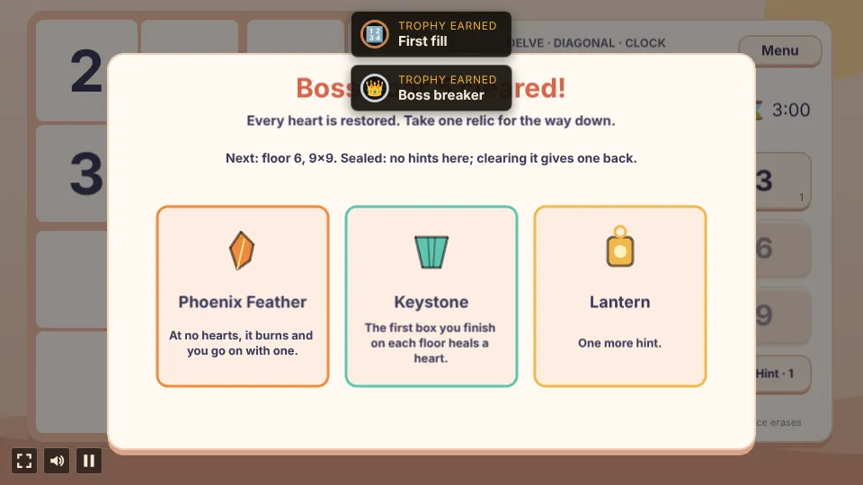

**Difficulty** (hub setting): Easy gives 5 hints a Classic board and 4 hearts a Delve run, Hard 2
hints and 2 hearts; Normal is 3 and 3. The puzzles themselves don't change.

## Code layout

- `src/game/sudoku.ts`: making and solving 4x4, 6x6 and 9x9 boards with one solution, with Killer
  cages, Thermometer lines, Arrows, Kropki dots, Sandwich sums and Parity marks.
- `src/game/techniques.ts`: solving by hand (singles, naked pairs, pointing pairs, X-wings), which
  names a hint's technique.
- `src/game/lessons.ts`: the technique school's four lessons.
- `src/game/state.ts`: the rules of every mode, the weekly gauntlet, ascensions, hints, relics and
  style unlocks.
- `src/game/catalog.ts`: the styles, relics, twists, ascensions and Classic levels.
- `src/game/save.ts`: the saved progress.
- `src/scenes/GameScene.ts`: the menu, style picker, school, calendar, board, panel and end cards.
- `src/scenes/layout.ts`: where everything sits, sideways and upright.
- `src/scenes/themes.ts`: the colours and fonts of the ten styles.
- `src/audio.ts`: music and sound effects.

See [AGENTS.md](AGENTS.md) for the architecture and how to change things.

## Run it

From the repository root: `npm run dev`, then open `/games/ninefold/`. The playthrough test is
`npx playwright test --project ninefold`.
