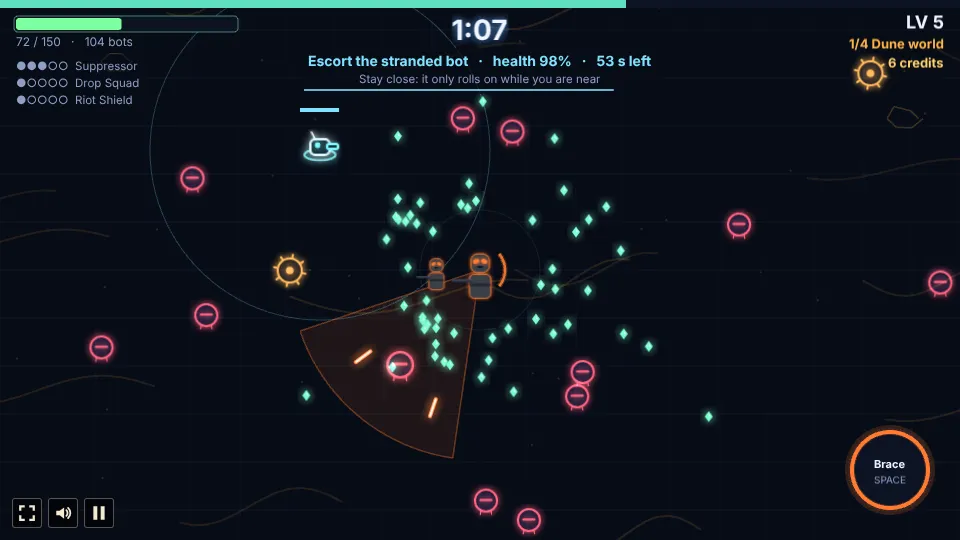

# Riftblade

A survivor-style auto-attack roguelike built with [Phaser 4](https://phaser.io), TypeScript and
Vite, part of the [game hub](../../README.md).

Pick a hero (blaster soldiers, blade knights, a rebel commander or a trio of battle bots) and fight the Rift Crusade across four of eight worlds: from the Dune world,
the space map lets you choose your way through two of the Swamp, Spore, Scrap, Ice, Crystal and
Storm worlds to the Lava world. On each you hold out for five minutes while its faction pours in from every side, then
beat its boss. You only steer: your weapon fires (or your blade strikes) on its own. Shot-down foes drop lumen shards, and
every level-up pauses the run on three upgrade cards (four for Elara Voss). Your hero, level and kit carry over from
world to world, and between worlds a star map offers a trader, an elite fight, a rest or an event.
Beat the Hollow Champion on the Lava world to win the run. Everything is drawn in code in a "Glow
Vector" style: dark fields with a faint grid and each world's own scenery, and neon-rimmed heroes,
foes and bolts.


## How to play

| Input | Action |
| --- | --- |
| WASD or arrow keys | Walk |
| Hold the mouse anywhere on the field | Walk toward that point; the hero keeps walking while you hold |
| Touch: put a finger down anywhere and drag | A steering stick appears where the finger went down; walk the way you drag, faster the further out (the stick follows a finger that goes past its rim) |
| Space, or the round button bottom right | Signature move, once charged |
| Tap a hero card, or 1-9, 0, - and =; then Fight, or Enter | Choose a hero and start the run |
| Tap a card, or 1 / 2 / 3 (and 4 on Elara's level-ups) | Choose an upgrade at a level-up, the next planet on the space map, a node on the star map, an offer at the trader or an answer to an event |
| Continue, Enter or Space | Close the panel of a hero just unlocked; the run waits behind it |
| Reroll, or 4 | At the trader: new offers for a few credits |
| Leave, or Enter | At the trader: on to the next world |
| Run again, or Enter | After a run, back to the hero select screen |


### The heroes

| Hero | Weapon | Signature | Paths |
| --- | --- | --- | --- |
| Captain Rook (slate armour, bronze markings) | Twin pistols: alternating shots at the two nearest bots | **Rally Order**: 5 s of +50% fire rate (12 s) | Gunslinger, Commander, Demolitions |
| Legionary TR-9 (charcoal armour, orange lenses) | Spread rifle: three wide, inaccurate bolts at the nearest bot. 150 health, slow | **Brace**: 3 s without damage, knocks bots back (20 s) | Suppressor, Riot Shield, Drop Squad |
| Corporal Bram-17 (sand armour, pink markings) | Carbine: straight bolts at the nearest bot | **Frag Out**: a grenade that clears a circle (9 s) | Marksman, Jump Trooper, Brothers in Arms |
| Kael Varro (magenta blade) | Slashes in front. Fast and reckless; Temper fills as he kills and drains as he heals | **Leap Strike**: leaps onto the strongest foe and slashes all round (10 s) | Prodigy, Ace Pilot, The Fall (turns him to Lord Vharn's teal and to the Hollow) |
| Lord Vharn (turquoise blade) | Throws his blade, which flies out and back. 160 health, armoured, slow | **Grip**: lifts the 5 nearest foes and crushes them (12 s) | Dread, Iron Grip, Life Support |
| Master Oom (golden blade) | A Current push ripples out around him. Tiny, very fast, 240 health, lightly armoured | **Somersault**: a spinning leap that cuts through foes (8 s) | Stillness, Whirlwind, Old Teacher |
| Elder Corvin Hale (sky blue blade) | A defensive spin hits every foe close by | **Deflect**: 3 s of foe bolts flying back, and foes that touch him thrown off (11 s) | Bulwark, Persuasion, Vantage |
| Regent Veyl (lime lightning) | Forked lightning chains from foe to foe. Little health and slow, huge damage | **Overload**: 3 s of lightning in every direction (12 s) | Storm, Puppet Master, Dark Bargain |
| Kresh the Twinblade (violet staff blade) | His double-ended staff orbits him. Fast and tough | **Hunt**: marks the strongest foe and dashes in for triple damage (9 s) | Dervish, Stalker, Rebuilt |
| Master Joren Vask (royal blue blade) | A fast flurry strikes in four directions around him. **Edge**: every 10th hit is a critical hit | **Breaking Point**: one huge strike that stuns the strongest foe (12 s) | Duelist Form, Breaker, Council Seat |
| Commander Elara Voss (red) | Precise pistol: always aims at the nearest foe. 85 health, medium speed. **Hope**: her level-ups offer 4 cards instead of 3 | **Call for Aid**: plants a signal flag, and rebel fighters bombard the area round it (16 s) | Sharpshooter, Rebel Network, Diplomat |
| Triad-77 (white) | Three skinny battle bots moving as one unit, each shooting the foe nearest to it. about 42 health per bot; a fallen bot is rebuilt after 10 s, and the run ends only when all are down | **Formation Shift**: toggles Spread (a wide triangle) and Column (stacked, all firing at the nearest foe, triple damage) (2.5 s) | Firing Line, Factory, Uplink |

Only Legionary TR-9 is open from the start. Every other hero unlocks through a deed, which the game
never shows: a locked card is a dark placeholder with no art or name. When a deed is done, the run
pauses on a panel with the new hero (Continue, Enter or Space goes on), and the hero is free from
the next run on. The deeds:

| Hero | Deed |
| --- | --- |
| Corporal Bram-17 | Take Legionary TR-9's Drop Squad path to tier 5 |
| Captain Rook | Take Corporal Bram-17's Brothers in Arms path to tier 5 |
| Kael Varro | Reach the second world |
| Regent Veyl | Reach the third world |
| Master Joren Vask | Reach the Lava world |
| Master Oom | Clear the Swamp world taking at most 5 toad globs |
| Elder Corvin Hale | Win an elite arena on the star map |
| Kresh the Twinblade | Defeat 10 elites in one run |
| Lord Vharn | Take Kael Varro's The Fall path to tier 5 |
| Commander Elara Voss | Hold 100 credits at once |
| Triad-77 | Defeat 2500 foes in one run |

All but the two path deeds can be done with any hero. A save from before this chain keeps every
hero it shows as played (a world reached) or unlocked.


### The run: the Rift Crusade

A run makes four jumps: it starts on the Dune world and ends on the Lava world, and after each of
the first two bosses the space map lets you pick the next planet from three (see below). Each
world lasts five minutes and ends with its boss; the clock starts again on each, and the HUD shows
where you are (for example "2/4 Spore world") and your credits. Your hero, level, abilities and
gear carry over. Each jump is tougher than the last: its foes have more health, hit harder and
come faster.

- Foes appear just off screen and come at you. More come every minute, and they get tougher; at
  most 250 are on the field at once. At 1:30, 3:00 and 4:15 a ring of them closes in. Once the
  boss appears, no more come: only the foes already on the field and those the boss calls itself.
  A boss with no other foe left beside it is exposed and takes double damage.
- From 0:50, an **elite** ringed in gold comes every 50 s. It drops a chest (a free tier of an
  upgrade you hold and some health) and a few **credits**.
- After a hit you are safe for a moment. Health does not come back on its own without a Medpack.
- Every gun aims at the nearest foe on its own, a boss no differently from the rest.

| World | Faction | Foes | Boss |
| --- | --- | --- | --- |
| 1 Dune world | Scrap bots (red and amber) | **Clankers** swarm. **Rollerbombs** stop and glow when close, then rush in a straight line and explode: step aside. | **The Grinder Crawler**: a giant tread tank that fires fans of shells, calls in Clankers, and gets faster below half health |
| 2 Swamp world | Wild beasts (lime) | **Mire rats** run in fast weaving packs. **Spitter toads** stop in range and spit globs that slow you. | **The Bog Mother**: spits fans of globs, spawns packs of young and leaves bog pools that slow you |
| 3 Ice world | Iron Dominion (periwinkle and white) | **Line troopers** come in squads of five that advance in a line and fire volleys together. **Walker gunners** are slow and fire heavy bursts. | **The Siege Walker**: four legs, shell volleys, artillery barrages that light up the ground before they land, and stomps when you get close |
| 2 Spore world | Mycelid Bloom (magenta and pink) | **Sporelings** drift in clumps and burst into spore clouds that slow you. **Puffcaps** stop in range and puff out rings of spores. | **The Spore Queen**: spits fans of spores, calls in sporelings and leaves spore pools that slow you |
| 2 Scrap world | Scrap Horde (rust and copper) | **Scrappers** run in fast packs of three. **Haulers** are slow and tough, and fall apart into scrappers when broken. | **The Scrap King**: a welded crawler that fires heavy fans of shells and calls in scrappers, faster below half health |
| 3 Crystal world | Shardborn (violet and aqua) | **Shardlings** come in pairs and burst into splinters that fly out. **Prisms** stop in range and fire lances of bolts in a line. | **The Prism Colossus**: splinter volleys, barrages that light up the ground before they land, and stomps when you get close |
| 3 Storm world | Stormcallers (electric yellow) | **Wisps** weave fast. **Conductors** stop in range and call lightning down where you stand. **Lightning** strikes near you now and then, after a warning ring. | **The Storm Herald**: lightning dashes along a line it marks first; below half health it sends out rings of sparks with gaps |
| 4 Lava world | Hollow cult (violet and ember) | **Ash acolytes** swarm and burst into embers that burn for a moment. **Fallen knights** block bolts from the front with a shield and dash at you; hit them while their guard is down. **Lava vents** glow, then erupt. | **The Hollow Champion**: fast blade dashes along a line it marks first; below half health it burns and sends out rings of fire with gaps to slip through |


### The space map

After the boss of the Dune world falls (and again after the second world's), the space map shows
the crusade's four jumps as columns of planets, with the route flown so far lit. Tap one of the
next jump's three planets (or press 1, 2 or 3): each card shows its name, a line on what waits
there and its faction, once you have landed on it in any run (until then it reads "Uncharted"; the
planets landed on are saved in the browser). The Lava world is always the last jump. Then the star
map comes, on the way to the planet you chose.


### Side objectives

Each world brings three side objectives, one after the other: one shared by every world at 1:00,
the world's own at 2:15 and your hero's own at 3:30. The HUD shows its name, progress and time
left under the clock, with a line on what to do; an arrow at the screen's edge points to its
marker when it is off screen. Finish it in time for credits, a level or a free upgrade card. A
failed one just ends; the next comes at its time. None run in the elite arena, and one still
under way when the boss comes is called off.

| Objective | Where | What to do | Reward |
| --- | --- | --- | --- |
| Defend the position | Every world | Stay 15 s in a ring while foes push in (40 s) | Upgrade card |
| Escort the stranded bot | Every world | Stay near the bot, which only rolls on while you are close, until it reaches its goal; foes touching it wear it down (60 s) | 30 credits |
| Destroy the relay beacons | Every world | Break 3 beacons (45 s) | A level |
| Survive the shrinking zone | Every world | Stay inside a zone that closes in for 30 s; 4 s outside fails it | 25 credits |
| Raid the guarded cache | Dune, Scrap and Crystal worlds | Break the cache; an elite guards it (50 s) | 45 credits |
| Purge the nests | Swamp and Spore worlds | Break 4 nests, which breed the world's swarm while they stand (50 s) | Upgrade card |
| Thaw the frozen squad | Ice world | Stand by each of 3 frozen troopers for 1.5 s; each one freed fights beside you for 40 s (60 s) | A level |
| Seal the vents | Lava and Storm worlds | Stand on each of 3 vents for 1.5 s while the open ones erupt (50 s) | Upgrade card |
| Quick draw | Captain Rook | Down 70 foes (30 s) | 30 credits |
| Hold the drop zone | Legionary TR-9 | Stay 8 s in a small drop zone while foes push in hard (35 s) | Upgrade card |
| Recon run | Corporal Bram-17 | Reach 4 markers far apart (40 s) | 30 credits |
| Duel | Kael Varro | Beat a marked elite (40 s) | Upgrade card |
| Unbroken | Lord Vharn | Take no more than 60 damage for 40 s | A level |
| Lift the wreck | Master Oom | Stand by a wreck for 4 s; it then crashes down on the foes around it (40 s) | 25 credits |
| Shelter the pilgrim | Elder Corvin Hale | Keep foes off a pilgrim for 30 s | Upgrade card |
| Living storm | Regent Veyl | Land 220 hits (25 s) | A level |
| Bloodtrail | Kresh the Twinblade | Down 30 foes in a row without being hit (60 s) | Upgrade card |
| Shatter the monolith | Master Joren Vask | Break a monolith (35 s) | Upgrade card |
| Signal the fleet | Commander Elara Voss | Use Call for Aid inside a marked ring (45 s) | 40 credits |
| Salvage run | Triad-77 | Stand at each of 3 scrap piles for 1.2 s (45 s) | 35 credits |

The shared one is drawn from those not seen yet this run. Beacons, nests, the cache and the
monolith take hits like foes (your weapon aims at them when they are the nearest), but do no harm
and drop nothing.


### Power-ups

From a world's first minute on, a fallen foe now and then drops a power-up (an elite does half of
the time); at most 3 lie about at once, each for 25 s, blinking in its last seconds. Walk over one
to use it:

| Power-up | Sign | Effect |
| --- | --- | --- |
| Bomb | Amber bomb | Every foe on screen loses 65% of its health (a boss 4%) |
| Magnet | Horseshoe | Every lumen shard on the field flies to you |
| Lure | Rings | Pickup range ×2.2 for 30 s |
| Overdrive | Double chevron | Attacks 50% faster for 10 s |
| Shield | Shield | Blocks the next 3 hits |
| Freeze | Snowflake | Every foe but the boss stands still for 5 s |
| Credit cache | Coins | 20 credits |

Lure, Overdrive and the shield show their time or hits left beside your health. Power-ups left
lying when a world is cleared are lost.


### The star map

After a boss falls, you collect what is lying about, earn credits for the clear, choose the next
planet on the space map and then one of two or three nodes on the star map on the way there (tap
it or press its number):

- **Trader**: three offers (a gear piece or an ability tier, priced by tier) bought with credits,
  as many as you can afford, and a reroll for 8 credits.
- **Elite fight**: a 60 s arena with two or three elites of the world just cleared. Beat them all
  for a free tier of your choice (of what you hold) and 20 credits, plus what each elite drops.
- **Rest**: heal half your max health.
- **Event**: a choice with a twist, one of: a **stranded bot** (take it along as a turret drone
  for the next world, or strip it for 20 credits), a **derelict cache** (40 credits, or a random
  gear piece for 15% of your max health; with no gear left to give, 40 credits at no cost), a **shrine of the Current** (give a tier of one ability
  for two tiers of another) or a **lumen well** (a free level-up, or 25 credits).

Then the next world begins. Credits come from elites (6 each), the bosses (30) and each world
cleared (12).


### Upgrades


Each level-up offers three different cards (four for Elara Voss), at least one from your hero's own paths while any are
left. Every upgrade has five tiers. A run holds at most **6 abilities** (your paths and pool
skills) and **4 pieces of gear**; when both are full, only what you hold can come up, and when
nothing is left a Field Ration heals you.

- **Hero paths** (three per hero, plus a drill, below), soldiers: Gunslinger (fire rate, ricochets, quick-draw bursts), Commander
  (1-3 squad troopers), Demolitions (timed charges, bigger blasts, bomblets); Suppressor (a slowing,
  burning cone), Riot Shield (blocks the front, bashes, reflects), Drop Squad (1-3 squad
  troopers land in drop pods and follow him, supply crates); Marksman (piercing, heavy rounds), Jump Trooper (jet dashes that leave fire,
  homing mini rockets), Brothers in Arms (1-3 brothers who copy every shot); Sharpshooter (critical
  hits on worn foes, piercing shots, a second pistol on the next nearest foe), Rebel Network (1-3
  commandos, a speeder bike that runs foes down, a medic who heals her), Diplomat (the flag raises
  a shield bubble that cuts damage and later heals; foes near the flag are confused and fight each
  other); Firing Line (faster fire, a 4th and a 5th bot), Factory (faster rebuilding; scrap from
  kills builds rolling shield bots that catch bolts), Uplink (a command bot links the unit:
  linked aim, each bot on a different foe, then shared health).
- **Knight paths**: Prodigy (wider slashes, combos, a thrown blade), Ace Pilot (a starfighter
  strafes, a bot co-pilot repairs), The Fall (full Temper doubles damage, halves healing);
  Dread (a slowing aura, weak foes flee), Iron Grip (Grip takes more foes and throws them), Life
  Support (regrowing armour plates, rage when nearly down); Stillness (standing still charges the
  push, then he throws wreckage), Whirlwind (the Somersault bounces from foe to foe), Old Teacher
  (spirit pupils); Bulwark (longer Deflects, split bolts), Persuasion (foes his spin hits may
  switch sides), Vantage (standing still raises a platform for damage and reach); Storm (longer,
  forking chains), Puppet Master (fallen foes rise to fight for him), Dark Bargain (health for
  damage, kills heal); Dervish (a bigger, faster orbit, the staff flies out), Stalker (Hunts
  chain, kills speed him up), Rebuilt (rises once on mechanical legs); Duelist Form (more strikes,
  a lunge, a counter), Breaker (hits strip armour from elites and bosses), Council Seat (turns foe
  bolts back, a ward).
- **Drills** (each hero's fourth path): five plain gains in the hero's own order:

  | Hero | Drill | Tiers 1 to 5 |
  | --- | --- | --- |
  | Rook | Old Soldier | +20 health, +0.5 health/s, +8% damage, +1 health/s, +15% fire rate |
  | TR-9 | Garrison Drill | +8% damage, +0.5 health/s, +8% damage, signature 15% faster, +15% fire rate |
  | Bram | Field Kit | +0.5 health/s, +8% damage, +20 health, +1 health/s, +15% fire rate |
  | Kael | Momentum | +20 health, +8% damage, +0.5 health/s, +6% speed, +15% damage |
  | Vharn | Juggernaut | +30 health, +8% damage, -6% damage taken, +30 health, +15% damage |
  | Oom | Inner Calm | +20 health, +0.5 health/s, signature 15% faster, +30 health, +1 health/s |
  | Corvin | Old Guard | +20 health, -6% damage taken, +8% damage, +1 health/s, +15% damage |
  | Veyl | Cold Ambition | +8% damage, +6% crit chance, +8% damage, signature 15% faster, +15% damage |
  | Kresh | Scavenger | +20 health, +0.5 health/s, +8% damage, +30 health, +1 health/s |
  | Joren | Swordmaster | +20 health, +0.5 health/s, +8% damage, +30 health, +1 health/s |
  | Elara | Resistance Cell | +8% damage, +20 health, signature 15% faster, +15% fire rate, +15% damage |
  | Triad-77 | Hardened Chassis | -6% damage taken, +8% damage, -6% damage taken, +15% fire rate, +15% damage |

- **Blaster pool** (soldiers, Elara and Triad-77): Ricochet Rounds, Overcharge (pierce), Thermal Grenade, Stun Rounds
  (slow), Quick Reload, Covering Drone, Scatter Shot, Call-In (a supply crate that crashes on the
  swarm and leaves a medkit), Orbital Beacon (a strike from orbit on the thickest crowd every 9 to
  5 s), Executioner Rounds (a foe a hit leaves under 8 to 18% health falls; an elite under half
  that, never a boss).
- **Blade pool** (knights): Blade Throw, Wide Arc (reach), Riposte (a counter after a hit),
  Blade Dash, Spinning Guard (orbiting blades), Focus (critical hits), Crescent Wave (a cutting
  blast toward the nearest foe every 4 to 2.4 s), Iron Skin (-4 to -20% damage taken, +10 to +60
  health).
- **Current pool** (Kael, Oom, Corvin, Joren): Push Wave, Mending (healing), Foresight (dodge),
  Calm Mind (signature cooldown), Stasis Pulse (slows every foe close by by 40 to 60%, every 7 to
  5 s), Battle Trance (+5 to +18% speed, 3 to 12% dodge).
- **Hollow pool** (Vharn, Veyl, Kresh, and Kael after The Fall): Lightning Arc, Grip, Rage,
  Drain, Dark Nova (a blast all round you every 6 to 4 s), Soul Harvest (0.4 to 1.3 health back
  for each kill). Joren may also draw Lightning Arc.
- **Gear**: Servo Boots (speed), Magnet Coil (pickup range), Plate Armour, Overclock (cooldowns),
  Medpack (regeneration), Power Cell (damage), Lumen Lens (XP), Targeting Chip (critical hits),
  Threat Scanner (+10 to +50% damage to elites and bosses), Salvage Rig (+20 to +100% credits
  picked up), Barrier Emitter (blocks a whole hit, then recharges for 21 to 9 s), Adrenal Stim
  (+10 to +30% speed and damage below 40% health).
- **Capstones**: a path at tier 5 together with its gear piece unlocks at once:

  | Hero | Capstone | Path + gear | Effect |
  | --- | --- | --- | --- |
  | Rook | Twin Storm | Gunslinger + Overclock | Both pistols fire every shot, +30% fire rate |
  | Rook | Last Company | Commander + Plate Armour | 5 troopers that hit 50% harder |
  | Rook | Carpet Strike | Demolitions + Magnet Coil | A line of 6 blasts sweeps the thickest swarm every 6 s |
  | TR-9 | Hailstorm | Suppressor + Overclock | A ring of 12 bolts every 1.5 s, +2 rifle bolts |
  | TR-9 | Phalanx | Riot Shield + Plate Armour | Three shields orbit you, blocking and bashing |
  | TR-9 | Orbital Drop | Drop Squad + Servo Boots | A full squad of 6 troopers lands, and every 8 s a drop pod slams into the swarm |
  | Bram | Longshot | Marksman + Magnet Coil | Bolts pierce everything, every 2nd is heavy |
  | Bram | Skyfall | Jump Trooper + Servo Boots | Dashes land with a blast, twice the rockets |
  | Bram | The Batch | Brothers in Arms + Medpack | 5 brothers who also throw frags |
  | Kael | Perfect Form | Prodigy + Overclock | A streak of 12 kills: 10 s of all-round combos at double speed |
  | Kael | Squadron Run | Ace Pilot + Servo Boots | Three starfighters loop around him, always firing |
  | Kael | Hollow Rebirth | The Fall + Plate Armour | +60 health, -30% damage taken, double slash damage, slower |
  | Vharn | Terror | Dread + Magnet Coil | Foes in the aura deal half damage and fall to their knees every 4 s |
  | Vharn | Crushing Will | Iron Grip + Overclock | Grip goes off on its own every 4 s |
  | Vharn | Unbreakable | Life Support + Medpack | Once per world, survives a killing blow at 1 health |
  | Oom | Lift the Ship | Stillness + Plate Armour | Every 12 s a starship wreck crashes onto the swarm |
  | Oom | Golden Cyclone | Whirlwind + Servo Boots | While he moves, golden blades storm around him |
  | Oom | Council of Spirits | Old Teacher + Medpack | 4 spirit masters, each with an attack of their own |
  | Corvin | Perfect Guard | Bulwark + Plate Armour | Deflects all the time while walking |
  | Corvin | Silver Tongue | Persuasion + Overclock | Every 10 s the 8 weakest foes near join him |
  | Corvin | Unassailable | Vantage + Servo Boots | He carries his platform with him |
  | Veyl | Tempest | Storm + Overclock | Lightning rains on 6 foes across the screen every second |
  | Veyl | Court of Puppets | Puppet Master + Magnet Coil | Up to 20 puppets, and elites rise too |
  | Veyl | Eternal Regent | Dark Bargain + Medpack | Overload lasts 5 s, and while it storms he cannot fall |
  | Kresh | Violet Tornado | Dervish + Overclock | A second staff orbits the other way |
  | Kresh | Apex Predator | Stalker + Servo Boots | Every elite and boss is marked for good: +50% damage to them |
  | Kresh | Steel Strider | Rebuilt + Plate Armour | Rises twice, each time 25% stronger |
  | Joren | Royal Fury | Duelist Form + Overclock | Edge every 5th hit, and its crits chain to 2 foes near |
  | Joren | Shattering Blow | Breaker + Magnet Coil | Breaking Point hits every elite near at once |
  | Joren | Master of the Order | Council Seat + Plate Armour | Every 8 s, takes every foe bolt near and fires it back as one blast |
  | Elara | Never Miss | Sharpshooter + Overclock | Every hit is critical (bosses aside), and each kill fires a free shot at the next nearest foe |
  | Elara | The Uprising | Rebel Network + Medpack | 8 commandos fight with her, and each world starts with a supply drop (a crate of health and a chest) |
  | Elara | Rallying Cry | Diplomat + Plate Armour | The bubble goes with her always; Call for Aid confuses every foe around her |
  | Triad-77 | Endless Ranks | Firing Line + Overclock | 8 bots, and every 15th kill adds a spare bot for 12 s |
  | Triad-77 | Assembly Line | Factory + Magnet Coil | Scrap from 20 kills: up to 3 shield bots that send bolts back, then spare bots |
  | Triad-77 | Hive Signal | Uplink + Servo Boots | Every bot fires a 360° burst on each Formation Shift |

- **Crossovers**: a pool skill held with a fitting path gives a bonus: Gunslinger + Ricochet
  Rounds (ricochets seek new targets), Riot Shield + Stun Rounds (shield bashes stun), Brothers in
  Arms + Scatter Shot (brothers fire cones), Demolitions + Thermal Grenade (grenades split into
  bomblets); for the knights, The Fall + Rage (full Temper also maxes Rage), Iron Grip + Blade
  Throw (the thrown blade hits every gripped foe), Stillness + Push Wave (waves lift foes and throw
  them twice as far), Bulwark + Blade Throw (deflected bolts ride a thrown blade back), Puppet
  Master + Drain (puppets heal him when they hit), Dervish + Spinning Guard (a double ring), Council
  Seat + Lightning Arc (turned-back bolts chain lightning in royal blue); Rebel Network + Covering
  Drone (each commando gets a drone of its own), Firing Line + Scatter Shot (every bot fires its
  own cone; otherwise only the first does). A card that completes one shows a link icon.


The longest run, the wins and the furthest world reached per hero, the heroes unlocked and the
planets landed on are saved in the browser. So is the run under way: close the game mid-run (in a
fight, at a level-up or between planets) and it picks up where it stood when you open it again.



## Running locally

```sh
npm run dev   # then open http://localhost:5173/games/riftblade/
```

## Playthrough test

`e2e/playthrough.spec.ts` plays the first minute in headless Chromium with real inputs: on the
hero select screen it checks the twelve cards (all but Legionary TR-9 locked on a fresh save),
taps a locked card (no Fight button), then TR-9 and Fight, walks him in a wide circle by holding
the mouse down at a point that turns around him, takes the first card at the first level-up and
checks the upgrade was taken, fires Brace from its button and plays on to the one-minute mark. Side
objectives and power-ups only begin at 1:00, so they leave that first minute as it was.

```sh
npx playwright test --project riftblade
```

## Code layout

- `src/main.ts`: creates the game, the hub's settings and scaling.
- `src/howToPlay.ts`: the How to play screen.
- `src/game/`: the rules, without drawing: `heroes.ts` (the heroes, their pools, colour schemes
  and which are locked), `blades.ts` (the knights' attacks, signatures and skills, and the unlock
  deeds), `squad.ts` (Elara Voss and Triad-77: weapons, signatures, paths and allies),
  `upgrades.ts` (paths, pool, gear, capstones, crossovers and the card roll), `planets.ts` (the
  four worlds, their bosses and the star map's numbers), `state.ts` (the state and the numbers),
  `sim.ts` (everything that happens in a fight), `voyage.ts` (between fights: the star map, trader,
  arena, events and the next world), `objectives.ts` (the side objectives) and `save.ts`.
- `src/art/`: `glow.ts` (painting helpers), `sprites.ts` (the heroes, Scrap bots and pickups),
  `knights.ts` (the knights, their blades and allies), `squad.ts` (Elara, Triad-77, their allies,
  the drop pod and the locked placeholder) and
  `factions.ts` (the later factions and their bosses), all painted at boot.
- `src/scenes/`: `BootScene.ts`, `GameScene.ts` (input, camera and drawing), `objectiveArt.ts`
  (the objectives and power-ups, drawn in code) and `layout.ts`.
- `src/ui/panels.ts`: the hero select, level-up, new hero, star map, trader, event and end screens.
