# Riftblade

A survivor-style auto-attack roguelike built with [Phaser 4](https://phaser.io), TypeScript and
Vite, part of the [game hub](../../README.md).

Pick a hero (blaster soldiers, blade knights, a rebel commander, a trio of battle bots or a crew of rogues: a smuggler, a hunter, a droid and a spy) and fight the Rift Crusade across four of ten worlds: from the Dune world,
the space map lets you choose your way through two of the Swamp, Spore, Scrap, Ocean, Ice,
Crystal, Storm and Ruin worlds to the Lava world. On each you hold out for five minutes while its faction pours in from every side, then
beat its boss. You only steer: your weapon fires (or your blade strikes) on its own. Shot-down foes drop lumen shards, and
every level-up pauses the run on three upgrade cards (four for Elara Voss). Your hero, level and kit carry over from
world to world, and between worlds a star map offers a trader, an elite fight, a rest or an event.
Beat the Hollow Champion on the Lava world to win the run. Everything is drawn in code in a "Glow
Vector" style: dark fields with a faint grid and each world's own scenery, and neon-rimmed heroes,
foes and bolts.


## How to play

| Input | Action |
| --- | --- |
| WASD or arrow keys | Walk |
| Hold the mouse anywhere on the field | Walk toward that point; the hero keeps walking while you hold |
| Touch: put a finger down anywhere and drag | A steering stick appears where the finger went down; walk the way you drag, faster the further out (the stick follows a finger that goes past its rim) |
| Space, or the round button bottom right | Signature move, once charged |
| Tap a hero card, or 1-9, 0, - and = (with Shift for the thirteenth hero on); then Fight, or Enter | Choose a hero and start the run |
| Tap a card, or 1 / 2 / 3 (and 4 on Elara's level-ups) | Choose an upgrade at a level-up, the next planet on the space map, a node on the star map, an offer at the trader or an answer to an event |
| Continue, Enter or Space | Close the panel of a hero just unlocked; the run waits behind it |
| Reroll, or 4 | At the trader: new offers for a few credits |
| Leave, or Enter | At the trader: on to the next world |
| Run again, or Enter | After a run, back to the hero select screen |


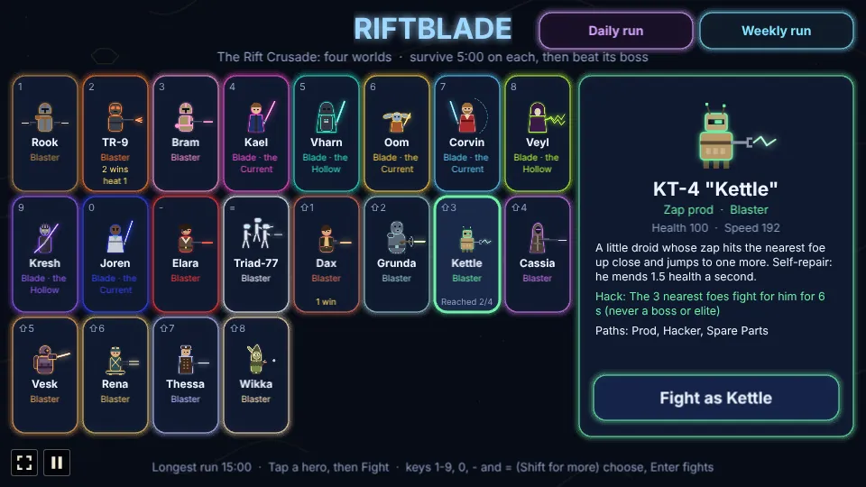

### The heroes

| Hero | Weapon | Signature | Paths |
| --- | --- | --- | --- |
| Captain Rook (slate armour, bronze markings) | Twin pistols: alternating shots at the two nearest bots | **Rally Order**: 5 s of +50% fire rate (12 s) | Gunslinger, Commander, Demolitions |
| Legionary TR-9 (charcoal armour, orange lenses) | Spread rifle: three wide, inaccurate bolts at the nearest bot. 150 health, slow | **Brace**: 3 s without damage, knocks bots back (20 s) | Suppressor, Riot Shield, Drop Squad |
| Corporal Bram-17 (sand armour, pink markings) | Carbine: straight bolts at the nearest bot | **Frag Out**: a grenade that clears a circle (9 s) | Marksman, Jump Trooper, Brothers in Arms |
| Kael Varro (magenta blade) | Slashes in front. Fast and reckless; Temper fills as he kills and drains as he heals | **Leap Strike**: leaps onto the strongest foe and slashes all round (10 s) | Prodigy, Ace Pilot, The Fall (turns him to Lord Vharn's teal and to the Hollow) |
| Lord Vharn (turquoise blade) | Throws his blade, which flies out and back. 160 health, armoured, slow | **Grip**: lifts the 5 nearest foes and crushes them (12 s) | Dread, Iron Grip, Life Support |
| Master Oom (golden blade) | A Current push ripples out around him. Tiny, very fast, 240 health, lightly armoured | **Somersault**: a spinning leap that cuts through foes (8 s) | Stillness, Whirlwind, Old Teacher |
| Elder Corvin Hale (sky blue blade) | A defensive spin hits every foe close by | **Deflect**: 3 s of foe bolts flying back, and foes that touch him thrown off (11 s) | Bulwark, Persuasion, Vantage |
| Regent Veyl (lime lightning) | Forked lightning chains from foe to foe. Little health and slow, huge damage | **Overload**: 3 s of lightning in every direction (12 s) | Storm, Puppet Master, Dark Bargain |
| Kresh the Twinblade (violet staff blade) | His double-ended staff orbits him. Fast and tough | **Hunt**: marks the strongest foe and dashes in for triple damage (9 s) | Dervish, Stalker, Rebuilt |
| Master Joren Vask (royal blue blade) | A fast flurry strikes in four directions around him. **Edge**: every 10th hit is a critical hit | **Breaking Point**: one huge strike that stuns the strongest foe (12 s) | Duelist Form, Breaker, Council Seat |
| Commander Elara Voss (red) | Precise pistol: always aims at the nearest foe. 85 health, medium speed. **Hope**: her level-ups offer 4 cards instead of 3 | **Call for Aid**: plants a signal flag, and rebel fighters bombard the area round it (16 s) | Sharpshooter, Rebel Network, Diplomat |
| Triad-77 (white) | Three skinny battle bots moving as one unit, each shooting the foe nearest to it. about 42 health per bot; a fallen bot is rebuilt after 10 s, and the run ends only when all are down | **Formation Shift**: toggles Spread (a wide triangle) and Column (stacked, all firing at the nearest foe, triple damage) (2.5 s) | Firing Line, Factory, Uplink |
| Dax Morrow (green vest) | Heavy pistol at the nearest foe; his first shot at an unhurt foe (not a boss) is a critical hit. 125 health, quick. **Luck**: every second chest also gives a free card | **Fly-By**: his freighter swoops over the thickest swarm and strafes it (14 s) | Fast Hands, Smuggler's Run, Lucky Streak |
| Grunda (amber fur) | Heavy crossbow: slow bolts that pierce a foe and push foes back. 160 health, big, slow. **Rage**: the more health she has lost, the harder she hits (up to +60%) | **Roar**: stuns and throws back every foe near her for 1.2 s; a boss is only slowed (16 s) | Heavy Bolts, Wild Heart, Warcry |
| KT-4 "Kettle" (white and blue) | Zap prod: a short-range zap at the nearest foe that jumps to one more. 100 health, tiny and very fast. **Self-repair**: mends 1.5 health a second | **Hack**: the 3 nearest foes fight for him for 6 s, never a boss or elite (11 s) | Prod, Hacker, Spare Parts |
| Cassia Vane (pink visor) | Long rifle: slow, hard shots from far away that pierce 2 foes. 90 health | **Cloak**: she vanishes for 4 s and takes no damage, the foes go for where she stood, and her next shot hits three times as hard (13 s) | Deadeye, Ghost, Spymaster |

Only Legionary TR-9 is open from the start. Every other hero unlocks through a deed, which the game
never shows: a locked card is a dark placeholder with no art or name. When a deed is done, the run
pauses on a panel with the new hero (Continue, Enter or Space goes on), and the hero is free from
the next run on. The deeds:

| Hero | Deed |
| --- | --- |
| Corporal Bram-17 | Take Legionary TR-9's Drop Squad path to tier 5 |
| Captain Rook | Take Corporal Bram-17's Brothers in Arms path to tier 5 |
| Kael Varro | Reach the second world |
| Regent Veyl | Reach the third world |
| Master Joren Vask | Reach the Lava world |
| Master Oom | Clear the Swamp world taking at most 5 toad globs |
| Elder Corvin Hale | Win an elite arena on the star map |
| Kresh the Twinblade | Defeat 10 elites in one run |
| Lord Vharn | Take Kael Varro's The Fall path to tier 5 |
| Commander Elara Voss | Hold 100 credits at once |
| Triad-77 | Defeat 2500 foes in one run |
| Dax Morrow | Open 6 chests in one run |
| Grunda | Take Dax Morrow's Smuggler's Run path to tier 5 |
| KT-4 "Kettle" | Take 8 power-ups in one run |
| Cassia Vane | Finish 6 side objectives in one run |

All but the three path deeds can be done with any hero. A save from before this chain keeps every
hero it shows as played (a world reached) or unlocked.

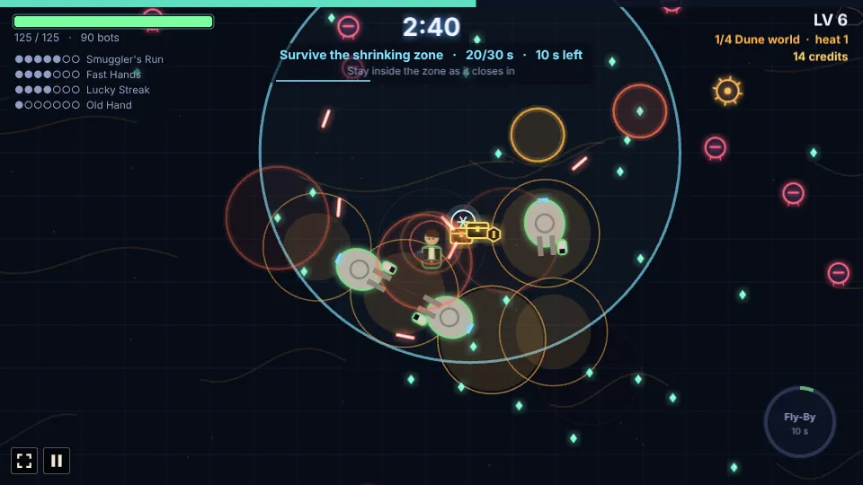

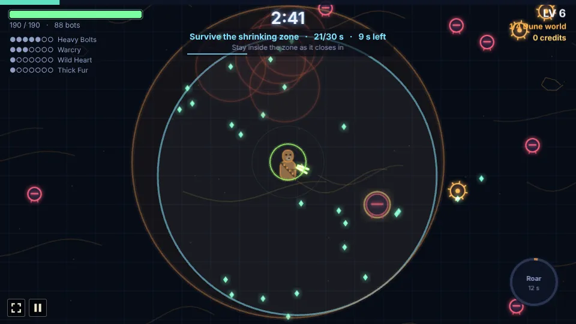

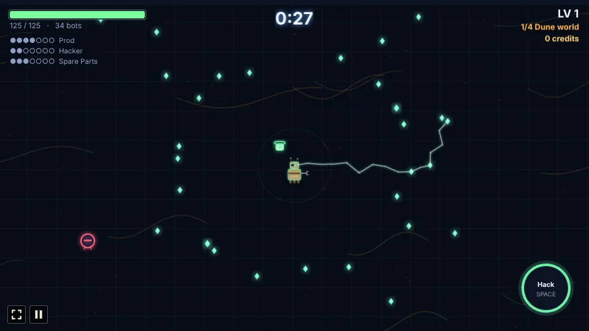

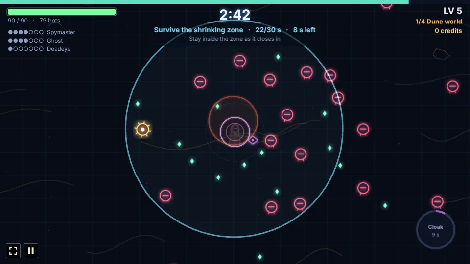


### The run: the Rift Crusade

A run makes four jumps: it starts on the Dune world and ends on the Lava world, and after each of
the first two bosses the space map lets you pick the next planet from four (see below). Each
world lasts five minutes and ends with its boss; the clock starts again on each, and the HUD shows
where you are (for example "2/4 Spore world") and your credits. Your hero, level, abilities and
gear carry over. Each jump is tougher than the last: its foes have more health, hit harder and
come faster.

- Foes appear just off screen and come at you. More come every minute, and they get tougher; at
  most 250 are on the field at once. At 1:30, 3:00 and 4:15 a ring of them closes in. Once the
  boss appears, no more come: only the foes already on the field and those the boss calls itself.
  A boss with no other foe left beside it is exposed and takes double damage.
- From 0:50, an **elite** ringed in gold comes every 50 s. It drops a chest (a free tier of an
  upgrade you hold and some health) and a few **credits**.
- After a hit you are safe for a moment. Health does not come back on its own without a Medpack.
- Every gun aims at the nearest foe on its own, a boss no differently from the rest.

| World | Faction | Foes | Boss |
| --- | --- | --- | --- |
| 1 Dune world | Scrap bots (red and amber) | **Clankers** swarm. **Rollerbombs** stop and glow when close, then rush in a straight line and explode: step aside. | **The Grinder Crawler**: a giant tread tank that fires fans of shells, calls in Clankers, and gets faster below half health |
| 2 Swamp world | Wild beasts (lime) | **Mire rats** run in fast weaving packs. **Spitter toads** stop in range and spit globs that slow you. | **The Bog Mother**: spits fans of globs, spawns packs of young and leaves bog pools that slow you |
| 3 Ice world | Iron Dominion (periwinkle and white) | **Line troopers** come in squads of five that advance in a line and fire volleys together. **Walker gunners** are slow and fire heavy bursts. | **The Siege Walker**: four legs, shell volleys, artillery barrages that light up the ground before they land, and stomps when you get close |
| 2 Spore world | Mycelid Bloom (magenta and pink) | **Sporelings** drift in clumps and burst into spore clouds that slow you. **Puffcaps** stop in range and puff out rings of spores. | **The Spore Queen**: spits fans of spores, calls in sporelings and leaves spore pools that slow you |
| 2 Scrap world | Scrap Horde (rust and copper) | **Scrappers** run in fast packs of three. **Haulers** are slow and tough, and fall apart into scrappers when broken. | **The Scrap King**: a welded crawler that fires heavy fans of shells and calls in scrappers, faster below half health |
| 3 Crystal world | Shardborn (violet and aqua) | **Shardlings** come in pairs and burst into splinters that fly out. **Prisms** stop in range and fire lances of bolts in a line. | **The Prism Colossus**: splinter volleys, barrages that light up the ground before they land, and stomps when you get close |
| 2 Ocean world | Tidebound (sea blue and foam) | **Crabs** scuttle in packs of three, in bursts with sideways steps. **Squids** stop in range and squirt fans of ink that slow you. Every minute from 0:40 **the tide** floods half the field after a warning: you wade slower in it while crabs and squids surf faster. | **The Deep Kraken**: fans of ink, calls in crabs, faster below half health |
| 3 Ruin world | Stone Watch (sandstone and ghostly green) | **Shades** drift in groups of three and pass through stone. **Sentinels** stop when close, glow and slam the ground around them. **Pillars** fall near you after a marked line, hurt whatever is under them and block the way for a while. | **The Stone Warden**: shell volleys, barrages that light up the ground before they land, stomps when you get close, and it smashes pillars in its way |
| 3 Storm world | Stormcallers (electric yellow) | **Wisps** weave fast. **Conductors** stop in range and call lightning down where you stand. **Lightning** strikes near you now and then, after a warning ring. | **The Storm Herald**: lightning dashes along a line it marks first; below half health it sends out rings of sparks with gaps |
| 4 Lava world | Hollow cult (violet and ember) | **Ash acolytes** swarm and burst into embers that burn for a moment. **Fallen knights** block bolts from the front with a shield and dash at you; hit them while their guard is down. **Lava vents** glow, then erupt. | **The Hollow Champion**: fast blade dashes along a line it marks first; below half health it burns and sends out rings of fire with gaps to slip through |


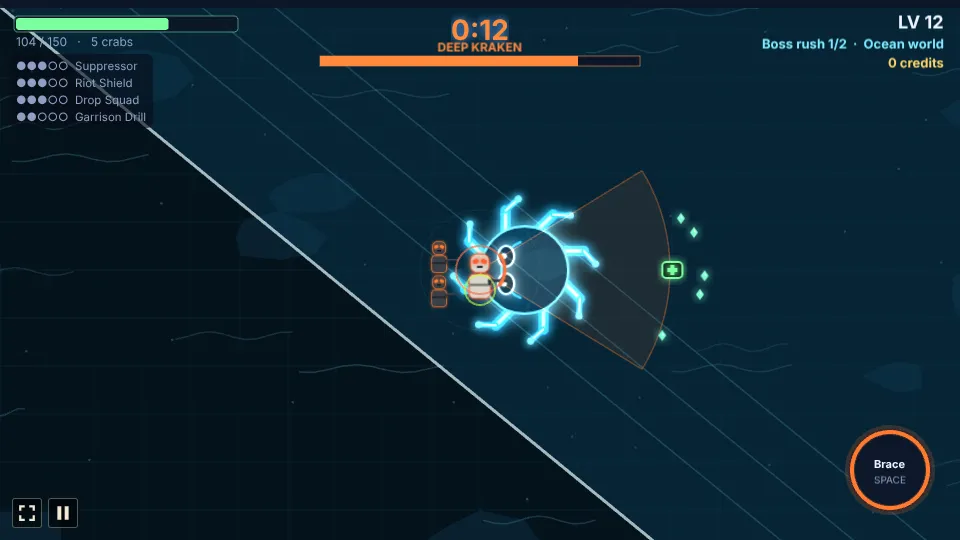

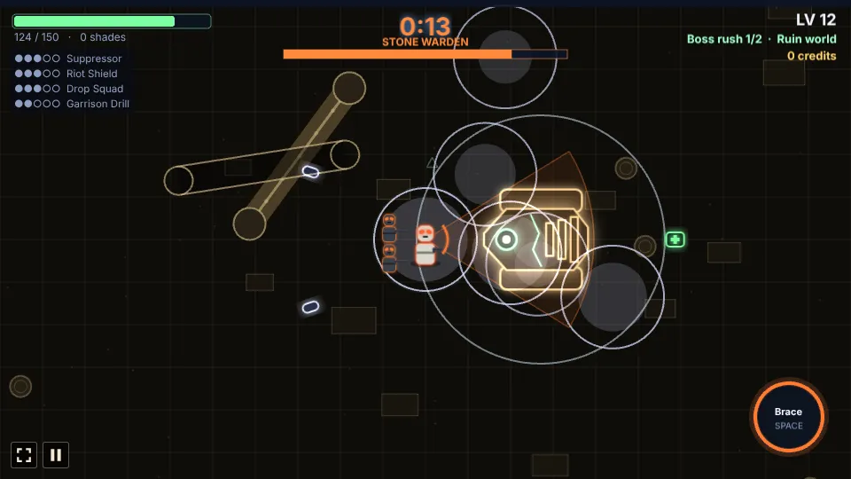

### Rift heat

Once a hero has won a run, its detail panel on the hero select shows a **Heat** row above Fight:
tap the arrows (or press Left and Right) to pick the rift heat of the next run, from 0 (the
crusade as designed) up to one above the highest heat that hero has won at. Each heat keeps every
rule below it and adds one:

| Heat | Adds |
| --- | --- |
| 1 | Elites come twice as often (every 25 s after the first) |
| 2 | Foes hit a quarter harder |
| 3 | No rest stops on the star map |
| 4 | Below a quarter of its health a boss goes into a frenzy: it attacks half again as fast and moves faster |
| 5 | Foes and bosses have a quarter more health |

Winning at a heat opens the next one for that hero, up to heat 5. The best heat won shows on the
hero's card beside its wins, the HUD names the heat under way after the planet, and the end screen
says which heat the run was at. Heat stacks with the difficulty setting.

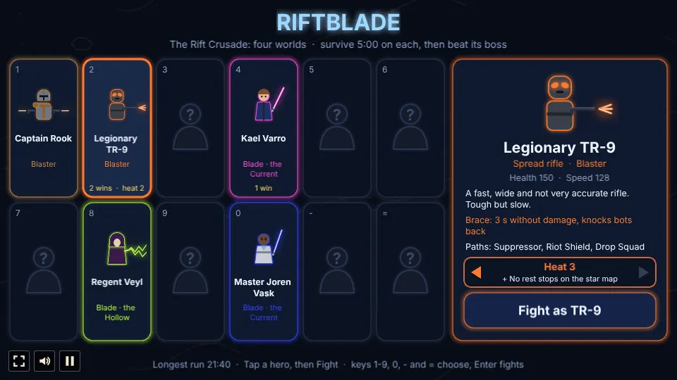

### The Armoury

At the end of every run, won or lost, its unspent credits go to the bank, plus 10 salvage for each
world reached; the end screen says how much. Once anything is banked, an **Armoury** button shows
at the top left of the hero select. There banked credits buy small lasting upgrades for every
hero (tap a piece or press 1-5; Back or Enter returns):

| Piece | Ranks | Each rank | Prices |
| --- | --- | --- | --- |
| Field Rations | 3 | +5% max health | 60, 120, 180 |
| War Chest | 3 | +15 credits at the start of a run | 50, 100, 150 |
| Lumen Lens | 2 | +10% shard pickup range | 80, 160 |
| Field Briefing | 1 | A fourth card at the first level-up of a run (Elara already has four) | 150 |
| Spare Reroll | 1 | The first reroll at each trader is free | 120 |

Every piece maxed costs 1,170 credits, about a dozen runs. Credits kept for the bank are credits
not spent at a trader, so each trader is a choice between this run and the next ones.

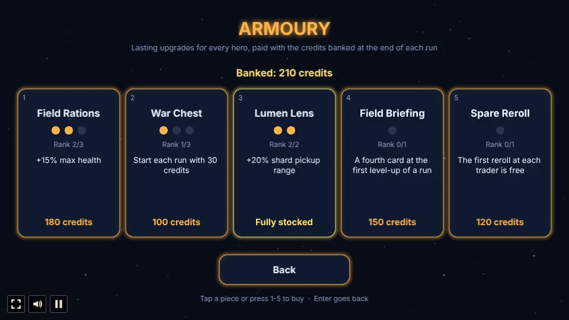

### The weekly run

Once a first run has ended, a **Weekly run** button shows at the top right of the hero select. It
opens this week's run: one of your open heroes and two mutators, both picked from the week's
number (weeks start on Monday, 00:00 UTC), with each world and star map seeded, so every attempt
that week starts each world the same way. It is fought at heat 0 and without the Armoury. The
panel shows how far you got this week; the first win of the week banks **100 credits** for the
Armoury (on top of the run's own credits). Tap Start or press Enter; Back returns.

| Mutator | Effect |
| --- | --- |
| Glass Cannon | +50% damage, -40% max health |
| Swarm | Foes come 40% faster, with a quarter less health |
| Haste | You and every foe move a quarter faster |
| Vampire | Every kill heals 1 health; no regeneration |
| Overcharged | Your signature recharges twice as fast |
| Fragile Foes | Foes have half health but hit twice as hard |

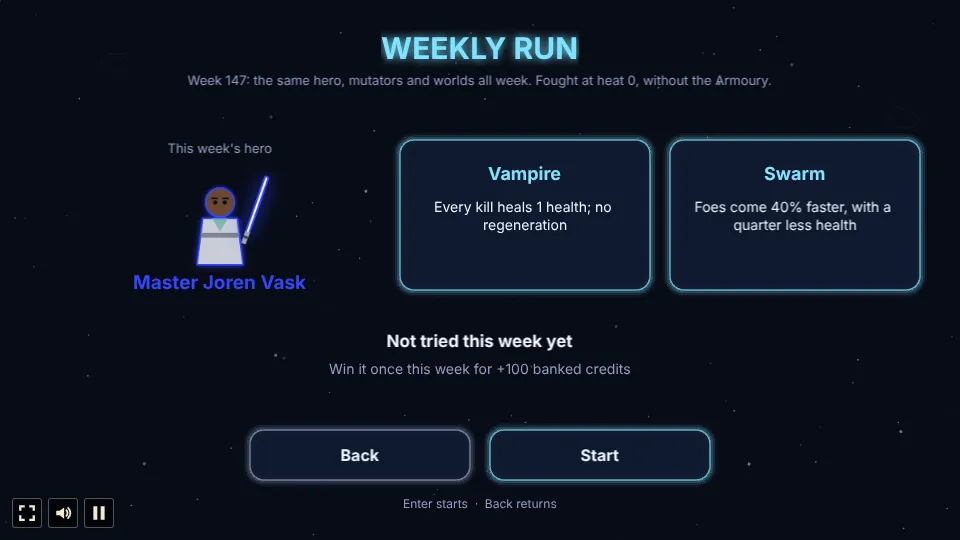

### The daily run

From the same first run on, a **Daily run** button shows beside the weekly one. It opens today's
run: three worlds (the Dune world, then one of Swamp, Spore, Scrap and Ocean, then one of Ice,
Crystal, Storm and Ruin), one of your open heroes and one mutator, picked from the day, with each world and star map
seeded, so everyone playing that day meets the same worlds and mutator (the hero can differ, as
it comes from the heroes each player has open). It is fought at heat 0 and without the
Armoury, and there is **one try a day**: starting it uses the day's try, even if you leave half
way. It scores **1000 per boss beaten plus 1 per kill** (falling in an elite arena still counts the
boss beaten before it); the panel and the end screen show today's
score, your best and how many days in a row you have played. Winning it banks **40 credits** for
the Armoury. A daily win is not a won crusade, so it opens no rift heat.

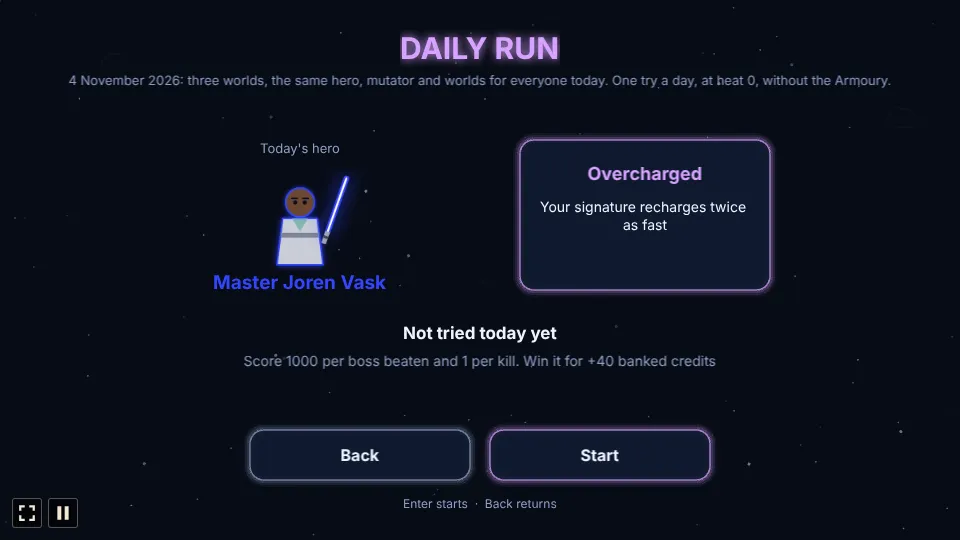

### The endless rift

After a won crusade (not a weekly or daily run) the victory screen offers the **Endless rift**
beside Run again (or press Space, a moment after the screen opens). The run goes on with the same
hero, level and kit, but no credits (the ones left at the win were banked with its salvage): the star map
leads from the Lava world back to the Dune world, and the four jumps start over, each loop with
foes and bosses **+40% health and +25% damage** on top of the one before (loop 1 is the first
after the win). Its score is the worlds cleared after the win; the end screen shows it with your
best, and each one banks **15 salvage**.

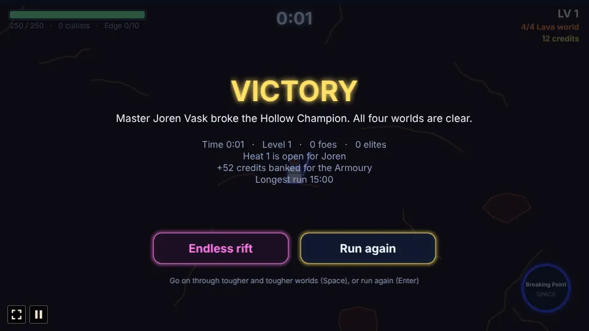

### The codex

Every foe, boss and card you meet goes into the codex, kept across runs: a foe or boss once it is
on the field, a card once it is dealt on a level-up, offered by a trader or held. Once anything is
in it, a **Codex** button shows at the top left of the hero select, beside the Armoury. Each page
fills once, and a full page banks its credits for the Armoury:

| Page | Entries | Pays |
| --- | --- | --- |
| Foes | 20 | 60 |
| Bosses | 10 | 100 |
| Pool skills | 30 | 80 |
| Gear | 12 | 50 |
| Hero paths | 64 (every hero's four) | 150 |

Tap a page or press 1-5; Back or Enter returns. Entries not met yet show as `? ? ?`.

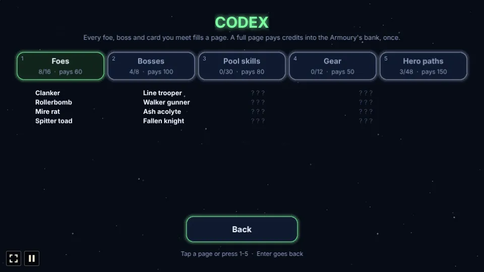

The codex's **Skill overview** button opens a page of every skill a run can take, in eight tabs:
hero paths (hero by hero, each drill last), the Blaster, Blade, Current and Hollow pools, gear,
specialisations and fusions. A skill you have taken at least once in a run shows its name, and
tapping it shows its text and every tier (with the specialisations it branches into, or for a
fusion what it fuses and locks out); one never taken stays `? ? ?`. Press 1-8 for a tab; Back or
Enter returns to the codex.

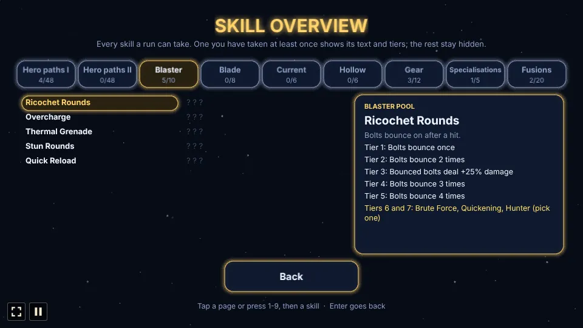

### Hero mastery

Every run gives its hero mastery XP: 40 for each boss beaten, 25 for every 100 foes downed and 100
for winning the crusade (the endless rift counts its bosses; a boss rush gives none). Once a hero
has some, its detail panel shows its mastery level and the XP to the next one. The end screen says
how much the run gave. Each level opens something that lasts:

| Level | XP | Opens |
| --- | --- | --- |
| 2 | 250 | Mastery colours: tap the colours toggle on the mastery row to wear them or the usual ones |
| 3 | 700 | A second starting weapon, a pool skill that suits the hero |
| 4 | 1400 | 8% more health |
| 5 | 2400 | 8% more damage |

Weekly and daily runs keep their rules: the hero wears its colours there, but starts without the
weapon and perks.

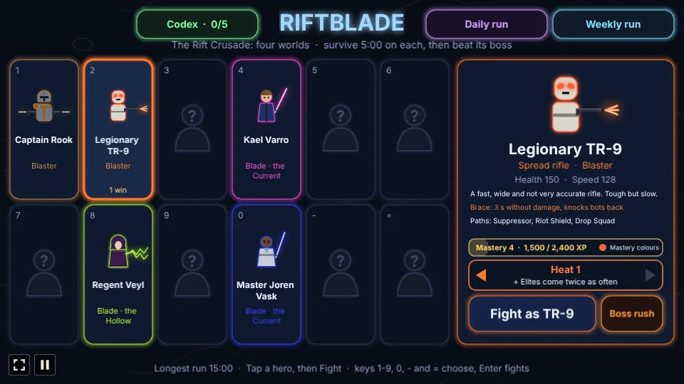

### The boss rush

Once two bosses are in the codex, a **Rush** button shows beside Fight. The boss rush fights every
boss you have met, in the order of the crusade, back to back, with a set kit: level 12, every path
at tier 3, the drill at tier 2 and full health. Each boss lands at once, with half its health, and
only its own adds come; there are no elites, side objectives or level-ups. Between bosses you heal
a little. The rush keeps your best: the most bosses beaten, then the fastest time. It banks no
credits.

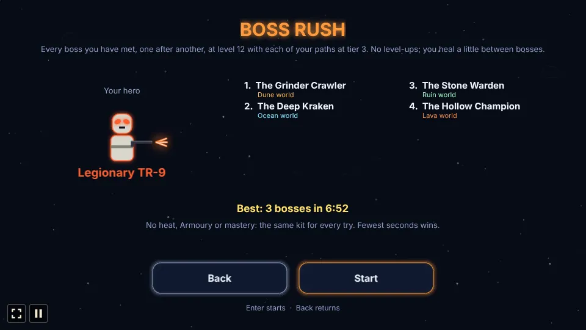

### Trophies

Ten trophies, listed on the start and pause screens (Trophies) and counted on the hub's card.
Each shows a toast once, when it is earned; a save from before trophies earns its own quietly.

| Trophy | Tier | Earned by |
| --- | --- | --- |
| Crawler down | Bronze | Beating the boss of the Dune world |
| Mastery | Bronze | Unlocking a capstone in a run |
| A new face | Bronze | Unlocking a second hero |
| Kitted out | Bronze | Buying your first piece in the Armoury |
| Crusader | Silver | Winning the Rift Crusade with any hero |
| Week in, week out | Silver | Winning a weekly run |
| Running hot | Silver | Winning a run at rift heat 3 |
| Into the furnace | Gold | Winning a run at rift heat 5 |
| Fully stocked | Gold | Buying every rank of every piece in the Armoury |
| The full roster | Gold | Unlocking every hero (hidden until earned) |

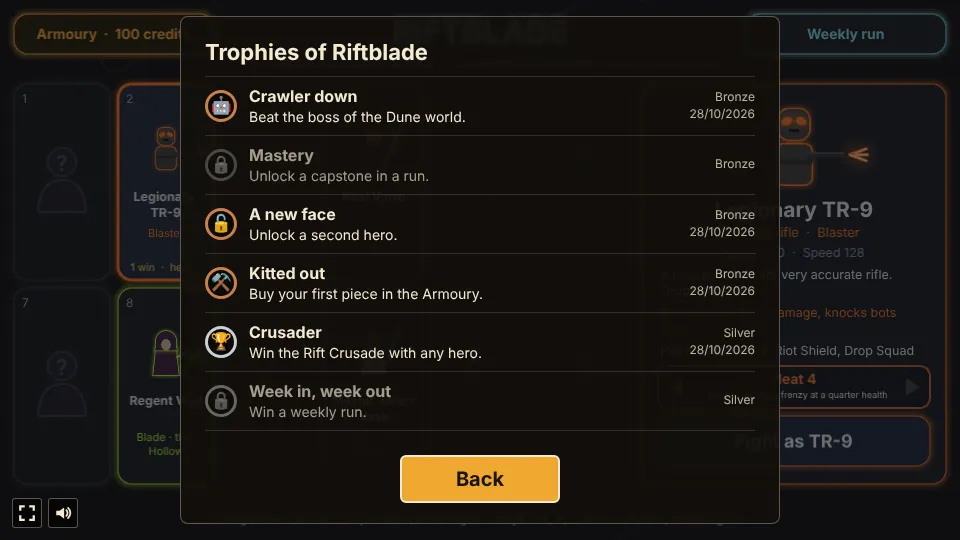

### The space map

After the boss of the Dune world falls (and again after the second world's), the space map shows
the crusade's four jumps as columns of planets, with the route flown so far lit. Tap one of the
next jump's four planets (or press 1 to 4): each card shows its name, a line on what waits
there and its faction, once you have landed on it in any run (until then it reads "Uncharted"; the
planets landed on are saved in the browser). The Lava world is always the last jump. Then the star
map comes, on the way to the planet you chose.


### Side objectives

Each world brings three side objectives, one after the other: one shared by every world at 1:00,
the world's own at 2:15 and your hero's own at 3:30. The HUD shows its name, progress and time
left under the clock, with a line on what to do; an arrow at the screen's edge points to its
marker when it is off screen. Finish it in time for credits, a level or a free upgrade card. A
failed one just ends; the next comes at its time. None run in the elite arena, and one still
under way when the boss comes is called off.

| Objective | Where | What to do | Reward |
| --- | --- | --- | --- |
| Defend the position | Every world | Stay 15 s in a ring while foes push in (40 s) | Upgrade card |
| Escort the stranded bot | Every world | Stay near the bot, which only rolls on while you are close, until it reaches its goal; foes touching it wear it down (60 s) | 30 credits |
| Destroy the relay beacons | Every world | Break 3 beacons (45 s) | A level |
| Survive the shrinking zone | Every world | Stay inside a zone that closes in for 30 s; 4 s outside fails it | 25 credits |
| Raid the guarded cache | Dune, Scrap, Crystal and Ruin worlds | Break the cache; an elite guards it (50 s) | 45 credits |
| Purge the nests | Swamp, Spore and Ocean worlds | Break 4 nests, which breed the world's swarm while they stand (50 s) | Upgrade card |
| Thaw the frozen squad | Ice world | Stand by each of 3 frozen troopers for 1.5 s; each one freed fights beside you for 40 s (60 s) | A level |
| Seal the vents | Lava and Storm worlds | Stand on each of 3 vents for 1.5 s while the open ones erupt (50 s) | Upgrade card |
| Quick draw | Captain Rook, Dax Morrow | Down 70 foes (30 s) | 30 credits |
| Hold the drop zone | Legionary TR-9 | Stay 8 s in a small drop zone while foes push in hard (35 s) | Upgrade card |
| Recon run | Corporal Bram-17, Cassia Vane | Reach 4 markers far apart (40 s) | 30 credits |
| Duel | Kael Varro | Beat a marked elite (40 s) | Upgrade card |
| Unbroken | Lord Vharn, Grunda | Take no more than 60 damage for 40 s | A level |
| Lift the wreck | Master Oom | Stand by a wreck for 4 s; it then crashes down on the foes around it (40 s) | 25 credits |
| Shelter the pilgrim | Elder Corvin Hale | Keep foes off a pilgrim for 30 s | Upgrade card |
| Living storm | Regent Veyl | Land 220 hits (25 s) | A level |
| Bloodtrail | Kresh the Twinblade | Down 30 foes in a row without being hit (60 s) | Upgrade card |
| Shatter the monolith | Master Joren Vask | Break a monolith (35 s) | Upgrade card |
| Signal the fleet | Commander Elara Voss | Use Call for Aid inside a marked ring (45 s) | 40 credits |
| Salvage run | Triad-77, KT-4 "Kettle" | Stand at each of 3 scrap piles for 1.2 s (45 s) | 35 credits |

The shared one is drawn from those not seen yet this run. Beacons, nests, the cache and the
monolith take hits like foes (your weapon aims at them when they are the nearest), but do no harm
and drop nothing.


### Power-ups

From a world's first minute on, a fallen foe now and then drops a power-up (an elite does half of
the time); at most 3 lie about at once, each for 25 s, blinking in its last seconds. Walk over one
to use it:

| Power-up | Sign | Effect |
| --- | --- | --- |
| Bomb | Amber bomb | Every foe on screen loses 65% of its health (a boss 4%) |
| Magnet | Horseshoe | Every lumen shard on the field flies to you |
| Lure | Rings | Pickup range ×2.2 for 30 s |
| Overdrive | Double chevron | Attacks 50% faster for 10 s |
| Shield | Shield | Blocks the next 3 hits |
| Freeze | Snowflake | Every foe but the boss stands still for 5 s |
| Credit cache | Coins | 20 credits |

Lure, Overdrive and the shield show their time or hits left beside your health. Power-ups left
lying when a world is cleared are lost.


### The star map

After a boss falls, you collect what is lying about, earn credits for the clear, choose the next
planet on the space map and then one of two or three nodes on the star map on the way there (tap
it or press its number):

- **Trader**: three offers (a gear piece or an ability tier, priced by tier) bought with credits,
  as many as you can afford, and a reroll for 8 credits.
- **Elite fight**: a 60 s arena with two or three elites of the world just cleared. Beat them all
  for a free tier of your choice (of what you hold) and 20 credits, plus what each elite drops.
- **Rest**: heal half your max health.
- **Event**: a choice with a twist, one of: a **stranded bot** (take it along as a turret drone
  for the next world, or strip it for 20 credits), a **derelict cache** (40 credits, or a random
  gear piece for 15% of your max health; with no gear left to give, 40 credits at no cost), a **shrine of the Current** (give a tier of one ability
  for two tiers of another) or a **lumen well** (a free level-up, or 25 credits).

Then the next world begins. Credits come from elites (6 each), the bosses (30) and each world
cleared (12).


### Upgrades


Each level-up offers three different cards (four for Elara Voss), at least one from your hero's own paths while any are
left. Every upgrade has seven tiers: five of its own, then two of a specialisation. A run holds at
most **7 abilities** (your paths and pool skills) and **5 pieces of gear**; when both are full,
only what you hold can come up, and when nothing is left a Field Ration heals you. Every tier line
names the stat it raises.

- **Specialisations** (tiers 6 and 7): at tier 5 an upgrade branches into three, and the first one
  taken is the only one it can have (the card says which two it locks out). Most upgrades branch
  into Brute Force, Quickening and Hunter; the ones that keep you standing (Riot Shield, Iron Skin,
  Mending, Plate Armour, the drills and the like) into Stalwart, Quickening and Brute Force; the
  finding gear (Magnet Coil, Lumen Lens, Salvage Rig, Threat Scanner) into Prospector, Hunter and Stalwart.

  | Specialisation | Tier 6 | Tier 7 |
  | --- | --- | --- |
  | Brute Force | +10% damage | +10% damage, +5% crit chance |
  | Quickening | +10% attack speed, -5% skill cooldowns | the same again |
  | Stalwart | +20 max health, +0.5 health/s | -5% damage taken, +4% dodge chance |
  | Hunter | +15% damage to elites and bosses, +5% move speed | +15% damage to elites and bosses, +4% crit chance |
  | Prospector | +10% XP, +25% pickup range | +10% XP, +25% credits |

- **Fusions**: two skills held at tier 3 or more can fuse into a third, with three tiers of its
  own and no slot of its own. Taking a fusion locks out every other fusion that shares one of its
  halves, and the skills it names, which are offered no more and stop rising if held.

  | Fusion | Fuses | Locks out | Tiers 1 / 2 / 3 |
  | --- | --- | --- | --- |
  | Chain Reaction | Ricochet Rounds + Thermal Grenade | Overcharge | +1 bounce, +10% damage / +12% damage / +1 bounce, +12% damage |
  | Railgun | Overcharge + Quick Reload | Scatter Shot | +2 pierce, +10% damage / +15% damage / +2 pierce, +15% damage |
  | Bullet Storm | Scatter Shot + Quick Reload | Overcharge | +15% attack speed / +10% attack speed, +10% damage / +15% attack speed |
  | Kill Order | Executioner Rounds + Covering Drone | Stun Rounds | +4% execute, +5% crit / +3% execute, +5% crit / the same |
  | Shock and Awe | Stun Rounds + Orbital Beacon | Thermal Grenade | +10% slow, +15% vs elites / +15% vs elites / +10% slow, +20% vs elites |
  | Air Support | Call-In + Covering Drone | Executioner Rounds | -8% cooldowns, +8% damage / -8% cooldowns / -8% cooldowns, +12% damage |
  | Thousand Cuts | Focus + Wide Arc | Iron Skin | +6% crit, +10% reach / +6% crit / +8% crit, +10% reach |
  | Iron Fortress | Iron Skin + Riposte | Blade Dash | -5% damage taken, +20 health / +20 health / -5% damage taken, +30 health |
  | Steel Cyclone | Spinning Guard + Blade Throw | Focus | +12% damage / -8% cooldowns / +15% damage, -7% cooldowns |
  | Crescent Rush | Crescent Wave + Blade Dash | Riposte | +6% speed, -8% cooldowns / +12% damage / +6% speed, -8% cooldowns |
  | Clear Water | Mending + Calm Mind | Battle Trance | +0.8 health/s, -10% signature cooldown / +0.8 health/s / +1 health/s, -10% signature cooldown |
  | Prescience | Foresight + Battle Trance | Mending | +5% dodge, +5% speed / +5% dodge / +5% dodge, +6% speed |
  | Frozen Moment | Stasis Pulse + Push Wave | Foresight | -10% cooldowns / +12% damage / -10% cooldowns, +10% damage |
  | Blood Pact | Rage + Drain | Soul Harvest | +0.3 health a kill, +10% damage / +10% damage / +0.4 health a kill, +12% damage |
  | Abyssal Storm | Lightning Arc + Dark Nova | Grip | -10% cooldowns, +8% damage / +12% damage / -10% cooldowns, +10% damage |
  | Reaper | Soul Harvest + Grip | Drain | +0.3 health a kill, +10% vs elites / +15% vs elites / +0.4 health a kill, +15% vs elites |
  | Juggernaut Plating | Plate Armour + Medpack | Servo Boots | -4% damage taken, +0.6 health/s / +25 health / -4% damage taken, +0.8 health/s |
  | Overdrive Core | Overclock + Power Cell | Barrier Emitter | -8% cooldowns, +8% damage / +10% damage / -8% cooldowns, +10% damage |
  | Hunter Kit | Threat Scanner + Targeting Chip | Lumen Lens | +20% vs elites, +4% crit / +15% vs elites / +20% vs elites, +5% crit |
  | Treasure Hunter | Magnet Coil + Salvage Rig | Threat Scanner | +50% pickup, +30% credits / +10% XP / +50% pickup, +40% credits |

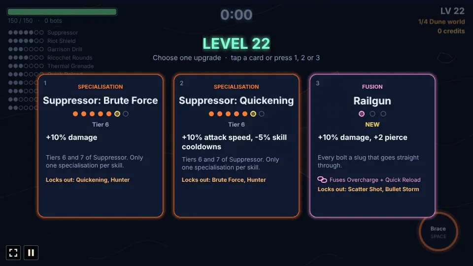

- **Hero paths** (three per hero, plus a drill, below), soldiers: Gunslinger (fire rate, ricochets, quick-draw bursts), Commander
  (1-3 squad troopers), Demolitions (timed charges, bigger blasts, bomblets); Suppressor (a slowing,
  burning cone), Riot Shield (blocks the front, bashes, reflects), Drop Squad (1-3 squad
  troopers land in drop pods and follow him, supply crates); Marksman (piercing, heavy rounds), Jump Trooper (jet dashes that leave fire,
  homing mini rockets), Brothers in Arms (1-3 brothers who copy every shot); Sharpshooter (critical
  hits on worn foes, piercing shots, a second pistol on the next nearest foe), Rebel Network (1-3
  commandos, a speeder bike that runs foes down, a medic who heals her), Diplomat (the flag raises
  a shield bubble that cuts damage and later heals; foes near the flag are confused and fight each
  other); Firing Line (faster fire, a 4th and a 5th bot), Factory (faster rebuilding; scrap from
  kills builds rolling shield bots that catch bolts), Uplink (a command bot links the unit:
  linked aim, each bot on a different foe, then shared health).
- **Crew paths**: Fast Hands (faster fire, a second bolt at the next nearest foe, triple first
  shots), Smuggler's Run (the freighter hits harder, drops charges, comes back for a second pass
  and later flies by on its own), Lucky Streak (credits, crits, a second chest from elites, more
  damage while flush); Heavy Bolts (more pierce, bolts that burst, two bolts a shot), Wild Heart
  (more Rage, healing and speed below half health), Warcry (a wider Roar that hurts, sends foes
  running and heals her); Prod (the zap jumps from foe to foe, reaches further and stuns), Hacker
  (Hack takes more foes, elites too, for longer and they hit harder), Spare Parts (faster repair,
  health, armour, a repair drone, shocks when hit); Deadeye (more pierce and range, more damage to
  healthy foes), Ghost (a longer Cloak that heals, speed while cloaked, every shot in it triple),
  Spymaster (marks the strongest foe for more damage, a spy drone that fires at it, credits from
  marked kills).
- **Knight paths**: Prodigy (wider slashes, combos, a thrown blade), Ace Pilot (a starfighter
  strafes, a bot co-pilot repairs), The Fall (full Temper doubles damage, halves healing);
  Dread (a slowing aura, weak foes flee), Iron Grip (Grip takes more foes and throws them), Life
  Support (regrowing armour plates, rage when nearly down); Stillness (standing still charges the
  push, then he throws wreckage), Whirlwind (the Somersault bounces from foe to foe), Old Teacher
  (spirit pupils); Bulwark (longer Deflects, split bolts), Persuasion (foes his spin hits may
  switch sides), Vantage (standing still raises a platform for damage and reach); Storm (longer,
  forking chains), Puppet Master (fallen foes rise to fight for him), Dark Bargain (health for
  damage, kills heal); Dervish (a bigger, faster orbit, the staff flies out), Stalker (Hunts
  chain, kills speed him up), Rebuilt (rises once on mechanical legs); Duelist Form (more strikes,
  a lunge, a counter), Breaker (hits strip armour from elites and bosses), Council Seat (turns foe
  bolts back, a ward).
- **Drills** (each hero's fourth path): five plain gains in the hero's own order:

  | Hero | Drill | Tiers 1 to 5 |
  | --- | --- | --- |
  | Rook | Old Soldier | +20 health, +0.5 health/s, +8% damage, +1 health/s, +15% fire rate |
  | TR-9 | Garrison Drill | +8% damage, +0.5 health/s, +8% damage, signature 15% faster, +15% fire rate |
  | Bram | Field Kit | +0.5 health/s, +8% damage, +20 health, +1 health/s, +15% fire rate |
  | Kael | Momentum | +20 health, +8% damage, +0.5 health/s, +6% speed, +15% damage |
  | Vharn | Juggernaut | +30 health, +8% damage, -6% damage taken, +30 health, +15% damage |
  | Oom | Inner Calm | +20 health, +0.5 health/s, signature 15% faster, +30 health, +1 health/s |
  | Corvin | Old Guard | +20 health, -6% damage taken, +8% damage, +1 health/s, +15% damage |
  | Veyl | Cold Ambition | +8% damage, +6% crit chance, +8% damage, signature 15% faster, +15% damage |
  | Kresh | Scavenger | +20 health, +0.5 health/s, +8% damage, +30 health, +1 health/s |
  | Joren | Swordmaster | +20 health, +0.5 health/s, +8% damage, +30 health, +1 health/s |
  | Elara | Resistance Cell | +8% damage, +20 health, signature 15% faster, +15% fire rate, +15% damage |
  | Triad-77 | Hardened Chassis | -6% damage taken, +8% damage, -6% damage taken, +15% fire rate, +15% damage |
  | Dax | Old Hand | +8% damage, +15% fire rate, +20 health, +6% crit chance, +15% damage |
  | Grunda | Thick Fur | +30 health, -6% damage taken, +8% damage, +1 health/s, +15% damage |
  | Kettle | Self-Repair | +20 health, +0.5 health/s, +6% speed, +1 health/s, +15% damage |
  | Cassia | Tradecraft | +8% damage, +6% crit chance, +6% speed, +8% damage, +15% damage |

- **Blaster pool** (soldiers, Elara, Triad-77 and the crew): Ricochet Rounds, Overcharge (pierce), Thermal Grenade, Stun Rounds
  (slow), Quick Reload, Covering Drone, Scatter Shot, Call-In (a supply crate that crashes on the
  swarm and leaves a medkit), Orbital Beacon (a strike from orbit on the thickest crowd every 9 to
  5 s), Executioner Rounds (a foe a hit leaves under 8 to 18% health falls; an elite under half
  that, never a boss).
- **Blade pool** (knights): Blade Throw, Wide Arc (reach), Riposte (a counter after a hit),
  Blade Dash, Spinning Guard (orbiting blades), Focus (critical hits), Crescent Wave (a cutting
  blast toward the nearest foe every 4 to 2.4 s), Iron Skin (-4 to -20% damage taken, +10 to +60
  health).
- **Current pool** (Kael, Oom, Corvin, Joren): Push Wave, Mending (healing), Foresight (dodge),
  Calm Mind (signature cooldown), Stasis Pulse (slows every foe close by by 40 to 60%, every 7 to
  5 s), Battle Trance (+5 to +18% speed, 3 to 12% dodge).
- **Hollow pool** (Vharn, Veyl, Kresh, and Kael after The Fall): Lightning Arc, Grip, Rage,
  Drain, Dark Nova (a blast all round you every 6 to 4 s), Soul Harvest (0.4 to 1.3 health back
  for each kill). Joren may also draw Lightning Arc.
- **Gear**: Servo Boots (speed), Magnet Coil (pickup range), Plate Armour, Overclock (cooldowns),
  Medpack (regeneration), Power Cell (damage), Lumen Lens (XP), Targeting Chip (critical hits),
  Threat Scanner (+10 to +50% damage to elites and bosses), Salvage Rig (+20 to +100% credits
  picked up), Barrier Emitter (blocks a whole hit, then recharges for 21 to 9 s), Adrenal Stim
  (+10 to +30% speed and damage below 40% health).
- **Capstones**: a path at tier 5 together with its gear piece unlocks at once:

  | Hero | Capstone | Path + gear | Effect |
  | --- | --- | --- | --- |
  | Rook | Twin Storm | Gunslinger + Overclock | Both pistols fire every shot, +30% fire rate |
  | Rook | Last Company | Commander + Plate Armour | 5 troopers that hit 50% harder |
  | Rook | Carpet Strike | Demolitions + Magnet Coil | A line of 6 blasts sweeps the thickest swarm every 6 s |
  | TR-9 | Hailstorm | Suppressor + Overclock | A ring of 12 bolts every 1.5 s, +2 rifle bolts |
  | TR-9 | Phalanx | Riot Shield + Plate Armour | Three shields orbit you, blocking and bashing |
  | TR-9 | Orbital Drop | Drop Squad + Servo Boots | A full squad of 6 troopers lands, and every 8 s a drop pod slams into the swarm |
  | Bram | Longshot | Marksman + Magnet Coil | Bolts pierce everything, every 2nd is heavy |
  | Bram | Skyfall | Jump Trooper + Servo Boots | Dashes land with a blast, twice the rockets |
  | Bram | The Batch | Brothers in Arms + Medpack | 5 brothers who also throw frags |
  | Kael | Perfect Form | Prodigy + Overclock | A streak of 12 kills: 10 s of all-round combos at double speed |
  | Kael | Squadron Run | Ace Pilot + Servo Boots | Three starfighters loop around him, always firing |
  | Kael | Hollow Rebirth | The Fall + Plate Armour | +60 health, -30% damage taken, double slash damage, slower |
  | Vharn | Terror | Dread + Magnet Coil | Foes in the aura deal half damage and fall to their knees every 4 s |
  | Vharn | Crushing Will | Iron Grip + Overclock | Grip goes off on its own every 4 s |
  | Vharn | Unbreakable | Life Support + Medpack | Once per world, survives a killing blow at 1 health |
  | Oom | Lift the Ship | Stillness + Plate Armour | Every 12 s a starship wreck crashes onto the swarm |
  | Oom | Golden Cyclone | Whirlwind + Servo Boots | While he moves, golden blades storm around him |
  | Oom | Council of Spirits | Old Teacher + Medpack | 4 spirit masters, each with an attack of their own |
  | Corvin | Perfect Guard | Bulwark + Plate Armour | Deflects all the time while walking |
  | Corvin | Silver Tongue | Persuasion + Overclock | Every 10 s the 8 weakest foes near join him |
  | Corvin | Unassailable | Vantage + Servo Boots | He carries his platform with him |
  | Veyl | Tempest | Storm + Overclock | Lightning rains on 6 foes across the screen every second |
  | Veyl | Court of Puppets | Puppet Master + Magnet Coil | Up to 20 puppets, and elites rise too |
  | Veyl | Eternal Regent | Dark Bargain + Medpack | Overload lasts 5 s, and while it storms he cannot fall |
  | Kresh | Violet Tornado | Dervish + Overclock | A second staff orbits the other way |
  | Kresh | Apex Predator | Stalker + Servo Boots | Every elite and boss is marked for good: +50% damage to them |
  | Kresh | Steel Strider | Rebuilt + Plate Armour | Rises twice, each time 25% stronger |
  | Joren | Royal Fury | Duelist Form + Overclock | Edge every 5th hit, and its crits chain to 2 foes near |
  | Joren | Shattering Blow | Breaker + Magnet Coil | Breaking Point hits every elite near at once |
  | Joren | Master of the Order | Council Seat + Plate Armour | Every 8 s, takes every foe bolt near and fires it back as one blast |
  | Elara | Never Miss | Sharpshooter + Overclock | Every hit is critical (bosses aside), and each kill fires a free shot at the next nearest foe |
  | Elara | The Uprising | Rebel Network + Medpack | 8 commandos fight with her, and each world starts with a supply drop (a crate of health and a chest) |
  | Elara | Rallying Cry | Diplomat + Plate Armour | The bubble goes with her always; Call for Aid confuses every foe around her |
  | Triad-77 | Endless Ranks | Firing Line + Overclock | 8 bots, and every 15th kill adds a spare bot for 12 s |
  | Triad-77 | Assembly Line | Factory + Magnet Coil | Scrap from 20 kills: up to 3 shield bots that send bolts back, then spare bots |
  | Triad-77 | Hive Signal | Uplink + Servo Boots | Every bot fires a 360° burst on each Formation Shift |
  | Dax | Fan the Hammer | Fast Hands + Overclock | Every shot also fires at the next nearest foe |
  | Dax | Full Throttle | Smuggler's Run + Servo Boots | The freighter flies by every 5 s, and +15% speed |
  | Dax | Jackpot | Lucky Streak + Magnet Coil | Every chest raises one more skill |
  | Grunda | Siege Crossbow | Heavy Bolts + Overclock | Every bolt bursts, 50% wider |
  | Grunda | Second Wind | Wild Heart + Medpack | Once a world, a killing blow leaves her at 40% health |
  | Grunda | Thunder Lungs | Warcry + Plate Armour | She roars on her own every 8 s |
  | Kettle | Arc Welder | Prod + Overclock | The zap jumps to 8 foes, and every 5th bursts |
  | Kettle | Botnet | Hacker + Magnet Coil | Every 25 kills hacks the 3 nearest foes |
  | Kettle | Reboot | Spare Parts + Plate Armour | Once a world, a killing blow leaves him at 50% health |
  | Cassia | Clean Shot | Deadeye + Overclock | Every 3rd shot does double damage |
  | Cassia | Vanish | Ghost + Servo Boots | A hit cloaks her for 2 s (at most every 8 s) |
  | Cassia | Dossier | Spymaster + Magnet Coil | Marked kills give 10 XP |

- **Crossovers**: a pool skill held with a fitting path gives a bonus: Gunslinger + Ricochet
  Rounds (ricochets seek new targets), Riot Shield + Stun Rounds (shield bashes stun), Brothers in
  Arms + Scatter Shot (brothers fire cones), Demolitions + Thermal Grenade (grenades split into
  bomblets); for the knights, The Fall + Rage (full Temper also maxes Rage), Iron Grip + Blade
  Throw (the thrown blade hits every gripped foe), Stillness + Push Wave (waves lift foes and throw
  them twice as far), Bulwark + Blade Throw (deflected bolts ride a thrown blade back), Puppet
  Master + Drain (puppets heal him when they hit), Dervish + Spinning Guard (a double ring), Council
  Seat + Lightning Arc (turned-back bolts chain lightning in royal blue); Rebel Network + Covering
  Drone (each commando gets a drone of its own), Firing Line + Scatter Shot (every bot fires its
  own cone; otherwise only the first does). A card that completes one shows a link icon.


The longest run, the wins and the furthest world reached per hero, the heroes unlocked and the
planets landed on are saved in the browser. So is the run under way: close the game mid-run (in a
fight, at a level-up or between planets) and it picks up where it stood when you open it again.
A progress code (QR code or link) moves only the lasting progress, not the run under way; a
progress file moves both.

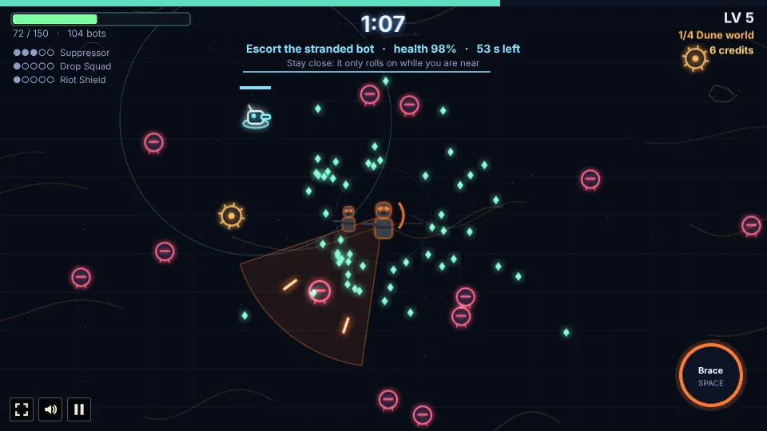

## Running locally

```sh
npm run dev   # then open http://localhost:5173/games/riftblade/
```

## Playthrough test

`e2e/playthrough.spec.ts` plays the first minute in headless Chromium with real inputs: on the
hero select screen it checks the sixteen cards (all but Legionary TR-9 locked on a fresh save),
taps a locked card (no Fight button), then TR-9 and Fight, walks him in a wide circle by holding
the mouse down at a point that turns around him, takes the first card at the first level-up and
checks the upgrade was taken, fires Brace from its button and plays on to the one-minute mark. Side
objectives and power-ups only begin at 1:00, so they leave that first minute as it was.

```sh
npx playwright test --project riftblade
```

## Code layout

- `src/main.ts`: creates the game, the hub's settings and scaling.
- `src/howToPlay.ts`: the How to play screen.
- `src/game/`: the rules, without drawing: `heroes.ts` (the heroes, their pools, colour schemes
  and which are locked), `blades.ts` (the knights' attacks, signatures and skills, and the unlock
  deeds), `squad.ts` (Elara Voss and Triad-77: weapons, signatures, paths and allies), `crew.ts`
  (Dax Morrow, Grunda, Kettle and Cassia Vane: the same),
  `upgrades.ts` (paths, pool, gear, capstones, crossovers and the card roll), `planets.ts` (the
  ten worlds, their bosses and the star map's numbers), `state.ts` (the state and the numbers),
  `sim.ts` (everything that happens in a fight), `voyage.ts` (between fights: the star map, trader,
  arena, events, the endless rift's loop and the next world), `objectives.ts` (the side
  objectives), `daily.ts` (the daily run), `endless.ts` (the endless rift's numbers), `codex.ts`
  (the codex pages), `mastery.ts` (hero mastery), `rush.ts` (the boss rush) and `save.ts`.
- `src/art/`: `glow.ts` (painting helpers), `sprites.ts` (the heroes, Scrap bots and pickups),
  `knights.ts` (the knights, their blades and allies), `squad.ts` (Elara, Triad-77, their allies,
  the drop pod and the locked placeholder), `crew.ts` (the crew and their allies, painted the first
  time one is shown) and
  `factions.ts` (the later factions and their bosses), all painted at boot, and `worlds.ts` and
  `realms.ts` (the space map's factions), painted once a run leaves the Dune world.
- `src/scenes/`: `BootScene.ts`, `GameScene.ts` (input, camera and drawing), `objectiveArt.ts`
  (the objectives and power-ups, drawn in code) and `layout.ts`.
- `src/ui/panels.ts`: the hero select, Armoury, codex, weekly and daily run, boss rush, level-up, new hero,
  star map, trader, event and end screens.
