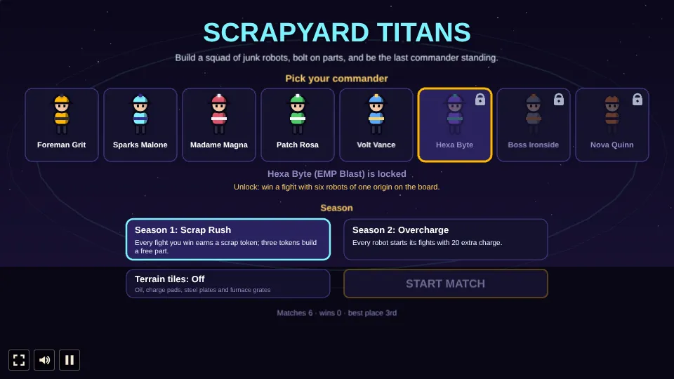
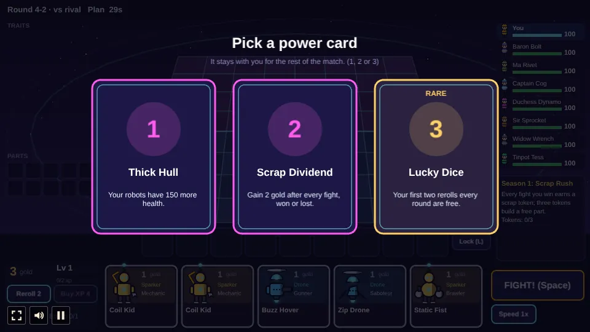
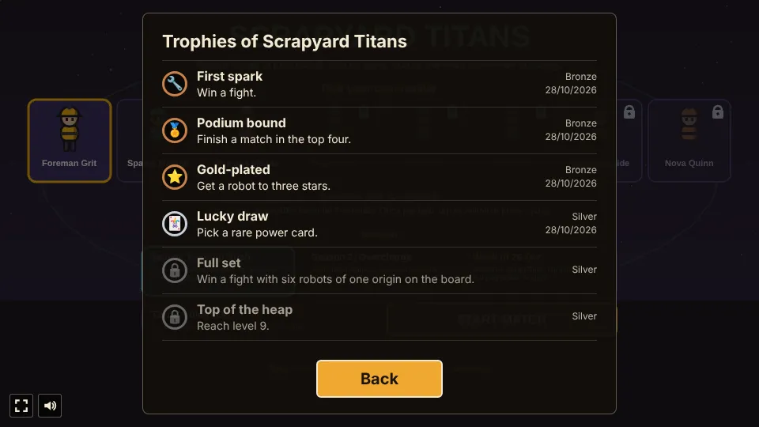

# Scrapyard Titans

A board auto-battler built with [Phaser 4](https://phaser.io), TypeScript and Vite, part of the
[game hub](../../README.md).

You are one of eight commanders in a junkyard arena. Each round you buy junk-built robots from a
shop, place them on your half of an 8x8 board and press FIGHT; the robots then battle on their own
against a rival commander's squad or a pack of scrap monsters. A lost fight costs your commander
health. Three copies of a robot merge into a stronger one, robots that share an origin or class
unlock trait bonuses, and parts bolted onto a robot combine into finished items. The last commander
standing wins. The seven rivals are AI; there is no multiplayer.

The look is a cel-shaded arena in fake 3D: the board tilts away from you (far rows narrower and
shorter), the robots are flat-shaded figures with a hard shadow band and an ink outline, drawn bigger
the nearer they stand, and the commanders walk around the board's edge.

## How to play

| Control | Action |
| --- | --- |
| Click or tap a shop card | Buy that robot onto your bench |
| Drag a robot, or tap it and then a tile or bench slot | Place it on your half of the board (the near four rows), or swap two robots |
| Drag a part onto a robot, or tap the part and then the robot | Bolt it on; two parts on one robot build a finished item |
| Drag a robot onto the shop, or E with it selected | Sell it |
| R, or Reroll | New robots in the shop for 2 gold |
| L, or Lock | Keep the shop as it is for the next round; a reroll unlocks it |
| Tap a rival in the list on the right | During planning, show its board on the far half, with its level, gold, traits and power cards |
| Tap the panel under the list | Switch between the last fight's damage meter and your power cards |
| X, or Buy XP | 4 XP for 4 gold; each level lets one more robot onto the board |
| Space, or FIGHT! | Start the fight early; during a fight, use your commander's skill once |
| T, or Speed | Play fights at 1x or 2x |
| 1, 2 or 3 | Pick a power card when one is offered |
| Tap the Scrap Rat | On the rat round, zap it for gold before it escapes |

The menu picks a commander (each with one skill a fight), a season and whether the board has
terrain tiles. The plan phase lasts 30 seconds; when it runs out the fight starts on its own.

- **Rounds.** Stage 1 is three monster rounds and a draft. Every later stage has five fights against
  rivals, a draft in the middle and a monster round at the end (stage 2's is the Scrap Rat chase).
  Monster rounds drop parts and gold as orbs your commander walks over to collect.
- **Economy.** 5 gold a round (3 in stage 1), 1 more for every 10 you hold (up to 5), and a bonus
  for a win or loss streak. Each round also gives 2 XP. Levels run 1 to 9, and higher levels bring
  pricier robots into the shop.
- **Damage.** A lost fight costs the commander a base by stage plus a little per enemy robot left
  standing.
- **Star-ups.** Three copies of a robot merge into a 2-star, three 2-stars into a 3-star; health
  and attack grow 1.8x a star and the ability more.
- **Robots.** Each season's roster has 30 robots: five origins with one robot of each of the six
  classes, at costs 1 to 5. Origins have tiers at 2, 4 and 6 robots; classes at 2 and 4.

  | Class | Ability |
  | --- | --- |
  | Guardian | Plate Up: shields itself |
  | Brawler | Ground Pound: hits and stuns the tiles around it |
  | Gunner | Barrage: fires shells at random enemies |
  | Sniper | Long Shot: a heavy round at the farthest enemy |
  | Saboteur | Backstab: leaps behind the enemy line at the start, then blinks to the weakest enemy |
  | Mechanic | Patch Job: repairs and shields the most hurt ally |

  | Origin | Bonus |
  | --- | --- |
  | Heavy | Heavy robots gain armour |
  | Drone | Drones dodge attacks |
  | Sparker | Casting throws lightning at 3 enemies |
  | Magnet (Season 1) | Enemies lose armour |
  | Salvager (Season 1) | Attack speed each time an ally falls |
  | Neon (Season 2) | Stronger abilities |
  | Hacker (Season 2) | Enemies gain less charge |

- **Parts and items.** Six parts (Buzzsaw, Servo, Plating, Fuel Cell, Capacitor, Scope) each add a
  stat; any two on one robot build one of 21 finished items with a special effect (like the Chain
  Saw's cleave or the Reactor Core's restart). A robot carries 3 items, and you hold up to 10 parts
  and items; any more are scrapped. With a part picked up, a tag over each robot names what it
  would build there, and the panel lists every recipe for that part.
- **Damage meter.** After each fight the panel under the players list ranks your robots by the
  damage they dealt, and names the one that took the most.
- **Power cards.** At rounds 2-1, 3-2, 4-2 and 5-2 every commander picks one of three power cards
  (15 in all, like Thick Hull, Recycler or War Chest) that last the whole match. From 4-2 on, the
  third card is a rare one, gold-edged, that changes the economy: Lucky Dice (the first two rerolls
  each round are free), Hand to Mouth (no interest, but 6 gold every round) or Gilded Shop (gilded
  robots in one shop slot in five, from level 1).
- **Commanders.** Foreman Grit (Overclock: robots attack 40% faster for 5 seconds), Sparks Malone
  (Big Zap: zaps and stuns the toughest enemy) and Madame Magna (Scrap Wall: shields every robot)
  are open from the start. Five more unlock through deeds, saved on the device: Patch Rosa
  (Patch-Up: repairs every robot for 220) for a top-four finish, Volt Vance (Power Surge: fills
  every robot's charge) for a 3-star robot, Hexa Byte (EMP Blast: drains and stuns every enemy) for
  a won fight with six robots of one origin, Boss Ironside (Rally Cry: robots hit 35% harder for 6
  seconds) for level 9 and Nova Quinn (Air Strike: 140 damage to every enemy) for a won match. A
  locked commander's card says what unlocks it. The rivals use their skills on their own and call
  out a taunt at the start of a fight.
- **Weekly season.** The third season card is this week's: the date (weeks run Monday to Sunday,
  UTC) picks one of the two seasons with or without terrain, in turn, so every combination comes
  round once a month. The card shows the rules and this week's best place, which is saved apart from
  the overall best.
- **Trophies.** Ten, listed on the start and pause screens: First spark (win a fight), Podium
  bound (top four), Gold-plated (a 3-star robot), Lucky draw (a rare power card), Full set (a won
  fight with six robots of one origin), Top of the heap (level 9), Last one standing (win a match),
  Full roster (every commander unlocked), and two hidden ones for the long run.
- **Rank ladder.** A saved rank that only goes up: a finish in the top four earns rank points (50,
  35, 25 or 15), and the rank sets how hard the rivals play. Rust (0 points) is the game as
  designed; Iron (100) rivals reroll for copies sooner, Steel (250) also get 1 more gold a round,
  Chrome (450) also find pricier robots in their shops, and Titan (700) get 2 more gold a round and
  reroll from round 2-1. The menu shows the rank and the next one, the end screen the points won.
  In AI-only test matches the AI seat's average place goes from about 4.2 at Rust to 5.1 at Steel
  and 6.4 at Titan.
- **Draft rounds.** Robots carrying a part or item walk a ring in the middle of the board; the
  commanders pick one each, lowest health first.
- **Seasons.** Season 1, Scrap Rush, has Magnet and Salvager robots, and every won fight earns a
  scrap token (three build a free part). Season 2, Overcharge, has Neon and Hacker robots, and every
  robot starts its fights with 20 extra charge.
- **Terrain.** With terrain tiles on, each half of the board gets four: oil slows, charge pads
  charge, steel plates armour and furnace grates burn whoever stands on them.
- **Gilded robots.** From level 5 a shop card is now and then a gilded robot: it costs 2 more and
  counts for a second origin, but never merges.

Difficulty (the hub's setting): Easy gives your commander 130 health and the rivals 1 gold less a
round; Hard gives it 80 health and the rivals 1 gold more. Normal is 100 health.

Watch AI: `?watch` lets the AI play your seat too, with a random commander, season and terrain, and
shows your seat's fights on the board.

## Code layout

| Path | What it holds |
| --- | --- |
| `src/main.ts` | Creates the game and calls the hub's `setupGame` and `setupScaling` |
| `src/howToPlay.ts` | The How to play screen's text |
| `src/progress.ts` | What lasts between matches: stats and the deeds that unlock commanders |
| `src/game/data.ts` | Every rule and number: robots, traits, parts, items, power cards, commanders, monsters, rounds, economy, terrain |
| `src/game/battle.ts` | The fight sim on the 8x8 board, in fixed 50 ms steps, raising events for the view |
| `src/game/match.ts` | The match: players, shops, buying, merging, items, rounds, pairings, damage, drafts |
| `src/game/ai.ts` | The rival commanders' plan, power card and draft choices |
| `src/art/paint.ts` | Paints the cel-shaded robots, monsters, commanders and part icons at start-up |
| `src/scenes/layout.ts` | Screen positions and the board's fake 3D projection |
| `src/scenes/GameScene.ts` | The menu, the board, the HUD, fight playback and input |
| `e2e/playthrough.spec.ts` | Plays the first round in headless Chromium |

## Screenshots

