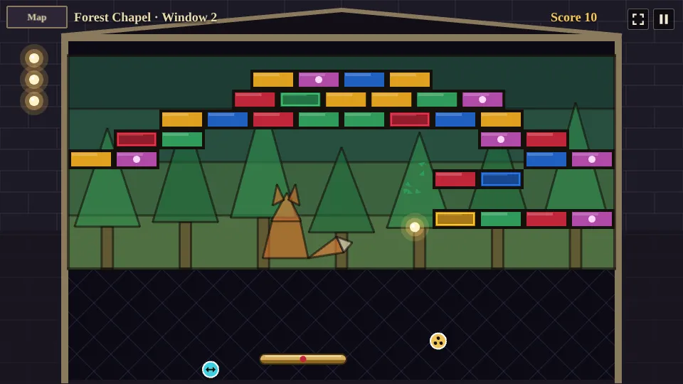
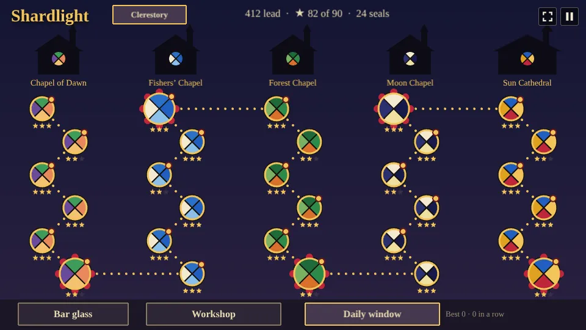
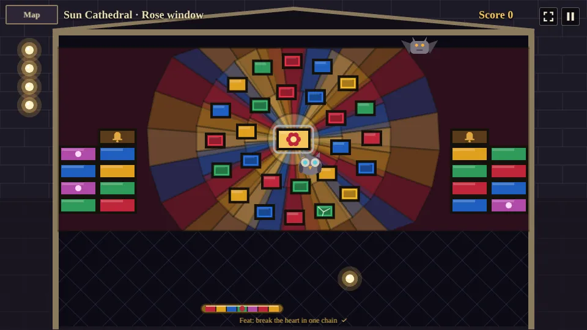
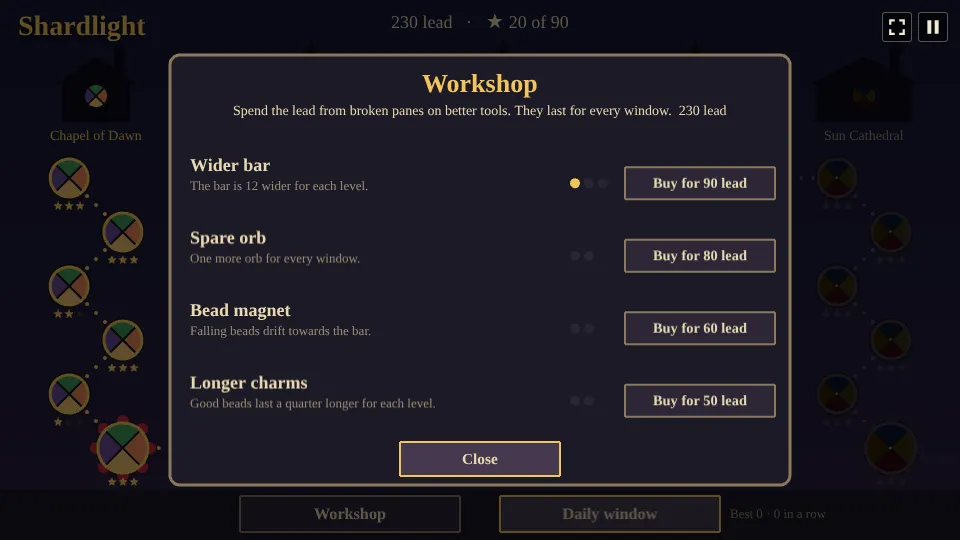

# Shardlight

A block breaker in a chapel of stained glass. You are a glazier's apprentice restoring old windows:
keep a lantern orb bouncing off your brass bar and break every dull pane, until the light shines
through the picture behind. Walk a map of five chapels and thirty windows, each chapel ending in a
turning rose window.

## How to play

- **Move the bar** with the mouse, by dragging on a touch screen, or with A / D or ← / →.
- **Launch** the orb with a click, a tap or Space. A caught orb on a sticky bar goes the same way.
- **Aim** by where the orb meets the bar: the middle sends it straight up, the ends off to the side.
- **Panes:** plain glass breaks in one hit, thick glass in two (it cracks first), lead panes only
  break to a fire orb and don't need breaking, and purple bead panes always drop a bead. The heart
  of a rose window takes three hits.
- **Beads** fall from broken panes: catch them with the bar for a wide bar, three orbs, a sticky
  bar, a fire orb, a slow orb or an extra orb. The dark ones shorten the bar or speed the orb up.
- **Chains:** each pane broken before the orb is back at the bar is worth more than the last.
- A window has three orbs (more with the Spare orb upgrade). Lose them all and try again.
- Escape leaves a window for the map.

## The map

The map shows the five chapels (Dawn, the Fishers', the Forest, the Moon and the Sun Cathedral) and
the path through their thirty windows. A restored window opens the next and shows its stars: three
for no orb lost, two for one, one otherwise. Each chapel's last window is a rose window, a ring (two
rings from the Forest Chapel on) of panes turning round a heart. From the Forest Chapel on, some
rows slide from side to side.

## Workshop and daily window

Broken panes pay lead, more for a restored window and each star. Spend it in the **Workshop** on a
wider bar, a spare orb, a bead magnet and longer charms; they last for every window.

The **Daily window** is the same window for every player that day, with one try. The map keeps your
best daily score and your days in a row.

## Code layout

- `src/main.ts` boots Phaser and the shared setup.
- `src/game/levels.ts` makes each window's panes from its number; `src/game/sim.ts` plays a window
  (orbs, bar, panes, beads) in fixed steps; `src/game/save.ts` keeps the progress.
- `src/scenes/GameScene.ts` draws the map, the workshop and a window in play; `src/scenes/art.ts`
  paints the panes, the pictures and the rest.
- `src/audio.ts` has the music and sound effects, `src/i18n/` the texts, `src/trophies/` the trophies.
- `e2e/playthrough.spec.ts` plays the first window.
