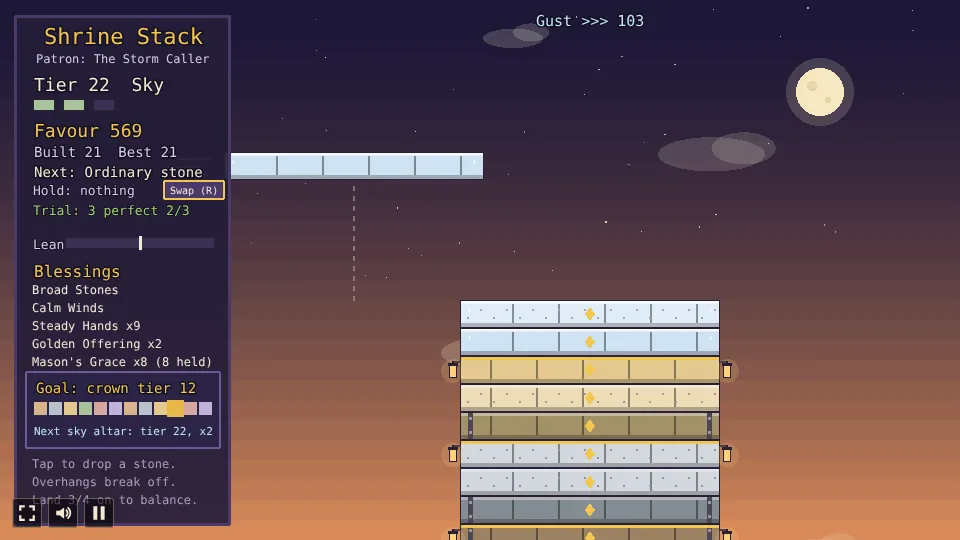
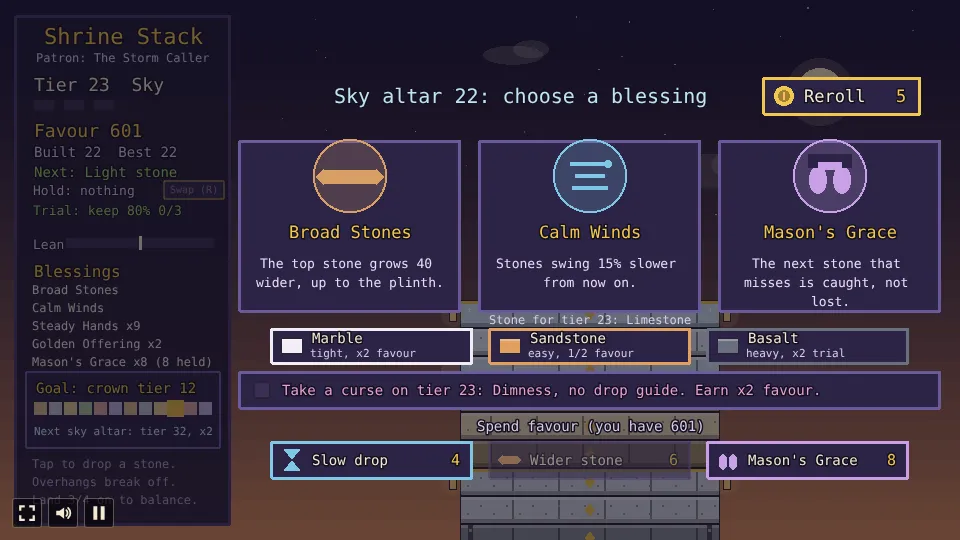

# Shrine Stack

A stacking prototype built with [Phaser 4](https://phaser.io), TypeScript and Vite, part of the
[game hub](../../README.md).

Raise a temple on a hilltop at dusk, under a patron whose rule holds for the whole run. A stone
swings back and forth above the temple; tap to drop it. Whatever hangs over the stone below breaks
off and tumbles away, so a careless drop narrows the temple for good. Every three stones make a
tier, and a tier whose stones all landed well is balanced: it earns favor, gold trim and lanterns,
and a blessing of your choice. Favor buys new blessings and one-time help between tiers, heavy and
light stones and tier trials change each drop, a stone can be held in reserve, and from tier 3 the
temple leans with every off-centre drop, perfect chains grow the stone back and each break picks the
next tier's stone. A curse taken with a blessing doubles a tier's favor, tier 10 is gilded for double
favor, and finishing tier 12 crowns the shrine. After the crown you can keep building into a windy
sky.


## How to play

| Control | Action |
| --- | --- |
| Tap or click a patron card | Start the temple under that patron |
| Tap or click anywhere | Drop the swinging stone |
| Swap (R) | From tier 2: put the stone in hand in reserve, or swap it with the one held (once per tier) |
| Tap or click a blessing card | Keep that blessing after a balanced tier |
| Marble, Sandstone, Basalt | Between tiers, from tier 3: pick the next tier's stone (tap again for plain limestone) |
| Reroll | Spend 5 favor to swap the three blessings on offer (four under the Many-Handed) for new ones |
| Slow drop, Wider stone, Mason's Grace | Between tiers: spend favor on one-time help |
| Take a curse | Between tiers: tick it before choosing a blessing to take the curse with it |
| Build on | After a break with no blessing: go back to stacking |
| Keep building | On the crowned panel: carry on into the endless sky |
| Build again | After the temple falls or is crowned: start again on a bare plinth |

1. **Choose a patron.** Every temple starts with a pick of two patrons, each with a boon and a bane
   for the whole run: the **Gilded Hand** (every stone earns 1 more favor, but there is no Mason's
   Grace, so a miss always ends the run), the **Many-Handed** (balanced tiers offer four blessings,
   but stones swing 10% faster), the **Patient Mason** (stones swing 10% slower, but perfect drops
   earn no extra favor) or the **Storm Caller** (3 more pixels of perfect leeway, but gusts blow
   from tier 6, not only past the crown).
2. **Drop the stone over the one below.** Only the part resting on it stays; the overhang breaks
   off, and the next stone is as wide as what is left.
3. **Perfect drops**, within 5 pixels of the stone below, snap on whole and earn 2 extra favor.
4. **Tiers**: three stones make a tier. A tier is balanced when each of its stones kept at least
   three quarters of its width; it earns 5 favor and offers three blessings (four under the
   Many-Handed) to choose from. A wobbly tier earns nothing extra. Each tier swings 5% faster than the one before.
5. **Reroll**: while choosing, spend 5 favor to draw new blessings (and a new curse), as often as
   favor lasts. A new curse comes untaken.
6. **Spend favor** between tiers on one-time help, each at most once per break: a **Slow drop** (4
   favor: the next stone swings at half speed), a **Wider stone** (6: the top stone grows 20 wider,
   up to the plinth) or **Mason's Grace** (8: the next miss is caught, though the caught stone still
   leaves the tier wobbly and fails its trial). The shop also opens after a
   wobbly tier when you have at least 4 favor, and from tier 3 after every tier; tap **Build on** to
   carry on.
7. **Stone kinds**: from tier 2, a stone can be **heavy** (dark, iron-strapped: swings 25% slower,
   but a drop that is not perfect cracks 6 more pixels off) or **light** (pale pumice: swings 30%
   faster and earns 1 more favor). The panel shows the kind of the next stone.
8. **The reserve**: from tier 2, **Swap** (or R) puts the stone in hand in reserve and hands you
   the next one, for free while the reserve is empty; once it holds a stone, the swap trades the two,
   once per tier. The stone keeps swinging from where it is. Save a light stone for a trial, or get
   a heavy one out of the way.
9. **Tier trials**: from tier 2, every tier sets a trial, either three perfect drops or every stone
   keeping at least 80% of its width. Meet it for 6 extra favor; the panel tracks it.
10. **The temple leans**: from tier 3, every stone that lands off the centre of the one below adds
    its offset to the lean meter in the panel (left or right). Past 60 pixels the tier being built
    topples: its stones tumble off, taking the favor they earned with them, and the tier starts over. A finished
    tier settles, halving the lean. Perfect drops add nothing, and a drop to the other side leans it
    back, so the widest drop is not always the right one.
11. **Perfect chains**: from tier 3, the third perfect drop in a row, and every perfect drop after it,
    grows the stone back 12 pixels, up to the plinth's width. A chain carries across a tier end; a
    cut or a miss breaks it.
12. **Materials**: from tier 3, every break shows the stone for the next tier. Plain limestone needs
    no pick; or take **Marble** (half the perfect window, but everything the tier earns is doubled),
    **Sandstone** (double the perfect window, half the favor) or **Basalt** (heavy: swings 25% slower
    and cracks 6 more off each cut, but its trial pays double). Tap the pick again for limestone.
13. **Curses**: a balanced tier's break offers a curse for the next tier (Haste: stones swing 30%
    faster; Brittle: every cut cracks 6 more off; Dimness: no drop guide). Tick it before choosing a
    blessing, and everything that tier earns (stones, balance, trial) is doubled.
14. **The goal** is tier 12. The side panel tracks it, a pip per tier. Tier 10 is gilded: its
    stones are leaf gold, and every stone and its balance bonus earn double favor. Finishing tier 12
    crowns the shrine and wins the run.
15. **The endless sky**: after the crown, **Keep building** lifts the crown off, a break picks the
    first sky tier's stone (and a blessing, if tier 12 was balanced), and the temple climbs on. Gusts now push the falling stone sideways (the
    top of the screen and the streaks by the stone show which way and how hard), stronger the higher
    you go (under the Storm Caller they just keep growing from tier 6). Aim upwind. Every tenth tier
    past the crown (22, 32, ...) is a **sky altar**: its stones are cloud-silver and earn double
    favor, and finishing it offers a blessing even if it came out wobbly. The panel's goal box
    names the next one.
16. **The end** comes when a stone misses the temple. The most tiers built in one temple are saved
    in the browser.


### Patrons

| Patron | Boon | Bane |
| --- | --- | --- |
| The Gilded Hand | Every stone earns 1 more favor. | No Mason's Grace: a miss always ends the run. |
| The Many-Handed | Balanced tiers offer four blessings. | Stones swing 10% faster. |
| The Patient Mason | Stones swing 10% slower. | Perfect drops earn no extra favor. |
| The Storm Caller | Perfect drops get 3 more pixels of leeway. | Gusts blow from tier 6, not only past the crown. |


### Materials

| Material | Effect on its tier |
| --- | --- |
| Limestone | The plain stone: no pick needed. |
| Marble | Half the perfect window; every favor the tier earns is doubled. |
| Sandstone | Double the perfect window; half the favor. |
| Basalt | Heavy: swings 25% slower and cracks 6 more off each cut; the tier's trial pays double. |


### Blessings

| Blessing | Effect |
| --- | --- |
| Broad Stones | The top stone grows 40 pixels wider, up to the plinth's width. |
| Calm Winds | Stones swing 15% slower from now on. |
| Steady Hands | The perfect drop window grows by 6 pixels. |
| Golden Offering | Every stone placed earns 1 more favor. |
| Mason's Grace | The next stone that misses is caught, and you get another try. |

Blessings can be taken more than once, and they add up.







The difficulty, set on the hub page's Settings, changes one thing: stones swing 20% slower on Easy
and 25% faster on Hard.

## Running locally

`npm run dev` at the repo root, then open `/games/shrine-stack/` (or pick Shrine Stack on the hub
page).

## Playthrough test

`e2e/playthrough.spec.ts` plays the first round in headless Chromium: it checks the new temple
waits for a patron, takes the first of the two offered and checks its rule, checks that the first
stone swings, drops each of the first tier's three stones with a tap while it is
over the stone below (checking that a second tap while it falls drops nothing), checks the balanced
tier's favor and its three blessings (four under the Many-Handed), taps Reroll and checks it cost 5
favor and brought new cards, checks the break also shows a curse and the favor shop (neither is taken), and takes the
first blessing, checking its effect and tier 2's trial as tier 2 starts. Like the other games' tests it owns the game clock and plays at 4x speed
(`PLAYTHROUGH_SPEED`). The **Playthrough Shrine Stack** workflow
(`.github/workflows/playthrough.yml`) runs it on every PR that touches this folder or
the workflow, and uploads the video and screenshots as the `playthrough-shrine-stack` artifact.

```sh
npx playwright test --project shrine-stack
```

## Code layout

All paths are inside `games/shrine-stack/`.

- `src/game/`: the rules in plain TypeScript with no Phaser dependency. `state.ts` has the
  swinging, dropping, cutting, tiers, blessing effects, the reroll, the shop, stone kinds, the
  reserve, trials, the lean, perfect chains, materials, patrons, curses, the gilded tier, the goal
  and the endless sky, `blessings.ts` the blessing names and texts, `catalog.ts` the shop items,
  stone kinds, trials, curses, materials and patrons, and `save.ts` the best height.
- `src/scenes/`: `GameScene` draws the sky, the temple, the panel with the patron, the goal track,
  the next stone, the reserve, the trial, the curse and the lean meter, the patron cards, the
  blessing cards, the reroll button, the material row, the curse toggle and the shop, gusts, the
  crown, and the end panel and wires taps to the rules; `layout.ts` says where things are drawn.
- `src/ui/`: the button.

Balance numbers (swing speed, the perfect window, the balance share, favor) are the constants at
the top of `src/game/state.ts`.
