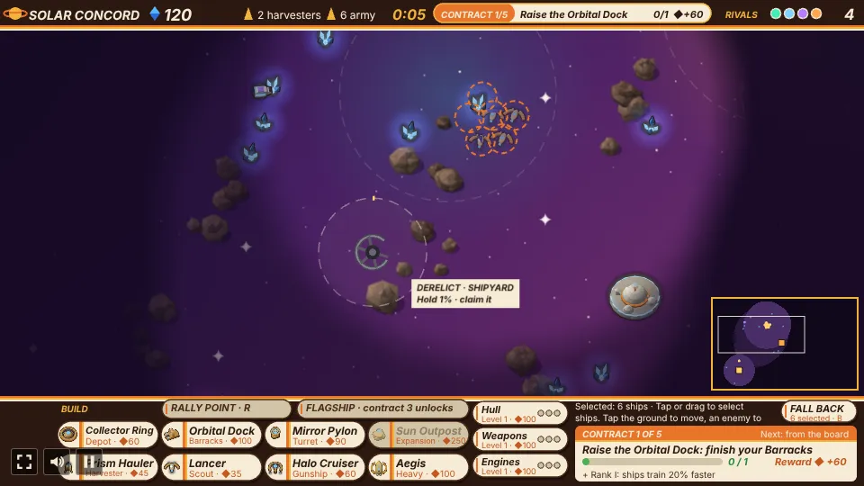
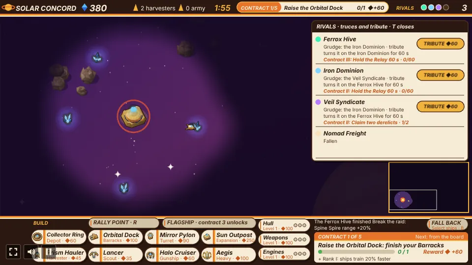

# Space Wars

A real-time strategy prototype built with [Phaser 4](https://phaser.io), TypeScript and Vite, part
of the [game hub](../../README.md).

Five factions share a random star map, a battlefield larger than the screen that you scroll
around. Each one starts with a hub and two harvesters (crystal haulers) at its own start point, and
each has its own ships and buildings. Mine crystal, raise a base beside your hub, train a fleet,
pick your way through five contracts on the contract board and take down the four rival hubs
before they take down yours. Won battles carry you across a five-sector campaign.

It looks like a 1970s science-fiction paperback cover: airbrushed violet skies and nebulae, a
ringed gas giant, sparkle glints, and real low-poly 3D ships with chrome and painted hulls, racing
stripes and long exhaust flames, under a chocolate-and-mustard striped HUD with cream pill buttons.

## How to play

| Control | Action |
| --- | --- |
| Tap a faction card (before the battle) | Command that faction. The other four are AI |
| Tap an open sector under the cards (before the battle) | Fight the next battle in that campaign sector |
| Tap a card on the contract board | Take that contract (the first is taken when the countdown runs out) |
| Flagship button (after the third contract) | Build your one flagship at the hub |
| Tap a combat unit | Select it (replaces the selection) |
| Drag a box over combat units | Select every combat unit in the box |
| The army count on the top bar, or Q | Select every warship you have |
| Tap empty space | Move the selected units there (a wing fans out round the spot) |
| Tap an enemy unit or building | Attack it with the selected units |
| Build buttons, then tap the map | Place a building (green ring when it can go there) |
| Expansion button, then tap a far crystal field | Place an outpost, a second hub |
| Train buttons | Queue a unit: harvesters at a hub, combat units at a Barracks |
| Research buttons (Hull, Weapons, Engines) | Start the next level at your hub |
| Fall back button, or B | Send the selected ships home to the nearest hub or Depot, where ships repair |
| Rally point button, or R, then tap the map | Plant the rally point: new warships fly there and fan out round it. Tap the flag in rally mode to take it down |
| Space, or tap an arrow on the map's edge | Jump to the latest attack on your ships or base |
| The rivals on the top bar, or T | Open the rivals panel: accept or decline a truce, or pay tribute to turn a rival |
| Right-click | Cancel a placement or the rally point, clear the selection and close the rivals panel |
| Arrow keys or WASD, or drag with two fingers | Scroll the map |
| Tap or drag on the minimap | Move the view there |
| H | Centre the map on your hub |
| Hover over a unit or building | Its name, role, hit points and stats |
| Hover over a command button | What it is: cost, stats and ability |
| Tap a perk card after a victory | Keep that perk for the rest of the campaign |
| Tap after the battle ends | Start a new battle on a new map |

0. **Pick a faction** on the first screen. Each card shows its hub, its three warships, its
   barracks and its signature ability. Your faction always starts at the bottom left of the map.
1. **Crystal** is the only currency. Harvesters work on their own: each one mines the crystal
   nearest its hub, fills up and carries it back to the hub or a Depot.
2. **Buildings** cost crystal and take time to finish. Each must go within 240 pixels of one of
   your hubs, on ground you have scouted, clear of other buildings, rock fields, crystal nodes and the relay beacon. Every faction names
   its buildings and ships its own way, so each button shows the role under the name: the Barracks
   is the building with the role "Barracks" under its name (the Solar Concord's is the Orbital
   Dock).
3. **Units**: each faction has a fast scout, a gunship and a heavy, all trained at its Barracks. A
   unit with no orders fires at any enemy in its sight. Ships fly round the rock fields rather than
   over them, and a wing that bunches up drifts apart, so ships never sit on top of each other.

    Select one to see its name and hit points
   on the command bar.
4. **Contracts** give the battle its goals (below). After the first, the contract board offers two
   at a time over the map and you tap one. The current one is on the top bar and in the panel on
   the command bar, with its progress, reward and rank perk. The third one done unlocks your
   **flagship** (below).
5. **The fog of war** hides everything your ships and buildings can't see (below), so send scouts
   out.
6. **The relay beacon** sits on what was a crystal node partway between your start and the centre
   of the map, out in the fog. Find it and hold it to earn crystal (below).
7. **Salvage**: every enemy ship you destroy leaves a glowing gold shard worth 8 crystal.
8. **Expansions and research** (below) grow your economy and your fleet once the base is running.
9. **Nebulae** hide the ships inside them from enemies and slow them (below), so a wing can lie in
   wait or slip past. **Derelict stations** out in the fog give a perk to whoever holds one (below).
10. **Veterans**: a ship that destroys 3 enemy ships is a Veteran and at 8 an Ace, each rank +15%
    damage and hull. Ships slowly **repair** beside a hub, outpost or Depot, and the Fall back
    button sends a wing home to do it (below).
11. **Truces and tribute**: a rival you are beating may offer a truce for crystal, and your crystal
    can turn a rival's grudge onto another faction (below).
12. **Victory** comes when all four rival hubs are destroyed. A hub that falls takes its whole
    faction with it (an outpost does not). **Defeat** comes when your own hub falls. Once only two
    rivals are left, or you hold more than a third of the hubs, the rest sign a **last-stand pact**
    and raid you together (below). Each victory opens the next **campaign sector** and keeps one of
    its perks (below).
13. **The rivals** play the same game and fight each other as much as you. They wait about a
    minute and a quarter before they attack, then send their army (keeping two ships home, and the
    hurt ones repairing) at the faction that last hit them, or else the nearest enemy building.
    From 30 seconds in, the rival nearest the relay beacon keeps a warship on it, and from two
    minutes the next nearest does too. From a minute in, a rival with three warships sends one to
    claim the nearest derelict station it does not own. Their idle warships fetch their own
    salvage, a warship under 30% goes home to repair, and from two minutes on they research and
    from two and a half they build an outpost, saving up for both once their army is big enough.

### The contract board

Five contracts a battle. The first is always the same: raise your Barracks. Once a contract is
done it pays its crystal reward at once, gives your faction its rank perk for the rest of the
battle, and the contract board opens over the top of the map with two contracts for the next
rank. Tap one to take it; after 15 seconds the board takes the first card. The second board always
offers Break the raid beside one other. A contract is never offered twice in a battle, and one that
can't be played (no Veil Syndicate left for Break a Mine Lattice, say) stays off the board. Only
progress made while a contract is current counts.

| Contract | From rank | Goal | Reward | Perk |
| --- | --- | --- | --- | --- |
| Raise the Barracks | I (always first) | Finish your Barracks (it names your faction's own, such as the Orbital Dock) | 60 | Ships train 20% faster |
| Break the raid | II | Destroy 7 enemy ships | 120 | Turret range +20% |
| Escort the convoy | II | Three harvesters fly from your hub to a crystal field 420 to 820 px away, and the rival nearest it sends up to 3 ships to hunt them; get 2 there | 150 | Harvesters carry 30% more |
| Claim two derelicts | II | Hold two derelict stations at once | 160 | Ships repair twice as fast |
| Hold the Relay 60 s | II | Keep a warship on the relay beacon you own for 60 s in all | 150 | Ships 10% faster |
| Hold a nebula 45 s | II | Keep a warship in a nebula no enemy warship is in, 45 s in all | 140 | Ships see 20% further |
| Break a Mine Lattice | III | Destroy a Veil Syndicate Mine Lattice | 180 | Turret damage +25% |
| Raze an outpost | III | Destroy 3 enemy buildings | 200 | Ship hulls +15% (new ships) |
| Survive the raid 90 s | III | Every rival not under truce or held by your tribute turns on you and sends its fleet at your hub at once; keep the hub for 90 s (not offered, and failed if taken, while every rival is at peace or paid off) | 220 | Ships cost 10% less |
| Topple a hub | IV | Destroy a rival hub | 300 | Ship damage +10% |

A kill or a razed building counts for you when your ship or turret landed the last hit. A convoy
that loses two harvesters fails: the board offers two more contracts for the same rank, and the
convoy's survivors stay on as harvesters. Those that arrive start mining their new field. Break a
Mine Lattice fails the same way once no Veil Syndicate rival is left. While the rivals panel is
open, the board stands aside; the top bar still counts down.

**The rivals run contracts too.** From 1:30 each rival works through a chain of its own, ranks II
to V, picked from Break the raid, Hold the Relay, Claim two derelicts, Raze an outpost and Topple a
hub, for the same rewards and perks as yours. A rival plays to its contract: on a raid contract it
sends its fleet out with two ships fewer than usual (and at a hub for Topple a hub), on Hold the
Relay it keeps a ship on the beacon however far its hub is, and on Claim two derelicts it goes for
stations anywhere. A contract it hasn't finished in 3 minutes is dropped for another. The rivals
panel shows each rival's contract and progress, and the message line says when one finishes.

### The flagship

The third contract done unlocks the Flagship button above the build row. Your flagship is your
faction's heavy grown into a slow capital ship: 400 crystal (times the faction's cost), built at
the hub in 25 seconds, with 3 times the heavy's hull, 1.6 times its damage, 20 px more range and
70% of its speed, riding on a gold ring. It carries a stronger take on the faction's ability. You
get one per battle: once it is lost, it is gone.

| Faction | Flagship | Ability |
| --- | --- | --- |
| Solar Concord | Dawn Throne | Friends within 120 px take only 35% of each shot |
| Ferrox Hive | Brood Mother | Spawns a scout every 6 s, up to 10 scouts |
| Iron Dominion | Iron Citadel | Shells splash enemies within 55 px for 70% damage |
| Veil Syndicate | Night Shroud | Cloaked until it fires, then seen for only 1 s |
| Nomad Freight | Caravan Prime | Pays 12 crystal for each enemy unit destroyed within 260 px |

### The last-stand pact

Once only two rivals are left, or you hold more than a third of the finished hubs (after the first
minute and a quarter), the rivals left sign a pact. Their truces with you end, they stop fighting
each other, they each get 100 crystal, and tribute no longer turns them. A banner on the map
counts down 60 seconds to their joint raid, when every rival sends its whole fleet at your hub at
once, and then again every 45 seconds until they fall or you do.

### The sector campaign

Battles are fought across five sectors in a chain, shown under the faction cards. Each victory
opens the next sector, and lets you keep one of the perks you earned from that battle's contracts:
it applies from the start of every later sector's battles. A harder sector has rivals that start
with an outpost, more crystal and research, and fewer loose crystal fields on the map. You can
replay any open sector by tapping it before the battle, and a lost battle is fought again in the
same sector. The campaign is kept in the browser.

| Sector | Rivals with an outpost | Rival crystal | Rival research | Loose crystal fields |
| --- | --- | --- | --- | --- |
| 1 · Drift Reach | 0 | +0 | 0 | 16 |
| 2 · Ember Shoals | 2 | +40 | 0 | 13 |
| 3 · Glass Expanse | 4 | +80 | 0 | 11 |
| 4 · Ash Gate | 4 | +120 | level 1 in every track | 9 |
| 5 · Crown Nebula | 4 | +160 | level 1 in every track | 7 |

### The relay beacon

A warship (not a harvester) inside the beacon's ring holds it. A faction alone in the ring fills
the capture ring in 5 seconds, after first draining a rival's; when it is full the beacon is that
faction's. The owner earns 3 crystal every second while one of its warships stays in the ring, so
you choose between keeping ships out at the beacon and keeping them home to defend. A floating +3
rises from the beacon each time it pays you.

### Fog of war

You only see what your ships and buildings see. Space you have never seen is near black; space you
have seen before is dimmed, with rival buildings shown as you last saw them (one that has fallen,
been finished or changed hands since looks the same until you see its spot again; tap one to attack
it, and your ships fly there and fight it, or find it gone and take on whatever is there), and rival ships
show only while in sight. Scouts see furthest (1.6 times their weapon sight), other warships 1.2
times, harvesters 80 pixels, a hub 175 and other buildings 110 past their edge. The relay beacon
and the crystal fields show once you have seen them, and you can only build on ground you have
scouted. The rivals are not limited by the fog.

### Nebulae

The eight nebulae on every map are more than paint. A ship inside one flies at 70% of its speed
and is hidden from every enemy faction that has no ship within 70 pixels of it, no building within
70 pixels of its edge and no claimed Wide Sensors covering it. Firing gives a ship away for 1.5
seconds. Enemies chasing a ship into a nebula lose it until they are close, and a wing waiting
inside one ambushes whatever passes. Your own hidden ships are drawn faintly, and a faint dashed
ring marks each nebula's edge. The lane from your start to the relay beacon is always clear of them.

### Veterans

The ship whose shot destroys an enemy ship gets the kill. At 3 kills it is a **Veteran** and at 8 an
**Ace**: each rank adds 15% to its damage and its hit points (the hull grows on the spot). Gold
chevrons above a ship show its rank and its hover label names it. Turrets, mines and derelict guns
earn no ranks, so a veteran is worth pulling back from a losing fight.

### Repair and fall back

Any ship within 120 pixels of a finished hub, outpost or Depot of its faction gets back 3% of its hit
points a second, with a green cross beside it while it heals. The **Fall back** button at the right
end of the message line (or B) sends the selected ships to a point just short of their nearest hub
or Depot. Rivals pull their hurt ships home too.

### Attack alerts and the rally point

When a rival hits one of your harvesters, warships or buildings, an orange ring pulses round the
spot and the message line says what is under attack. While the spot is off screen, an orange arrow
on the map's edge points at it. **Space**, or a tap on the arrow, jumps the map there. An alert lasts
8 seconds after the last hit, and hits close together share one alert.

The **Rally point** button left of the Flagship button (or R) arms the rally point: tap the map and
a mustard flag goes up there. Every new warship from your Barracks or a held derelict shipyard then
flies to it, each to its own spot in two rings round the flag, so a fresh wing gathers in the open
rather than stacking on the Barracks. Tap the flag in rally mode to take it down.

### Minimap

The minimap in the map's bottom-right corner shows the whole battlefield: the space you have
explored, crystal you have found, the relay beacon, every building you know of and every ship you
can see, each in its faction's colour, with attack alerts as orange rings and a cream frame for the
part of the map on screen. Tap or drag on it to move the view.

### Derelict stations

Three derelict stations lie in the fog on every map, one of each kind, away from the bases, the
beacon and the lane to it. A faction alone in a station's 60-pixel ring with warships claims it in
10 seconds (first draining a rival's claim, which costs the owner the station) and keeps it until
another faction takes it the same way; a faction that falls loses its stations. Rivals send a ship to
claim the stations near their hubs.

| Station | Perk for the owner |
| --- | --- |
| Wide Sensors | Sees 280 pixels round it, into nebulae too |
| Shipyard | Trains the owner's combat units out there, like a second Barracks |
| Gun Platform | Shoots the owner's enemies within 170 pixels for 14 a second |

### Truces and tribute

A rival whose grudge is on you sues for peace when it is under pressure: its hub under 75% or three
ships lost to you lately. Its offer stays open for 25 seconds; the rivals area of the top bar glows
and a hint names it. Open the rivals panel (tap the rivals, or T) and accept for 90 seconds of truce
and 40 crystal of tribute, or decline. Under a truce neither side's ships, turrets or mines fire on
the other, and the rival raids someone else; ordering an attack on it breaks the truce. The panel
also shows each rival's grudge, and for 60 crystal of **tribute** turns that grudge onto the living
faction nearest it, held there for 60 seconds whatever hits it, its ships already on their way to
you turning on that faction's hub instead.

### Expansions

The Expansion button builds an outpost: a smaller copy of your hub (250 crystal, 18 s, 60% of the
hub's hit points). It must go within 120 pixels of a crystal node and at least 400 pixels from your
other hubs, on ground you have scouted. A finished outpost trains harvesters, which work the crystal
nearest it; every harvester drops its crystal at the nearest hub, outpost or Depot; and you can
build within 240 pixels of it. Losing an outpost does not end the battle.

### Research

Three tracks are researched at your hub with crystal, one level at a time, 20 seconds each: Hull
(+10% hit points a level, ships already flying included), Weapons (+10% damage) and Engines (+10%
speed). Each track has three levels costing 100, 160 and 240 crystal (times the faction's cost
multiplier). The button fills while its level is researched, and its pips show the levels done.

### Salvage

A ship destroyed by another faction (not a decoy) drops a glowing gold shard worth 8 crystal. The nearest of
your ships within 260 pixels pulls it in; when it reaches the ship, a +8 floats up over the spot and
a +8 flashes next to your crystal count. A shard nobody reaches fades after 45 seconds. Rivals'
shards work the same way for them, and their idle warships go to fetch them. Nomad
Freight's Salvage Yard still pays its own 8 crystal on top for enemy ships destroyed near it.

### The factions

Each faction's ships and stations are low-poly 3D models, rendered at 16 headings so they turn
smoothly, and keep the faction's colour on a stripe or a glow.

| Faction | Look | Barracks | Ships (cost) | Signature ability |
| --- | --- | --- | --- | --- |
| Solar Concord | Curved gold hulls round glowing blue crystals; arched carriers; pylons are floating crystals | Orbital Dock | Lancer (35), Halo Cruiser (60), Aegis (100) | Halo Cruiser's shield: friends within 70 px take half the damage |
| Ferrox Hive | Teal and bronze insects with glowing sacs; domed hives and spines | Brood Pit | Stinger (30), Brood Carrier (55), Carapace (90) | Brood Carrier spawns a Stinger every 12 s, up to 6 scouts |
| Iron Dominion | Dark iron warships with gold trim and ice-blue windows (a forge hauler with a cog crest and cranes, a winged assault gunship, a rounded strike cruiser with flight bays and a dorsal cannon, and a vast cathedral battleship with a ram prow and spires) | Forge Works | Ram Skiff (40), Siege Barge (70), Bulwark (115) | Siege Barge's shells splash enemies within 28 px of the target |
| Veil Syndicate | Pale starships with glowing blue nacelles (a boxy shuttle, a saucerless arrowhead escort, a saucer frigate with low nacelles and a rollbar, a ringed space station under way on warp nacelles); mushroom starbases and a spacedock | Cloak Works | Phantom Blade (35), Hack Frigate (60), Decoy Wraith (105) | Phantom Blade is hidden until it fires; Hack Frigate's hits disable a turret for 6 s, and 6 hits in a row take it over; Mine Lattice lays hidden mines; Decoy Wraith drops a decoy every 15 s |
| Nomad Freight | Off-white fighters with amber stripes (a fighter with four wings in an X, a twin-nacelle hauler, a saucer-cockpit freighter, a dagger-wedge destroyer with twin bridge towers); rounded modular bases | Salvage Yard | Courier Skiff (30), Escort Gunship (55), Siege Hauler (105) | Salvage Yard pays 8 crystal for each enemy unit destroyed within 200 px; Nomad carries 14 crystal a trip |

The Veil Syndicate's Mine Lattice lays a mine at a random spot within 130 pixels every 8 seconds
while it isn't hacked, up to 4 at a time. A rival's mine is hidden until one of your ships is within
60 pixels of it. An enemy ship that comes within 16 pixels sets it off: 45 damage to every enemy
ship within 40 pixels.

Each Hack Frigate hit puts a turret out for 6 seconds and fills a ring round it; 6 hits before it
comes back on take it over, and it becomes the hacker's own turret, as damaged as it was.

Rivals fight each other as well as you:

Each faction's stats are a few multipliers on the base game (hit points, damage, speed, cost, and
how much a harvester carries).

Every faction's four ships and four buildings:

The same ships side by side at their true sizes; every faction's heavy is the same size, the biggest ships in the game:

## Watch AI

Add `?watch` to the game's URL (`/games/space-wars/?watch`) to skip the faction picker
and let the AI command all five factions on an open map until one is left. Pan with the arrow keys
or WASD as usual. The panel in the top right holds the battle still, plays it from 1x to 8x
(**[** and **]**) and opens a log of every build, outpost, research and attack (**L**). Contracts,
the flagship and the last-stand pact don't run in a watched battle, and it is always fought in the
first sector. Tap the end screen to watch another.

## Difficulty

The difficulty, set on the hub page's Settings, changes how big a rival's army gets before it
attacks.

| Difficulty | Army to attack |
| --- | --- |
| Easy | 9 combat units |
| Normal | 6 combat units |
| Hard | 4 combat units |

The map is 1600 by 1000 pixels. Each faction's hub starts at its own spot, the player's at the
bottom left, the other four at the other corners and in the middle, nudged a little at random.

With Reduce motion on, the explosions are left out, shots stay at a steady brightness instead of
fading, exhaust flames, shards and the beacon's glow hold still, floating numbers fade in place
without rising and the Solar Concord's crystal pylons stop bobbing.

## Running locally

`npm run dev` at the repo root, then open `/games/space-wars/` (or pick Space Wars on the hub
page).

## Playthrough test

`e2e/playthrough.spec.ts` plays the first round in headless Chromium: it picks the Solar Concord,
waits for the harvesters to bring in crystal, raises a Barracks beside the hub (which completes the
first contract and pays its reward and perk), takes Break the raid off the contract board, trains three Lancers, box-selects them, takes the
relay beacon (hidden in the fog at the start, so the test checks the wing finds it) until it pays, fights off the rival picket that comes to contest it and collects its
salvage shard, then attacks the nearest enemy base. It pans the map with the arrow keys to reach
what it taps. Run it with `npx playwright test --project space-wars`.

## Code layout

- `src/main.ts`: creates the Phaser game and calls `setupGame`.
- `src/game/factions.ts`: the five factions, their ship and building outlines and stats.
- `src/game/contracts.ts`: the first contract, the contract board's pool, their rewards and perks, and how the board draws its two cards.
- `src/game/campaign.ts`: the five campaign sectors and the saved campaign (sectors open, perks kept).
- `src/game/fog.ts`: the fog of war's grid of explored and in-sight cells.
- `src/game/research.ts`: the hull, weapons and engines research tracks.
- `src/game/pathing.ts`: how ships find their way round the rock fields.
- `src/game/map.ts`: random star maps: hub spots, crystal nodes, rock fields, nebulae, stars and
  derelict stations, and which node is the relay beacon.
- `src/game/world.ts`: the battle (economy, expansions, production, research, orders, combat, mines
  and hacks, nebula cover, veteran ranks, repair, derelict stations, truces and tribute, the AI, the
  relay beacon, salvage, the fog, the contract board, the convoy, the flagship, the last-stand pact
  and a sector's head start), with no Phaser.
- `src/game/describe.ts`: the tooltip and faction-card text, from the faction data.
- `src/game/arena.ts`: the battlefield, the fixed start points and the placement and crystal distances.
- `src/scenes/GameScene.ts`: draws the battle each frame, scrolls the map and turns clicks into commands, and plays the sound and music.
- `src/audio.ts`: the music (a synth space opera in E minor) and the sound effects, made in code.
- `src/scenes/layout.ts`: the top bar, the command bar, its buttons (the Fall back and Flagship buttons included), the rivals panel's box, the contract board, the sector strip, the perk cards, the role names and the font.
- `src/art/mesh.ts`: the low-poly modelling kit (boxes, tubes, ellipsoids, extruded outlines).
- `src/art/render3d.ts`: the software renderer that paints meshes with airbrushed and chrome shading.
- `src/art/models.ts`: every faction's ship and station models, and the crystal, beacon, shard and rock models.
- `src/art/textures.ts`: bakes the models into sprite frames and paints the map's backdrop at boot.
- `src/art/draw.ts` and `src/art/palette.ts`: health and progress pills, dashed rings, the HUD's stripes and colours.

See [AGENTS.md](AGENTS.md) for how the pieces fit and how to make common changes.
