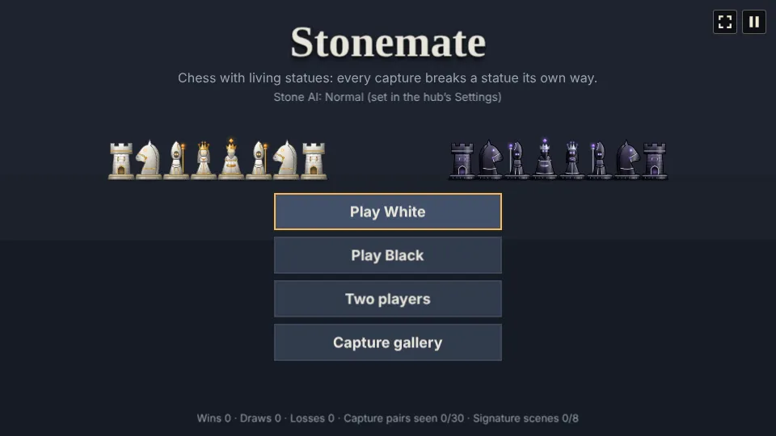
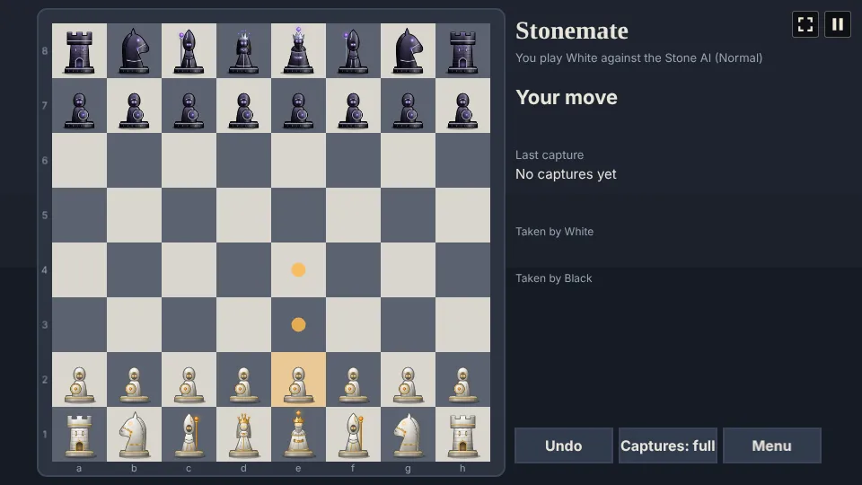
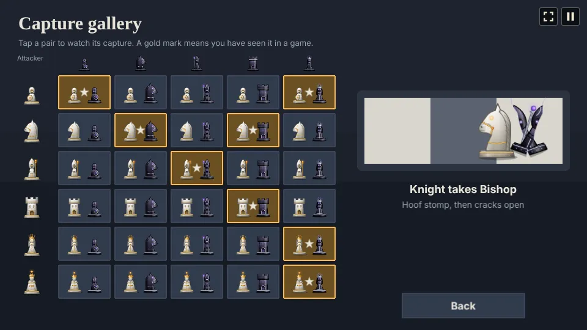

# Stonemate

Chess with living statues. Sculpted figures in white marble with gold inlay and black obsidian
with silver inlay, all with rune-lit eyes, walk the board, and every capture plays a scene of its
own: the attacker strikes the way its kind fights, and the victim breaks the way its kind breaks. Play the Stone AI as White or Black, or a friend on
one screen, and watch any capture in the gallery.

## How to play

Tap one of your statues to pick it up: the squares it can reach are marked, with a ring round a
statue it can take. Tap a marked square to move. The usual rules of chess hold, castling, en passant
and promotion included (a pawn on the far row becomes the piece you pick), and a game ends in
checkmate or a draw (stalemate, too few pieces to mate, fifty moves without a capture or pawn move,
or the same position three times).

- **Undo** (or U) takes back your last move, and the Stone AI's reply.
- **Captures: full / quick** (or Q) switches between the full scenes and quick ones that skip the
  strike and play the fall at double speed.
- **Menu** leaves the game; it is saved after every move, and **Continue game** on the menu picks it
  up again.
- The arrows on the menu pick the Stone AI's level, from 1 to 7. Until you pick one, the hub's
  difficulty picks it (Easy is Novice, Normal Casual player, Hard Club player). A saved game keeps
  the level it was started on.

  | Level | How it plays |
  | --- | --- |
  | 1 Beginner | Looks one move ahead and often gives pieces away |
  | 2 Novice | Looks one move ahead and sometimes picks a weaker move |
  | 3 Casual player | Looks two moves ahead and nearly always plays well |
  | 4 Club player | Looks three moves ahead and always plays its best |
  | 5 Expert | A deeper search that also weighs pawn structure, the bishop pair and open files |
  | 6 Master | The deeper search to five moves ahead, further in sharp lines |
  | 7 Grandmaster | The deeper search with the biggest budget, a few seconds a move |

  Each level beat the one below it in matches of the Stone AI against itself. The top three think
  in the background, so the statues keep moving while they do.

### Captures

A king is never taken, so there are 6 attackers and 5 victims: 30 pairs. Each kind of piece has
one strike and each kind one fall, and every capture plays the attacker's strike and then the
victim's fall, so all 30 pairs differ.

| Attacker | Strike |
| --- | --- |
| Pawn | Sword chop: shuffles up, rears back and chops |
| Knight | Hoof stomp: a high leap, a rear and a slam with a shockwave |
| Bishop | Staff blast: its eyes flare and a rune bolt flies |
| Rook | Body slam: backs up, then charges in a straight line |
| Queen | Rune beam: rises and burns a beam through |
| King | Sceptre smite: an orb of light drops onto the victim |

| Victim | Fall |
| --- | --- |
| Pawn | splits in two |
| Knight | its head topples off and rolls away; the body crumbles |
| Bishop | cracks open along its veins and splits |
| Rook | falls to rubble |
| Queen | bursts to shards |

Eight pairs play a hand-made scene instead (★ in the gallery):

| Pair | Scene |
| --- | --- |
| Pawn takes Pawn | Scuffle: two shoves, then the chop |
| Pawn takes Queen | Upset!: the queen looms, one tiny tap, a silence, and she bursts |
| Knight takes Knight | Joust: both charge and meet in the middle |
| Knight takes Rook | Tower vault: the knight leaps over the tower and kicks it down from behind |
| Bishop takes Bishop | Rune duel: two bolts wrestle in the middle until one breaks through |
| Rook takes Rook | Siege: three rams, and the tower gives on the third |
| Queen takes Queen | Royal duel: two beams meet and one pushes through |
| King takes Queen | Royal decree: the queen bows and turns to dust |

Checkmate ends with the beaten king cracking and falling to rubble. With the hub's Reduce motion
on, the scenes play without screen shake or flashes.

### Trophies

First blow, Carved anew (promote a pawn), Joust, Stone cold (beat the Stone AI), Upset! (a pawn
takes a queen), Swift mason (mate within 25 moves), Every signature scene, Master mason
(beat the Club player or stronger), Grandmaster of stone (beat the Grandmaster) and one hidden.

## Code layout

| File | What it holds |
| --- | --- |
| `src/main.ts` | Creates the Phaser game and hands it to `setupGame` and `setupScaling` |
| `src/game/chess.ts` | The rules: a position with make and unmake, legal moves, check, mate and draws |
| `src/game/ai.ts` | The Stone AI's levels 1 to 4: alpha-beta search with a capture search at the leaves |
| `src/game/deep.ts` | The Stone AI's levels 5 to 7: a deeper search with a richer evaluation |
| `src/game/aiWorker.ts`, `src/game/think.ts` | Run the deep search in a web worker |
| `src/game/rules.ts` | The seven AI levels, the signature pairs, the quick-mate limit |
| `src/game/save.ts` | The saved game and the stats |
| `src/scenes/GameScene.ts` | The menu, the board and panel, input, moves and the gallery |
| `src/scenes/captures.ts` | Every strike, fall and signature scene |
| `src/scenes/statues.ts` | The statues drawn in code: sculpted figures with gold and silver inlay |
| `src/scenes/art.ts` | Paints the statues for the screen, and the fragments they break into |
| `src/audio.ts` | Music and sound effects |
| `src/howToPlay.ts`, `src/i18n/`, `src/trophies/` | How to play, texts and trophies |
| `e2e/playthrough.spec.ts` | Plays the first round to White's first capture |
