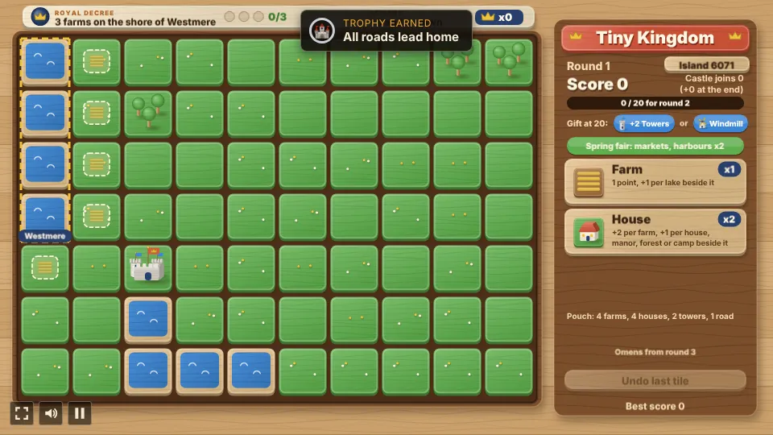
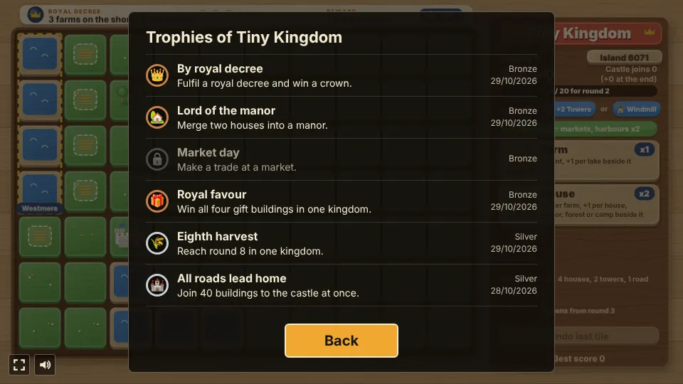

# Tiny Kingdom

A tile-placing puzzle prototype built with [Phaser 4](https://phaser.io), TypeScript and Vite,
part of the [game hub](../../README.md).

Build a kingdom on a small island of grass, lakes and forests, laid out at random for every new
kingdom (the panel shows its island number). It looks like a wooden toy set: painted beech tiles
in a walnut tray, block houses, peg trees and towers with flags on dowels. Each round hands out a
pouch of farms, houses, towers and a road, and every turn draws three of them: you place one and
the others go back. Every building scores against its neighbours, so where it goes matters more
than what it is. Each round also brings a royal decree, a side goal that pays a crown, a season
that makes some buildings score double, and reaching the round's goal earns a royal gift, such as a
new building: the windmill, the market, the harbor or the lumber camp. From round 3 an omen warns of
what the next round brings. Every island has a castle, and the buildings joined to it by a chain of
buildings and roads pay a bonus when the kingdom is finished. Two houses side by side can merge into
a manor; a lumber camp can clear a wood; a market can trade tiles. Play a random island, type in an
island's number, try the island of the day, or work through the eight-island campaign for up to
three stars each. Run out of tiles or room and the kingdom is finished.


## How to play

| Control | Action |
| --- | --- |
| Tap or click a tile button | Pick one of the three tiles drawn this turn |
| Hover a cell | See what the picked building would score there, which neighbours pay into it, and whether it joins the castle |
| Tap or click a grass cell | Place the building there; the other two tiles go back and a new three are drawn |
| On a touchscreen, tap a grass cell once, then again | The first tap shows the preview (there is no hover); a second tap on the same cell places the building (clearing a wood works the same way) |
| Tap a house with a house beside it, then that house | Merge the two into a manor (tap anything else to cancel) |
| Pick the lumber camp, then tap a wood beside a camp | Clear the wood to grass, spending the camp tile |
| Tap a market | Open the market trade: give two tiles of one kind for one gift building, once a round |
| Tap a gift | When the round's goal is reached: take one of the two gifts |
| Undo last tile | Take back the last placement, clearing or merge; once per round |
| Island button (next to the round) | Open the islands card: campaign levels, the island of the day, a random island, or type a number (keypad or keyboard digits, Enter to play, Esc to close) |
| New kingdom | After the game ends: start again on a new random island |

1. **Buildings go on grass.** Lakes and forests stay as they are, but buildings score from them.
2. **The score is the whole board's**, plus the decree bonuses won: a placement also changes what
   the buildings next to it are worth, and the popups show each change.
3. **Neighbour links**: while you hover a cell, a dotted link runs from each neighbour that adds
   points to the ghost tile, with its share at the neighbour's end (a lake +1, a farm beside a house
   +2, a tower that gains from a new house +2, ...), and the total sits over the ghost. The shares
   and the ghost's own base point always add up to the total.
4. **Rounds**: round 1 starts with 4 farms, 4 houses, 2 towers and a road and a goal of 20.
   Reaching the goal adds 3 farms, 3 houses, 2 towers and a road to what is left, and the goal
   rises (20, 45, 75, 110, ...).
5. **Draw three, keep one**: each turn draws three tiles from the pouch, and the panel shows one
   button per kind drawn (with how many of it are in the hand). You place one; the others go back,
   and the next turn draws three again. The pouch line under the buttons says what is left to
   draw. The draw always holds a tile that has room if the pouch has one. Undo gives back the
   hand the tile came from.
6. **Royal decree**: each round has a side goal, shown in the banner above the board with its
   progress beads, such as "3 farms on the shore of Eastmere" or "2 houses by Northwood" or "A tower
   watching 3 houses". The board outlines the named lake or wood (with its name), ticks the
   buildings that already count and marks the open spots. Fulfilling it pays **+8 points and a
   crown** at once; crowns are counted in the banner and kept from kingdom to kingdom. A decree not
   fulfilled by the round's end lapses, and the next round brings a new one. Lakes and woods are
   named from where they lie on the island (Eastmere, Westpool, Northwood, ...). A decree is only
   asked when the board has room for it and the pouch holds the tiles it needs.
7. **Royal gift**: the panel shows the two gifts on offer for reaching the goal ("Gift at 20: +2
   Towers or Windmill"). When the goal is reached, the board pauses on a card until you take one.
   Round 1 always offers +2 Towers or the Windmill; later rounds offer one new building you don't
   have yet (the Windmill, then the Market, the Harbor and the Lumber camp) beside +2 Towers, +3
   Houses or +3 Farms. Once all four are won, two of the tile packs and +2 of each new building.
8. **New buildings**, each won as a gift: the **market** scores 1 for each different kind of
   building around it; the **harbor** only goes on a lake's shore; the **lumber camp** only goes
   beside a forest and makes each house beside it score 1 more.
9. **Manors**: tap a house that has a house beside it, then tap that house. The second house
   becomes a manor (4 points and more per farm) and the first cell is grass again, free to build
   on. A merge takes no tile, counts for the decree and the goal, and can be undone like a tile.
10. **The castle and its roads**: every island has a castle. Buildings joined to it by an unbroken
    chain of buildings and roads (sharing edges) each pay **+1 when the kingdom is finished**; the
    panel counts them as you build ("Castle joins 5"), a gold bead marks each joined cell, and the
    preview shows "castle +N" when a placement joins more. The **road** is a tile in every pouch
    that scores nothing, but bridges gaps in the chain.
11. **Omens**: from round 3, the strip above the undo button (and the round banner) warns of what
    the next round brings, and the board marks the cell with a coral box. A **flood**: a named
    lake rises over a marked shore cell (grass or a farm) when the next round begins, whatever
    stands there. A **storm**: the marked tower, which has no house around it, falls when the
    next round begins, unless a house stands by it by then. A round to prepare.
12. **Clear a wood**: pick the lumber camp and tap a wood beside a lumber camp already standing.
    The wood becomes grass and the camp tile is spent: the camp and the houses beside the wood
    lose its points (the preview shows the loss), but there is room to build. It can be undone.
13. **Market trades**: once a round, while a market stands, tap it to open the trade card and
    give two tiles of one kind from the pouch for one gift building you have already won and that
    has somewhere to go (or a wood to clear). A new hand is drawn afterwards, and a trade cannot be
    undone; if nothing has room after it, the kingdom ends.
14. **Seasons**: each round has one, in turn: Spring fair (markets and harbors score double),
   Harvest festival (farms), Timber season (houses and lumber camps) and Winter watch (towers and
   windmills). The strip under the gift row shows it. A doubled building scores its worth again
   as a bonus when you place it, and the preview shows a small "x2"; buildings already standing
   never change when the season does.
15. **Islands** are random: two or three lakes, two or three woods and the castle scattered over
    the grass, so every kingdom is a new puzzle. Every island has a lake with room on its shore for
    the first decree and room around the castle for its chain. The island button opens the islands card, where you can type
    any island number from 1 to 9999 to play it (share the number to share the puzzle), play the
    **island of the day** (the same island for everyone that day, with its own best score), or
    play the **campaign**.
16. **Campaign**: eight islands, each with three star scores shown on the card and at the bottom
    of the panel. Your final score on a level earns one to three stars, and a star opens the next
    level. The best stars per level are saved.
17. **Undo** takes back the last tile placed, wood cleared or merge, once per round. A tile that
    fulfilled a decree or started a new round cannot be taken back.
18. **The end** comes when the pouch is empty or no tile has room left. If two houses could still
    merge, or a lumber camp clear a wood, to make room, the undo button reads "No room: merge houses
    or finish" (or "No room: clear a wood or finish"): make room, or tap it to finish the kingdom.
    While the last tile can still be undone, the button stays Undo, so a slip on the last grass
    cell can be taken back first. The castle then pays its bonus, and the best final score and the
    crowns are saved in the browser.
19. **Trophies**: ten to earn across your kingdoms, listed behind the Trophies button on the start
    and pause screens. A first decree, manor, market trade and all four gift buildings are bronze;
    round 8, 40 buildings joined to the castle and 10 crowns in all are silver; a kingdom of 350
    points, three stars on a campaign level and a star on every level are gold.


### Scoring

"Beside" means the four cells sharing an edge; "around" also counts the four diagonals.

| Building | Scores |
| --- | --- |
| Farm | 1, and 1 more per lake beside it |
| House | 2 per farm beside it, and 1 per house, manor, forest or lumber camp beside it |
| Tower | 2 per house or manor around it, but nothing while another tower is beside it |
| Windmill (a gift) | 1 per farm around it; and each farm beside it scores 1 more |
| Market (a gift) | 1 for each different kind of building around it |
| Harbor (a gift) | Only on a lake's shore: 2 per lake and 1 per house or manor beside it |
| Lumber camp (a gift) | Only beside a forest: 2 per forest beside it; and each house beside it scores 1 more. Spend one to clear a wood beside a camp |
| Road | Nothing; it runs the castle's chain on |
| Manor (two houses merged) | 4, plus 3 per farm and 1 per house, manor or forest beside it |
| Castle (on every island) | Nothing itself; every building joined to it by a chain of buildings and roads pays 1 when the kingdom is finished |

### The three loop changes


### The hand, the castle, omens, trades and clearing woods


### New buildings, manors, seasons and islands






The difficulty, set on the hub page's Settings, changes the round goals, 20% lower on Easy and 20% higher on Hard, and moves the campaign's star scores with what that does to a final score: 1% higher on Easy and 6% lower on Hard.

## Running locally

`npm run dev` at the repo root, then open `/games/tiny-kingdom/` (or pick Tiny Kingdom on the hub
page).

## Playthrough test

`e2e/playthrough.spec.ts` plays the first round in headless Chromium: it seeds `Math.random` so
the game always picks the same island (1990), checks the new kingdom, its map (with the castle), its
first hand of three, its decree (3 farms on the shore of Eastmere) and its gifts, picks the house
and hovers a cell beside the castle to check the preview, its forest link and that it joins the
castle, checks a tap on the castle or a lake places nothing, then places seven tiles by tapping (a
house, four farms, a house and a road), checking the hand drawn before each one, the tile buttons
it gives and the score each adds against the rules. After the farm by the castle it tests undo: the
undo takes that farm back with the hand it came from, a second undo in the round does nothing, and
the farm goes back down. Hovering the second house before placing it checks its two links, and the
road's preview shows +0. The last farm fulfils the decree (+8, a crown, saved) and reaches the goal
at once: round 2 begins with a new hand, nothing can be placed until the gift is taken, and taking
the Windmill adds its tiles. Like the other games' tests it owns the game
clock and plays at 4x speed (`PLAYTHROUGH_SPEED`). The **Playthrough Tiny Kingdom** workflow
(`.github/workflows/playthrough.yml`) runs it on every PR that changes this folder or the
workflow, and uploads the video and screenshots as the `playthrough-tiny-kingdom` artifact.

```sh
npx playwright test --project tiny-kingdom
```


## Code layout

All paths are inside `games/tiny-kingdom/`.

- `src/game/`: the rules in plain TypeScript with no Phaser dependency. `tiles.ts` has the
  buildings and the random island generator (with the castle), `state.ts` the scoring, previews,
  the hand, rounds, placing, clearing woods, trades, merging and gifts taken, `decree.ts` the royal
  decrees and the lake and wood names, `omens.ts` the omens, `castle.ts` the castle's chain,
  `gifts.ts` the gifts, `seasons.ts` the seasons, `islands.ts` the campaign, the island of the day
  and typed island numbers, and `save.ts` the best score, the crowns, the daily best and the stars.
- `src/scenes/`: `BootScene` paints the textures, `GameScene` draws the board, the decree banner,
  the side panel, the trade card and the islands card and wires taps to the rules, `layout.ts`
  says where things are drawn.
- `src/art/`: the wooden toy set, painted on canvases in code at startup: `wood.ts` the toolkit and
  painters, `textures.ts` every texture.
- `src/ui/`: the button.
- `src/trophies/`: the trophy list and texts (`index.ts`, `i18n/`), and `check.ts`, which awards
  them from the game state.

Changing a building's rule is its case in `cellParts` in `src/game/state.ts` and its line in
`INFO` in `src/game/tiles.ts`.
