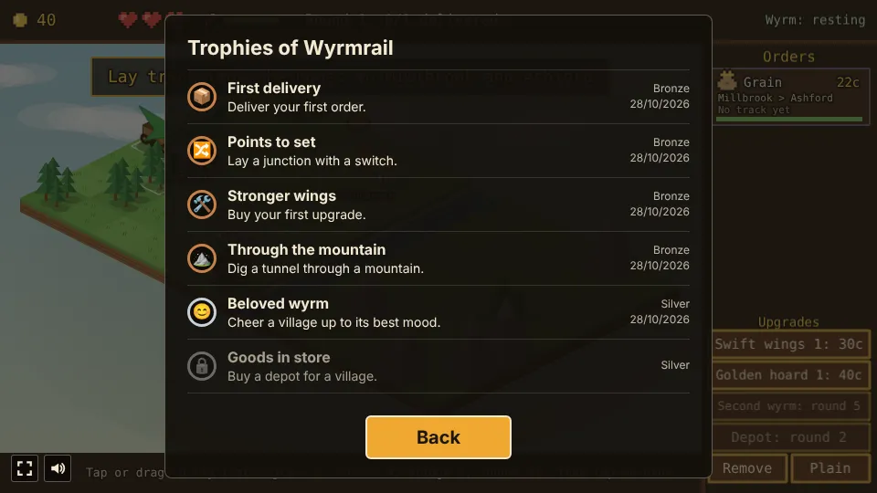
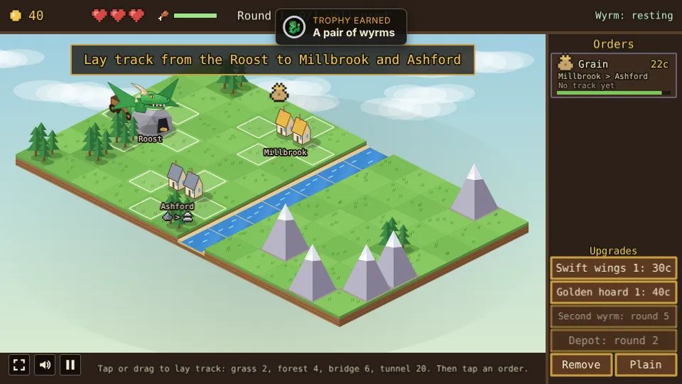

# Wyrmrail

A railway-building prototype built with [Phaser 4](https://phaser.io), TypeScript and Vite, part of
the [game hub](../../README.md).

A green wyrm sleeps in the Roost at the edge of a floating valley, drawn in isometric low-poly. Lay
track from the Roost to the villages, then send the wyrm along it, pulling two wagons, to carry each
village's goods to another before the order runs out of time. Where the line branches, the switches
decide which way the wyrm goes. Keep it fed at the Roost, bring goods to the workshops that make
better ones, keep the villages in good cheer, build depots and tunnels, wake a second wyrm late in
the game, and after the eighth village finish with the festival and its medal. Every game is played
in a new valley.


## How to play

| Control | Action |
| --- | --- |
| Tap or drag over tiles next to the line | Lay track there |
| Tap an order | Send the wyrm to fetch and deliver it |
| Tap a junction | Throw its switch |
| Tap a village | Courier call: send a free wyrm with gifts (from round 2) |
| Depot, then a village | Build a depot there (from round 2) |
| Remove | Toggle: tap track to take it up for half what it cost |
| Plain | Toggle: lay track that joins only the piece it continues, and crossings |
| A charter card | Pick the round's charter (from round 3) |
| Swift wings, Golden hoard, Second wyrm | Buy an upgrade |

1. **The valley** is new every game: a river winds down the middle, mountains rise in the east,
   forest is scattered about and the villages that join after the first round get new places. The
   Roost, Millbrook and Ashford always stand in the same spots, with open grass between them.
2. **Track** grows from the line: a tile can take track when it is next to track, the Roost or a
   village. Lit outlines show where. Grass costs 2 coins, forest 4, a bridge over the river 6 and
   a **tunnel** through a mountain 20, which opens shortcuts through the east; the wyrm is out of
   sight inside. Track joins up with every piece and station next to it. Laying track through a
   forest clears its pines.
   With **Plain** on, a new piece joins only the piece it continues (the one the drag came from,
   or its first neighbour on the line) and the one straight across from that, so a line can run
   beside another without making junctions; a plain piece laid with track on all four sides is a
   **crossing**, two straights the wyrm only goes straight over, with no switch. Its outlines are
   blue. Auto-join stays the default.
3. **Orders** come in on the panel on the right, up to three at a time: a cargo, the village it
   comes from, the one it goes to, the pay and a bar of time left. The first is always grain from
   Millbrook to Ashford. Goods waiting for the wyrm show over their village.
4. **The wyrm** pulls two wagons, so it can carry two orders at once. It always heads for the
   nearest stop: a village its cargo is going to or, while a wagon is free, a village with goods
   it was sent to fetch. It loads the goods and the village they go to pays on arrival. An order
   it can't reach yet, or whose way was cut after it was sent, says "No track yet". A dotted line in the wyrm's colour shows the way
   it is taking and a ring marks its stop.
5. **Switches steer**: track with three or four arms is a junction, and its switch is set against
   one arm, shown by a striped barrier and dimmed rails. A new junction's switch is set against the
   branch just laid, and a tap on the junction sets it against the next arm. The wyrm goes the way
   the switches send it, never through a barred arm, even when that is the long way round, and it
   looks at the switches again on every tile, so a switch thrown on the fly changes its way. It
   only turns back at a village, the Roost or the end of a line. Only when the switches leave it
   no way at all does it take the shortest way and stop for a second at each junction set against
   it to throw the switch itself.
6. **Feeding the wyrm**: the wyrm's belly (the bar by the drumstick at the top) empties a little
   with every tile it flies, a full belly lasting 36 tiles. When it is down to 30% the bar turns
   amber, and before its next stop the wyrm flies home to the Roost and eats for 1.2 seconds,
   cargo and all. On an empty belly it flies at half speed. Where the Roost sits on the line
   decides how far those trips are.
7. **Workshops**: Ashford has a forge, Fernhollow a mill and Stonereach a sawmill, shown by a sign
   under the village's name. Goods a workshop takes (ore, grain and timber) often come in as
   orders to it, and delivering them there pays as usual and makes the workshop send out the
   better goods (iron, flour and planks) as a new order, its name in gold, paying 60% more than
   an ordinary order over the same distance. It can be the board's fourth order.
8. **A second wyrm**, a copper one, can be woken from round 5 for 150 coins. It shares the track
   and the orders: each wyrm fetches the sent orders nearest to it and carries its own cargo. A
   wyrm waits before a junction while the other wyrm is on it or heading into it, for up to 3
   seconds, then goes on anyway. Each has its own belly.
9. **Deadlines**: an order that runs out of time leaves the board, cargo and all, and costs one of
   the three hearts. Losing all three ends the game.
10. **Village moods**, from round 2: each village wears a face by its name. A delivery in time
    cheers the village it went to by one step; a late order sours it by one, and so does going
    without a visit (a pickup or a delivery) for 25 seconds plus 6 for every village on the line.
    In the festival nobody waits for a visit, since every order goes to the host.
    Moods run from bitter through sulking, content and cheerful to delighted. A cheerful village's
    orders pay 25% more and a delighted one's 50% more; a sulking village sends orders with 30%
    less time ("rush order" on the card). A village that turns bitter loses faith in the line,
    which costs a heart, and it sulks on from there.
11. **Washouts and rockfalls**, from round 3: every 35 seconds the valley picks on a bridge (a
    washout) or a piece of track beside a mountain (a rockfall; a tunnel is safe), if the line has one. The tile is
    marked with an amber "!" and a warning for 9 seconds, then its track is gone: a wyrm heading
    over it stops short and picks its stop again (a pickup goes back to the queue), and an order
    with no way left waits until the track is rebuilt, at the usual price. A spare loop keeps the
    line running meanwhile. The warning holds off while a wyrm is on the tile, never falls on a tile a
    wyrm stands on, and blows over if a wyrm is stranded there with no track beside it. Taking the track up
    yourself doesn't stop the hazard, and no track can be laid on its tile until it has struck.
12. **Round charters**, from round 3: each round opens with two charters to choose from, and the
    game waits until one is tapped (the board takes no taps meanwhile). A charter rules the round: a *Fair* (one cargo pays double,
    every deadline a quarter shorter), *Rush orders* (half again the pay, deadlines a third
    shorter), *Patient villages* (deadlines half as long again, a quarter less pay), *Cheap rails*
    (track at half price, a fifth less pay), *Busy season* (orders twice as often, a tenth less
    pay) or a *Feast* (the wyrms never go hungry, a tenth less pay). The HUD shows the round's
    charter by the round, the festival's included.
13. **Passengers**, from round 3: now and then an order is passengers, who pay triple and allow
    40% less time. They fill both wagons: a wyrm only fetches them while it carries nothing, and
    loads nothing else until they are delivered.
14. **Depots**, from round 2: the Depot button, then a tap on a village, builds a depot there, shown
    by a shed by its name. The first costs 60 coins and each one after it 30 more. Goods waiting
    at a depot (sent or not) use up their time at half speed, and a wyrm loads them at once.
15. **Courier calls**, from round 2: tap a village (without dragging off it) to send a free wyrm,
    one heading nowhere and carrying nothing, with gifts for 5 coins. When it gets there the
    village's wait for a visit starts again and it cheers up by one step. A delighted village
    needs no gifts. The hint line says when a village is sulking and a wyrm is free.
16. **Rounds**: one delivery finishes round 1, then each round asks for one more than its number.
    A new village joins in each round from 2 to 8 (see below).
17. **The festival**: round 9 is the last. The festival is held at Kettlecross, under bunting, and
    every new order goes there. Ten deliveries win the game.
18. **Festival medals**: a won festival is graded by its time and the hearts left: gold for all
    three hearts in 2:30 or less, silver for two hearts or more in 4:00 or less, else bronze. The
    best medal on each difficulty is kept in the browser, and it gives the next game on that
    difficulty its boon and the boons below it: bronze a *Head start* (25 more coins), silver a
    *Swift start* (Swift wings 1 from the start) and gold an *Early riser* (the second wyrm from
    round 3).


### Villages

| Village | Sends | Joins | Workshop |
| --- | --- | --- | --- |
| Millbrook | Grain | Round 1 | |
| Ashford | Tools | Round 1 | Forge: ore to iron |
| Fernhollow | Timber | Round 2 | Mill: grain to flour |
| Stonereach | Ore | Round 3 | Sawmill: timber to planks |
| Saltmere | Fish | Round 4 | |
| Brackenly | Timber | Round 5 | |
| Dunmoor | Grain | Round 6 | |
| Wyndle | Fish | Round 7 | |
| Kettlecross | Tools | Round 8 | |

An order pays 10 coins plus 3 per tile between the two villages (as the crow flies), and allows
20 seconds plus 5 per tile.

### Upgrades

| Upgrade | Levels | Cost | Effect |
| --- | --- | --- | --- |
| Swift wings | 3 | 30, 60, 100 | The wyrm flies 0.6 tiles a second faster (from 2) |
| Golden hoard | 3 | 40, 80, 140 | Every order pays 25% more |
| Second wyrm | 1 | 150, from round 5 | A second, copper wyrm joins the line |
| Depot | One per village | 60, then 30 more each, from round 2 | Goods at that village wait at half speed and load at once |


The difficulty, set on the hub page's Settings, changes one thing: orders allow 50% more time on
Easy and 30% less on Hard.

## Trophies

Ten trophies, listed behind the Trophies button on the start and pause screens and counted on the
hub's card:

| Trophy | Tier | Earned by |
| --- | --- | --- |
| First delivery | Bronze | Delivering your first order |
| Points to set | Bronze | Laying a junction with a switch |
| Stronger wings | Bronze | Buying your first upgrade |
| Through the mountain | Bronze | Digging a tunnel |
| Beloved wyrm | Silver | Cheering a village up to its best mood |
| Goods in store | Silver | Buying a depot |
| A pair of wyrms | Silver | Waking the second wyrm |
| Busy line | Silver | Delivering 25 orders in one game |
| Festival time | Gold | Winning the festival |
| Golden festival (hidden) | Gold | Winning the festival with a gold medal |





## Running locally

`npm run dev` at the repo root, then open `/games/wyrmrail/` (or pick Wyrmrail on the hub page).

## Playthrough test

`e2e/playthrough.spec.ts` plays the first round in headless Chromium: it checks the new game (40
coins, three hearts, no track, the grain order from Millbrook to Ashford), checks the order can't be
sent before there is track, lays five pieces of track from the Roost to both villages by tapping
tiles and checks each costs 2 coins and that the junction gets a switch, then taps the order and
follows the wyrm as it loads the grain at Millbrook. It taps the junction until its switch is set
against the Roost's arm, checks the wyrm then reaches Ashford without stopping, and that the
delivery pays 22 coins and starts round 2. Like the other
games' tests it owns the game clock and plays at 4x speed (`PLAYTHROUGH_SPEED`). The **Playthrough
Wyrmrail** workflow (`.github/workflows/playthrough.yml`) runs it on every pull request that
touches this folder or the workflow, and uploads the video and screenshots as the
`playthrough-wyrmrail` artifact.

```sh
npx playwright test --project wyrmrail
```

## Code layout

All paths are inside `games/wyrmrail/`.

- `src/game/`: the rules in plain TypeScript with no Phaser dependency. `map.ts` holds the valley
  (generating each game's terrain and village places, track costs, the Roost, the villages and
  their workshops), `state.ts` the tuning numbers and the shape of a game, and `sim.ts` moves it
  on: laying and removing track (plain or joined, crossings), switches, routes along it, orders,
  the wyrms' trips and meals, workshops, village moods, washouts and rockfalls, round charters,
  passengers, upgrades, rounds and the festival. The valley, new orders, hazards and charters are
  picked with `Math.random`.
- `src/scenes/`: `BootScene` bakes textures, `GameScene` draws the valley, the track, the wyrm,
  the HUD and the panel and wires taps to the rules, `layout.ts` says where things are drawn.
- `src/art/`: all the art, drawn in code and baked into textures at startup. `valley.ts` paints the
  isometric valley and the props standing on it (pines, mountains, the Roost, the villages and the
  festival bunting), `sprites.ts` the green and copper wyrms and their wagons and the pixel cargo and HUD icons, with helpers in
  `canvas.ts` and `pixelArt.ts`.
- `src/trophies/`: the trophies (`index.ts`), their texts (`i18n/`) and when each is earned
  (`check.ts`).
- `src/ui/`: the buttons.
